# İki Tabloyu Birleştirmek

Geçen hafta bir soruyu cevaplayamadık: **hangi günler eksik?**

Sebebi şuydu: olmayan bir şey veride iz bırakmaz. Ölçülmemiş bir günü veriye
bakarak bulamazsınız, çünkü orada o güne ait hiçbir satır yoktur. Aramak için
**veride olmayan bir listeye** ihtiyaç var.

Bu hafta öğrendiğimiz işlem bunu mümkün kılıyor. Bazı sorular tek bir tabloya
sorulamaz; cevap iki tablonun **karşılaştırmasında** durur.

---

## 1. Anahtar: İki Tablonun Buluştuğu Sütun

Birleştirme sihir değildir. İki tabloda **aynı şeyi ifade eden** bir sütun
bulup satırları o sütun üzerinden eşlemektir. O sütuna **anahtar** denir.

```sql
SELECT t.gun, g.toplam_arac
FROM takvim t
JOIN gunluk g ON t.gun = g.gun
```

`ON t.gun = g.gun` kısmı eşlemenin kuralıdır: soldaki satırın `gun` değeri
sağdaki satırın `gun` değerine eşitse o iki satır birleşir.

> Anahtarın **adı** aynı olmak zorunda değil, **anlamı** aynı olmak zorunda.
> `gun` ile `tarih` adında iki sütun pekâlâ eşlenebilir; `gun` ile
> `olcum_sayisi` eşlenemez — ikisi aynı şeyi anlatmıyor.

Tablolara `t` ve `g` gibi takma adlar verdik. Zorunlu değil, ama iki tabloda
aynı adlı sütun varsa hangisinden bahsettiğinizi yazmanın tek yolu bu.

---

## 2. Olması Gerekeni Üretmek: Takvim Tablosu

Elimizde ölçülen günlerin listesi var (`gunluk` görünümü). Olması gereken
günlerin listesi hiçbir yerde yazılı değil — ama **üretilebilir:**

```sql
CREATE OR REPLACE TEMP VIEW takvim AS
SELECT explode(sequence(DATE '2024-12-01', DATE '2025-01-31', INTERVAL 1 DAY)) AS gun
```

`sequence` iki tarih arasını verilen adımla dolduran bir **dizi** üretir;
`explode` o diziyi satırlara açar. Sonuç 62 satırlık, tek sütunlu bir tablodur.

> **Bu tablo ölçülmedi, üretildi.** İçindeki hiçbir satır bir cihazdan
> gelmedi; hepsini takvim tanımı üretti.

Veri analizinde iki tür tablo vardır ve karıştırılmamaları gerekir:

| | Ölçülen tablo | Referans tablo |
| --- | ------------- | -------------- |
| Kaynağı | Cihaz, kayıt, gözlem | Tanım, takvim, kural, insan |
| Doğruluğu | Toplandığı kadar | Tanım gereği |
| Örnek | `gunluk` | `takvim` |

Takvim tablosundaki 62, gerçeğin sayısı değil **tanımın** sayısıdır. Aralık ve
Ocak kaç gündür sorusunun cevabı ölçümle bulunmaz.

---

## 3. INNER JOIN: Yalnızca Eşleşenler

Yukarıdaki ilk sorgudaki düz `JOIN` — tam adıyla `INNER JOIN` — eşleşen her
satır çiftini döndürür. **Eşleşmeyen satır sonuçta hiç yer almaz.**

Şimdi dikkat edin. Aradığımız şey tam olarak **eşleşmeyen** satırdı: takvimde
olan ama veride olmayan gün. INNER JOIN onu attığı için bu sorguyla eksik günü
**asla** bulamayız.

Daha kötüsü: sorgu hata vermez. Satırlar döner, sütunlar dolu gelir, her şey
yolunda görünür.

> Bir sorgunun hata vermemesi, doğru soruyu sorduğu anlamına gelmez.



---

## 4. LEFT JOIN ve NULL'un İşe Yaradığı Yer

`LEFT JOIN` soldaki tablonun **her satırını korur.** Sağda eşleşme bulursa sağ
sütunları doldurur; bulamazsa `NULL` bırakır.

İşte eksik günleri bulan sorgu:

```sql
SELECT t.gun
FROM takvim t
LEFT JOIN gunluk g ON t.gun = g.gun
WHERE g.gun IS NULL
ORDER BY t.gun
```

Altıncı haftada `NULL` sorunun kendisiydi: güvenilmez bir boşluk. Burada
**cevabın kendisi.** Aynı şey, farklı rol — çünkü bu kez boşluğu veri değil
birleştirme üretti ve ne anlama geldiğini biliyoruz.

> **`IS NULL` denetimini anahtar sütununda yapın.** Yukarıda `g.gun` yazdık,
> `g.toplam_arac` yazmadık. Ölçülmüş bir sütun gerçekten boş olabilir; o sütuna
> bakarsanız var olan bir günü eksik sanarsınız.

### Hangisini seçmeliyim?

| | `JOIN` (INNER) | `LEFT JOIN` |
| --- | -------------- | ----------- |
| Eşleşmeyen sol satır | **Kaybolur** | **Korunur**, sağ sütunlar `NULL` |
| Satır sayısı | Sol tablodan az olabilir | Sol tablodan az olamaz |
| Ne zaman | İki tarafta da olanı istiyorsanız | Sol tablonun bütünlüğü önemliyse |
| Eksik bulmaya uygun mu | **Hayır** | **Evet** — `IS NULL` ile |

Pratik kural: **soldaki tabloyu kaybetmek istemiyorsanız `LEFT JOIN`.**

`RIGHT JOIN` da vardır; `LEFT JOIN`in aynadaki hâlidir ve tabloların yerini
değiştirerek aynı sonucu alırsınız. Bu yüzden pratikte `LEFT JOIN` yeter.

---

## 5. Birleştirmenin İkinci İşi: Dışarıdan Bilgi Eklemek

Eksik bulmak birleştirmenin bir kullanımı. Günlük hayatta daha sık
kullanılanı şu: veriye, **veride olmayan bilgiyi** eklemek.

Trafik verisinde hangi günün özel olduğu yazmıyor. Ama biz biliyoruz:

```sql
CREATE OR REPLACE TEMP VIEW ozel_gunler AS
SELECT * FROM VALUES
    (DATE '2024-12-31', 'yilbasi gecesi'),
    (DATE '2025-01-01', 'yilbasi tatili')
AS t(gun, aciklama)
```

```sql
SELECT g.gun, g.toplam_arac, o.aciklama
FROM gunluk g
LEFT JOIN ozel_gunler o ON g.gun = o.gun
ORDER BY g.gun
```

Sonuç yine 62 satır: iki satırda `aciklama` dolu, altmışında `NULL`. Artık
grafiği okurken o iki günü işaretleyebilir, "burada ne olmuş?" sorusuna cevap
verebilirsiniz.

> **Bu tabloyu siz yazdınız.** Zenginleştirme verisinin kaynağı her zaman
> başka bir sistem değildir; çoğu zaman alan bilgisi olan insandır. Yazdığınız
> her satır bir **iddiadır** ve raporda nereden geldiğini söylemeniz gerekir.

---

## 6. Tuzak: Satır Çoğalması

Birleştirmenin en sık ve en sessiz hatası. Sağdaki tabloda anahtar
**tekrarlıyorsa**, soldaki satır her eşleşme için bir kez çıkar.

`ozel_gunler` tablosuna 1 Ocak'ı yanlışlıkla iki kez yazdığınızı düşünün.
Birleştirmeden sonra 1 Ocak **iki satır** olur. Tablo 62 değil 63 satırdır ve o
günün araçlarını toplarsanız iki kez sayarsınız.

Sorgu hata vermez. Sayılar yalnızca büyür.

Disiplin iki ölçümdür. **Birleştirmeden önce** anahtarın sağ tabloda tek
olduğunu doğrulayın:

```sql
SELECT COUNT(*) AS satir, COUNT(DISTINCT gun) AS farkli_gun
FROM ozel_gunler
```

İki sayı eşit değilse anahtar tekrarlıyor. **Birleştirmeden sonra** satır
sayısını sayın: `LEFT JOIN` sonucu sol tablodan fazlaysa çoğalma var.

> Bu dönem üçüncü kez aynı disiplin: **beklediğiniz sayıyı önce yazın, sonra
> ölçün.** Altıncı haftada kapsama için, dokuzuncu haftada seri uzunluğu için
> yaptık; şimdi satır sayısı için yapıyoruz.

---

## 7. Maliyet: Küçük ile Büyük, Büyük ile Büyük

Bu hafta hiç beklemedik. 62 satırlık takvimi ve iki satırlık özel gün tablosunu
birleştirmek anında bitti. Sebebi şu: küçük tablo **her makineye kopyalanır** ve
eşleme satırların bulunduğu yerde yapılır. Hiçbir şey taşınmaz.

İki büyük tabloyu birleştirmek böyle değildir. Aynı anahtara sahip satırların
**aynı makinede buluşması** gerekir — bu da veriyi makineler arasında taşımak
demektir ve pahalıdır.

Taşımanın ne olduğu, ne zaman gerektiği ve bir sorgunun süresinin neyle
belirlendiği **gelecek haftanın konusu.**

---

## 8. Laboratuvar: Veriyi Zenginleştirin

Dönem sonundaki projenin beşinci parçası.

1. `takvim` tablosunu kurun. `LEFT JOIN` ve `IS NULL` ile eksik gün olup
   olmadığını bulun. Çıktıyı — **boş çıksa bile** — kaydedin; "eksik yok" da
   bir bulgudur.
2. Kendi elinizle **en az üç satırlık** bir referans tablo yazın. Özel günler,
   hava durumu notu, okul tatili — alan bilginiz ne derse.
3. Günlük seriyle birleştirin ve satır sayısının **değişmediğini** doğrulayın.
4. Zenginleştirilmiş tabloda bir soru cevaplayın: işaretlediğiniz günler
   diğerlerinden farklı mı? **Sayı verin.**
5. Referans tablonuzdaki bilginin **kaynağını** yazın.

> Beşinci madde en önemlisi. Kendi yazdığınız bir tabloyu kaynak göstermeden
> kullanmak, veriyi uydurmaktan bir adım uzaktır. Nereden bildiğinizi yazın.

---

## 9. İyi Pratikler ve Sık Yapılan Hatalar

**İyi pratikler**

- Birleştirmeden önce anahtarın sağ tabloda **tek** olduğunu doğrulayın.
- Soldaki tabloyu kaybetmek istemiyorsanız `LEFT JOIN` kullanın.
- `IS NULL` denetimini **anahtar** sütununda yapın, ölçülmüş sütunda değil.
- Tablolara takma ad verin ve her sütunu `t.gun` biçiminde yazın.
- Referans tabloların kaynağını not edin — kendi yazdıklarınız dahil.
- Birleştirme sonrası satır sayısını, beklediğiniz sayıyla karşılaştırın.

**Sık yapılan hatalar**

- **INNER JOIN ile eksik aramak.** Aradığınız satır tanım gereği atılır; sorgu
  çalışır, cevap gelmez.
- **Satır çoğalmasını fark etmemek.** Hata vermez; toplamlar sessizce şişer.
- **Yanlış sütunda `IS NULL`.** Ölçülmüş bir sütun gerçekten boş olabilir.
- **Anahtarın tipini kontrol etmemek.** Metin `'2024-12-01'` ile tarih ekranda
  aynı görünür, eşleşmede her zaman aynı davranmaz.
- **Referans tabloyu ölçüm sanmak.** Takvimdeki 62, ölçümün değil tanımın
  sayısıdır.
- **`ON` koşulunu yazmayı unutmak.** Koşulsuz birleştirme her satırı her satırla
  eşler; üç milyon satırda bu sorgu bitmez.

---

## 10. İsteğe Bağlı Ev Uygulaması

1. Takvimi **saat** çözünürlüğünde kurun (`INTERVAL 1 HOUR`). 62 × 24 = 1488
   saat bekliyoruz. Kaç saat eksik çıktı?
2. Eksik saatleri güne göre gruplayın. Eksikler belirli günlerde mi toplanıyor,
   yoksa dağınık mı? İkisi farklı şeyler anlatır.
3. `LEFT JOIN` sorgusundan `WHERE ... IS NULL` koşulunu kaldırın. Satır sayısı
   kaç oldu ve neden?
4. `ozel_gunler` tablosuna aynı günü **bilerek** iki kez yazın. Birleştirmeden
   sonra satır sayısı kaç oldu? Toplam araç sayısı değişti mi?

**Düşündürücü soru:** Takvim tablosu 62 gün üretti, çünkü biz "1 Aralık –
31 Ocak" dedik. Veride 29 Kasım'a ait ölçümler de olsaydı, bu yöntemle fark
edebilir miydiniz? Edemezseniz sorun verinin mi, yoksa kurduğunuz referans
listesinin mi?

---

## Gelecek Hafta

Bu hafta birleştirmeyi hep **küçük** bir tabloyla yaptık ve hiç beklemedik.
Gelecek hafta bunun neden böyle olduğunu göreceğiz: veri makineler arasında
nasıl bölünüyor, ne zaman taşınmak zorunda kalıyor ve bir sorgunun süresi neyle
belirleniyor.

Dört haftadır sorguları yazdık ve sonuçlarına baktık. Şimdi perdenin arkasına
bakma zamanı.

---

## Kaynaklar

- Apache Software Foundation. *Spark SQL — JOIN.*
  https://spark.apache.org/docs/latest/sql-ref-syntax-qry-select-join.html
- Apache Software Foundation. *Spark SQL — Built-in Functions (`sequence`, `explode`).*
  https://spark.apache.org/docs/latest/api/sql/
- Databricks. *Join hints.*
  https://docs.databricks.com/aws/en/sql/language-manual/sql-ref-syntax-qry-select-hints

---

*Öğr. Gör. Turgay Taymaz · Afyon Kocatepe Üniversitesi*
*Bu materyal CC BY-NC-SA 4.0 ile lisanslanmıştır. Kullanırken kaynak gösteriniz.*
*Kaynak: https://github.com/ttaymaz/ders-notlari*
