# Bölümleme ve Maliyet

Dört haftadır sorgu yazdık ve sonuçlarına baktık. Bir şeyi hiç sormadık:
**bu sorgu çalışırken ne oldu?**

Geçen hafta bir söz verdik. Birleştirmeyi küçük bir tabloyla yaptık ve hiç
beklemedik; sebebinin "küçük tablo her makineye kopyalanır" olduğunu
söyledik. Bu hafta o cümleyi kanıtlayacağız — ve kanıtı motorun kendi
çıktısında bulacağız.

**Bu hafta yeni bir analiz öğrenmiyoruz. Yazdığımız sorguların neye mal
olduğunu öğreniyoruz.**

---

## 1. Veri Tek Parça Değil: Bölümler

Elimizdeki iki CSV birlikte 232 MB. Spark bunu tek bir yığın olarak
görmüyor; **bölümlere** ayırıyor.

Her bölüm bir **görevdir**, her görev bir **çekirdekte** çalışır. Üç milyon
satırı tek tek okumak yerine, bölümler **aynı anda** okunur.

```sql
SELECT spark_partition_id() AS bolum, COUNT(*) AS satir
FROM ham
GROUP BY bolum
ORDER BY bolum
```

Bu sorgu her bölümde kaç satır olduğunu gösterir. İki şeye bakın: kaç bölüm
var, ve bölümler **birbirine yakın büyüklükte mi.**

> Paralelliğin tamamı buradan geliyor. Üç milyon satırlık bir sayma işi 12
> saniyede bitiyorsa, sebep makinenin hızlı olması değil; işin bölünmüş
> olmasıdır.

### Dengesiz bölüm

Bölümlerden biri diğerlerinin on katı büyükse ne olur? Diğer çekirdekler
işini bitirir ve **bekler.** Sorgu, en yavaş bölüm kadar sürer.

Bu, dağıtık işlemenin en sık sorunudur ve adı vardır: **çarpıklık** (skew).
Sorgunuz yavaşsa ve sebebini bulamıyorsanız bölüm boyutlarına bakın.

---

## 2. İki Tür Dönüşüm: Dar ve Geniş

Dördüncü haftada dönüşüm ile eylemi ayırdık: dönüşümler tembeldir, eylem
gelene kadar hiçbir şey çalışmaz. Şimdi dönüşümleri **kendi aralarında**
ayırıyoruz.



**Dar dönüşüm** bölümün içinde biter. `WHERE` bir satırı atarken başka
satıra bakmaz; `SELECT` bir sütunu seçerken komşu bölümü ilgilendirmez. Her
bölüm kendi işini yapar, kimse kimseyle konuşmaz.

**Geniş dönüşüm** bölümler arası konuşma gerektirir. `GROUP BY bolge`
yazdığınızda aynı bölgenin satırları **aynı makinede buluşmak zorundadır** —
ama o satırlar başlangıçta farklı bölümlere dağılmıştır.

| | Dar dönüşüm | Geniş dönüşüm |
| --- | ----------- | ------------- |
| Örnek | `WHERE`, `SELECT`, `CASE` | `GROUP BY`, `JOIN`, `ORDER BY`, `DISTINCT` |
| Bölüm dışına bakar mı | Hayır | **Evet** |
| Veri taşınır mı | Hayır | **Evet** |
| Maliyet | Düşük | **Yüksek** |

---

## 3. Karıştırma Neden Pahalı?

Satırları anahtara göre yeniden dağıtma işlemine **karıştırma** (shuffle)
denir. Pahalı olmasının sebebi hesap değil, **taşıma:**

1. Her bölüm, satırlarını hedef bölümlere göre ayırır ve **diske yazar.**
2. Hedef makineler bu parçaları **ağ üzerinden** okur.
3. Ancak bundan sonra gruplama yapılabilir.

Yani araya bir disk yazma ve bir ağ transferi giriyor. Hesabın kendisi —
toplama, ortalama — bunların yanında neredeyse bedavadır.

> **Maliyet hesapta değil, taşımadadır.** Bir sorgunun ne kadar süreceğini
> tahmin etmek istiyorsanız kaç satır işlendiğine değil, **ne kadar veri
> taşındığına** bakın.

Bu, bütün dönem gördüğünüz süreleri açıklıyor. `COUNT(*)` hızlıydı: her
bölüm kendi satırlarını sayar, sonunda yalnızca bölüm sayısı kadar sayı
toplanır. `GROUP BY` ile aynı veriyi gruplamak daha uzun sürdü: önce bütün
satırlar yeniden dağıtıldı.

---

## 4. Planı Okumak: `EXPLAIN`

Spark bir sorguyu çalıştırmadan önce **plan** yapar. Planı görebilirsiniz:

```sql
EXPLAIN
SELECT GEOHASH, COUNT(*) FROM trafik GROUP BY GEOHASH
```

Çıktı uzun ve çoğu satırı bu hafta ilgilendirmiyor. **Tek bir kelime
arayacaksınız:**

```
Exchange
```

`Exchange` karıştırmanın plandaki adıdır. Varsa veri taşınacak; yoksa
taşınmayacak.

Şimdi aynı şeyi dar bir sorguyla deneyin:

```sql
EXPLAIN
SELECT GEOHASH FROM trafik WHERE AVERAGE_SPEED > 100
```

`Exchange` yok. Plan tek bir okuma ve bir süzmeden oluşuyor.

> Plan okumayı öğrenmek, tahmin etmekten kurtulmaktır. "Bu sorgu pahalı
> galiba" demek yerine `EXPLAIN` yazıp bakabilirsiniz.

---

## 5. Geçen Haftanın İddiası: Yayınlama

Geçen hafta şunu söyledik: küçük tabloyla birleştirmek ucuzdur, çünkü küçük
tablo her makineye kopyalanır. Şimdi kanıtlayalım:

```sql
EXPLAIN
SELECT g.gun, o.aciklama
FROM gunluk g LEFT JOIN ozel_gunler o ON g.gun = o.gun
```

Planda şunu göreceksiniz:

```
BroadcastHashJoin
```

**Yayınlama** (broadcast) budur: küçük tablo bütün makinelere gönderilir ve
eşleme yerinde yapılır. Büyük tablonun satırları hiç taşınmaz.

İki tür taşımayı karıştırmayın:

| | Karıştırma | Yayınlama |
| --- | ---------- | --------- |
| Ne taşınır | **Büyük** tablonun tamamı | **Küçük** tablonun tamamı |
| Kaç kez | Anahtara göre yeniden dağıtılır | Her makineye bir kopya |
| Maliyet | Yüksek | Düşük |
| Koşul | — | Küçük tablo belleğe sığmalı |

Son satır önemli: yayınlama ancak küçük tablo gerçekten küçükse işe yarar.
İki büyük tabloyu birleştirirken Spark'ın başka seçeneği yoktur — karıştırır.

---

## 6. İki Ayrı Maliyet

Dönemin başında bir ölçüm yaptık: veriye dokunan ilk komut **42 saniye**
sürdü, aynı komut hemen ardından **12 saniye.** Aradaki 30 saniye veri
taşıma değildi.

İki maliyet kalemini ayırmak gerekiyor:

**Kaynak tahsisi.** Sunucusuz ortamda ilk komut çalışırken arkada makineler
ayrılıyor, Spark oturumu kuruluyor. Bu bir kerelik bir bedel ve sorgunuzun
nasıl yazıldığıyla ilgisi yok.

**Veri taşıma.** Her karıştırma yeniden ödenir ve bu, sorgunuzun nasıl
yazıldığına bağlıdır.

> Bir sorguyu ilk kez çalıştırıp "yavaş" demek yanlış ölçümdür. İki kez
> çalıştırın; ikinci süre sorgunun gerçek maliyetine daha yakındır.

Maliyet neden önemli? Çünkü işlem gücü sınırsız değil. Bulutta ödediğiniz
şey makine değil, **makine zamanı**: aynı işi yarı sürede yapan bir sorgu
yarı fiyatlıdır. Paylaşılan bir ortamda ise sizin boşa harcadığınız zaman
başkasının beklediği zamandır.

---

## 7. Maliyeti Azaltmanın Yolları

**Önce süzün.** Bir milyon satırı gruplamak, on milyon satırı gruplamaktan
ucuzdur. `WHERE` koşulunu `GROUP BY`dan önce çalıştırın — Spark bunu çoğu
zaman kendisi yapar ama her zaman yapamaz.

**Az sütun okuyun.** `SELECT *` ihtiyacınız olmayan sütunları da taşır.
Üç sütun kullanıyorsanız üç sütun isteyin.

**Küçük tabloyu küçük tutun.** Yayınlanabilir bir tablo ucuzdur;
büyüdüğünde plan sessizce karıştırmaya döner.

**Şemayı kendiniz verin.** `inferSchema=True` veriyi **bir kez fazladan**
okur: önce tipleri anlamak için, sonra asıl okuma için. Bu bir tam
tarama ve bedava değil.

**Gereksiz sıralama yapmayın.** `ORDER BY` geniş bir dönüşümdür. Sonucu
göstermek için sıralamak gerekiyorsa küçültmeden sonra sıralayın.

> Beşinci haftanın kuralı burada da geçerli: **önce küçült.** O zaman
> taşımak içindi, şimdi gerekçesi tam olarak görünüyor.

---

## 8. Laboratuvar: Sorgunuzun Maliyet Notu

Dönem sonundaki projenin altıncı parçası.

1. Bölüm sayısını ve bölüm boyutlarını yazdırın. Dengeli mi?
2. Proje sorgularınızdan **birini** seçin. `EXPLAIN` çalıştırın ve
   çıktıda kaç `Exchange` olduğunu sayın.
3. Aynı sorguyu **iki kez** çalıştırıp iki süreyi de not edin.
4. Sorguyu bir kez de **önce süzerek** yazın. Süre değişti mi? Sayı verin.
5. Projenize bir **maliyet notu** yazın: analiziniz kaç karıştırma
   içeriyor, en pahalı adım hangisi ve neden?

> Beşinci madde projenin parçası. İki cümle yeter ama gerekçeli olmalı:
> "`GROUP BY GEOHASH` en pahalı adım, çünkü üç milyon satır anahtara göre
> yeniden dağıtılıyor."

---

## 9. İyi Pratikler ve Sık Yapılan Hatalar

**İyi pratikler**

- Süre ölçerken sorguyu **iki kez** çalıştırın; ilk süre kaynak tahsisini
  de içerir.
- Bir sorgunun pahalı olup olmadığını tahmin etmek yerine `EXPLAIN` yazın.
- `GROUP BY`dan önce süzün, `ORDER BY`ı en sona bırakın.
- İhtiyacınız olan sütunları adıyla isteyin.
- Yavaş bir sorguda önce bölüm dengesine bakın.

**Sık yapılan hatalar**

- **İlk çalıştırmanın süresini sorgunun maliyeti sanmak.** Aradaki fark
  kaynak tahsisi olabilir.
- **`SELECT *` ile çalışmak.** Kullanmadığınız sütunlar da taşınır.
- **Her şeyi sıralamak.** `ORDER BY` bedava değil ve çoğu zaman gereksiz.
- **Karıştırma ile yayınlamayı karıştırmak.** Biri büyük tabloyu taşır,
  diğeri küçük tabloyu kopyalar.
- **Bölüm dengesini hiç kontrol etmemek.** Sorgu en yavaş bölüm kadar sürer.
- **`toPandas()` ile maliyeti çözdüğünü sanmak.** O, veriyi tek makineye
  toplamaktır; beşinci haftada konuştuk.

---

## 10. İsteğe Bağlı Ev Uygulaması

1. `EXPLAIN` çıktısını `GROUP BY`, `ORDER BY`, `DISTINCT` ve `JOIN` için
   ayrı ayrı alın. Hangisinde kaç `Exchange` var?
2. `SELECT *` ile üç sütunlu bir `SELECT` arasındaki süre farkını ölçün.
3. `inferSchema=True` olmadan okuyup süreyi karşılaştırın. (Sütunlar metin
   olarak gelecek; sayısal işlem yapacaksanız dönüştürmeniz gerekir.)
4. Bir `GROUP BY` sorgusunu, önce `WHERE` ile süzdüğünüz hâliyle
   karşılaştırın. Fark beklediğiniz kadar mı?

**Düşündürücü soru:** Bölüm sayısını ikiye katlasanız sorgu iki kat hızlanır
mı? Hangi noktada hızlanmayı bırakır ve neden?

---

## Gelecek Hafta

Bu hafta bir şeyi fark ettiniz: her sorguda 232 MB'lık CSV **baştan**
okunuyor. Üç sütun kullansak da dosyanın tamamı taranıyor, çünkü CSV satır
satır yazılmış düz bir metin dosyası — hangi sütunun nerede olduğunu
önceden bilmenin yolu yok.

Gelecek hafta veriyi **tablo olarak** saklayacağız. Aynı veri, farklı
biçim — ve sorgu süreleri bu yüzden değişecek.

---

## Kaynaklar

- Apache Software Foundation. *Spark SQL Performance Tuning.*
  https://spark.apache.org/docs/latest/sql-performance-tuning.html
- Apache Software Foundation. *EXPLAIN.*
  https://spark.apache.org/docs/latest/sql-ref-syntax-qry-explain.html
- Databricks. *Adaptive query execution.*
  https://docs.databricks.com/aws/en/optimizations/aqe

---

*Öğr. Gör. Turgay Taymaz · Afyon Kocatepe Üniversitesi*
*Bu materyal CC BY-NC-SA 4.0 ile lisanslanmıştır. Kullanırken kaynak gösteriniz.*
*Kaynak: https://github.com/ttaymaz/ders-notlari*
