# Tablo Olarak Saklamak

Geçen hafta planda bir satır gördük ve üstünde durmadık:

```
Batched: false
```

CSV toplu okunamıyor. Spark her satırı tek tek okuyup, işleyebilmek için
sütunlara çevirmek zorunda. Dosyada hiçbir istatistik de yok: hangi değerin
nerede olduğunu önceden bilmenin yolu olmadığı için **her sorgu baştan
tarıyor.**

Bu hafta veriyi aynı bırakıp **yerleşimini** değiştiriyoruz. Yeni bir analiz
yok; aynı sorgular, farklı süreler.

---

## 1. Dosya ile Tablo Aynı Şey Değil

Şimdiye kadar hep **dosya** okuduk: `spark.read.csv(VERI, ...)`. Yol verdik,
Spark gidip okudu. Her seferinde.

**Tablo** bundan fazlasıdır. Bir adı vardır, şeması yazılıdır, istatistikleri
tutulur ve nerede durduğunu bilmek sizin işiniz değildir.

| | Dosya | Tablo |
| --- | ----- | ----- |
| Nasıl ulaşılır | Yol ile | **Ad** ile |
| Şema | Her okumada çıkarılır | **Yazılı** |
| İstatistik | Yok | Var (en küçük, en büyük, sayı) |
| Yerleşim | Satır satır | **Sütun sütun** |

Tablonun adı üç parçalıdır: **katalog**, **şema**, tablo.

```sql
workspace.default.trafik_tablo
```

Bu ad tanıdık olmalı. Verinizi yüklediğiniz volume'un yolu
`/Volumes/workspace/default/trafik` idi — aynı katalog, aynı şema. Volume ve
tablo komşu; biri dosya tutuyor, diğeri tablo.

---

## 2. Tabloyu Kurmak

Tablo kurmak tek bir sorgudur:

```sql
CREATE OR REPLACE TABLE workspace.default.trafik_tablo AS
SELECT to_timestamp(DATE_TIME, 'yyyy-MM-dd HH:mm:ss') AS zaman,
       GEOHASH,
       AVERAGE_SPEED,
       NUMBER_OF_VEHICLES
FROM ham
```

Dikkat edin: tarihi burada **bir kez** çeviriyoruz. Şimdiye kadar her not
defterinde `to_timestamp` satırını baştan yazıyorduk; artık çevrilmiş hâli
saklanıyor.

Bu sorgu diğerlerinden yavaş olacak, çünkü veriyi okumakla kalmıyor,
**yazıyor** da.

> **Bir kez öde, her sorguda kazan.** Tabloyu kurmak bir kerelik bir
> maliyettir. Ondan sonraki her sorgu bu maliyetin karşılığını alır.

Tablonun ne olduğunu sorabilirsiniz:

```sql
DESCRIBE DETAIL workspace.default.trafik_tablo
```

Çıktıda üç şeye bakın: `format`, `numFiles`, `sizeInBytes`. Ölçtüğümüzde:

| Alan | Değer |
| ---- | ----- |
| `format` | `delta` — Databricks'in tablo biçimi |
| `numFiles` | **3** dosya |
| `sizeInBytes` | **8.029.833** — yani 7,7 MB |

CSV 231,8 MB idi. Tablo **7,7 MB.** Yaklaşık **30 kat** küçük.

> **Ama bu sayıyı dürüst okumak gerekiyor.** Kazancın tamamı sıkışmadan
> gelmiyor: CSV'nin sekiz sütunu var, tabloya **dördünü** aldık. Yani 30
> katın bir kısmı atılan sütunlar, bir kısmı sütunlu sıkışma. Hangisinin
> payı ne kadar? Ev uygulamasının ikinci maddesi bunu ölçüyor.

Tablonun özelliklerinde sıkıştırma algoritması da yazılı:
`delta.parquet.compression.codec: zstd`.

---

## 3. Sütunlu Saklama



CSV'de bir satırın sekiz sütunu **yan yana** yazılıdır. İki sütun istediğinizde
diskten okunan şey yine bütün satırdır; gerisi okunduktan sonra atılır.

Sütunlu biçimde her sütun **kendi bloğunda** durur. İki sütun istediğinizde
yalnızca iki blok okunur.

Bunun ikinci bir sonucu var ve daha çarpıcı: **sıkışma.** Aynı sütunun
değerleri birbirine benzer — `GEOHASH` sütununda binlerce kez aynı önekler,
`AVERAGE_SPEED` sütununda birbirine yakın sayılar. Benzer değerler yan yana
olduğunda çok daha iyi sıkışır.

> Bu, 231,8 MB'ın 7,7 MB'a düşmesinin bir sebebi. Diğer sebep sekiz
> sütundan dördünü almamız — ikisini karıştırmayın.

Üçüncü sonuç geçen haftanın planında eksik olan şey: sütunlu biçim **toplu**
okunabilir. Ölçtük, plan değişti:

| | CSV planı | Tablo planı |
| --- | --------- | ----------- |
| Okuma | `FileScan csv` · `Batched: false` | `PhotonScan parquet` |
| Çevirme | `PhotonRowToColumnar` | **yok** |

> **İki ada dikkat, neredeyse aynı yazılıyor.** `PhotonRowToColumnar`
> *girişte* satırları sütuna çeviriyordu ve kayboldu — aradığımız buydu.
> `PhotonColumnarToRow` ise *çıkışta* sonucu satıra çeviriyor ve **iki
> planda da var;** ekrana tablo basmak için gerekiyor.

---

## 4. İstatistik ve Dosya Atlama

Tablo, her dosya için sütunların **en küçük ve en büyük** değerini saklar.
Bu küçük bilgi büyük bir şey mümkün kılıyor.

Şu sorguyu düşünün:

```sql
SELECT COUNT(*) FROM workspace.default.trafik_tablo
WHERE zaman >= '2025-01-15'
```

Tablo, bir dosyadaki en büyük `zaman` değerinin 2024-12-20 olduğunu
biliyorsa **o dosyayı hiç açmaz.** Buna **dosya atlama** denir.

CSV'de bu mümkün değildi: içinde ne olduğunu anlamanın tek yolu dosyayı
okumaktı.

> Geçen haftanın cümlesi hâlâ geçerli ama bir adım derinleşti: maliyet
> taşımadadır — ve **hiç okunmayan veri hiç taşınmaz.**

### Ölçtük, atlama olmadı

Beklenti şuydu: tarih süzen bir sorgu daha hızlı olur. Ölçüm tersini verdi.

| Sorgu | Süre |
| ----- | ---: |
| `SELECT COUNT(*) FROM trafik_tablo` | **0,58 sn** |
| Aynısı, `WHERE zaman >= '2025-01-15'` ile | **0,78 sn** |

Süzülmüş sorgu **daha yavaş.** İki sebep var ve ikisi de öğretici.

**Birincisi: `COUNT(*)` veriyi hiç okumuyor.** Tablo her dosyada kaç satır
olduğunu zaten biliyor; sorgu bu bilgiden cevaplanıyor. Süzme girdiği anda
veriyi gerçekten okumak gerekiyor.

> Bu yüzden `COUNT(*)` bir karşılaştırma için **kötü bir başlangıç
> noktasıdır.** Ölçtüğünüz şey okuma değil, muhasebe.

**İkincisi: atlanacak dosya yok.** Tabloyu sıralamadan yazdık ve yalnızca
üç dosya var. Zaman değerleri üçüne de karışık dağıldığı için her dosyanın
aralığı bütün dönemi kapsıyor.

İstatistik vardır, ama **işe yaramaz.** Veriyi hangi sütuna göre
düzenlediğiniz, hangi sorguların hızlanacağını belirler — ev uygulamasının
birinci maddesi bunu ölçüyor.

### İstatistiğin işe yaradığı yer

Yine de istatistik boşa durmuyor. Planın sonunda yeni bir bölüm var:

```
== Optimizer Statistics ==
  full = trafik_tablo
```

Ve bunun somut bir sonucu oldu. CSV planında karıştırma hedefi
`hashpartitioning(GEOHASH, 231)` yazıyordu; tablo planında **16.**

Optimize edici tablonun gerçek boyutunu bildiği için 231 bölüm yerine 16
bölüm seçti. CSV'de bu bilgi olmadığı için varsayılan değeri kullanmak
zorundaydı.

---

## 5. Şema Artık Yazılı

`inferSchema=True` kullandığımız her okumada Spark veriyi **bir kez
fazladan** tarıyordu: önce tipleri anlamak için, sonra asıl okuma için.

Tabloda tipler veriyle birlikte saklanır:

```sql
DESCRIBE TABLE workspace.default.trafik_tablo
```

Fazladan tarama yok. Ve daha önemlisi: tip bir **sözleşme** oldu.
`AVERAGE_SPEED` sütunu sayıysa, yarın birisi oraya metin yazamaz.

Dördüncü haftada `inferSchema`yı bilerek kullanmıştık — ilk haftalarda şema
yazmak konuyu dağıtırdı. O geçici çözümün bedelini geçen hafta ölçtük, bu
hafta kaldırıyoruz.

---

## 6. Tabloyu Sütuna Göre Bölmek

Burada bir terim çakışması var ve baştan ayırmak gerekiyor.

Geçen hafta **bölüm** derken verinin çalışma anında kaç parçaya ayrıldığını
anlatıyorduk — sekiz bölüm, her biri bir görev. Bu, sorgu çalışırken olan
bir şeydi.

Tabloyu sütuna göre bölmek **diskte** olan bir şeydir: örneğin aya göre
bölerseniz her ay kendi klasörüne yazılır ve yalnızca o ayı soran bir sorgu
diğer klasörlere hiç bakmaz.

> **Bizim verimiz için gerekmiyor** ve yapmıyoruz. 232 MB iki aya bölünürse
> ortaya küçük dosyalar çıkar; küçük dosya çok olduğunda her birini açmanın
> maliyeti kazancı yer. Bölmek büyük tablolarda işe yarar, küçüklerde zarar.

Bilmeniz yeterli: bölme bir araçtır, her zaman doğru cevap değil.

---

## 7. Ölçtük: 30 Kat Küçük, 1,3 Kat Hızlı

Aynı sorguyu iki biçimde çalıştırdık — `GROUP BY GEOHASH`, biri CSV
üzerinden biri tablo üzerinden:

| | Boyut | 1. ölçüm | 2. ölçüm |
| --- | ----: | -------: | -------: |
| CSV | 231,8 MB | 1,00 sn | 1,00 sn |
| Tablo | **7,7 MB** | 0,85 sn | **0,74 sn** |

Boyut **30 kat** küçüldü. Süre **1,35 kat** iyileşti.

Bu ikisi arasındaki uçurum bu haftanın asıl dersi. Neden 30 kat küçük veri
30 kat hızlı değil?

Çünkü bu ölçekte zamanın çoğu veriyi okumakla geçmiyor. Sorgu planlanıyor,
görevler başlatılıyor, karıştırma koordine ediliyor — bunlar veri 232 MB da
olsa 8 MB da olsa aynı. Bir saniye, bu ortamda herhangi bir sorgu için
yaklaşık **taban süre.**

> **Dürüst olmak gerekiyor:** aynı CSV sorgusu geçen hafta 1,28 ve 1,54
> saniye ölçülmüştü, bu hafta 1,00. Oturumlar arası sapma, tablonun
> kazandırdığı farkla **aynı mertebede.** Yani "tablo 1,35 kat hızlı"
> demek bile bu ölçümle ispatlanmış sayılmaz.

Peki tablo işe yaramadı mı? Yaradı, ama kazanç başka yerde:

- **Depolama 30 kat azaldı** — bu tartışmasız ve ölçülmüş.
- **Şema ve tipler yazılı** oldu; fazladan tarama yok, üstüne sözleşme var.
- **İstatistik var:** karıştırma 231 bölüm yerine 16 bölümle yapıldı.
- Dört haftadır her not defterinde yazdığımız `to_timestamp` satırı gitti.

Süre kazancının görünmesi için verinin **çok daha büyük** olması gerekir.
232 MB'da ölçtüğünüz şey biçim değil, sabit giderler.

> **Yanlış ölçekte yapılan ölçüm yanlış sonuç verir.** Bir iyileştirmenin
> işe yarayıp yaramadığını anlamak için onu işe yarayacağı boyutta
> denemeniz gerekir — ve o boyut her zaman elinizde olmaz.

---

## 8. Laboratuvar: Aynı Soru, İki Biçim

Dönem sonundaki projenin yedinci parçası.

1. Tabloyu kurun ve `DESCRIBE DETAIL` ile **boyutunu** not edin. CSV'nin
   231,8 MB'ı neye düştü?
2. Proje sorgularınızdan birini seçin. Süresini **CSV üzerinden** ölçün —
   **iki kez.**
3. Aynı sorguyu **tablo üzerinden** iki kez ölçün. Önce tahmininizi yazın.
4. Dört sayıya birlikte bakın. Tablonun kazancı, **aynı biçimin iki ölçümü
   arasındaki farktan** büyük mü? Değilse doğru cümle nedir?
5. İki `EXPLAIN` çıktısını karşılaştırın: `PhotonRowToColumnar` tablo
   planında da var mı? Karıştırma bölüm sayısı değişti mi?
6. Projenizin **veri hazırlama** adımını yazın: ham CSV'den tabloya nasıl
   geçtiniz, hangi sütunları aldınız, tarihi nerede çevirdiniz?

> Dördüncü madde bu haftanın ölçüm disiplini. Bir kazancın gürültüden
> büyük olduğunu göstermeden "hızlandı" demek, ölçüm yapmamakla aynı
> kapıya çıkar.

> Altıncı madde projenin parçası ve bundan sonraki bütün analizlerin
> başlangıç noktası. Projenizde artık CSV değil tablo okuyun.

---

## 9. İyi Pratikler ve Sık Yapılan Hatalar

**İyi pratikler**

- Aynı veriyi birden fazla sorguda kullanacaksanız **bir kez** tabloya
  dönüştürün.
- Dönüşümü tablo kurarken yapın: tarihi bir kez çevirin, bir daha
  uğraşmayın.
- Tabloya yalnızca kullandığınız sütunları alın.
- Tablo kurduktan sonra `DESCRIBE DETAIL` ile boyutuna ve dosya sayısına
  bakın.
- Hızlanmayı **ölçün**; tahminle yetinmeyin — ve ölçümü en az iki kez
  yapıp gürültüyü görün.
- Bir biçim değişikliğini karşılaştırırken `COUNT(*)` kullanmayın; o sorgu
  veriyi okumuyor.

**Sık yapılan hatalar**

- **Her not defterinde CSV'yi baştan okumak.** Tablo tam bunun için var.
- **Tabloyu kurup CSV'yi kullanmaya devam etmek.** Kodun bir yerinde
  `spark.read.csv` kalırsa kazancın yarısını kaybedersiniz.
- **Küçük tabloyu sütuna göre bölmek.** Küçük dosya çoğaltmak maliyeti
  artırır.
- **İstatistiğin tek başına yeteceğini sanmak.** Veri sıralı değilse
  atlanacak dosya kalmaz.
- **Tablo adını yolla karıştırmak.** Tabloya ad ile ulaşılır
  (`katalog.şema.tablo`), yol ile değil.
- **Ölçümde sonucu sürücüye çekmek.** Geçen haftanın hatası; tekrar etmeyin.
- **Boyut kazancını süre kazancı sanmak.** 30 kat küçük veri 30 kat hızlı
  değil; bu ölçekte zamanın çoğu sabit giderlere gidiyor.
- **Gürültüyü kazanç saymak.** Tek ölçüm arasındaki 0,2 saniyelik fark
  çoğu zaman hiçbir şey anlatmaz.

---

## 10. İsteğe Bağlı Ev Uygulaması

1. Tabloyu `zaman` sütununa göre sıralı yazıp (`ORDER BY zaman`) tarih
   süzen bir sorguyu yeniden ölçün. Sıralama atlamayı mümkün kıldı mı?
2. Yalnızca iki sütunlu ikinci bir tablo kurun. Boyutu, dört sütunlu
   tablonun 7,7 MB'ının kaçta kaçı? Bu sayı, 30 katlık kazancın ne kadarının
   **atılan sütunlardan** geldiğini söyler.
3. `DESCRIBE HISTORY workspace.default.trafik_tablo` çalıştırın. Tablo
   kendi geçmişini tutuyor; kaç sürüm görüyorsunuz?
4. `OPTIMIZE workspace.default.trafik_tablo` çalıştırıp `DESCRIBE DETAIL`e
   yeniden bakın. `numFiles` değişti mi?

**Düşündürücü soru:** Tabloyu kurmak bir kerelik maliyet dedik. Ham veriye
her ay yeni bir dosya ekleniyor olsaydı bu cümle hâlâ doğru olur muydu?

---

## Gelecek Hafta

Üç haftadır veriyi hızlı ve ucuz işlemeyi konuştuk. Bir soruyu hiç
sormadık: **bu veriye kim erişebilir?**

Tabloyu kurduğunuzda bir ad verdiniz ve o ad bir katalogda duruyor.
Kataloglar yetkilendirmenin de yaşadığı yer: kimin hangi tabloyu
görebileceği orada tanımlanır.

> Gelecek hafta bulutun ikinci yüzüne bakıyoruz: dağıtım modelleri,
> güvenlik ve erişim denetimi.

---

## Kaynaklar

- Databricks. *What is Delta Lake?*
  https://docs.databricks.com/aws/en/delta/
- Databricks. *Data skipping for Delta Lake.*
  https://docs.databricks.com/aws/en/delta/data-skipping
- Apache Software Foundation. *Parquet Files.*
  https://spark.apache.org/docs/latest/sql-data-sources-parquet.html

---

*Öğr. Gör. Turgay Taymaz · Afyon Kocatepe Üniversitesi*
*Bu materyal CC BY-NC-SA 4.0 ile lisanslanmıştır. Kullanırken kaynak gösteriniz.*
*Kaynak: https://github.com/ttaymaz/ders-notlari*
