# Dağıtım Modelleri, Güvenlik ve Erişim

Üç haftadır veriyi **hızlı ve ucuz** işlemeyi konuştuk. Bir soruyu hiç
sormadık:

**Bu veriye kim erişebilir?**

Geçen hafta bir tablo kurdunuz ve ona bir ad verdiniz:
`workspace.default.trafik_tablo`. O ad bir **katalogda** duruyor — ve
kataloglar yalnızca bir isim defteri değil. Kimin neyi görebileceği de orada
tanımlanır.

Bu hafta ikinci haftaya geri dönüyoruz, ama bu kez erişim tarafından.

---

## 1. Dağıtım Modelleri: Bulut Kimin?

İkinci haftada **hizmet** modellerini ayırmıştık: IaaS, PaaS, SaaS. O ayrım
*neyi kiraladığınızla* ilgiliydi.

**Dağıtım modeli** farklı bir soruyu cevaplar: *bu bulut kimin ve kim
kullanıyor?*

| Model | Donanım kimin | Kim kullanır | Tipik gerekçe |
| ----- | ------------- | ------------ | ------------- |
| **Genel bulut** | Sağlayıcının | Herkes, paylaşımlı | Maliyet, hız, ölçek |
| **Özel bulut** | Kurumun kendisinin | Tek kurum | Mevzuat, denetim, veri konumu |
| **Karma bulut** | İkisi birden | Duruma göre | Hassas veri içeride, hesap dışarıda |

Dördüncü bir model daha anılır: **topluluk bulutu** — benzer ihtiyaçları olan
kurumların ortak kullandığı altyapı. Hastane birlikleri ya da üniversite
konsorsiyumları buna örnek.

> **Bu bir teknik seçim değil.** Üç modelin hepsinde aynı yazılım çalışabilir.
> Seçimi belirleyen şey mevzuat, denetim yükümlülüğü, maliyet ve verinin
> hangi ülkede durabileceği.

### Karma bulut neye benziyor?

Bir hastane düşünün. Hasta kayıtları kendi binasındaki sunucularda durmak
zorunda. Ama yıl sonu istatistiğini hesaplamak için üç gün boyunca yüz
makine gerekiyor; o makineleri satın almak anlamsız.

Çözüm: kişisel veriler içeride kalır, **kimliksizleştirilmiş** özet dışarıya
çıkar ve hesap bulutta yapılır. Karma bulut tam olarak budur — ve zor kısmı
teknik değil, hangi verinin hangi tarafta duracağına karar vermek.

---

## 2. Biz Hangi Modeli Kullanıyoruz?

Kullandığımız platform **genel buluttur** ve **çok kiracılıdır**: aynı
fiziksel altyapıyı binlerce başka hesap kullanıyor. Çalışma alanınız o
altyapıda size ayrılmış, yalıtılmış bir alan.

Bunun iki sonucunu dönem boyunca zaten yaşadınız:

- **Hesap başına tek çalışma alanı.** Başkasına yetki verecek bir yönetim
  konsolu yok.
- **İşlem gücü paylaşımlı.** İlk komutun 42 saniye sürmesinin sebebi buydu:
  size makine ayrılıyordu.

> Bu bir eksiklik değil, modelin sonucu. Ücretsiz bir genel bulut hesabında
> çok kullanıcılı yetkilendirme **yoktur**, çünkü hesap tek kişiliktir.

Bu yüzden bu haftanın laboratuvarında yetki **veremeyeceksiniz.** Yetkinin
nerede tanımlandığını göreceksiniz, kimliğinizi soracaksınız, mevcut
yetkileri listeleyeceksiniz — ama başkasına açmak için ikinci bir kullanıcı
gerekir ve o, bu modelde yok.

---

## 3. Kimlik Doğrulama ile Yetkilendirme Aynı Şey Değil

Birinci hafta hesabınızı açarken e-postanıza bir kod geldi ve onu girdiniz.
O adımın adı **kimlik doğrulamaydı**: *sen kimsin?*

**Yetkilendirme** ikinci ve ayrı bir sorudur: *sen ne yapabilirsin?*

| | Kimlik doğrulama | Yetkilendirme |
| --- | ---------------- | ------------- |
| Sorusu | Kimsin? | Ne yapabilirsin? |
| Ne zaman | Girişte, bir kez | **Her işlemde** |
| Örnek | E-posta kodu, şifre | `SELECT` yetkisi |

İkisini karıştırmak yaygın bir hatadır. Giriş yapabilmek, her şeyi
yapabilmek demek değildir — ve bir kullanıcının kimliğini doğrulamak,
ona yetki vermiş olmak anlamına gelmez.

```sql
SELECT current_user()
```

Bu sorgu kimliğinizi döndürür. Yetkileriniz başka bir yerde yazılı.

---

## 4. Erişim Nerede Tanımlanır: Katalog

Geçen haftanın üç parçalı adı yalnızca bir adres değil, aynı zamanda bir
**yetki hiyerarşisi:**

```
workspace  .  default  .  trafik_tablo
 katalog       şema       tablo
```

Yetki bu üç basamağın herhangi birine verilebilir. Katalog düzeyinde
verilen yetki içindeki bütün şemaları kapsar; şema düzeyinde verilen yetki
içindeki bütün tabloları.

Hiyerarşiyi gezebilirsiniz:

```sql
SHOW CATALOGS;
SHOW SCHEMAS IN workspace;
SHOW TABLES IN workspace.default;
SHOW GRANTS ON TABLE workspace.default.trafik_tablo;
```

Yetki vermenin sözdizimi de şudur:

```sql
GRANT SELECT ON TABLE workspace.default.trafik_tablo TO `ayse@ornek.edu.tr`
```

Tek satır. **Ve sorun tam olarak bu kadar kolay olması.**

> Bu satırı bu ortamda çalıştıramayacaksınız; verecek ikinci bir kullanıcı
> yok. Ama sözdizimini bilmek ve nereye yazıldığını görmek, yetkinin
> kodun içinde değil **katalogda** yaşadığını anlamak için yeterli.

### Bir yetki hiyerarşisinde yanlışlık nasıl görünür?

Şema düzeyinde `SELECT` verdiğinizi düşünün. Bugün o şemada iki tablo var,
ikisi de zararsız. Altı ay sonra birisi aynı şemaya kişisel veri içeren
üçüncü bir tablo ekler.

Kimse yeni bir yetki vermedi. Ama yetki **önceden** verilmişti.

---

## 5. Paylaşılan Sorumluluk, Erişim Tarafından



İkinci haftanın sorumluluk şemasını hatırlayın: yukarı çıktıkça sağlayıcı
daha çoğunu devralıyordu. Güvenlikte de öyle — ama bir sınıra kadar.

**Sağlayıcının işi:** veri merkezinin fiziksel güvenliği, diskteki ve ağdaki
şifreleme, işletim sistemi yamaları, yedekler. Bunları siz yapmıyorsunuz ve
yapamıyorsunuz.

**Sizin işiniz:** kimin hangi tabloya hangi yetkiyle erişeceği. Bunu
sağlayıcı yapamaz, çünkü yalnızca siz bilirsiniz.

> **Bir ihlal çoğu zaman duvarın yıkılması değil, kapının açık
> bırakılmasıdır.** Haberlerde okuduğunuz veri sızıntılarının önemli bir
> kısmı şifrelemenin kırılması değil, erişime açık bırakılmış bir depolama
> alanıdır.

Şifreleme iki yerde olur ve ikisi farklı şeyi korur:

- **Durağan şifreleme:** disk çalınırsa veri okunamaz.
- **Aktarım hâlinde şifreleme:** ağda dinleyen veriyi okuyamaz.

İkisi de sizin yetkisiz birine `SELECT` vermenizi engellemez. Şifreleme
**yanlış kişiye verilen izni** korumaz.

---

## 6. En Az Yetki

Kural tek cümle: **gerekenden fazlasını vermeyin.**

Uygulaması zor olan kısmı şu asimetri: yetki vermek bir satır, yetkiyi
**bulmak** bir araştırma. "Bu tabloyu kim görebiliyor?" sorusunun cevabı
katalogda dağılmış durumda.

İki pratik sonuç:

**Geçici erişim kalıcı olur.** "Bir hafta bakması lazım" diye verilen yetki
kaldırılmaz, çünkü kaldırmayı kimse hatırlamaz. Verirken bitiş tarihini
yazın.

**Tablo düzeyi, şema düzeyinden iyidir.** Daha dar olan yetki, ileride
eklenecek tabloları kapsamaz.

> Dördüncü haftadan beri söylediğimiz şeyin güvenlik hâli: **sorduğunuz
> soruya en yakın aracı kullanın.** Orada sütun seçmekti, burada yetki
> kapsamı.

---

## 7. Veri Nerede Duruyor?

Geçen hafta `EXPLAIN` çıktısında bir satır vardı ve üstünde durmadık:

```
Location: ... s3://dbstorage-prod-.../uc/6c6dee90-...
```

Tablonuz bir nesne depolama kovasında duruyor. Üçüncü haftada nesne
depolamayı öğrenmiştiniz; işte orada.

Şimdi dikkat edin: **bu satır hangi ülkede olduğunu söylemiyor.** Ve siz
orayı seçmediniz. Hesabı açarken böyle bir soru sorulmadı.

Ücretsiz bir hesap için bu kabul edilebilir. Gerçek bir kurumda değildir.

### Kişisel veri ve mevzuat

Türkiye'de kişisel verilerin işlenmesi **KVKK** ile düzenlenir; kişisel
verinin yurt dışına aktarılması ayrı koşullara bağlıdır. Avrupa'da karşılığı
GDPR'dır.

Peki bizim verimiz kişisel veri mi? **Değil** — ve bunu gerekçesiyle
söyleyebilmek gerekiyor:

- Satırlar birey değil, **bölge ve saat** birimindedir.
- Bir hücrede tek bir aracın değil, o bölgedeki araçların **sayısı** var.
- Hiçbir sütun bir kişiye, araca ya da plakaya geri götürmüyor.

Ama şu soruyu sormak zorunda olan kişi sizsiniz. Aynı veri **araç başına**
toplanmış olsaydı cevap değişirdi: bir aracın gün içindeki konum dizisi,
sahibini bulmaya yeter.

> Veri kümesine bakıp "bu kişisel veri mi?" diye sormak analistin işidir,
> hukukçunun değil. Hukukçu sonra gelir; soruyu soran siz olmalısınız.

Onuncu haftada referans tablonuzun **kaynağını** yazmanızı istemiştik. Bu
onun devamı: veriyi nereden aldığınız kadar, **nerede durduğu** ve **kimi
ilgilendirdiği** de analizin parçası.

---

## 8. Laboratuvar: Erişimi Haritalamak

Dönem sonundaki projenin sekizinci parçası.

1. `current_user()` ile kimliğinizi yazdırın.
2. `SHOW CATALOGS`, `SHOW SCHEMAS`, `SHOW TABLES` ile hiyerarşiyi gezin.
   Kaç katalog görüyorsunuz?
3. `SHOW GRANTS ON TABLE` ile tablonuzun yetkilerine bakın. Listede kim var?
4. Tablonuzun **nerede durduğunu** `DESCRIBE DETAIL` çıktısındaki
   `location` alanından okuyun ve not edin.
5. Projenize bir **erişim ve veri notu** yazın, üç başlıkta:
   - Veriniz nerede duruyor ve ülkesini biliyor musunuz?
   - Veriniz kişisel veri mi? **Gerekçesiyle.**
   - Bu analizi bir kurumda yapıyor olsaydınız kime hangi yetkiyi
     verirdiniz?

> Beşinci maddenin ikinci başlığı projede değerlendirilecek. "Değil" demek
> yetmez; neden olmadığını satır biriminden yola çıkarak yazın.

---

## 9. İyi Pratikler ve Sık Yapılan Hatalar

**İyi pratikler**

- Yetkiyi **tablo** düzeyinde verin; şema düzeyi ileride eklenecekleri de
  kapsar.
- Geçici erişime bitiş tarihi yazın, yoksa kalıcı olur.
- Veri kümesini ilk aldığınızda "bu kişisel veri mi?" diye sorun.
- Verinin **nerede** durduğunu bilin; bilmiyorsanız bunu bir eksik olarak
  not edin.
- Not defterine şifre, anahtar veya kişisel veri yazmayın; not defterleri
  paylaşılır ve sürüm geçmişinde kalır.
- Kimliksizleştirilmiş özet dışarı çıkabiliyorsa ham veriyi dışarı
  çıkarmayın.

**Sık yapılan hatalar**

- **Kimlik doğrulamayı yetkilendirme sanmak.** Giriş yapabilmek her şeyi
  yapabilmek değildir.
- **Şifrelemeye güvenip erişimi gevşetmek.** Şifreleme yanlış kişiye
  verilmiş izni korumaz.
- **Şema düzeyinde yetki vermek.** Bugünkü tablolar için verdiğiniz izin,
  yarın eklenecekleri de kapsar.
- **"Zaten herkes görebiliyor" diye kişisel veriyi paylaşmak.** Kapsamın
  genişliği gerekçe değildir.
- **Verinin konumunu hiç sormamak.** Ücretsiz hesapta sorun değil, kurumda
  sorun.
- **Kişisel veri sorusunu hukuka bırakmak.** Soruyu soran analist olmalı.

---

## 10. İsteğe Bağlı Ev Uygulaması

1. `SHOW GRANTS ON SCHEMA workspace.default` çalıştırın. Tablo düzeyindeki
   listeden farklı mı?
2. Yeni bir şema açın (`CREATE SCHEMA workspace.deneme`) ve tablonuzun bir
   kopyasını oraya taşıyın. İki şemanın yetkileri birbirinden bağımsız mı?
3. Kullandığınız bir bulut hizmetinin — e-posta, depolama, müzik — hangi
   dağıtım modelinde olduğunu ve verinizin hangi ülkede durduğunu bulmaya
   çalışın. Bulabiliyor musunuz?
4. Trafik verisini araç başına toplanmış hâlde hayal edin. Hangi sütunlar
   eklenirdi ve o veri kişisel veri olur muydu?

**Düşündürücü soru:** Verinizi kimliksizleştirdiniz: plaka yok, kimlik yok.
Ama veri bir aracın her saat bulunduğu bölgeyi içeriyor. Bu veri gerçekten
kimliksiz mi?

---

## Gelecek Hafta

Dönem boyunca sekiz parça ürettiniz: ilk sorular, grafikler, veri kalitesi
notu, zaman serisi, zenginleştirme, maliyet notu, veri hazırlama ve erişim
notu.

Gelecek hafta bunları **tek bir rapora** birleştiriyoruz. Yeni araç yok;
elinizde olanı anlatılabilir hâle getireceksiniz.

> Bir analiz, anlatılamıyorsa bitmemiştir.

---

## Kaynaklar

- NIST. *The NIST Definition of Cloud Computing (SP 800-145).*
  https://csrc.nist.gov/pubs/sp/800/145/final
- Kişisel Verileri Koruma Kurumu. *KVKK mevzuatı.*
  https://www.kvkk.gov.tr/
- Databricks. *Unity Catalog privileges and securable objects.*
  https://docs.databricks.com/aws/en/data-governance/unity-catalog/manage-privileges/privileges

---

*Öğr. Gör. Turgay Taymaz · Afyon Kocatepe Üniversitesi*
*Bu materyal CC BY-NC-SA 4.0 ile lisanslanmıştır. Kullanırken kaynak gösteriniz.*
*Kaynak: https://github.com/ttaymaz/ders-notlari*
