# Parçaları Birleştirmek: Raporlama

On üç hafta boyunca veriye sorular sorduk, grafikler çizdik, güvenilirliğini
sınadık, zaman eksenine oturttuk, dışarıdan bilgi ekledik, maliyetini
ölçtük, tablo olarak sakladık ve erişimini konuştuk.

Elinizde **sekiz parça** var.

Bu hafta yeni bir araç öğrenmiyoruz. Bu hafta o sekiz parçayı tek bir
anlatıya dönüştürüyoruz — ve bu, sanıldığından zor bir iştir.

> **Bir analiz, anlatılamıyorsa bitmemiştir.** Çalışan kod bir sonuç değil,
> bir araçtır. Sonuç, okuyan kişinin kafasında kalan cümledir.

---

## 1. Yapıştırmak ile Birleştirmek Aynı Şey Değil

**Yapıştırmak** parçaları alt alta koymaktır. Dosya uzar, her şey içindedir,
ve okuyan kişi nerede olduğunu bilmez. Hangi sorunun cevabını okuduğu belirsiz
olduğu için hiçbir cevabı hatırlamaz.

**Birleştirmek** üç işlemdir:

**Sırala.** Bölümler bir düzene girer: önce veriyi tanıtırsınız, sonra ona
güvenilip güvenilmeyeceğini söylersiniz, sonra soru sorarsınız. Tersi olmaz —
güvenilmez bir veriye sorulan sorunun cevabı da güvenilmez.

**Bağla.** Her bölüm bir öncekine bir cümleyle bağlanır. *"Altı günün eksik
olduğunu bulduğumuz için eğilimi okurken o boşluğa dikkat ettim."* Bu cümle
iki bölümü birbirine dikiyor.

**At.** En zor olanı. Dönem boyunca denediğiniz her şey rapora girmez.

---

## 2. Not Defteri Hem Çalışır Hem Anlatır

Teslim ettiğiniz dosya iki iş yapıyor: kod hücreleri analizi **yürütür**,
markdown hücreleri ne yaptığınızı **anlatır.**

Markdown hücreleri süs değil. Kuralı şu:

> **Her kod hücresinin üstünde, o hücrenin cevapladığı soru Türkçe yazılı
> olmalı.**

Dördüncü haftadan beri yaptığınız şeyin aynısı: önce Türkçe soru, sonra
sorgu. Rapor bunu bölüm ölçeğine taşıyor.

Üç cümlelik bir markdown hücresi çoğu zaman yeter:

1. Bu bölümde neyi soruyorum?
2. Nasıl baktım? (Tek cümle — kod zaten altında.)
3. Ne buldum?

Üçüncüsü olmayan bölüm eksiktir. Kod çalışmış, çıktı gelmiş, ama kimse
sonucu söylememiştir.

---

## 3. Baştan Sona Bir Kez: Gizli Durum

Bu haftanın tek teknik konusu, ve en sık kaybedilen puan burada.

Not defteri hücreleri **istediğiniz sırada** çalıştırılabilir. Bir hücreyi
silseniz bile, o hücrenin oluşturduğu görünüm oturumda **hâlâ durur.** Buna
**gizli durum** denir: ekranda her şey yolunda görünür, çünkü defteriniz
artık var olmayan bir hücrenin bıraktığı mirasla çalışıyordur.

Sonuç şu olur: sizde çalışır, başkasında çalışmaz.

Çözüm tek bir alışkanlıktır:

> **Oturumu sıfırlayın ve hepsini baştan çalıştırın.**
> Üstteki **Run** menüsü → **Clear** → **Clear state and run all**

Menüyü açtığınızda bu satır **gri** görünebilir. Sebebi basit: defteri hiç
çalıştırmadıysanız temizlenecek bir durum da yoktur. Bir hücre çalıştırın,
satır etkinleşir.

Bu adımdan sonra hata veren hücre, gerçekten hatalı olan hücredir. Dönem
boyunca bütün örnek not defterlerinin "üstten aşağı tek seferde çalışır"
olmasının sebebi buydu.

> Teslim edeceğiniz HTML çıktısı hücrelerin **son çalıştırıldığı hâlini**
> gömer. Yani sıfırlamadan aktarırsanız, sizde çalışan ama kimsede
> çalışmayan bir dosya teslim etmiş olursunuz — ve bu, dosyanın içinde
> görünür.

---

## 4. Neyi Atacaksınız?

Raporlamanın en zor kısmı yazmak değil, **silmek.**

Dönem boyunca denediniz: çalışmayan sorgular, yanlış çözünürlükler,
okunmayan grafikler. Bunların hepsi öğrenme sürecinin parçasıydı. **Hiçbiri
rapora girmez** — rapor süreci değil sonucu anlatır.

Ölçüt tek soru: *bu hücre, bölümün sorusunu cevaplamaya katkı yapıyor mu?*

| Kalır | Atılır |
| ----- | ------ |
| Sorunun cevabını veren sorgu | Aynı şeyin üç farklı denemesi |
| Bulguyu gösteren grafik | Okunmayan, yorumlanmayan grafik |
| Veriye güveni sınayan denetim | Sonucu kullanılmayan keşif hücresi |
| Bir sınırı ortaya koyan boş çıktı | Hata veren, düzeltilmemiş hücre |

Son satıra dikkat: **boş çıktı atılmaz.** Onuncu haftada eksik gün sorgusu
boş dönseydi "eksik yok" bir bulgu olurdu. Bulgu olan boşluk kalır, işe
yaramayan deneme gider.

---

## 5. Bir Bulguyu Cümleye Dökmek

Bu, dersin en çok tekrarlanan isteğinin son hâli: **sayı verin.**

Zayıf cümle:

> Hafta içi trafik daha yoğun.

Güçlü cümle:

> Ölçüm başına ortalama araç sayısı hafta içi 38, hafta sonu 24. Fark en çok
> sabah 08'de açılıyor; akşam 20'den sonra kapanıyor.

İkisi aynı veriden çıkıyor. Fark şu: ikincisi **yanlışlanabilir.** Birinci
cümleye kimse "emin misin?" diye soramaz, çünkü bir şey iddia etmiyor.

Güçlü bir bulgu cümlesinde üç şey vardır:

1. **Yön:** arttı, azaldı, yüksek, düşük.
2. **Büyüklük:** kaçtan kaça, kaç kat, yüzde kaç.
3. **Sınır:** nerede, ne zaman, hangi koşulda geçerli.

Üçüncüsü en çok atlananı. *"Ocak'ta trafik arttı"* — hangi günler arasında,
ve Aralık'ın eksik altı günü bu karşılaştırmayı etkiliyor mu?

---

## 6. Grafik Bir Bulgudur, Süs Değil

Beşinci haftanın kuralı rapor ölçeğinde:

- **Başlık** grafiğin ne gösterdiğini söyler.
- **Eksen adları** birimi söyler. "Araç" değil, "ölçüm başına ortalama araç".
- **Altındaki cümle** ne görmemiz gerektiğini söyler.

Üçüncüsü olmadan grafik yarım kalır. Okuyan kişi sizin gördüğünüzü görmek
zorunda değil; gösterin.

> Bir grafiği savunmanın en iyi testi şu: **grafiği kapatıp aynı şeyi
> söyleyebiliyor musunuz?** Söyleyemiyorsanız grafikten bir bulgu
> çıkarmamışsınız, yalnızca bir resim üretmişsiniz.

---

## 7. Sonuç: Üç Başlık

Raporun son bölümü üç başlıktan oluşur ve her biri birkaç cümledir.

**Ne buldum?** En güçlü iki ya da üç bulgu, sayılarıyla. Bütün bölümleri
tekrar etmeyin; en çok güvendiklerinizi seçin.

**Neyi bulamadım?** Cevaplayamadığınız sorular, veriye güvenmediğiniz
noktalar, yaptığınız varsayımlar.

**Bir hafta daha olsaydı?** Hangi soruya bakardınız ve neden.

> **İkinci başlık bu dersin imzasıdır.** Dönem boyunca bir şeyi tekrar
> ettik: ölçülmemiş günü grafikte göremezsiniz, boş yetki listesi erişim
> yok demek değildir, 30 kat küçük veri 30 kat hızlı değildir. Hepsinin
> ortak dersi şu: **bilmediğinizi bilmek, analizin parçasıdır.**

Bulamadığınızı yazmak zayıflık değildir. Yazmayan kişi ya aramamıştır ya da
bulduğunu saklıyordur; ikisi de daha kötüdür.

---

## 8. Teslim Öncesi Denetim Listesi

Dışa aktarmadan önce baştan sona geçin:

**Çalışma**

- [ ] Oturum sıfırlandı ve defter baştan sona çalıştı.
- [ ] Hata veren hücre yok.
- [ ] Veri yolu tek bir değişkende; başka bilgisayarda düzeltmesi bir satır.

**Yapı**

- [ ] On bölüm başlığı var ve sırası doğru.
- [ ] Her kod hücresinin üstünde Türkçe bir soru var.
- [ ] Her bölümün sonunda "ne buldum" cümlesi var.
- [ ] Sonuç bölümünde üç başlık da yazılı.

**İçerik**

- [ ] Her bulgu cümlesinde **sayı** var.
- [ ] Her grafikte başlık, eksen adı ve altında bir cümle var.
- [ ] Referans tablonuzun **kaynağı** yazılı.
- [ ] Verinin sınırları (eksik, aykırı, kapsama) bir yerde söylenmiş.
- [ ] Atılacaklar atıldı: tekrar eden deneme, yorumsuz grafik yok.

**Dosya**

- [ ] HTML olarak aktarıldı ve **tarayıcıda açılıp kontrol edildi.**
- [ ] Grafikler ve çıktılar HTML dosyasının içinde görünüyor.
- [ ] Dosya adı doğru biçimde.

> Son maddenin altını çizin: HTML dosyasını **açıp bakın.** İçinde
> grafiklerin görünmediği bir dosya teslim etmek, bu dersin en sık
> rastlanan kazasıdır.

---

## 9. Laboratuvar: Raporu Kurmak

Bu hafta laboratuvar, projenin kendisidir. Sırayla:

1. **Boş iskeleti kurun.** On markdown hücresi, her birinde yalnızca bölüm
   başlığı. Henüz içerik yok.
2. **Parçaları taşıyın.** Her bölümün altına ilgili haftanın çalışan
   hücrelerini getirin.
3. **Atın.** Her hücreye tek soruyu sorun: bölümün sorusuna katkı yapıyor mu?
4. **Bağlayın.** Her bölümün başına, bir öncekine bağlayan bir cümle yazın.
5. **Sonuç bölümünü yazın.** Üç başlık, her biri birkaç cümle.
6. **Sıfırlayıp baştan çalıştırın.** Kırılan ne varsa şimdi kırılsın.
7. **HTML'e aktarın, açıp kontrol edin.**
8. **Denetim listesini** baştan sona geçin.

> Üçüncü adımda duracaksınız. Sildiğiniz hücre size emek vermiş gibi gelir ve
> silmek istemezsiniz. Ölçüt emek değil, **katkı.**

Bitirenler teslimi laboratuvarda yapabilir. Bitiremeyenlerin elinde çalışan
bir iskelet olmalı; kalan iş yazmaktır, kod değil.

---

## 10. İyi Pratikler ve Sık Yapılan Hatalar

**İyi pratikler**

- Bölüm başlıklarını **önce** kurun, içeriği sonra taşıyın.
- Her kod hücresinin üstüne sorusunu yazın.
- Her bölümü bir öncekine bir cümleyle bağlayın.
- Bulgu cümlelerinde yön, büyüklük ve sınırı birlikte verin.
- Teslimden önce oturumu sıfırlayıp baştan çalıştırın.
- Aktardığınız HTML dosyasını açıp gözle kontrol edin.

**Sık yapılan hatalar**

- **Yapıştırıp bitti sanmak.** Sıra, bağ ve silme olmadan rapor olmaz.
- **Gizli duruma güvenmek.** Sizde çalışan defter, sıfırlandığında kırılır.
- **Süreci anlatmak.** Denediğiniz ve bıraktığınız yollar rapora girmez.
- **Yorumsuz grafik koymak.** Altında cümlesi olmayan grafik eksik sayılır.
- **Sayı vermeden bulgu yazmak.** "Arttı" bir bulgu değil, bir izlenim.
- **"Neyi bulamadım" bölümünü boş bırakmak.** Bu bölüm bu dersin imzası.
- **HTML dosyasını kontrol etmemek.** Grafiklerin görünmediği bir dosya
  teslim edilmiş olabilir.

---

## Gelecek Hafta

Dönemin son dersi. Projeleri birlikte okuyacağız: hangi bulgular güçlü
çıktı, hangi cümleler yanlışlanabilir değildi, hangi sınırlar fark edildi
hangileri kaçtı.

Ardından dönemi baştan sona bir cümlelik parçalarla toplayacağız — on üç
haftada ne öğrendiğimizi görmek, öğrenmenin kendisi kadar değerli.

> Elinizdeki şey bir dosya değil: üç milyon satırlık bir veriye sorduğunuz
> sorular ve verdiğiniz cevaplar.

---

## Kaynaklar

- Tufte, Edward R. *The Visual Display of Quantitative Information.*
  2. baskı, Graphics Press, 2001.
- Databricks. *Notebook export and import.*
  https://docs.databricks.com/aws/en/notebooks/notebook-export-import
- Databricks. *Develop code in notebooks — run cells.*
  https://docs.databricks.com/aws/en/notebooks/run-notebook

---

*Öğr. Gör. Turgay Taymaz · Afyon Kocatepe Üniversitesi*
*Bu materyal CC BY-NC-SA 4.0 ile lisanslanmıştır. Kullanırken kaynak gösteriniz.*
*Kaynak: https://github.com/ttaymaz/ders-notlari*
