# Değerlendirme, Geri Bildirim ve Dönem Özeti

Dönemin son dersi. Üç iş yapacağız: projeleri birlikte okumak, sık çıkan
sorunları konuşmak ve on üç haftayı toplamak.

Bu ders bir kapanış töreni değil, bir **okuma dersidir.** Kendi işinizi
başkasının gözüyle görmek, onu yapmak kadar öğreticidir.

---

## 1. Projeleri Birlikte Okumak

Değerlendirmeniz size bu derste iletilir. Bu bir **bilgilendirmedir**; resmî
not ilanı, dönem sonunda öğrenci bilgi sistemi üzerinden yapılır. Teslim ve
ilan takvimi ders sayfasındaki proje yönergesinde yazılı.

Sınıfta okuduğumuz örneklerin üç kuralı var:

- **İsim geçmez.** Örnekler adsız okunur.
- **Konu kişi değil, iştir.** "Bu cümle sayı vermiyor" bir eleştiridir;
  "bu öğrenci dikkatsiz" değildir.
- **İyi örnek de okunur.** Yalnızca hataya bakmak, neyin doğru olduğunu
  öğretmez.

> Projenizdeki bir eksiği başkasının raporunda görmek, kendi raporunuzda
> görmekten kolaydır. Bu dersin işi tam olarak bu.

---

## 2. Sık Çıkan Yedi Şey

Aşağıdaki liste puanlama tablosundan çıkıyor: her satır, puanın yarısının
gittiği yerle ilgili. Kendi raporunuza bakarken bu listeyi yanınıza alın.

| Sorun | Nasıl görünür | Düzeltmesi |
| ----- | ------------- | ---------- |
| **Sayısız bulgu** | "Trafik hafta içi daha yoğun" | Yön, büyüklük ve sınırı birlikte yaz |
| **Yorumsuz grafik** | Grafik var, altında cümle yok | Ne görmemiz gerektiğini yaz |
| **Kaynaksız referans tablo** | Tablo var, nereden geldiği yok | Kendi yazdıysan onu da söyle |
| **Boş "neyi bulamadım"** | Başlık var, altı boş | Bir soruyu cevaplayamadın; yaz |
| **Sıfırlanmamış defter** | Hücreler sende çalışır, dosyada hata var | `Run` → `Clear` → `Clear state and run all` |
| **Süreci anlatmak** | Aynı şeyin üç denemesi yan yana | Katkı yapmayanı at |
| **Sınırsız karşılaştırma** | "Ocak'ta arttı" | Hangi günler arasında? Eksik altı gün? |

Yedisinin ortak özelliği şu: **hiçbiri hata vermez.** Rapor derlenmez, kod
patlamaz. Sorun sessizdir ve yalnızca okuyan kişi fark eder.

Bu, dönem boyunca tekrar ettiğimiz dersin son hâli.

---

## 3. İyi Bir Bulgu Cümlesi Neye Benziyor?

Dört çift. Soldaki cümleler yanlış değil — **eksik.** Sağdakiler aynı
veriden çıkıyor.

| Zayıf | Güçlü |
| ----- | ----- |
| Trafik hafta içi daha yoğun | Ölçüm başına ortalama araç hafta içi 38, hafta sonu 24; fark en çok sabah 08'de |
| Veride eksik günler var | Beklenen 62 günün 56'sı ölçülmüş; eksik altı gün 17–30 Aralık arasında kümelenmiş |
| Tablo CSV'den hızlı | Tablo sorgusu 0,74 sn, CSV 1,00 sn; ama aynı CSV sorgusu başka oturumda 1,54 sn ölçüldü, yani fark gürültüyle aynı mertebede |
| Verimiz kişisel veri değil | Satır birimi bölge ve saat; hücrede tek aracın değil araçların sayısı var, hiçbir sütun bir kişiye geri götürmüyor |

Dördüncü çift ayrıca şunu gösteriyor: **gerekçe her zaman sayı demek
değildir.** Bazen bir tanımdır. Ama her zaman "neden böyle diyorsun"
sorusuna cevap verir.

> Üçüncü çifte dikkat edin: güçlü cümle kendi kanıtının **sınırını** da
> söylüyor. Bunu yazmak iddiayı zayıflatmaz, güvenilir yapar.

---

## 4. Dönemin Omurgası: Beş İplik

On üç haftayı konu konu saymak yanlış olur. Ders aslında **beş fikri** farklı
biçimlerde tekrarladı.

### 1. Bakmadan bilemezsiniz

Beklenti kurup saymak. 62 gün bekledik, 56 çıktı. Satır sayısını saydık,
çoğalma var mı diye baktık. Bölüm dengesine baktık. Plana baktık.

**Her seferinde bakmak bir şeyi değiştirdi.**

### 2. Hata vermeyen hatalar en tehlikelisidir

Satır çoğalması hata vermez. `INNER JOIN` ile eksik aramak hata vermez.
`ROWS` penceresinin gün saymadığı hata vermez. Boş yetki listesi hata
vermez. Sıfırlanmamış defter sizde hata vermez.

**Çalışan bir sorgu, doğru soruyu sorduğunuz anlamına gelmez.**

### 3. Maliyet hesapta değil, taşımadadır

Üç milyon satırı toplamak ucuz, taşımak pahalı. Önce küçült. Küçük tabloyu
yayınla. Sonucu sürücüye çekme — 48,63 saniye.

### 4. Ölçmeden iyileştirme yapılmaz

"Önce süz" kuralı bu veride işi **uzattı.** Biçim değiştirmek boyutu 30 kat
küçülttü ama süreyi 1,35 kat iyileştirdi — ve o fark oturumlar arası
sapmayla aynı mertebedeydi.

**İyi bilinen kurallar bile her veride kazandırmaz.**

### 5. Gerekçe, sonucun yarısıdır

Çözünürlük seçtiniz ve **neden** seçtiğinizi yazdınız. Referans tablo
yazdınız ve **kaynağını** bildirdiniz. "Kişisel veri değil" dediniz ve
**satır biriminden** gerekçelendirdiniz.

Projenin puanlaması da buna göre kurulmuştu: yarısı iş, yarısı gerekçe.

---

## 5. En Başa Dönüş

İlk dersin açılış problemi şuydu: elinizde 96,9 MB'lık bir CSV vardı ve
Excel onu açamıyordu. Satır sayısı 1.266.396, Excel'in sınırı 1.048.576.

Bugün ne yapabiliyorsunuz?

| | İlk hafta | Şimdi |
| --- | --------- | ----- |
| Veri | Açılamıyor | **3.030.359 satır**, iki dosya |
| Sorgu | — | Gruplama **~1 saniye** |
| Saklama | 231,8 MB CSV | **7,7 MB** tablo |
| Soru | "Bunu nasıl açarım?" | "Hangi günler eksik?" |

Son satır en önemlisi. Dönem başında sorun **dosyayı açmaktı**; şimdi sorun
**ne soracağınız.** Araç sorunu çözüldüğünde geriye asıl iş kalıyor.

> Ve bir saniyenin neden bir saniye olduğunu biliyorsunuz: veri sekiz bölüme
> ayrıldı, her bölüm bir çekirdekte sayıldı, karıştırmada yalnızca kısmi
> toplamlar taşındı.

---

## 6. Araç Değişir, Yöntem Kalır

Bu dönem bir platform öğrendiniz. Beş yıl sonra o platformun menüleri
değişmiş, adı değişmiş, belki yerini başka bir ürün almış olacak.

Değişmeyecek olan şu:

- Veriye **önce Türkçe** soru sormak
- Cevaba güvenmeden önce verinin **kapsamasını** sınamak
- Bir seçimin **gerekçesini** yazmak
- Bulduğunuzun **sınırını** söylemek
- Bulamadığınızı **saklamamak**

Bu beş alışkanlık hiçbir ürüne bağlı değil. Yarın başka bir araçla
çalışırsanız yanınızda gelir.

> Bu derste öğrendiğiniz en taşınabilir şey bir SQL kalıbı değil; **bir
> sorunun cevaplanabilir hâle nasıl getirileceği.**

---

## 7. Konuşmadıklarımız

Dürüst olmak gerekiyor: bu ders bulut bilişimin bir bölümünü gösterdi.
Konuşmadıklarımız:

- **Akan veri.** Biz durağan dosyalarla çalıştık. Veri saniye saniye
  gelirken işlemek ayrı bir konudur.
- **Makine öğrenmesi.** Veriyi hazırladık ama üstüne model kurmadık.
- **Küme yapılandırması.** Sunucusuz ortamda bu kararlar bizim yerimize
  verildi; gerçek bir kurumda verilmesi gerekir.
- **Çok kullanıcılı yönetişim.** Yetkiyi gördük, veremedik; tek kişilik bir
  hesapta bu mümkün değil.
- **Maliyetin parası.** Maliyeti süre olarak ölçtük, faturayı hiç görmedik.

> Bunları saymak, dersin eksikliğini göstermek için değil. **Neyi
> bilmediğinizi bilmek** bu dönemin tekrar eden dersiydi; son derste kendi
> dersimize uygulamamak tutarsızlık olurdu.

---

## 8. Sınıf Çalışması: Cümleyi Güçlendirmek

1. Kendi raporunuzdan **en zayıf bulgu cümlenizi** bulun. Gerçekten en
   zayıfını — sayı vermeyen, sınır söylemeyen.
2. Üç parçalı kuralı uygulayarak yeniden yazın: **yön, büyüklük, sınır.**
3. Yeniden yazdığınız cümleyi okuyun.

Sınıf tek soru sorar: **"Emin misin?"**

Cümleniz bu soruya dayanıyorsa güçlüdür. Soruya yer bırakmıyorsa — yani
yanlışlanamıyorsa — hâlâ zayıftır.

> Bu alıştırma dönemin bütün isteğini tek cümleye indiriyor: iddia edin,
> ölçün, sınırını söyleyin.

---

## 9. Bundan Sonra

**Ders materyali açık kalıyor.** On üç haftanın ders notu ve örnek not
defterleri yerinde duruyor; ileride bir veri işine giriştiğinizde geri
dönebilirsiniz.

**Hesabınız kapanmıyor.** Çalışma alanınız, volume'unuz ve kurduğunuz tablo
yerinde. Başka bir veri kümesi yükleyip aynı adımları uygulamak, öğrendiğinizi
sınamanın en iyi yolu.

**Nereye bakabilirsiniz:**

- SQL'i derinleştirmek: pencere fonksiyonları, alt sorgular, küme işlemleri.
  Bu derste yüzeyine dokunduk.
- Python tarafında veri işleme: aynı kavramlar, farklı sözdizimi.
- Başka bir açık veri kümesi: aynı soruları başka bir veriye sormak,
  öğrendiğinizin ne kadarının veriye bağlı olmadığını gösterir.

> Bir öneri: **başka bir açık veri kümesi indirip bu dönemin on bölümünü
> baştan uygulayın.** İkinci kez yaptığınızda ne kadar kolaylaştığını
> görmek, öğrendiğinizin kanıtıdır.

---

## Kapanış

Dönem başında Excel'in açamadığı bir dosya vardı.

Şimdi elinizde üç milyon satırlık bir veriye sorduğunuz sorular, verdiğiniz
cevaplar ve — en değerlisi — cevaplayamadığınızı bildiğiniz sorular var.

---

## Kaynaklar

- Apache Software Foundation. *Spark SQL Guide.*
  https://spark.apache.org/docs/latest/sql-programming-guide.html
- Databricks. *Documentation.*
  https://docs.databricks.com/
- NIST. *The NIST Definition of Cloud Computing (SP 800-145).*
  https://csrc.nist.gov/pubs/sp/800/145/final

---

*Öğr. Gör. Turgay Taymaz · Afyon Kocatepe Üniversitesi*
*Bu materyal CC BY-NC-SA 4.0 ile lisanslanmıştır. Kullanırken kaynak gösteriniz.*
*Kaynak: https://github.com/ttaymaz/ders-notlari*
