# Delegeler, Lambda İfadeleri ve Olaylar: Davranışı Değer Gibi Taşımak

Şimdiye kadar metotlara **veri** verdik: bir sayı, bir kitap, bir liste. Bu hafta metotlara **davranış** veriyoruz: "neye göre arayacağını", "nasıl karşılaştıracağını", "bir şey olduğunda ne yapacağını". Bunun için C#'ın üç aracını öğreniyoruz: delegeler, lambda ifadeleri ve olaylar.

Bu haftanın taşıyıcısı kendi yazdığımız bir **bağlı liste**. Konumuz bağlı liste değil; listeyi, delegelerin ve olayların neden gerektiğini gösterecek kadar yazıyoruz. Önümüzdeki haftalarda aynı listeye yeni yetenekler ekleyeceğiz.

---

## 1. Açılış: Aynı Arama, Üç Kez

Bir kitap listesinde arama yapan üç metot düşünün:

```csharp
Kitap? YilaGoreBul(int yil)        { /* listeyi gez, Yil > yil ise döndür */ }
Kitap? YazaraGoreBul(string yazar) { /* listeyi gez, Yazar içeriyorsa döndür */ }
Kitap? BasligaGoreBul(int uzunluk) { /* listeyi gez, Baslik kısaysa döndür */ }
```

Üçünün gövdesi aynı: listeyi baştan sona gez, her elemana bir soru sor, "evet" diyen ilk elemanı döndür. Farklı olan yalnızca **sorunun kendisi**. Yarın "1930 ile 1950 arası" diye dördüncü bir arama gerekirse dördüncü bir metot yazılır.

Daha iyi bir yol: soruyu metodun içine gömmek yerine **parametre olarak almak.** Tek bir `Bul` metodu yazılır; ona sayı veya metin değil, "sorulacak soruyu" verirsiniz. Bir soruyu, yani bir metodu, parametre olarak vermenin yolu **delegedir.**

> **Düşünün:** 3. haftada `EnBuyuk<T>` metodu karşılaştırma kuralını `IComparable<T>` ile tipin içinden alıyordu. Kitapları bir gün yıla, bir gün başlığa göre karşılaştırmak isteseydik ne yapardık?

---

## 2. Bugünün Taşıyıcısı: Kendi Bağlı Listemiz



Bağlı listede her eleman bir **düğümde** durur. Düğüm iki şey tutar: kendi değeri ve **bir sonraki düğümün adresi.** Liste yalnızca ilk düğümü (`_bas`) ve son düğümü (`_son`) bilir; geri kalanına zincir boyunca yürüyerek ulaşılır. Son düğümün `Sonraki`'si `null`'dır.

```csharp
class Dugum<T>(T deger)
{
    public T Deger { get; } = deger;
    public Dugum<T>? Sonraki { get; set; }
}

class BagliListe<T>
{
    private Dugum<T>? _bas;
    private Dugum<T>? _son;

    public int Sayi { get; private set; }

    public void Ekle(T deger)
    {
        var yeni = new Dugum<T>(deger);
        if (_son is null)
            _bas = yeni;          // liste boştu: yeni düğüm hem baş hem son
        else
            _son.Sonraki = yeni;  // eski sona yeni düğümü bağla
        _son = yeni;
        Sayi++;
    }
}
```

`Dugum<T>?` içindeki `?`, 1. haftanın nullable referans tipleridir: "`Sonraki` bir düğüm **ya da `null`** tutabilir." Bağlı listede bu bir zorunluluk: yeni oluşturulan düğümün henüz bir sonrakisi yoktur, son düğümün `Sonraki`'si her zaman `null`'dır, liste boşken `_bas` ve `_son` da `null`'dır. `?` silinirse derleyici `CS8618` uyarısı verir ("`null` olamaz dediğin özellik kurucudan çıkarken boş"); program yine aynı çalışır, çünkü `?` yalnızca derleme zamanı denetimidir. Bu `?`, `int?`'deki ile aynı şey değildir: `int?` gerçekten yeni bir tip (`Nullable<int>`) üretir, `Dugum<T>?` ise yalnızca derleyiciye bir niyet bildirir.

İki şey geçen haftalardan tanıdık. `Dugum<T>` ve `BagliListe<T>` **jenerik** tiplerdir: aynı liste kitap da tutar, sayı da. `Sonraki` bir **referanstır**: düğümler heap'te dağınık durur, aralarındaki bağ yalnızca adreslerdir.

Listeyi gezmek, `null`'a gelene kadar `Sonraki`'yi izlemektir:

```csharp
for (var d = _bas; d is not null; d = d.Sonraki)
    Console.WriteLine(d.Deger);
```

> .NET'te bağlı listenin hazırı `LinkedList<T>`'dir; gerçek projede onu kullanırsınız. Bizim listemiz içini görmek ve bu haftanın araçlarını üzerine kurmak için var.

---

## 3. Delege: Metodu Değişkene Koymak

**Delege**, "şu imzadaki bir metot" anlamına gelen bir **tiptir.** Bir delege değişkeni, o imzaya uyan herhangi bir metodu tutabilir ve çağırabilir.

```csharp
bool EskiMi(Kitap k) => k.Yil < 1930;
bool KisaMi(Kitap k) => k.Baslik.Length <= 10;

Kosul kosul = EskiMi;              // metodun adı, parantez YOK
Console.WriteLine(kosul(calikusu)); // True — EskiMi çağrıldı

kosul = KisaMi;                    // aynı değişken, başka metot
Console.WriteLine(kosul(memed));    // True — KisaMi çağrıldı

// Dosyanın altında, diğer tiplerle birlikte:
delegate bool Kosul(Kitap k);      // Kitap alıp bool döndüren her metot
```

İki yazım arasındaki fark bu haftanın anahtarıdır:

| Yazım | Anlamı |
| ----- | ------ |
| `EskiMi(calikusu)` | Metodu **şimdi çağır**, sonucunu (`bool`) al |
| `EskiMi` | Metodun **kendisi**; çağrılmadı, bir değer gibi taşınabilir |

Delege, metodu çağırmadan bir yere bırakmanın yoludur. Onu alan taraf, ne zaman ve hangi değerle çağıracağına kendisi karar verir.

### Delege bir tip tanımıdır

`delegate bool Kosul(Kitap k);` satırı bir metot değil, `class` ve `record` gibi bir **tip tanımıdır.** Üst düzey ifadelerle yazılan bir programda tip tanımları, çalışan kodun **altında** durmak zorundadır. Satırı yukarıya, örneğin `EskiMi`'nin üstüne yazarsanız derleyici ondan sonraki ilk ifadeyi reddeder:

```
error CS8803: Üst düzey deyimler ad alanı ve tür bildirimlerinden önce gelmelidir.
```

Karıştırmak çok doğaldır; iki satır da `bool` ile başlar:

| Satır | Ne | Dosyadaki yeri |
| ----- | -- | -------------- |
| `delegate bool Kosul(Kitap k);` | Bir **tip** tanımı | Altta, diğer tiplerle |
| `bool EskiMi(Kitap k) => ...;` | Bir **yerel fonksiyon**, çalışan kodun parçası | Üstte, ifadelerle |

### Neden delege kullanıyoruz?

Kısa cevap: **bir metoda veri değil, davranış vermek için.** Delege "ne yapılacağını", "ne zaman ve nerede yapılacağından" ayırır.

Delege olmasaydı açılıştaki arama sorununu iki yoldan çözebilirdik, ikisi de kötü. Her arama türü için ayrı bir metot yazmak döngüyü her seferinde tekrar ettirir. Tek bir `Bul(string tur, object deger)` metodunun içine `switch` koymak ise listenin bütün arama türlerini önceden bilmesini gerektirir; yeni bir arama türü her seferinde listenin kodunu değiştirir. Tasarım derslerinden bildiğiniz Açık/Kapalı ilkesinin tam tersi. Delegeyle liste aramanın ne olduğunu hiç bilmez; döngü bir kez yazılır, yeni aramalar listeye dokunmadan eklenir.

Delegenin üç kullanım alanı vardır:

| Kullanım | Anlamı | Örnek |
| -------- | ------ | ----- |
| **Davranışı parametre yapmak** | Algoritmanın değişen parçasını dışarıdan almak | `Bul(Func<T, bool>)`, `List<T>.Sort(Comparison<T>)`, LINQ'te `Where` |
| **Geri çağırma** (callback) | "İş bitince ya da bir şey olunca bunu çağır" | Olaylar, düğme tıklaması, zamanlayıcı, `async` sonrası devam |
| **Davranışı saklamak** | Bir işi daha sonra çalıştırmak üzere bir değişkende, listede, sözlükte tutmak | `Dictionary<string, Action>` ile menü komutları |

Bu haftanın `Bul`, `HerBiri` ve `EnBuyuk` metotları birinciye, `Eklendi` olayı ikinciye örnektir. Önümüzdeki haftaların LINQ'i birinciye, asenkron programlaması ikinciye dayanır.

> **C bilenler için:** Aynı ihtiyaç C'de **fonksiyon işaretçisiyle** karşılanır. En bilinen örnek `qsort`'tur: sıralamayı nasıl yapacağını bilmez, karşılaştırma fonksiyonunu dışarıdan alır.
>
> ```c
> int karsilastir(const void *a, const void *b) { /* ... */ }
> qsort(dizi, n, sizeof(int), karsilastir);
> ```
>
> **Delege, fonksiyon işaretçisinin tip güvenli halidir.** C'de `void*` üzerinden her şey geçebilir ve hata çalışırken ortaya çıkar. C#'ta `Func<Kitap, bool>` yalnızca `Kitap` alıp `bool` döndüren metotları kabul eder; uymayan metot derlenirken reddedilir.

**"Arayüzle de yapılmaz mı?"** Yapılır; tasarım derslerinden bildiğiniz Strateji kalıbı tam olarak budur. Değişen şey **tek bir metotsa** delege daha kısadır. Birden çok metot birlikte değişiyorsa ya da davranışın kendi durumunu (alanlarını) tutması gerekiyorsa arayüz doğru araçtır.

---

## 4. Hazır Delegeler: `Func`, `Action` ve Diğerleri

Her imza için kendi delege tipinizi yazmanıza gerek yok. .NET, jenerik delege tipleri hazır verir:

| Tip | İmza | Örnek |
| --- | ---- | ----- |
| `Func<T, TSonuc>` | `T` alır, `TSonuc` döndürür | `Func<Kitap, bool>`, `Func<Kitap, int>` |
| `Func<T1, T2, TSonuc>` | İki parametre | `Func<int, int, int> topla` |
| `Action<T>` | `T` alır, bir şey döndürmez | `Action<string> yaz = Console.WriteLine;` |
| `Predicate<T>` | `T` alır, `bool` döndürür | `List<T>.FindAll` bunu bekler |
| `Comparison<T>` | İki `T` alır, `int` döndürür | `List<T>.Sort` bunu kabul eder |

Kural: `Func`'ın **son** tip parametresi dönüş tipidir. `Action` hiçbir şey döndürmeyen metotlar içindir. 16'ya kadar parametreli sürümleri vardır.

3. bölümdeki `Kosul` tipini yazmamıza aslında gerek yoktu; aynı imza `Func<Kitap, bool>` ile hazır geliyor:

```csharp
Func<Kitap, bool> eskiMi = EskiMi;      // Kosul ile aynı imza
Func<int, int, int> topla = (a, b) => a + b;
Action<string> yaz = Console.WriteLine; // döndürmüyor → Action
```

Ama imzaları aynı olsa da `Kosul` ile `Func<Kitap, bool>` **iki ayrı tiptir** ve birbirine atanamaz:

```csharp
Func<Kitap, bool> f = kosul;
// error CS0029: 'Kosul' türü örtülü olarak 'System.Func<Kitap, bool>' türüne dönüştürülemez
```

Bu yüzden .NET'te herkes aynı hazır tipleri kullanır. Kendi delege tipini yazan, başkalarının `Func` bekleyen metotlarıyla uyumsuz kalır. Kural: kendi delege tipinizi yazmadan önce `Func`, `Action` veya `Comparison` yetiyor mu, bakın.

Bu tipler **varyans** taşır (3. haftanın konusu): `Func<in T, out TSonuc>`. Bu yüzden `Yayin` alan bir `Func<Yayin, bool>`, `Kitap` bekleyen bir `Func<Kitap, bool>` yerine kullanılabilir. Delegelerde varyansın anlamı arayüzlerdekiyle aynıdır: `T` girer, `TSonuc` çıkar.

---

## 5. Lambda İfadeleri: Yerinde Yazılan Metot

Her seferinde ayrı bir metot yazıp adını vermek zahmetlidir. **Lambda ifadesi**, adı olmayan ve gerektiği yerde yazılan bir metottur:

```csharp
Func<Kitap, bool> yeniMi = k => k.Yil > 1950;
```

`=>` işaretinin solu parametreler, sağı gövdedir. Okunuşu: "`k` verilince, `k.Yil > 1950` döndür."

| Biçim | Örnek |
| ----- | ----- |
| Tek parametre | `k => k.Yil > 1950` |
| Birden çok parametre | `(a, b) => a.Yil.CompareTo(b.Yil)` |
| Parametresiz | `() => Console.WriteLine("merhaba")` |
| Çok satırlı gövde | `k => { var yas = 2026 - k.Yil; return yas > 80; }` |

Parametre tiplerini yazmazsınız; derleyici atandığı delege tipinden çıkarır. `Func<Kitap, bool>` bekleyen bir yerde `k`'nin `Kitap` olduğu bellidir.

---

## 6. Listeye Davranış Vermek

Açılıştaki üç arama metodu artık tek bir metottur:

```csharp
public T? Bul(Func<T, bool> kosul)
{
    for (var d = _bas; d is not null; d = d.Sonraki)
        if (kosul(d.Deger))
            return d.Deger;
    return default;
}
```

`Bul` hangi kitabın arandığını bilmez; yalnızca her düğümde aynı soruyu sorar. Soruyu çağıran verir:

```csharp
raf.Bul(k => k.Yil > 1930)              // Sinekli Bakkal
raf.Bul(k => k.Yazar.Contains("Ali"))   // Kuyucaklı Yusuf
raf.Bul(k => k.Yil > 2000)              // null → bulunamadı
```

Aynı fikirle, her elemana bir iş yaptıran `HerBiri`:

```csharp
public void HerBiri(Action<T> islem)
{
    for (var d = _bas; d is not null; d = d.Sonraki)
        islem(d.Deger);
}

raf.HerBiri(k => Console.Write($"{k.Yil} "));   // 1922 1936 1937 1955
```

### Strateji kalıbının tek satırlık hali

Tasarım derslerinden bildiğiniz **Strateji** kalıbında değişen algoritma bir arayüzün arkasına konur ve her algoritma için bir sınıf yazılır. Değişen şey tek bir metotsa, C#'ta bu sınıfların yerini bir delege alır:

```csharp
public T? EnBuyuk(Comparison<T> karsilastir)
{
    if (_bas is null) return default;
    T enBuyuk = _bas.Deger;
    for (var d = _bas.Sonraki; d is not null; d = d.Sonraki)
        if (karsilastir(d.Deger, enBuyuk) > 0)
            enBuyuk = d.Deger;
    return enBuyuk;
}

raf.EnBuyuk((a, b) => a.Yil.CompareTo(b.Yil))                    // İnce Memed
raf.EnBuyuk((a, b) => a.Baslik.Length.CompareTo(b.Baslik.Length)) // Kuyucaklı Yusuf
raf.EnBuyuk((a, b) => string.Compare(a.Baslik, b.Baslik,
                          StringComparison.CurrentCulture))        // Sinekli Bakkal
```

Üç strateji, sıfır yeni sınıf. 3. haftadaki `BaslikKarsilastirici` sınıfının yaptığı iş artık tek satır. Kalıp ortadan kalkmadı; dil, kalıbı yazmayı ucuzlattı.

---

## 7. Kapanım: Lambda Neyi Hatırlar?

Bir lambda, kendi dışındaki bir değişkeni kullanabilir:

```csharp
int okunan = 0;
Action oku = () => okunan++;
oku(); oku(); oku();
Console.WriteLine(okunan);   // 3
```

Lambda `okunan` değişkeninin **değerini değil, kendisini** yakalar. Buna **kapanım** (closure) denir. Yakalanan değişken, onu yakalayan lambda yaşadığı sürece yaşar; tanımlandığı metot bitmiş olsa bile:

```csharp
Func<int> SayacUret()
{
    int n = 0;
    return () => ++n;    // n, SayacUret bittikten sonra da yaşar
}

var s1 = SayacUret();
var s2 = SayacUret();
s1(); s1(); s2();
Console.WriteLine($"{s1()} {s2()}");   // 3 2
```

Her `SayacUret` çağrısı kendi `n` değişkenini açar; `s1` ve `s2` iki ayrı sayaçtır.

### Döngü tuzağı

```csharp
var islemler = new List<Func<int>>();
for (int i = 0; i < 3; i++)
    islemler.Add(() => i);

foreach (var f in islemler)
    Console.Write($"{f()} ");    // 3 3 3
```

`for` döngüsünün **tek bir** `i` değişkeni vardır ve üç lambda da onu yakalar. Lambdalar çalıştığında döngü bitmiştir ve `i` 3'tür. Düzeltme, her turda yeni bir değişken açmaktır:

```csharp
for (int i = 0; i < 3; i++)
{
    int kopya = i;
    islemler.Add(() => kopya);   // 0 1 2
}
```

`foreach` bu sorunu yaşatmaz: döngü değişkeni her turda yeniden açılır.

---

## 8. Olaylar: "Bir Şey Olduğunda Haber Ver"

Listeye bir kitap eklendiğinde ekrana bir günlük satırı yazılsın, bir sayaç artsın, belki bir dosya güncellensin. Liste bunların hiçbirini bilmemeli; yarın yeni bir dinleyici eklendiğinde listenin kodu değişmemeli. **Gözlemci** (Observer) kalıbının çözdüğü sorun budur ve C#'ta dilin içinde hazır bir karşılığı vardır: **olay** (event).

```csharp
class BagliListe<T>
{
    public event Action<T>? Eklendi;

    public void Ekle(T deger)
    {
        // ... düğümü ekle ...
        Eklendi?.Invoke(deger);   // abone varsa hepsini çağır
    }
}
```

Dinleyenler `+=` ile **abone olur**, `-=` ile **ayrılır**:

```csharp
Action<Kitap> gunluk = k => Console.WriteLine($"[günlük] {k.Baslik} eklendi");
raf.Eklendi += gunluk;
raf.Eklendi += k => eklenen++;

raf.Ekle(calikusu);          // iki abone de çalışır
raf.Eklendi -= gunluk;
raf.Ekle(memed);             // yalnızca sayaç çalışır
```

`?.Invoke` gerekli, çünkü hiç abone yokken olay `null`'dır.

### Neden `event` kelimesi?

Olay aslında bir delege alanıdır. `event` kelimesi onu dışarıya karşı korur: dışarıdan yalnızca `+=` ve `-=` yapılabilir.

```csharp
raf.Eklendi("hiç eklenmemiş kitap");   // CS0070 — dışarıdan tetiklenemez
raf.Eklendi = null;                    // CS0070 — abonelerin hepsi silinemez
```

`event` kelimesini silerseniz bu iki satır derlenir: herkes olayı istediği zaman sahte bir bilgiyle tetikleyebilir ya da diğer bütün dinleyicileri tek bir atamayla silebilir. `event`, tetikleme yetkisini olayın sahibine bırakır.

### İki dikkat noktası

- **Lambda ile abone olduysanız `-=` ile ayrılamazsınız.** `raf.Eklendi -= k => eklenen++;` yeni bir lambda üretir; abone olan lambdayla aynı nesne değildir ve hiçbir şey kaldırılmaz. Ayrılmanız gerekecekse lambdayı önce bir değişkene koyun (`gunluk` gibi).
- **Abonelik bir referanstır.** Olayın sahibi, abone olan nesneyi tutar. Ömrü uzun bir nesnenin olayına kısa ömürlü bir nesne abone olur ve hiç ayrılmazsa, kısa ömürlü nesne çöp toplayıcı tarafından toplanamaz. Çöp toplayıcısı olan bir dilde bellek sızıntısının en sık sebebi budur.

---

## 9. Laboratuvar

`kod/lab/bagli-liste-lab.cs` dosyasında `BagliListe<T>`'nin hazır bir hali ve beş görev var:

| Görev | Metot |
| :---: | ----- |
| 1 | `int Say(Func<T, bool> kosul)` |
| 2 | `BagliListe<T> Filtrele(Func<T, bool> kosul)` — yeni liste |
| 3 | `BagliListe<TSonuc> Donustur<TSonuc>(Func<T, TSonuc> donusum)` — yeni liste, başka tip |
| 4 | `bool Sil(Func<T, bool> kosul)` — ilk eşleşen düğümü çıkar |
| 5 | `Silindi` olayını tetikle |

Dosya kendi kendini denetler: çalıştırdığınızda her görev için `[TAMAM]`, `[YANLIŞ]`, `[HATA]` veya `[YAPILMADI]` yazar ve sonunda kaç denetimin geçtiğini söyler. Ayrıntılar `kod/README.md` içinde.

3. görevde `Donustur` metodunun kendisi jeneriktir: `T` sınıftan gelir, `TSonuc` metottan. `raf.Donustur(k => k.Baslik.Length)` çağrısında derleyici `TSonuc`'u `int` olarak çıkarır ve bir `BagliListe<int>` döner.

---

## 10. İyi Pratikler ve Sık Yapılan Hatalar

**İyi pratikler**

- Kendi delege tipinizi yazmadan önce `Func`, `Action` veya `Comparison` yetiyor mu, bakın
- Davranış parametresini metodun son parametresi yapın; çağrı satırı okunur kalır
- Olayı tetiklerken `?.Invoke` kullanın
- Ayrılacağınız aboneliği bir değişkende tutun
- Döngüde lambda üretiyorsanız döngü değişkenini değil, tur içinde açılan bir kopyayı yakalayın

**Sık yapılan hatalar**

- Delege beklenen yerde metodu çağırmak: `Bul(EskiMi(k))` yerine `Bul(EskiMi)`
- `for` döngüsünde döngü değişkenini yakalamak (3 3 3)
- Lambda ile abone olup aynı lambdayı yazarak ayrılmaya çalışmak
- `event` kelimesini unutup olayı herkese açık bir delege alanı bırakmak
- Bağlı listede son düğümü silerken `_son`'u güncellememek

---

## 11. Örnek Kodlar

`kod/` klasöründe; çalıştırma, .NET 9 yolu, laboratuvar ve Denemeniz için soruları klasördeki `README.md` içinde.

| Dosya | Konu |
| ----- | ---- |
| `01-bagli-liste.cs` | Düğüm, bağ, sona ekleme |
| `02-delege-nedir.cs` | Delege tipi, `Func`, `Action` |
| `03-davranis-parametresi.cs` | `Bul`, `HerBiri`, `EnBuyuk` |
| `04-kapanim.cs` | Kapanım ve döngü tuzağı |
| `05-olaylar.cs` | Olaylar |
| `hatali/01-olayi-disaridan.cs` | Kasıtlı olarak derlenmez |
| `lab/bagli-liste-lab.cs` | Laboratuvar |

---

## Gelecek Hafta

**Yineleyiciler ve ertelenmiş yürütme.** Listemize bir `foreach` yazmayı deneyin:

```csharp
foreach (var kitap in raf)
    Console.WriteLine(kitap.Baslik);
```

Derlenmez. `List<T>` ile çalışan bu satır neden bizim listemizle çalışmıyor? Bir sınıfın `foreach` ile gezilebilmesi için ne gerekir? Cevap `IEnumerable<T>` ve `yield return`; ve onunla birlikte, tanıtım dersindeki üçüncü ısınma sorusunun cevabı.

---

## Kaynaklar

- Microsoft Learn — Delegeler: <https://learn.microsoft.com/dotnet/csharp/programming-guide/delegates/>
- Microsoft Learn — Lambda ifadeleri: <https://learn.microsoft.com/dotnet/csharp/language-reference/operators/lambda-expressions>
- Microsoft Learn — Olaylar: <https://learn.microsoft.com/dotnet/csharp/programming-guide/events/>
- Microsoft Learn — `LinkedList<T>`: <https://learn.microsoft.com/dotnet/api/system.collections.generic.linkedlist-1>

---

*Öğr. Gör. Turgay Taymaz · Afyon Kocatepe Üniversitesi*
*Bu materyal CC BY-NC-SA 4.0 ile lisanslanmıştır. Kullanırken kaynak gösteriniz.*
*Kaynak: https://github.com/ttaymaz/ders-notlari*
