# Yineleyiciler ve Ertelenmiş Yürütme: `foreach`'in Arkası

Geçen hafta yazdığımız bağlı listeyi `foreach` ile gezmeye çalıştığımızda derleyici reddetti. `List<T>` ile çalışan aynı satır, bizim listemizle neden çalışmıyor? Bu hafta `foreach`'in arkasındaki mekanizmayı açıyor, kendi yapılarımızı gezilebilir yapıyor ve bunu yaparken C#'ın en güçlü fikirlerinden birine varıyoruz: **iş, istendiği ana kadar ertelenebilir.**

Bu haftanın taşıyıcısı **yığın ve kuyruk**. İkisi de geçen haftanın düğümleri üzerine kurulu; konumuz bu iki yapı değil, onları `foreach` ile gezilebilir kılmak.

---

## 1. Açılış: `foreach` Neden Reddetti?

```csharp
foreach (var kitap in raf)
    Console.WriteLine(kitap.Baslik);
```

```
error CS1579: 'BagliListe<Kitap>', 'GetEnumerator' için bir genel örnek veya
uzantı tanımı içermediğinden foreach deyimi ... üzerinde çalışamaz
```

Hata mesajı cevabı söylüyor: `foreach` bir `GetEnumerator` metodu arıyor ve bizim listemizde yok. Öyleyse `foreach` aslında ne yapıyor?

---

## 2. `foreach` Aslında Ne Yapar?

Derleyici her `foreach` döngüsünü üç çağrıya çevirir:

```csharp
foreach (var k in kitaplar)
    Console.WriteLine(k);
```

aslında şudur:

```csharp
using (IEnumerator<string> gezgin = kitaplar.GetEnumerator())
{
    while (gezgin.MoveNext())
    {
        var k = gezgin.Current;
        Console.WriteLine(k);
    }
}
```

| Üye | Görevi |
| --- | ------ |
| `GetEnumerator()` | Koleksiyondan yeni bir **gezgin** (enumerator) ister |
| `MoveNext()` | Gezgini bir sonraki elemana taşır; eleman kalmadıysa `false` |
| `Current` | Gezginin o anda durduğu eleman |

İki arayüz bu sözleşmeyi tanımlar:

- **`IEnumerable<T>`** — "beni gezebilirsin": tek üyesi `GetEnumerator()`
- **`IEnumerator<T>`** — "gezgin": `MoveNext()` ve `Current`

Koleksiyon ile gezgin ayrı nesnelerdir. Bu yüzden aynı listeyi iki `foreach` aynı anda, birbirini bozmadan gezebilir: her biri kendi gezginini alır.

---

## 3. `yield return`: Gezgini Derleyiciye Yazdırmak

Kendi gezgin sınıfımızı elle yazabilirdik: bir `Current` alanı, düğümü izleyen bir alan, `MoveNext` içinde bir sonraki düğüme geçiş. Ama C# bunu bizim yerimize yazar:

```csharp
class BagliListe<T> : IEnumerable<T>
{
    // ... _bas, _son, Ekle ...

    public IEnumerator<T> GetEnumerator()
    {
        for (var d = _bas; d is not null; d = d.Sonraki)
            yield return d.Deger;
    }

    IEnumerator IEnumerable.GetEnumerator() => GetEnumerator();
}
```

Gövdesinde `yield return` geçen bir metodu derleyici sıradan bir metot gibi derlemez. Arka planda bir gezgin sınıfı üretir:

- Her `yield return` bir eleman verir ve metodu **o noktada duraklatır**
- Bir sonraki `MoveNext` çağrısında metot **kaldığı yerden** devam eder; yerel değişkenler (burada `d`) korunur
- Metodun sonuna gelinince ya da `yield break` ile gezinti biter

Artık `foreach (var kitap in raf)` derlenir.

> **Neden iki `GetEnumerator`?** `IEnumerable<T>`, jeneriklerden önceki eski `IEnumerable` arayüzünden türer ve onu da uygulamayı ister. İkinci satır yalnızca birinciye yönlendirir. Her seferinde aynen yazılan bir kalıp satırdır.

### `foreach` arayüze değil metoda bakar

İlginç bir ayrıntı: `foreach` derlenmek için `IEnumerable<T>` arayüzüne bakmaz; sınıfta uygun imzalı bir `GetEnumerator` metodu olması yeter. Arayüzü yine de uygularız, çünkü `IEnumerable<T>` bekleyen metotlar (gelecek hafta LINQ'in tamamı) ancak arayüzü uygulayan tiplerle çalışır.

---

## 4. Ertelenmiş Yürütme

`yield return` içeren bir metot **çağrıldığında çalışmaz.** Bu, haftanın en önemli cümlesi.

```csharp
var sayilar = Uret();
Console.WriteLine("Uret() çağrıldı");

foreach (var x in sayilar)
    Console.WriteLine($"alındı: {x}");

IEnumerable<int> Uret()
{
    Console.WriteLine("  [başladı]");
    for (int i = 1; i <= 3; i++)
    {
        Console.WriteLine($"  [üretiliyor: {i}]");
        yield return i;
    }
    Console.WriteLine("  [bitti]");
}
```

```
Uret() çağrıldı
  [başladı]
  [üretiliyor: 1]
alındı: 1
  [üretiliyor: 2]
alındı: 2
  [üretiliyor: 3]
alındı: 3
  [bitti]
```

İlk satır `Uret() çağrıldı`'dır: `Uret()` çağrıldığında `[başladı]` bile yazılmadı. Çağrı yalnızca bir gezgin döndürdü. Metodun gövdesi `foreach` ilk elemanı istediğinde başladı ve her `yield return`'de durup sırayı döngüye bıraktı. Üretim ve tüketim **iç içe** ilerliyor: önce hepsi üretilip sonra tüketilmiyor.

Buna **ertelenmiş yürütme** (deferred execution) denir. Üç sonucu vardır:

**1. Her gezinti metodu baştan çalıştırır.**

```csharp
foreach (var x in sayilar) { Console.WriteLine($"alındı: {x}"); break; }
```

```
  [başladı]
  [üretiliyor: 1]
alındı: 1
```

İkinci gezinti `[başladı]` ile yeniden başlıyor. Ertelenmiş bir dizi bir **tarif**tir, sonuç değil; her gezinti tarifi yeniden işletir. `break` yüzünden `[bitti]` hiç yazılmadı: istenmeyen eleman hiç üretilmez.

**2. Kaynak sonradan değişirse sonuç da değişir.** Tanıtım dersindeki üçüncü ısınma sorusu buydu. İki filtre yazalım; biri sonucu hemen bir listeye yazsın, diğeri `yield return` ile ertelesin:

```csharp
var sayilar = new List<int> { 1, 2, 3 };
var hemen      = FiltreleHemen(sayilar, s => s > 1);
var ertelenmis = FiltreleErtelenmis(sayilar, s => s > 1);
sayilar.Add(4);
```

```
Hemen      : 2 3
Ertelenmiş : 2 3 4
```

Ertelenmiş filtre, kaynağa ancak gezildiği anda baktığı için sonradan eklenen 4'ü görür. Gelecek hafta LINQ'in `Where` metodunun tam olarak böyle çalıştığını göreceğiz.

**3. Sonsuz diziler mümkün olur.**

```csharp
IEnumerable<long> Fibonacci()
{
    long a = 0, b = 1;
    while (true)
    {
        yield return a;
        (a, b) = (b, a + b);
    }
}

foreach (var f in Fibonacci())
{
    if (f > 100) break;
    Console.Write($"{f} ");    // 0 1 1 2 3 5 8 13 21 34 55 89
}
```

`while (true)` hiç bitmez, ama çağıran yalnızca istediği kadarını alır. Liste döndüren bir metot sonsuz bir diziyi asla döndüremezdi. `yield break` ise gezintiyi metodun içinden bilerek bitirir.

---

## 5. Taşıyıcı: Yığın ve Kuyruk



İki yapı da düğümlerden oluşur; farkları **hangi uçtan** eklenip çıkarıldığıdır:

| | Ekleme | Çıkarma | Kural | .NET'teki hazırı |
| - | ------ | ------- | ----- | ---------------- |
| **Yığın** | Tepeye | Tepeden | Son giren ilk çıkar (LIFO) | `Stack<T>` |
| **Kuyruk** | Sona | Baştan | İlk giren ilk çıkar (FIFO) | `Queue<T>` |

Yığın, üst üste konmuş tabaklar gibidir: en son koyduğunuzu ilk alırsınız. Kuyruk, gişe sırası gibidir: ilk gelen ilk hizmet alır.

```csharp
class Yigin<T> : IEnumerable<T>
{
    private Dugum<T>? _tepe;

    public void Ekle(T deger) => _tepe = new Dugum<T>(deger) { Sonraki = _tepe };

    public T Cikar()
    {
        if (_tepe is null) throw new InvalidOperationException("Yığın boş.");
        T deger = _tepe.Deger;
        _tepe = _tepe.Sonraki;
        return deger;
    }

    public IEnumerator<T> GetEnumerator()
    {
        for (var d = _tepe; d is not null; d = d.Sonraki)
            yield return d.Deger;
    }

    IEnumerator IEnumerable.GetEnumerator() => GetEnumerator();
}
```

Yığının `Ekle` metodu tek satır: yeni düğüm, eski tepeyi `Sonraki` olarak gösterir ve kendisi tepe olur. `new Dugum<T>(deger) { Sonraki = _tepe }` yazımı bir **nesne başlatıcısıdır**: kurucu çalıştıktan hemen sonra özelliğe değer verir.

Kuyruk, geçen haftanın bağlı listesine çok benzer: `_bas` ve `_son` tutar, sona ekler, baştan çıkarır. Tek incelik, son eleman da çıkınca kuyruğun **tamamen** boşalmasıdır:

```csharp
public T Cikar()
{
    if (_bas is null) throw new InvalidOperationException("Kuyruk boş.");
    T deger = _bas.Deger;
    _bas = _bas.Sonraki;
    if (_bas is null) _son = null;   // son eleman da çıktı
    return deger;
}
```

Aynı üç kitabı aynı sırayla ikisine de ekleyip gezersek:

```
Yığın : İnce Memed, Sinekli Bakkal, Çalıkuşu
Kuyruk: Çalıkuşu, Sinekli Bakkal, İnce Memed
```

Gezinti sırası, yapının kuralını doğrudan gösterir. .NET'in `Stack<T>` sınıfı da aynı sırayla gezilir.

> Boş yapıdan çıkarmaya kalkınca `InvalidOperationException` fırlatıyoruz; .NET'in `Stack<T>.Pop` ve `Queue<T>.Dequeue` metotları da aynısını yapar. İstisnaların tasarımı ayrı bir konunun konusu.

---

## 6. Laboratuvar (Ödev)

`kod/lab/yigin-kuyruk-lab.cs` dosyasında yedi görev var: yığının `Cikar`, `Bak` ve gezintisi; kuyruğun `Cikar` ve gezintisi; ertelenmiş çalışan bir `IlkN` ve kendi yığınınızla ters çeviren bir `Tersten`. Dosya kendi kendini denetler; ayrıntılar `kod/README.md` içinde.

`IlkN` görevine dikkat: kaynağın hepsini önce bir listeye toplayıp sonra ilk `n` tanesini vermek sonlu kaynaklarda doğru sonuç verir, ama sonsuz bir kaynakla hiç bitmez. Ertelenmiş yürütmenin farkı tam burada.

---

## 7. İyi Pratikler ve Sık Yapılan Hatalar

**İyi pratikler**

- Gezilebilir bir yapı yazıyorsanız `IEnumerable<T>` uygulayın; gezgini elle değil `yield return` ile yazın
- Bir diziyi birden çok kez gezecekseniz ve her gezinti pahalıysa sonucu bir kez listeye alın
- Kaynağın gezinti sırasında değişmemesine dikkat edin
- Gerçek projede yığın ve kuyruk için `Stack<T>` ve `Queue<T>` kullanın

**Sık yapılan hatalar**

- `yield return` içeren metodun çağrıldığı anda çalıştığını sanmak
- Ertelenmiş bir diziyi iki kez gezip işin iki kez yapıldığını fark etmemek
- Ertelenmiş bir sonucu alıp kaynağı sonra değiştirmek ve "eski" sonucu beklemek
- Kuyruktan son elemanı çıkarırken `_son`'u boşaltmayı unutmak
- Sonsuz olabilecek bir kaynağın hepsini bir listeye toplamaya çalışmak

---

## 8. Örnek Kodlar

`kod/` klasöründe; çalıştırma, .NET 9 yolu, laboratuvar ve Denemeniz için soruları klasördeki `README.md` içinde.

| Dosya | Konu |
| ----- | ---- |
| `01-foreach-nasil-calisir.cs` | `foreach` = `GetEnumerator` + `MoveNext` + `Current` |
| `02-yield-ile-liste.cs` | Bağlı listemiz `foreach` ile gezilebilir |
| `03-ertelenmis-yurutme.cs` | Ertelenmiş yürütmenin izi |
| `04-yigin-ve-kuyruk.cs` | Yığın ve kuyruk |
| `05-sonsuz-dizi.cs` | Sonsuz dizi, `yield break` |
| `06-ertelenmis-filtre.cs` | Hemen ve ertelenmiş filtre |
| `lab/yigin-kuyruk-lab.cs` | Laboratuvar |

---

## Gelecek Hafta

**LINQ ve desen eşleme.** Bağlı listemiz artık `IEnumerable<T>` uyguluyor. Bunun beklenmedik bir sonucu var: hiçbir şey eklemeden `raf.Where(k => k.Yil > 1930)` yazabilirsiniz ve çalışır. Neden? 4. haftanın laboratuvarında yazdığınız `Say`, `Filtrele` ve `Donustur` metotlarıyla ilişkisi ne? Ve ikinci yarıda yeni bir taşıyıcı: kayıtlarla kurulan bir **ifade ağacı** ve onu tek bir `switch` ile değerlendiren desen eşleme.

---

## Kaynaklar

- Microsoft Learn — Yineleyiciler: <https://learn.microsoft.com/dotnet/csharp/iterators>
- Microsoft Learn — `yield` deyimi: <https://learn.microsoft.com/dotnet/csharp/language-reference/statements/yield>
- Microsoft Learn — `Stack<T>`: <https://learn.microsoft.com/dotnet/api/system.collections.generic.stack-1>
- Microsoft Learn — `Queue<T>`: <https://learn.microsoft.com/dotnet/api/system.collections.generic.queue-1>

---

*Öğr. Gör. Turgay Taymaz · Afyon Kocatepe Üniversitesi*
*Bu materyal CC BY-NC-SA 4.0 ile lisanslanmıştır. Kullanırken kaynak gösteriniz.*
*Kaynak: https://github.com/ttaymaz/ders-notlari*
