# LINQ ve Desen Eşleme: Veriyi Sorgulamak, Şekline Göre Karar Vermek

Bu hafta iki araç öğreniyoruz. **LINQ**, bir koleksiyona "şunları filtrele, şuna göre sırala, şunu seç" diye sorular sormanın C#'taki yoludur. **Desen eşleme** ise bir değerin "şekline" bakarak karar vermenin yoludur: "bu bir toplama işlemi mi, sağ tarafı sıfır mı?".

İkisi de geçen haftaların üzerine kurulu. LINQ'in tamamı, 4. haftanın delegeleri ile 5. haftanın `IEnumerable<T>` ve `yield return`'ünden oluşur. Desen eşleme ise 2. ve 3. haftanın `record`'larıyla birlikte parlar. Bu haftanın ikinci taşıyıcısı da bu yüzden kayıtlarla kurulan bir **ifade ağacı**.

---

## 1. Açılış: Hiçbir Şey Eklemeden

Geçen hafta bağlı listemiz `IEnumerable<T>` uygulamaya başladı. Bunun beklenmedik bir sonucu var:

```csharp
int say = raf.Count(k => k.Yil > 1930);
var filtre = raf.Where(k => k.Yil > 1930);
var donustur = raf.Select(k => k.Baslik.Length);
```

`BagliListe<T>` içinde `Count`, `Where` veya `Select` diye bir metot yazmadık; yine de üç satır da derlenir ve çalışır. Üstelik bu üç metodu tanıyorsunuz: 4. haftanın laboratuvarında **`Say`**, **`Filtrele`** ve **`Donustur`** adıyla kendiniz yazdınız. LINQ, sizin yazdığınız metotların .NET'teki hazır, genel halidir.

Peki listemize dokunmadan bu metotlar nereden geldi?

---

## 2. Genişletme Metotları: LINQ'in İçi

**Genişletme metodu** (extension method), bir tipin koduna dokunmadan ona "metot ekliyormuş gibi" yazılan statik bir metottur:

```csharp
static class KendiLinqim
{
    public static IEnumerable<T> Nerede<T>(this IEnumerable<T> kaynak, Func<T, bool> kosul)
    {
        foreach (var x in kaynak)
            if (kosul(x)) yield return x;
    }
}
```

Fark tek bir kelimede: ilk parametrenin başındaki **`this`**. Bu sayede metot iki biçimde çağrılabilir:

```csharp
kitaplar.Nerede(k => k.Yil > 1930)                  // genişletme metodu gibi
KendiLinqim.Nerede(kitaplar, k => k.Yil > 1930)     // derleyicinin yazdığı asıl çağrı
```

Birinci satır ikincinin kısaltmasıdır; derleyici çevirir. Kurallar:

- Genişletme metodu **statik, iç içe olmayan, jenerik olmayan** bir sınıfta durur
- İlk parametre `this` ile işaretlenir ve hangi tipi "genişlettiğini" söyler
- Metodun erişebildiği tek şey o tipin `public` üyeleridir; tipin içine girmez

LINQ'in `Where` ve `Select` metotları, `System.Linq` ad alanındaki `Enumerable` sınıfında **aynı fikirle** yazılmıştır: `IEnumerable<T>` üzerine bir genişletme metodu, ertelenmiş çalışan bir gezgin. Gerçek kod, başarım için listeye ve diziye özel kısa yollar içerir; ama davranışı bizim `Nerede`'mizle aynıdır. `IEnumerable<T>` uygulayan her tip — `List<T>`, diziler, bizim `BagliListe<T>`'miz, yığınımız, kuyruğumuz — bu metotları kendiliğinden kazanır.

> `using System.Linq;` satırını hiç yazmadık, çünkü proje ayarlarındaki `ImplicitUsings` onu kendiliğinden ekliyor (1. haftanın konusu).

---

## 3. LINQ Operatörleri

Aşağıdaki örneklerin hepsi şu listeyle çalışır: Reşat Nuri, Halide Edib, Sabahattin Ali, Tanpınar ve Yaşar Kemal'den on roman.

### Filtreleme, dönüştürme, sıralama

| Operatör | Ne yapar | 4. haftadaki karşılığı |
| -------- | -------- | ---------------------- |
| `Where(k => ...)` | Koşulu sağlayanlar | `Filtrele` |
| `Select(k => ...)` | Her elemanı dönüştürür | `Donustur` |
| `OrderBy`, `OrderByDescending` | Sıralar | — |
| `ThenBy` | Eşitlik durumunda ikinci ölçüt | — |
| `Take(n)`, `Skip(n)` | İlk `n` / ilk `n` hariç | `IlkN` (5. hafta) |

```csharp
kitaplar.OrderBy(k => k.Yazar).ThenBy(k => k.Yil).Take(3)
```

Her operatör bir `IEnumerable<T>` döndürür; bu yüzden zincirlenebilir. Okuma sırası yazma sırasıdır: önce yazara göre sırala, eşitse yıla göre, sonra ilk üçü al.

### Tek eleman ve sorular

| Operatör | Ne döndürür | Bulamazsa |
| -------- | ----------- | --------- |
| `First(k => ...)` | İlk eşleşen | **İstisna** (`InvalidOperationException`) |
| `FirstOrDefault(k => ...)` | İlk eşleşen | `null` (ya da `default`) |
| `Any(k => ...)` | En az biri sağlıyor mu? | `false` |
| `All(k => ...)` | Hepsi sağlıyor mu? | Boş listede `true` |
| `Count(k => ...)` | Kaç tane? | `0` |

`First` mi `FirstOrDefault` mu? Elemanın **mutlaka** olması gerekiyorsa ve yokluğu bir hataysa `First`; olmayabilirse `FirstOrDefault` ve ardından `?.` / `??`.

### Toplama ve gruplama

```csharp
kitaplar.Min(k => k.Yil)      // 1922
kitaplar.Max(k => k.Yil)      // 1961

var gruplar = kitaplar
    .GroupBy(k => k.Yazar)
    .OrderByDescending(g => g.Count())
    .ThenBy(g => g.Key);

foreach (var g in gruplar)
    Console.WriteLine($"{g.Key}: {g.Count()} kitap, ilk {g.Min(k => k.Yil)}");
```

```
Sabahattin Ali: 3 kitap, ilk 1937
Ahmet Hamdi Tanpınar: 2 kitap, ilk 1949
...
```

`GroupBy` her grubu bir **anahtar** (`Key`, burada yazar) ve o anahtara ait elemanlar olarak verir. Her grup da bir `IEnumerable<Kitap>` olduğu için `Count`, `Min` gibi operatörler grubun içinde de çalışır.

### Sorgu sözdizimi

LINQ'in SQL'e benzeyen ikinci bir yazımı vardır:

```csharp
var sorgu = from k in kitaplar
            where k.Yil >= 1940
            orderby k.Yil descending
            select k.Baslik;
```

Derleyici bunu `Where`, `OrderByDescending` ve `Select` çağrılarına çevirir; iki yazım aynı şeydir. Bu derste metot sözdizimini kullanıyoruz; sorgu sözdizimini okuyabilmeniz yeterli.

---

## 4. LINQ Ertelenmiş Çalışır

Geçen haftanın en önemli fikri burada karşılığını bulur. `Where`, `Select`, `OrderBy` bir **tarif** döndürür; tarif ancak `Count`, `ToList`, `First`, `foreach` gibi bir şey sonucu istediğinde işletilir.

Tanıtım dersindeki üçüncü ısınma sorusunun tam cevabı:

```csharp
var sayilar = new List<int> { 1, 2, 3 };
var buyukler = sayilar.Where(s => s > 1);
sayilar.Add(4);
Console.WriteLine(buyukler.Count());   // 3
```

`Where` satırında hiçbir şey filtrelenmedi. Filtre, `Count` çağrıldığında, yani 4 eklendikten **sonra** işletildi.

Ertelemenin bir bedeli de var: **her işletme tarifi baştan çalıştırır.** Lambdanın kaç kez çağrıldığını sayalım:

```csharp
int cagri = 0;
var sorgu = yillar.Where(y => { cagri++; return y > 1930; });   // dört yıl
Console.WriteLine($"{sorgu.Count()} {sorgu.Count()}  çağrı: {cagri}");
// 3 3  çağrı: 8

var liste = yillar.Where(y => { cagri++; return y > 1930; }).ToList();
Console.WriteLine($"{liste.Count} {liste.Count}  çağrı: {cagri}");
// 3 3  çağrı: 4   (sayaç sıfırlandıktan sonra)
```

| İşlem | Ne olur |
| ----- | ------- |
| `Where`, `Select`, `OrderBy`, `GroupBy`, `Take` | **Ertelenir** — tarif döner |
| `Count`, `First`, `Any`, `Min`, `Max`, `ToList`, `ToDictionary`, `foreach` | **Hemen** işletir |

Kural: Bir sorgunun sonucunu birden çok kez kullanacaksanız ve sorgu pahalıysa, sonucu bir kez `ToList()` ile alın.

---

## 5. Desen Eşleme

**Desen eşleme** (pattern matching), bir değerin tipine ve özelliklerine bakarak karar vermenin yoludur. En okunaklı biçimi **`switch` ifadesidir**: her kol bir desen dener, ilk eşleşen kazanır.

### İlişkisel desen

```csharp
string Donem(Kitap k) => k.Yil switch
{
    < 1923 => "Cumhuriyet öncesi",
    >= 1923 and < 1950 => "Cumhuriyetin ilk yılları",
    _ => "1950 ve sonrası",
};
```

`<`, `>`, `<=`, `>=` ile karşılaştırma; `and`, `or`, `not` ile birleştirme. `_` "her şey" demektir ve son kol olarak yazılır.

### Özellik deseni

```csharp
string Etiket(Kitap k) => k switch
{
    { Yazar: "Yaşar Kemal", Yil: > 1955 } => "Yaşar Kemal, sonraki",
    { Yazar: "Yaşar Kemal" } => "Yaşar Kemal",
    { Baslik.Length: > 12 } => "uzun başlık",
    _ => "",
};
```

`{ Özellik: desen }` yazımı nesnenin özelliklerine bakar; birden çok özellik virgülle yazılır ve hepsi sağlanmalıdır. **Kolların sırası önemlidir:** özel durum genel durumdan önce gelmeli. İlk iki kolun yerini değiştirirseniz derleyici reddeder:

```
error CS8510: Desene ulaşılamıyor. switch ifadesinin önceki bir kolu
tarafından zaten işlenmiş ya da eşleştirilmesi mümkün değil.
```

Genel kol (`{ Yazar: "Yaşar Kemal" }`) özel kolu kapsadığı için ikinci kola hiç ulaşılamaz. Derleyici bu mantık hatasını sizin yerinize yakalar.

### Liste deseni

```csharp
string ozet = yillar switch
{
    [] => "boş",
    [var tek] => $"tek yıl: {tek}",
    [var ilk, .., var son] => $"{ilk}'den {son}'a, {yillar.Length} kitap",
};
```

`[ ]` içindeki desenler dizinin elemanlarına bakar; `..` "aradaki her şey" demektir. `var tek` gibi yazımlar eşleşen değeri bir değişkene bağlar.

### `is` ile tip deseni

```csharp
if (o is Kitap { Yil: < 1930 } eski)
    Console.WriteLine($"eski bir kitap: {eski.Baslik}");
```

`is` hem tipi denetler hem de eşleşirse değeri yeni bir değişkene (`eski`) bağlar. Önceki haftalarda `is not null` diye kullandığınız da bir desendi.

---

## 6. Taşıyıcı: İfade Ağacı



`(2 + 3) * 4` gibi bir aritmetik ifade bir **ağaçtır**: işlemler iç düğümler, sayılar yapraklardır. Hesaplamak için önce alt ağaçlar hesaplanır, sonra düğümün işlemi uygulanır. Ağacı kayıtlarla kuralım:

```csharp
abstract record Ifade;
record Sayi(int Deger) : Ifade;
abstract record IkiliIslem(Ifade Sol, Ifade Sag) : Ifade;
record Topla(Ifade Sol, Ifade Sag) : IkiliIslem(Sol, Sag);
record Carp(Ifade Sol, Ifade Sag) : IkiliIslem(Sol, Sag);

Ifade ifade = new Carp(new Topla(new Sayi(2), new Sayi(3)), new Sayi(4));
```

Bir düğüm ya bir `Sayi`'dır ya da iki alt ifadeyi birleştiren bir `IkiliIslem`. `abstract record` doğrudan oluşturulamaz; yalnızca türetilmiş kayıtlar için ortak taban görevi görür.

### Tek bir `switch` ile hesaplamak

```csharp
int Hesapla(Ifade i) => i switch
{
    Sayi s => s.Deger,
    Topla t => Hesapla(t.Sol) + Hesapla(t.Sag),
    Carp c => Hesapla(c.Sol) * Hesapla(c.Sag),
    _ => throw new ArgumentException($"Bilinmeyen ifade: {i}"),
};

Console.WriteLine(Hesapla(ifade));   // 20
```

Her kol bir düğüm türünü tanır ve alt ifadeler için metodu yeniden çağırır. Bu, özyinelemenin (recursion) ağaç üzerindeki doğal halidir: ağacın tanımı ile hesaplamanın tanımı aynı şekle sahip.

`_` kolunu silerseniz program derlenir ama derleyici uyarır (`CS8509`: switch ifadesi tam kapsamlı değil). Yeni bir düğüm türü eklendiğinde (laboratuvardaki `Fark` gibi) onu tanımayan bir `switch`, çalışırken istisna fırlatır.

### Konumsal desen: ağacın şekline bakmak

`record`'lar konumsal desenle parçalanabilir: `Topla(var sol, Sayi(0))` "sağ tarafı 0 sayısı olan bir toplama" demektir.

```csharp
Ifade Sadelestir(Ifade i) => i switch
{
    Topla(var sol, Sayi(0)) => Sadelestir(sol),   // x + 0 → x
    Carp(var sol, Sayi(1)) => Sadelestir(sol),    // x * 1 → x
    Topla t => new Topla(Sadelestir(t.Sol), Sadelestir(t.Sag)),
    Carp c => new Carp(Sadelestir(c.Sol), Sadelestir(c.Sag)),
    _ => i,
};
```

`(7 * 1) + 0` ifadesi `7`'ye iner. Sadeleştirme yeni bir ağaç **üretir**; eski ağaca dokunmaz. Kayıtların değiştirilemez olması burada işimize yarıyor (2. hafta).

### Ağacı gezmek ve LINQ

```csharp
IEnumerable<Ifade> Dugumler(Ifade i)
{
    yield return i;
    if (i is IkiliIslem(var sol, var sag))
    {
        foreach (var d in Dugumler(sol)) yield return d;
        foreach (var d in Dugumler(sag)) yield return d;
    }
}

Dugumler(ifade).OfType<Sayi>().Count()            // 3
Dugumler(ifade).OfType<Sayi>().Sum(s => s.Deger)  // 9
```

Bu dört satır dönemin şimdiye kadarki parçalarını bir araya getiriyor: `yield return` ile özyinelemeli gezinti (5. hafta), konumsal desen (bu hafta), LINQ'in `OfType` ve `Sum` operatörleri (bu hafta) ve `record` kalıtımı (2. ve 3. hafta).

---

## 7. Laboratuvar (Ödev)

`kod/lab/linq-ve-agac-lab.cs` iki bölümden oluşur. A bölümünde on romanlık listeye dört LINQ sorgusu yazarsınız. B bölümünde ifade ağacına yeni bir düğüm türü (`Fark`, çıkarma) ekler, `Hesapla` ve `Yazdir`'ı genişletir, beş kurallı bir `Sadelestir` yazar ve ağaçtaki sayıları LINQ ile sayarsınız. Dosya kendi kendini denetler; ayrıntılar `kod/README.md` içinde.

---

## 8. İyi Pratikler ve Sık Yapılan Hatalar

**İyi pratikler**

- Kendi koleksiyonunuz `IEnumerable<T>` uyguluyorsa LINQ'i yeniden yazmayın; zaten kullanılabilir
- Bir sorgunun sonucunu birden çok kez kullanacaksanız `ToList()` ile bir kez alın
- `switch` kollarını özelden genele sıralayın
- Kayıtlarla kurulan veri yapılarında desen eşlemeyi tercih edin: `if-else` zincirinden kısa ve derleyici tarafından denetlenir

**Sık yapılan hatalar**

- `Where` satırının filtrelediğini sanmak; filtre sonuç istendiğinde çalışır
- Aynı ertelenmiş sorguyu döngü içinde tekrar tekrar işletmek
- Bulunamama ihtimali olan yerde `First` kullanmak
- `switch` ifadesinde genel kolu özel kolun önüne yazmak (`CS8510`)
- `_` kolunu unutup yeni bir türün eklenmesiyle çalışırken istisna almak (`CS8509` uyarısını okumamak)

---

## 9. Örnek Kodlar

`kod/` klasöründe; çalıştırma, .NET 9 yolu, laboratuvar ve Denemeniz için soruları klasördeki `README.md` içinde.

| Dosya | Konu |
| ----- | ---- |
| `01-linq-kendi-listemizde.cs` | LINQ kendi listemizde |
| `02-genisletme-metodu.cs` | Kendi `Nerede` ve `Sec` metotlarımız |
| `03-linq-operatorleri.cs` | Sık kullanılan operatörler |
| `04-ertelenmis-linq.cs` | LINQ'in ertelenmiş çalışması |
| `05-desen-esleme.cs` | Desen türleri |
| `06-ifade-agaci.cs` | İfade ağacı |
| `lab/linq-ve-agac-lab.cs` | Laboratuvar |

---

## Sonraki Konu

**Hata yönetimi tasarımı ve birim testi.** Bu dönem boyunca birkaç yerde istisna fırlattık: boş yığından çıkarmak, bulunamayan elemana `First`, bilinmeyen bir düğüme `Hesapla`. Hangi durumda istisna fırlatılmalı, hangisinde `null` ya da `false` dönülmeli? Kendi istisna tipimizi ne zaman yazarız? Ve bir yapının doğru çalıştığını laboratuvar dosyalarındaki gibi elle değil, bir test çatısıyla nasıl sınarız?

---

## Kaynaklar

- Microsoft Learn — LINQ: <https://learn.microsoft.com/dotnet/csharp/linq/>
- Microsoft Learn — Genişletme metotları: <https://learn.microsoft.com/dotnet/csharp/programming-guide/classes-and-structs/extension-methods>
- Microsoft Learn — Desen eşleme: <https://learn.microsoft.com/dotnet/csharp/fundamentals/functional/pattern-matching>
- Microsoft Learn — Desenler (başvuru): <https://learn.microsoft.com/dotnet/csharp/language-reference/operators/patterns>

---

*Öğr. Gör. Turgay Taymaz · Afyon Kocatepe Üniversitesi*
*Bu materyal CC BY-NC-SA 4.0 ile lisanslanmıştır. Kullanırken kaynak gösteriniz.*
*Kaynak: https://github.com/ttaymaz/ders-notlari*
