# Ara Sınav Öncesi Tekrar ve Örnek Sorular

Bu hafta yeni bir konu işlemiyoruz. Üç işimiz var: altı konunun birbirine nasıl bağlandığını görmek, sınavda ne tür sorularla karşılaşacağınızı netleştirmek ve sınavdakiyle aynı biçimde örnek sorular çözmek.

Sınavın tarihi, saati ve yeri ders sayfasında duyurulur.

---

## 1. Sınav Nasıl Bir Sınav?

Sınav **kâğıt üzerinde** yapılır; bilgisayar, not ve internet yoktur. Soruların tamamı **çoktan seçmelidir**: her sorunun beş seçeneği vardır ve yalnızca biri doğrudur. Soru sayısı ve puanlar ders sayfasında duyurulur.

Seçenekler size cevabı vermez; kodu **okuyabilmeniz** gerekir. Soruların çoğu bir kod parçası gösterir ve şunlardan birini sorar:

| Biçim | Örnek soru kökü | Prova |
| ----- | --------------- | ----- |
| **Çıktı tahmini** | "Bu kod ekrana ne yazar?" | [`kod/01-cikti-tahmini.cs`](kod/01-cikti-tahmini.cs) |
| **Derlenir mi?** | "Aşağıdaki satırlardan hangisi derlenmez?" · "Bu kod için hangisi doğrudur?" | [`kod/02-derlenir-mi.cs`](kod/02-derlenir-mi.cs) |
| **Doğru kod parçası** | "Boşluğa hangisi yazılırsa metot istenen işi yapar?" | [`kod/03-yazma-provasi.cs`](kod/03-yazma-provasi.cs) |
| **Kavram ve neden** | "Bu iki satırın çıktısı neden farklıdır?" | Bütün provalardaki "neden" soruları |

Bu biçimlerin hepsinden örnekler 7. bölümde.

**Çeldiriciler rastgele değildir.** Yanlış seçeneklerin her biri, o konuda sık yapılan bir hatanın sonucudur: `for` döngüsündeki kapanımı unutan öğrencinin bulacağı çıktı, `with`'in listeyi kopyaladığını sanan öğrencinin bulacağı sayı. Kodu kendiniz izlemeden seçeneklere bakarsanız, sık yapılan hatanızı seçeneklerden birinde bulup onu işaretlersiniz. **Önce kodu izleyin, cevabı kenara yazın, sonra seçeneklere bakın.**

**"Derlenmez" ve "derlenir ama uyarı verir" de birer seçenektir.** Bir çıktı sorusunda doğru cevap "kod derlenmez" olabilir. 5. bölümdeki ayrımı bilmek bu seçenekleri doğru değerlendirmenizi sağlar.

**Hata kodu ezberlemeniz gerekmez.** Seçeneklerde `CS8510` yazmaz; "genel kol özel kolun önünde olduğu için ikinci kola ulaşılamaz" yazar.

---

## 2. Konu Haritası



Altıncı konu, öncekilerin hepsinin buluştuğu yerdir. `kitaplar.Where(k => k.Yil > 1950)` satırında beş konu birden var: `IEnumerable<T>` (3), `Func<T, bool>` ve lambda (4), ertelenmiş yürütme (5), genişletme metodu (6), ve kitap bir `record` ise eşitliği (2). Bu satırın her parçasını açıklayabiliyorsanız sınavın büyük kısmına hazırsınız.

| Konu | Ana fikir | Anahtar kelimeler |
| :--: | --------- | ----------------- |
| 1 | Derleyici ve çözümleyici sizin yerinize kontrol etsin | `dotnet`, `.csproj`, nullable, `?`, `??`, `?.` |
| 2 | Değişken değeri mi, nesnenin adresini mi tutuyor? | stack, heap, `struct`, `record`, kutulama, `with` |
| 3 | Tipi bir kez yaz, her tiple kullan | `<T>`, `where`, `default`, `in` / `out` |
| 4 | Metodu bir değer gibi taşı | delege, `Func`, `Action`, lambda, kapanım, `event` |
| 5 | Sonucu, istendiği anda üret | `IEnumerable<T>`, `yield return`, ertelenmiş yürütme |
| 6 | Koleksiyona soru sor, değerin şekline göre karar ver | genişletme metodu, LINQ, `switch` ifadesi, desenler |

Dönem boyunca kullandığımız **taşıyıcı yapılar** da aynı zinciri izler: 4. konuda yazdığımız bağlı liste, 5. konuda `IEnumerable<T>` uygulayıp `foreach` ile gezilebilir oldu ve yığın ile kuyruğun temeli oldu; 6. konuda aynı liste LINQ'e kendiliğinden açıldı. İfade ağacı ise `record` (2) ile desen eşlemenin (6) buluştuğu yerdi.

---

## 3. Konu Konu: Akılda Tutulacaklar

### 1 · Çalışma düzeni

- Nullable açıkken `string` "asla `null` değil", `string?` "`null` olabilir" demektir. İhlal **uyarı** verir, hata değil; program derlenir
- `a?.B` → `a` `null` ise `null`; `a ?? b` → `a` `null` ise `b`. `ad?.Length ?? -1` ikisini birlikte kullanır
- Çözümleyici uyarıları (`CA...`) kültüre bağlı dönüşümleri yakalar: `tr-TR` kültüründe `"i".ToUpper()` `"I"` değildir, `double.Parse("12.5")` `125` olur
- `dotnet build` uyarıları gösterir; değişmemiş dosyayı tekrar derlemek uyarıları yeniden göstermez

### 2 · Tip sistemi ve bellek

- `struct` atamada **kopyalanır**; `class` ve `record` atamada **paylaşılır** (iki değişken, tek nesne)
- `record` **değer eşitliği** verir: `==` içerikleri karşılaştırır. Ama tip de eşitliğin parçasıdır
- `with` **sığ** kopya üretir: içerideki `List` kopyalanmaz, iki kayıt aynı listeyi paylaşır
- Kutulama değeri **kopyalar**: `object kutu = adet;` sonrası `adet` değişse de kutu eski değeri tutar. İki kutu `==` ile karşılaştırılırsa adreslere bakılır
- `List<struct>` içindeki elemanın alanı yerinde değiştirilemez: liste size bir **kopya** verir

### 3 · Jenerikler

- Kısıtsız `T` üzerinde `>`, `+` veya `CompareTo` kullanılamaz; kısıt (`where T : IComparable<T>`) bunu açar
- Tür çıkarımı iki argümandan **tek** bir `T` bulmak zorundadır: `Buyuk(3, 7.5)` olur (`T = double`), `Buyuk(3, "7")` olmaz
- `Sayac<int>` ve `Sayac<string>` iki ayrı tiptir; statik alanları da ayrıdır
- `List<string>`, `List<object>` değildir; ama `IEnumerable<string>`, `IEnumerable<object>` yerine geçer (kovaryans, `out T`)
- Kısıtsız `T?`, `T` bir değer tipiyse `null` olamaz: `default` değeri `0`, `false` gibi bir değerdir

### 4 · Delegeler, lambda ve olaylar

- Delege beklenen yere metodun **adı** verilir, çağrısı değil: `Bul(EskiMi)`, `Bul(EskiMi(k))` değil
- `+=` delegeye metot ekler; `-=` **son eklenen** eşleşeni çıkarır. Değer döndüren bir delegeye birden çok metot eklenirse **sonuncunun** değeri döner
- Lambda değişkenin **kendisini** yakalar, o anki değerini değil. `for` döngüsünün değişkeni tek bir değişkendir (3 3 3); `foreach` her turda yeni bir değişken açar
- `event`, delegeyi dışarıya yalnızca `+=` ve `-=` için açar. Dışarıdan çağırmak veya `null` atamak derlenmez

### 5 · Yineleyiciler

- `foreach`, nesnede bir `GetEnumerator()` metodu arar; `IEnumerable<T>` bunu garanti etmenin yoludur
- `yield return` içeren metot, çağrıldığı anda **çalışmaz**; ilk eleman istendiğinde çalışmaya başlar ve her `yield return`'de durur
- Gezinti yarıda bırakılırsa (`break`, `Take`) metodun geri kalanı hiç çalışmaz
- Aynı ertelenmiş dizi iki kez gezilirse iş iki kez yapılır
- `yield` yalnızca dönüş tipi `IEnumerable<T>` (veya `IEnumerator<T>`) olan metotta kullanılabilir
- `Stack<T>` son giren ilk çıkar; `foreach` ile gezilince **üstten** başlar

### 6 · LINQ ve desen eşleme

- LINQ, `IEnumerable<T>` için yazılmış **genişletme metotlarıdır**: statik, jenerik olmayan bir sınıfta, ilk parametresi `this` olan metotlar
- `IEnumerable<T>` döndüren operatörler (`Where`, `Select`, `OrderBy`) ertelenir; tek değer ya da koleksiyon döndürenler (`Count`, `First`, `ToList`) hemen çalışır. Ertelenmiş sorgu **sonucu** değil, **tarifi** tutar
- Boş koleksiyonda: `Any` → `false`, `All` → `true`, `Sum` → `0`, `First` → istisna, `FirstOrDefault` → varsayılan değer
- `switch` ifadesi kolları **yukarıdan aşağı** dener; ilk eşleşen kazanır. Genel kol özel kolun önündeyse derlenmez
- Kapsanmayan değer kalırsa derleyici **uyarır**; program derlenir ama o değer gelince çalışırken istisna fırlar

---

## 4. Sık Karıştırılan Ayrımlar

| | Birincisi | İkincisi |
| --- | --- | --- |
| **`struct` / `record`** | Değer tipi; atamada kopyalanır | Referans tipi (`record class`); atamada paylaşılır, eşitliği içeriğe bakar |
| **Değer eşitliği / referans eşitliği** | İçerikler aynı mı? (`record` için `==`) | Aynı nesne mi? (`ReferenceEquals`, `class` için `==`) |
| **Uyarı / hata** | Program derlenir, çalışır | Program derlenmez |
| **`T?` (kısıtsız) / `int?`** | `T` değer tipiyse `null` olamaz | `Nullable<int>`; `null` olabilir |
| **Delege / olay** | Dışarıdan çağrılabilir, `=` ile ezilebilir | Dışarıdan yalnızca `+=` ve `-=` |
| **`for` / `foreach` kapanımı** | Tek değişken, hepsi son değeri görür | Her tur yeni değişken |
| **Ertelenmiş / hemen** | `Where`, `Select`, `OrderBy`, `yield` metodu | `Count`, `First`, `Any`, `ToList`, `ToDictionary` |
| **`First` / `FirstOrDefault`** | Bulamazsa istisna | Bulamazsa `null` ya da `0` |
| **`switch` ifadesi / `switch` deyimi** | Değer üretir, kollar `=>` ve virgülle | Komut çalıştırır, `case` ve `break` |

---

## 5. Uyarı mı, Hata mı?

"Derlenir mi?" sorusunun üç cevabı vardır ve üçü de ayrı bir şey söyler:

- **Derlenir.** Derleyici itiraz etmiyor.
- **Derlenir ama uyarı verir.** Derleyici bir **olasılığı** görüyor: bu değişken `null` olabilir, bu `switch` her değeri kapsamıyor. Program çalışır; uyarının söylediği durum gerçekleşirse çalışırken hata alırsınız.
- **Derlenmez.** Derleyici **kesin** bir kural ihlali görüyor: `init` özelliğine sonradan atama, olayı dışarıdan çağırma, ulaşılamayan `switch` kolu.

İlk altı konuda gördüğümüz derleyici uyarıları çoğunlukla nullable ve `switch` kapsamıyla ilgiliydi; çözümleyicilerin `CA...` uyarıları da birer uyarıdır. Kısa bir sezgi: derleyici "belki" diyorsa uyarı, "asla" diyorsa hatadır.

[`kod/02-derlenir-mi.cs`](kod/02-derlenir-mi.cs) bu ayrımın provasıdır: on bir sorudan her birini önce kâğıtta cevaplayın, sonra satırı açıp derleyin.

---

## 6. Örnek Kodlar

`kod/` klasöründe; çalıştırma ve .NET 9 yolu klasördeki `README.md` içinde.

| Dosya | Ne yapar |
| ----- | -------- |
| [`01-cikti-tahmini.cs`](kod/01-cikti-tahmini.cs) | **Çıktı tahmini** — on dört bölüm, 1–6. konuların hepsinden |
| [`02-derlenir-mi.cs`](kod/02-derlenir-mi.cs) | **Derlenir mi?** — on bir soru; her birini açıp derleyiciye sorun |
| [`03-yazma-provasi.cs`](kod/03-yazma-provasi.cs) | **Doğru kod parçası** — altı görev, kendi kendini denetler |

Bu haftanın çıktıları ve cevapları bilerek yazılmadı: her dosya, çalıştırıldığında cevabını kendisi verir. Önemli olan, çalıştırmadan **önce** kâğıda yazdığınız cevaptır.

---

## 7. Örnek Sorular

Sınavdaki biçimde sekiz soru. Her birini **önce kâğıtta** çözün: kodu izleyin, cevabınızı kenara yazın, sonra seçeneklere bakın. Kod içeren her soruyu ardından bir `.cs` dosyasına koyup çalıştırarak kendiniz denetleyebilirsiniz. Sınavda bu sorular çıkmayacak; biçim aynı, sorular farklı olacak.

**Soru 1.** Aşağıdaki kod ekrana ne yazar?

```csharp
var liste = new Sayac[1];
liste[0].Arttir();
var kopya = liste[0];
kopya.Arttir();
Console.WriteLine($"{liste[0].Deger} {kopya.Deger}");

struct Sayac { public int Deger; public void Arttir() => Deger++; }
```

A) `0 1`
B) `2 2`
C) `0 2`
D) `1 2`
E) Kod derlenmez; dizideki `struct` elemanı yerinde değiştirilemez

**Soru 2.** `void Yaz<T>(T x) where T : IComparable<T> { }` metodu için aşağıdaki çağrılardan hangisi **derlenmez**?

A) `Yaz(5);`
B) `Yaz("kar");`
C) `Yaz(3.2);`
D) `Yaz(DateTime.Now);`
E) `Yaz(new object());`

**Soru 3.** Aşağıdaki kod ekrana ne yazar?

```csharp
Func<int, int> f = x => x + 1;
Func<int, int> g = x => f(x) * 2;
f = x => x + 10;
Console.WriteLine(g(1));
```

A) `22`
B) `4`
C) `13`
D) `24`
E) Kod derlenmez; `g` tanımlanırken `f` değişkeni kullanılamaz

**Soru 4.** Bir sınıfta `public event Action? Bitti;` tanımlıdır ve `k` bu sınıfın bir nesnesidir. Sınıfın **dışında** yazılan aşağıdaki satırlardan hangisi derlenir?

A) `k.Bitti = null;`
B) `k.Bitti();`
C) `k.Bitti += () => Console.WriteLine("bitti");`
D) `k.Bitti?.Invoke();`
E) `Action a = k.Bitti;`

**Soru 5.** Aşağıdaki kod ekrana ne yazar?

```csharp
var k = Kare(5);
Console.WriteLine(k.Skip(1).First());

IEnumerable<int> Kare(int n)
{
    for (int i = 1; i <= n; i++)
    {
        Console.Write("*");
        yield return i * i;
    }
}
```

A) `*4`
B) `**4`
C) `*****4`
D) `*****1`
E) `4`

**Soru 6.** Aşağıdaki kod ekrana ne yazar?

```csharp
var s = new[] { 5, 3, 8, 3, 1 };
var r = s.Where(x => x > 2).Select(x => x * 10).OrderByDescending(x => x).Take(2);
Console.WriteLine(string.Join(",", r));
```

A) `50,30`
B) `80,50,30,30`
C) `8,5`
D) `80,50`
E) `50,30,80`

**Soru 7.** Aşağıdaki kod ekrana ne yazar?

```csharp
Console.WriteLine(Tur(12) + Tur(4) + Tur("Kocatepe") + Tur(true));

string Tur(object o) => o switch
{
    int i when i > 10 => "büyük",
    int => "küçük",
    string { Length: > 3 } m => m[..3],
    string m => m,
    _ => "?",
};
```

A) `büyükküçükKoc?`
B) `büyükküçükKocatepe?`
C) `büyükbüyükKoc?`
D) `küçükküçükKoc?`
E) Kod derlenmez; `int` kolu `int i when i > 10` kolunu kapsar

**Soru 8.** `Bul` metodunun dönüş tipi `string?` ve proje nullable açıktır. Aşağıdaki iki satır için hangisi doğrudur?

```csharp
string? ad = Bul();
int uzunluk = ad.Length;
```

A) Kod derlenmez; `string?` tipinde `Length` yoktur
B) Kod derlenir, uyarı vermez; `ad` `null` ise `uzunluk` 0 olur
C) Kod derlenir ama uyarı verir; `ad` `null` ise `uzunluk` 0 olur
D) Kod derlenmez; `null` olabilecek bir değişkenin üyesine erişilemez
E) Kod derlenir ama uyarı verir; `ad` `null` ise çalışırken istisna fırlar

---

## 8. Nasıl Çalışmalı?

**Kâğıtta çalışın.** Sınavda derleyici yok. Her provada önce kâğıda yazın, sonra çalıştırın. Bilgisayar başında "çalıştırıp bakarım" alışkanlığı sınavda işe yaramaz.

**Tutmayan her cevaba bir cümle yazın.** "Neden tutmadı?" sorusunun cevabı, ders notunda hangi bölüme dönmeniz gerektiğini söyler. Aynı türden iki hata yaptıysanız o konu eksiktir.

**Belleği çizin.** 2. konunun soruları (atama, kutulama, `with`) kutu ve okla çizildiğinde kendiliğinden çözülür: stack'te değişkenler, heap'te nesneler, aralarında oklar.

**Ertelenmiş kodda zaman çizelgesi yazın.** 5. ve 6. konuların soruları "bu satır **ne zaman** çalışır?" sorusudur. Satırların yanına çalıştıkları sırayı numaralayın.

**Laboratuvar dosyalarını bitirin.** 4, 5 ve 6. konuların laboratuvar dosyaları kendi kendini denetler. Sınavda kod yazmayacaksınız, ama "hangi kod parçası doğru?" sorusunu en hızlı, o kodu bir kez kendisi yazmış olan çözer. Notlardaki "Denemeniz için" soruları da sınav biçimindedir.

**Kodu bozun.** `event` kelimesini silin, `yield` metodunun dönüş tipini `List<int>` yapın, `switch` kollarının yerini değiştirin. Derleyicinin ne dediğine bakın. Neyin ne işe yaradığını en hızlı böyle öğrenirsiniz.

---

## Sonraki Konu

**Hata yönetimi tasarımı ve birim testi.** Dönem boyunca birkaç yerde istisnayla karşılaştık: boş yığından çıkarmak, bulunamayan elemana `First`, bilinmeyen bir düğüme `Hesapla`. Hangi durumda istisna fırlatılmalı, hangisinde `null` ya da `false` dönülmeli? Ve bir yapının doğru çalıştığını, laboratuvar dosyalarındaki `Denetle` yerine bir test çatısıyla nasıl sınarız?

---

## Kaynaklar

- Önceki altı konunun ders notları ve `kod/README.md` dosyalarındaki "Denemeniz için" soruları
- Microsoft Learn — C# derleyici hataları ve uyarıları: <https://learn.microsoft.com/dotnet/csharp/language-reference/compiler-messages/>

---

*Öğr. Gör. Turgay Taymaz · Afyon Kocatepe Üniversitesi*
*Bu materyal CC BY-NC-SA 4.0 ile lisanslanmıştır. Kullanırken kaynak gösteriniz.*
*Kaynak: https://github.com/ttaymaz/ders-notlari*
