# Hata Yönetimi Tasarımı ve Birim Testi

Şimdiye kadar istisnalara hep "bir şey ters gitti" diye baktık: boş yığından eleman istendi, `First` bir şey bulamadı, `Hesapla` tanımadığı bir düğümle karşılaştı. Bu hafta soruyu tersinden soruyoruz: **bir metot işini yapamadığında ne yapmalı?** İstisna fırlatmak cevaplardan yalnızca biri. `false` döndürmek ya da başarısızlığı bir değer olarak geri vermek de mümkün. Hangisinin seçileceği bir tasarım kararıdır.

İkinci yarıda, dönem boyunca laboratuvar dosyalarında elle yazdığımız `Denetle` metodunun yerini gerçek bir test çatısı alıyor: **xUnit**. Taşıyıcımız yine 5. konunun yığını ve kuyruğu. Bu kez onları çalıştırmıyoruz, **sınıyoruz**: boşken, doluyken, boşalıp yeniden dolarken.

---

## 1. Açılış: Dönem Boyunca Fırlattığımız İstisnalar

Şu dört satırın her biri istisna fırlatır:

```csharp
new Yigin<int>().Cikar();              // InvalidOperationException: Yığın boş.
kitaplar.First(k => k.Yil > 2000);     // InvalidOperationException
int.Parse("on iki");                   // FormatException
Hesapla(new Bilinmeyen());             // 6. konudaki _ => throw kolu
```

Hepsi istisna fırlatmalı mıydı? Aynı işlerin istisnasız sürümlerini de gördük: `FirstOrDefault` bulamayınca varsayılan değeri döndürür, `int.TryParse` çeviremeyince `false` döner. .NET tasarımcıları aynı soruya iki cevap vermiş ve ikisini yan yana koymuş. Bu haftanın sonunda hangisinin ne zaman seçildiğini söyleyebileceksiniz.

---

## 2. İstisna Nasıl Akar: `try`, `catch`, `finally`

```csharp
int Bol(int a, int b)
{
    try
    {
        Console.Write("[try] ");
        return a / b;
    }
    catch (DivideByZeroException)
    {
        Console.Write("[catch] ");
        return -1;
    }
    finally
    {
        Console.Write("[finally] ");
    }
}
```

`Bol(10, 2)` ekrana `[try] [finally] 5`, `Bol(10, 0)` ise `[try] [catch] [finally] -1` yazar. Dikkat edilecek iki nokta:

- **`finally` her durumda çalışır.** `try` içinde `return` olsa bile önce `finally` çalışır, değer ondan sonra döner. 2. konudaki `using` da aslında bir `try`/`finally`'dir.
- **`catch` yalnızca adını verdiği türü (ve ondan türeyenleri) yakalar.** Başka bir istisna `catch`'i görmeden geçer.

Bir metot istisnayı yakalamazsa istisna, çağıranına çıkar; o da yakalamazsa onun çağıranına. Bu yolda karşılaşılan her `finally` çalışır, ama `finally`'den sonraki satırlar çalışmaz:

```csharp
void Dis()
{
    Console.Write("Dis başladı | ");
    try { Ic(); Console.Write("Ic döndü | "); }
    finally { Console.Write("Dis'in finally'si | "); }
    Console.Write("Dis bitti | ");
}
```

`Ic` istisna fırlatırsa çıktı `Dis başladı | Ic | Dis'in finally'si |` olur; ardından istisnayı en dıştaki `catch` yakalar. "Ic döndü" ve "Dis bitti" hiç yazılmaz. Bu iki örnek `kod/01-istisna-akisi.cs` dosyasında.

---

## 3. İstisna Ailesi

İstisnalar da sınıftır ve bir kalıtım ağacı oluşturur:



Bu ağacın iki sonucu var:

**Taban türü yakalayan `catch`, bütün alt türleri de yakalar.** `catch (ArgumentException)` hem `ArgumentNullException` hem `ArgumentOutOfRangeException` yakalar. `catch (Exception)` her şeyi yakalar; bu yüzden ancak en dış katmanda, örneğin "beklenmeyen bir hata oluştu" deyip programı düzgünce kapatmak için kullanılır.

**`catch` blokları özelden genele sıralanır.** Genel olan önce yazılırsa sonrakine hiçbir zaman ulaşılamaz ve derleyici bunu hata sayar (`CS0160`). 6. konudaki `switch` kollarının kuralının (`CS8510`) aynısıdır.

### Yakalayıp yeniden fırlatmak

Bazen istisnayı yakalayıp bir şey yapmak (günlüğe yazmak gibi), sonra yukarı yollamak istersiniz:

```csharp
catch (Exception)
{
    Gunluge("hesap başarısız");
    throw;          // doğru: istisna olduğu gibi yukarı gider
}
```

`throw e;` yazmak da derlenir, ama istisnanın **yığın izini** (stack trace) siler: iz artık istisnanın asıl çıktığı metodu değil, `throw e;` satırını gösterir. Hatanın kaynağını bulmayı zorlaştıran bir değişikliktir. Çözümleyici bunu varsayılan ayarlarla bile `CA2200` uyarısıyla yakalar (1. hafta).

---

## 4. Koruma Cümleleri

Bir metodun ilk satırları, argümanların geçerli olup olmadığını denetler. Geçersizse metot hiç işe başlamadan durur. Bunlara **koruma cümlesi** (guard clause) denir:

```csharp
public SinirliYigin(int kapasite)
{
    ArgumentOutOfRangeException.ThrowIfNegativeOrZero(kapasite);
    _kapasite = kapasite;
}

public void Ekle(T deger)
{
    ArgumentNullException.ThrowIfNull(deger);
    if (_elemanlar.Count == _kapasite)
        throw new InvalidOperationException("Yığın dolu.");
    _elemanlar.Add(deger);
}
```

`ThrowIfNull` ve `ThrowIfNegativeOrZero` .NET 6 ve 8 ile gelen hazır koruma metotlarıdır. Parametre adını kendileri bulur ve istisnanın `ParamName` özelliğine yazarlar. `kod/02-koruma-cumleleri.cs` bu yığını üç yanlış kullanımla dener:

| Durum | İstisna | `ParamName` |
| ----- | ------- | ----------- |
| `new SinirliYigin<string>(0)` | `ArgumentOutOfRangeException` | `kapasite` |
| `Ekle(null)` | `ArgumentNullException` | `deger` |
| Dolu yığına `Ekle("c")` | `InvalidOperationException` | — |

İlk ikisi ile üçüncüsü arasında önemli bir fark var:

- **`ArgumentException` ailesi: çağıranın hatası.** Argüman yanlış. Aynı argümanla kaç kez çağırırsanız çağırın sonuç değişmez. Çözüm, çağıran kodu düzeltmektir.
- **`InvalidOperationException`: nesnenin durumu.** Argüman doğru (`"c"` geçerli bir değer), ama nesne şu an bu işi yapamaz. Bir eleman çıkarıldıktan sonra aynı çağrı başarılı olur.

---

## 5. Kendi İstisna Tipimiz ve Filtreler

Hazır istisnalar çoğu zaman yeter. Kendi tipinizi yazmanın tek iyi gerekçesi şudur: **çağıranın bu durumu ayrıca yakalayıp farklı davranması gerekiyorsa.**

```csharp
class BosYapiException(string yapi)
    : InvalidOperationException($"{yapi} boş, eleman çıkarılamaz.")
{
    public string Yapi { get; } = yapi;
}
```

Üç tasarım kararı var. Ad `Exception` ile biter. Tip, anlamca en yakın hazır istisnadan türer; böylece `InvalidOperationException` yakalayan eski kod da çalışmaya devam eder. Durumu anlatan bilgi (`Yapi`) bir özellikte durur, mesajın içinden ayıklanmak zorunda kalmaz.

### `when` filtresi

`catch`'e bir koşul eklenebilir. Koşul `false` ise o `catch` hiç yokmuş gibi davranılır:

```csharp
catch (BosYapiException e) when (e.Yapi == "kuyruk")
{
    Console.WriteLine("kuyruk boş: biraz bekleyip yeniden dene");
}
catch (BosYapiException e)
{
    Console.WriteLine($"{e.Yapi} boş: işlem iptal");
}
```

Filtrenin bilinen bir kullanımı daha var: **yakalamadan günlüğe yazmak.** Filtrede çağrılan metot istisnayı kaydedip `false` döndürür; istisna yakalanmaz, yoluna devam eder:

```csharp
catch (Exception e) when (Gunluge(e)) { }   // Gunluge her zaman false döner
```

`kod/03-kendi-istisnamiz-ve-filtre.cs` bu üç durumu ve "taban tipi yakalayan eski kod" durumunu birlikte gösteriyor.

---

## 6. İstisna mı, Try mı, Sonuç Tipi mi?

Boş yığından eleman istendi. Üç makul cevap var:

```csharp
T Cikar();                    // boşsa InvalidOperationException
bool TryCikar(out T deger);   // boşsa false
Sonuc<T> CikarSonuc();        // boşsa Hatali("yığın boş")
```

**Try kalıbı** .NET'in her yerinde: `int.TryParse`, `Dictionary.TryGetValue`, `Queue.TryDequeue`. Başarısızlığın olağan olduğu, çağıranın onu `if` ile karşılayacağı yerler için:

```csharp
while (yigin.TryCikar(out var kitap))
    Console.WriteLine($"çıktı: {kitap}");
```

**Sonuç tipi**, başarısızlığı bir değer olarak döndürür ve nedenini de taşır. C#'ta hazır bir sonuç tipi yok; 6. konunun kayıtları ve desen eşlemesiyle birkaç satırda yazılır:

```csharp
abstract record Sonuc<T>;
record Basarili<T>(T Deger) : Sonuc<T>;
record Hatali<T>(string Neden) : Sonuc<T>;

string Anlat(Sonuc<string> s) => s switch
{
    Basarili<string>(var deger) => $"başarılı: {deger}",
    Hatali<string>(var neden) => $"hatalı: {neden}",
    _ => throw new InvalidOperationException("bilinmeyen sonuç"),
};
```

Sonuç tipinin en güçlü yanı imzasıdır: `Sonuc<int> Oku(string metin)` imzasını okuyan herkes bu metodun başarısız olabileceğini görür. `int Oku(string metin)` imzası bunu söylemez; istisnayı belgelerden öğrenmeniz gerekir.

Karar için dört soru yeter:



| Durum | Seçim | .NET'teki örneği |
| ----- | ----- | ---------------- |
| Çağıran yanlış argüman verdi | `ArgumentException` ailesi | `ThrowIfNull` |
| Beklenmeyen, olağan olmayan durum | `InvalidOperationException` ya da kendi tipiniz | `Stack<T>.Pop` boşken |
| Olağan başarısızlık, nedeni önemsiz | Try kalıbı | `int.TryParse`, `TryGetValue` |
| Olağan başarısızlık, nedeni gerekli | Sonuç tipi | (hazırı yok; kendimiz yazdık) |

Çoğu zaman ikisi yan yana sunulur: `Cikar` ve `TryCikar`, `Parse` ve `TryParse`. Hangisinin kullanılacağına çağıran karar verir. `kod/04-try-kalibi-ve-sonuc-tipi.cs` üç yaklaşımı aynı yığın üzerinde gösteriyor.

---

## 7. Birim Testi: `Denetle`'den xUnit'e

Dönem boyunca laboratuvar dosyalarında şöyle satırlar yazdık:

```csharp
Denetle("1. KacTane: 3 çift sayı",
    () => new[] { 1, 2, 3, 4, 6 }.KacTane(x => x % 2 == 0) == 3);
```

Bu, bir **birim testi**dir: kodun küçük bir parçasını, beklenen sonucu bilinen bir girdiyle dener. `Denetle` metodu da küçük bir test çatısıydı: testleri çalıştırıyor, geçeni ve kalanı sayıyordu. Gerçek projelerde bu iş için hazır çatılar kullanılır. Bu dönem kalite ve test tarafında Python'da pytest ile yaptığınızın C#'taki karşılığı **xUnit**'tir.

### Proje yapısı

Testler ayrı bir projede durur ve sınanan projeye başvurur:

```
yapilar/
  yapilar.slnx
  Yapilar/                  sınıf kitaplığı: Yigin<T>, Kuyruk<T>
  Yapilar.Testler/          xUnit projesi: YiginTestleri, KuyrukTestleri
```

Kurulumu üç komut:

```
dotnet new classlib -o Yapilar
dotnet new xunit -o Yapilar.Testler
dotnet add Yapilar.Testler reference Yapilar
```

Çalıştırmak için `dotnet test`. Bu konudaki bütün sınıflar artık bir **kitaplıkta** durduğu için `public` yazılır; test projesi başka bir derlemedir ve `internal` olanları göremez (1. haftanın "başvuru eklendi ama sınıf görünmüyor" hatası).

### Bir test

```csharp
public class YiginTestleri
{
    [Fact]
    public void Son_eklenen_ilk_cikar()
    {
        var yigin = new Yigin<string>();      // Hazırla
        yigin.Ekle("a");
        yigin.Ekle("b");

        string cikan = yigin.Cikar();         // Çalıştır

        Assert.Equal("b", cikan);             // Doğrula
        Assert.Equal(1, yigin.Sayi);
    }
}
```

- `[Fact]` bir metodu test olarak işaretler. Test metodu `public` ve parametresizdir; bir şey döndürmez.
- Test **üç bölümden** oluşur: hazırla (Arrange), çalıştır (Act), doğrula (Assert). Aralarındaki boş satırlar bu bölümleri gösterir.
- Test adı neyi sınadığını cümle olarak söyler. Test kırıldığında ilk okunan şey addır.
- **`Assert.Equal(beklenen, gerçek)`: önce beklenen yazılır.** Ters yazılırsa test yine çalışır, ama kırıldığında mesaj yanıltır: `Expected: 2, Actual: 3`.

### İstisnayı sınamak

```csharp
[Fact]
public void Bos_yigindan_cikarmak_istisna_firlatir()
{
    var yigin = new Yigin<int>();

    var hata = Assert.Throws<InvalidOperationException>(() => yigin.Cikar());

    Assert.Equal("Yığın boş.", hata.Message);
}
```

`Assert.Throws` iki şeyi birden denetler: istisna fırlatıldı mı ve türü **birebir** bu mu? `ArgumentException` beklenen yerde `ArgumentNullException` fırlatılırsa test kırılır ("Exception type was not an exact match"). Türetilmiş türleri de kabul etmek isterseniz `Assert.ThrowsAny` kullanılır. Bu katılık bilinçlidir: 4. bölümdeki ayrım (yanlış argüman mı, yanlış durum mu) testte de korunur.

### Aynı test, farklı veriler

```csharp
[Theory]
[InlineData(1)]
[InlineData(2)]
[InlineData(100)]
public void N_eleman_eklenip_N_kez_cikarilinca_yigin_bos_kalir(int n)
```

`[Theory]` parametre alan bir testtir. Her `[InlineData]` ayrı bir test olarak çalışır ve ayrı raporlanır. pytest'teki `parametrize` ile aynı fikirdir.

---

## 8. Taşıyıcı: Yığın ve Kuyruğun Sınır Durumları

Hatalar çoğunlukla ortada değil, **kenarlarda** çıkar. Bir veri yapısı için kenarlar şunlardır:

- **Boş:** yeni kurulmuş yapı, ya da son elemanı çıkarılmış yapı
- **Tek eleman:** baş ve son aynı düğüm
- **Doldu ve boşaldı:** yapı yeniden kullanılabiliyor mu?
- **Geçersiz girdi:** `null`, negatif kapasite

5. konunun kuyruğunda bir satır, tam bu kenarlardan birini korur:

```csharp
public T Cikar()
{
    if (_bas is null) throw new InvalidOperationException("Kuyruk boş.");
    T deger = _bas.Deger;
    _bas = _bas.Sonraki;
    if (_bas is null) _son = null;     // son eleman çıktıysa _son da boşalmalı
    ...
}
```

Bu satır silinirse kuyruk ilk bakışta çalışır: ekler, çıkarır, gezer. Ancak tamamen boşalıp yeniden doldurulunca bozulur. `_son` hâlâ eski düğümü gösterdiği için yeni eleman "boşluğa" eklenir. Bu durumu sınayan test:

```csharp
[Fact]
public void Bosalan_kuyruga_yeniden_eklenebilir()
{
    var kuyruk = new Kuyruk<int>();
    kuyruk.Ekle(1);
    kuyruk.Cikar();

    kuyruk.Ekle(2);

    Assert.Equal(2, kuyruk.Cikar());
    Assert.Empty(kuyruk);
}
```

Satır silinip `dotnet test` çalıştırılırsa on beş testten yalnızca bu test kırılır. Mesajı da hatanın yerini gösterir:

```
Başarısız Yapilar.Testler.KuyrukTestleri.Bosalan_kuyruga_yeniden_eklenebilir
  Hata İletisi:
   System.InvalidOperationException : Kuyruk boş.
```

İyi bir test takımı böyle çalışır: her test bir davranışı sınar, kırılan testin adı bozulan davranışı söyler. `kod/yapilar/` klasöründe yığın için 10, kuyruk için 5 test var.

---

## 9. Laboratuvar (Ödev)

`kod/lab/` bir çözüm. Bu kez testler hazır, kod eksik. `dotnet test` ilk çalıştırıldığında 22 testin hepsi kırmızıdır. Görev, testlere dokunmadan hepsini yeşile çevirmektir:

1. **`SinirliKuyruk<T>`**: kapasiteli kuyruk. Koruma cümleleri, `InvalidOperationException` ve `TryEkle`.
2. **`PuanOkuyucu.Oku`**: bir metni 0–100 arası bir puana çevirir. İstisna fırlatmaz; her başarısızlığı nedeniyle birlikte `Hatali` olarak döndürür.
3. **`PuanOkuyucu.OkuYaDaFirlat`**: sonuç tipini istisna bekleyen bir çağırana açar. `Hatali` sonucu `ArgumentException`'a çevirir.

Ayrıntılar `kod/README.md` içinde.

---

## 10. İyi Pratikler ve Sık Yapılan Hatalar

**İyi pratikler**

- Argümanları metodun ilk satırlarında denetleyin; hazır `ThrowIf...` metotlarını kullanın
- Yanlış argüman için `ArgumentException` ailesini, yanlış durum için `InvalidOperationException`'ı seçin
- Başarısızlık olağansa istisna yerine Try kalıbını ya da sonuç tipini sunun; ikisini yan yana sunmak da bir seçenektir
- Kendi istisna tipinizi yalnızca çağıran onu ayrıca yakalayacaksa yazın ve en yakın hazır istisnadan türetin
- Her test tek bir davranışı sınasın; adı o davranışı cümle olarak söylesin
- Sınır durumlarını (boş, tek, doldu-boşaldı, geçersiz girdi) mutlaka sınayın

**Sık yapılan hatalar**

- `catch (Exception)` ile her şeyi yakalayıp sessizce yutmak: hata kaybolur, program yanlış veriyle devam eder
- `catch` bloklarını genelden özele sıralamak (`CS0160`)
- Yeniden fırlatırken `throw e;` yazmak: yığın izi silinir (`CA2200`)
- Olağan bir durumu (kullanıcının yanlış yazdığı sayı gibi) istisnayla akış denetimi yaparak karşılamak
- `Assert.Equal`'a önce gerçek değeri yazmak: kırılan testin mesajı ters okunur
- `Assert.Throws<ArgumentException>` ile türetilmiş bir istisnayı yakalamayı beklemek; birebir tür ister

---

## 11. Örnek Kodlar

`kod/` klasöründe; çalıştırma, .NET 9 yolu, laboratuvar ve Denemeniz için soruları klasördeki `README.md` içinde.

| Dosya | Konu |
| ----- | ---- |
| `01-istisna-akisi.cs` | `try`, `catch`, `finally` sırası; istisna yukarı çıkarken |
| `02-koruma-cumleleri.cs` | `ThrowIfNull`, `ThrowIfNegativeOrZero`; argüman mı, durum mu? |
| `03-kendi-istisnamiz-ve-filtre.cs` | `BosYapiException`, `when` filtresi, yakalamadan günlüğe yazma |
| `04-try-kalibi-ve-sonuc-tipi.cs` | Aynı yığında istisna, `TryCikar` ve `Sonuc<T>` |
| `yapilar/` | **Çözüm:** yığın ve kuyruk kitaplığı + 15 xUnit testi |
| `lab/` | **Laboratuvar:** 22 hazır test, kodu yazılacak üç görev |

---

## Sonraki Konu

**Bağımlılık enjeksiyonu, yapılandırma ve günlükleme.** Bu haftanın testleri kolaydı: `Yigin` kimseye bağlı değil. Peki sınanacak sınıf bir dosyadan okuyor, saati soruyor ya da bir veritabanına yazıyorsa? Test, gerçek dosyaya ya da gerçek saate bağlı kalmamalı. Bir sınıfın ihtiyaç duyduğu şeyleri kendisinin kurmak yerine dışarıdan alması, onu hem değiştirilebilir hem sınanabilir yapar. Bu fikrin adı bağımlılık enjeksiyonudur; .NET onu bir altyapı olarak sunar.

---

## Kaynaklar

- Microsoft Learn — İstisnalar ve istisna işleme: <https://learn.microsoft.com/dotnet/csharp/fundamentals/exceptions/>
- Microsoft Learn — İstisnalar için en iyi uygulamalar: <https://learn.microsoft.com/dotnet/standard/exceptions/best-practices-for-exceptions>
- Microsoft Learn — Try kalıbı (Tester-Doer ve Try-Parse): <https://learn.microsoft.com/dotnet/standard/design-guidelines/exceptions-and-performance>
- Microsoft Learn — xUnit ile birim testi: <https://learn.microsoft.com/dotnet/core/testing/unit-testing-with-dotnet-test>
- xUnit.net belgeleri: <https://xunit.net/>

---

*Öğr. Gör. Turgay Taymaz · Afyon Kocatepe Üniversitesi*
*Bu materyal CC BY-NC-SA 4.0 ile lisanslanmıştır. Kullanırken kaynak gösteriniz.*
*Kaynak: https://github.com/ttaymaz/ders-notlari*
