# Bağımlılık Enjeksiyonu, Yapılandırma ve Günlükleme

Geçen hafta yığını ve kuyruğu sınamak kolaydı: ikisi de kimseye bağlı değildi. Gerçek uygulamalardaki sınıflar ise bir dosyadan okur, saati sorar, bir ayara bakar, bir yere günlük yazar. Bu hafta, bir sınıfın ihtiyaç duyduğu şeyleri **kendisinin kurması yerine dışarıdan almasını** görüyoruz. Bu fikrin adı **bağımlılık enjeksiyonu**dur (dependency injection, DI). Sınıfı hem değiştirilebilir hem sınanabilir yapar.

Haftanın taşıyıcısı bir **graf**: bir DI kabı, servisler arasındaki bağımlılık grafını gezen bir programdır. Önce 50 satırlık kendi kabımızı yazıyoruz, sonra .NET'in hazırına geçiyoruz. Alan, dönem boyunca kullandığımız kütüphane: ödünç, iade, gecikme cezası.

> **Dönem projesi bu haftanın üzerine kurulu.** Şablondaki `Program.cs`, `IOptions<T>`, `ILogger<T>`, `appsettings.json` ve servis testleri bu notta adım adım açılıyor. Her bölümün sonunda şablondaki karşılığı var.

---

## 1. Açılış: Saati Kim Veriyor?

Bir kitabın gecikme cezası "bugün"e bağlıdır:

```csharp
class GecikmeHesabi
{
    public int Ceza(DateOnly sonTarih)
    {
        var bugun = DateOnly.FromDateTime(DateTime.UtcNow);
        int gecikme = bugun.DayNumber - sonTarih.DayNumber;
        return gecikme <= 0 ? 0 : Math.Min(gecikme * 3, 60);
    }
}
```

Bu sınıfı nasıl sınarsınız? "Beş gün gecikmede ceza 15 TL" testini bugün yazarsanız yarın kırılır. Tavanın 60 TL'de kaldığını görmek için takvimin değişmesini beklemeniz gerekir. Sorun sınıfın kodunda değil, **saati kendisinin sorması**ndadır. Saat sınıfın içine gömülüdür; dışarıdan değiştirilemez.

Aynı sorun her yerde vardır: dosyayı içeride `new JsonDepo()` ile açan servis gerçek dosyaya, ayarı içeride sabit `3` diye yazan servis o sayıya bağlıdır.

---

## 2. Bağımlılığı Dışarıdan Almak

Çözüm basittir: sınıf ihtiyacı olan şeyi **kurucusundan ister.**

```csharp
class GecikmeHesabi(TimeProvider saat, CezaKurali kural)
{
    public int Ceza(DateOnly sonTarih)
    {
        var bugun = DateOnly.FromDateTime(saat.GetUtcNow().UtcDateTime);
        int gecikme = bugun.DayNumber - sonTarih.DayNumber;
        if (gecikme <= 0) return 0;
        return Math.Min(gecikme * kural.GunlukUcret, kural.Tavan);
    }
}
```

`TimeProvider`, .NET 8 ile gelen soyut bir saat sınıfıdır. Uygulamada `TimeProvider.System` verilir; o gerçek saattir. Denemede ise istediğimiz anı söyleyen sahte bir saat veririz:

```csharp
class SabitSaat(DateOnly gun) : TimeProvider
{
    public override DateTimeOffset GetUtcNow()
        => new(gun.ToDateTime(new TimeOnly(12, 0)), TimeSpan.Zero);
}
```

Artık aynı sınıf üç farklı "bugün" ile denenebilir. `kod/01-bagimliligi-disaridan-almak.cs` dosyası 19 Kasım, 25 Kasım ve 30 Ocak için `0`, `15` ve `60` TL yazar; sonuncusu tavandır.

Burada üç fikir var:

- **Kurucu enjeksiyonu.** Bağımlılıklar kurucu parametresidir. Sınıfa bakan herkes neye ihtiyaç duyduğunu imzadan okur.
- **Soyutlamaya bağımlılık.** `GecikmeHesabi` belirli bir saate değil, `TimeProvider` soyutlamasına bağlıdır. Hangi saatin verileceğine kendisi karar vermez.
- **Bağlamak başka birinin işidir.** Nesneleri kurup birbirine bağlayan tek bir yer olur: programın girişi. Buna **bileşim kökü** (composition root) denir.

> **Şablonda:** `Cekirdek` projesindeki servisleriniz `IDepo<T>`, `TimeProvider`, `IOptions<T>` ve `ILogger<T>` alır. Hiçbirini kendisi kurmaz. Bileşim kökü `Uygulama/Program.cs`'tir.

---

## 3. Taşıyıcı: Kendi DI Kabımız

Servis sayısı arttıkça `Program.cs`'teki `new` zinciri uzar. Bir servisi kurmak için önce bağımlılıklarını, onlar için de kendi bağımlılıklarını kurmak gerekir. Bu işi yapan programa **DI kabı** (container) denir. Kap aslında bir **graf** gezer: her servis bir düğüm, "şuna ihtiyacım var" bir kenardır.



Bu grafı gezen kap 50 satırdır. Kayıt, 4. haftanın `Func`'ıyla yapılır: "bu tip istenirse şu lambdayı çalıştır." Lambda kabı parametre olarak alır ve kendi bağımlılıklarını ondan ister.

```csharp
var kap = new Kap();
kap.Kaydet<TimeProvider>(k => TimeProvider.System);
kap.Kaydet(k => new CezaKurali(GunlukUcret: 3, Tavan: 60));
kap.Kaydet(k => new GecikmeHesabi(k.Coz<TimeProvider>(), k.Coz<CezaKurali>()));
kap.Kaydet(k => new OduncDefteri());
kap.Kaydet(k => new IadeServisi(k.Coz<OduncDefteri>(), k.Coz<GecikmeHesabi>()));

var servis = kap.Coz<IadeServisi>();
```

Kabın kalbi `Coz` metodudur:

```csharp
public T Coz<T>() where T : class
{
    var tip = typeof(T);
    if (!_fabrikalar.TryGetValue(tip, out var fabrika))
        throw new InvalidOperationException($"{tip.Name} kayıtlı değil.");

    if (_yol.Contains(tip))
    {
        var dongu = _yol.SkipWhile(t => t != tip).Append(tip).Select(t => t.Name);
        throw new InvalidOperationException("Döngüsel bağımlılık: " + string.Join(" → ", dongu));
    }

    _yol.Add(tip);
    try { return (T)fabrika(this); }
    finally { _yol.RemoveAt(_yol.Count - 1); }
}
```

`_yol`, şu an kurulmakta olan tiplerin listesidir: grafta "yolda olduğumuz" düğümler. Fabrika kendi bağımlılıkları için `Coz`'u yeniden çağırır; graf böylece **derinlemesine** gezilir. `kod/02-kendi-di-kabimiz.cs` her düğüme girerken bir satır yazar:

```
IadeServisi
  OduncDefteri
  GecikmeHesabi
    TimeProvider
    CezaKurali
```

**Döngü.** `Fatura` bir `Hatirlatici`'ya, `Hatirlatici` da bir `Fatura`'ya ihtiyaç duyuyorsa hiçbiri kurulamaz. Kap `Fatura`'yı kurarken `Hatirlatici`'ya, oradan yeniden `Fatura`'ya gelir. `Fatura` zaten yoldadır, yani graf döngülüdür:

```
Döngüsel bağımlılık: Fatura → Hatirlatici → Fatura
```

Bu, grafta döngü bulmanın en yalın biçimidir: derinlemesine gezerken, hâlâ yolda olan bir düğüme yeniden gelmek. Döngü genellikle bir tasarım hatasıdır; iki sınıf birbirini tanımamalıdır.

Fabrikalar kayıt anında değil, `Coz` çağrıldığında çalışır. Bu yüzden kayıtların sırası önemli değildir.

---

## 4. .NET'in Hazır Kabı

.NET'in DI kabı aynı işi yapar ama fabrika yazmanızı istemez: sınıfın **kurucu parametrelerine bakarak** grafı kendisi çıkarır.

```csharp
var servisler = new ServiceCollection();
servisler.AddSingleton<Ayarlar>();
servisler.AddScoped<Sepet>();
servisler.AddTransient<Fis>();
servisler.AddSingleton(typeof(IDepo<>), typeof(BellekDepo<>));   // açık jenerik

using var kap = servisler.BuildServiceProvider();
var fis = kap.GetRequiredService<Fis>();
```

**Açık jenerik kayıt** (`typeof(IDepo<>)`), "her `T` için `IDepo<T>` istenirse `BellekDepo<T>` ver" demektir. Proje şablonundaki `IDepo<>` → `JsonDepo<>` kaydı budur; her kayıt tipiniz için ayrı kayıt yazmazsınız.

**`GetService` ve `GetRequiredService`.** Kayıtsız bir servis istendiğinde `GetService` `null` döndürür, `GetRequiredService` `InvalidOperationException` fırlatır. Bir servisin bağımlılıkları her zaman "zorunlu" çözülür: kurucu parametresi kayıtlı değilse servis kurulamaz.

---

## 5. Ömürler

Kap bir şey daha sorar: oluşturduğu nesneyi **ne kadar süre** kullansın?

| Ömür | Kayıt | Ne zaman yeni nesne? | Tipik kullanım |
| ---- | ----- | -------------------- | -------------- |
| Tekil (singleton) | `AddSingleton` | Uygulama boyunca bir kez | Ayarlar, saat, depo |
| Kapsamlı (scoped) | `AddScoped` | Her kapsam için bir kez (ör. her web isteği) | Bir isteğe ait iş birimi |
| Geçici (transient) | `AddTransient` | Her istendiğinde | Hafif, durumsuz yardımcılar |

`kod/03-hazir-di-kabi.cs` her nesneye bir sıra numarası verir: tekil `Ayarlar#1 Ayarlar#1`, geçici `Fis#1 Fis#2`, kapsamlı ise aynı kapsam içinde `Sepet#1 Sepet#1`, yeni kapsamda `Sepet#2`.

### Tutsak bağımlılık

Tekil bir servis kapsamlı bir servise bağımlıysa ne olur? Tekil servis bir kez kurulur ve aldığı kapsamlı nesneyi **ömür boyu tutar.** O nesne artık hiçbir kapsamın nesnesi değildir. Buna **tutsak bağımlılık** (captive dependency) denir. Web uygulamasında bütün isteklerin aynı "istek nesnesini" paylaşması gibi sessiz ve tehlikeli hatalar üretir.

Kap bunu yakalayabilir, ama yalnızca istenirse:

```csharp
servisler.BuildServiceProvider(new ServiceProviderOptions
{
    ValidateScopes = true,
    ValidateOnBuild = true,
});
```

Bu seçeneklerle kap kurulurken durur ve şunu söyler: *Cannot consume scoped service 'Sepet' from singleton 'Kasa'.* Seçenekler olmadan kap sorunsuz kurulur ve hata sessiz kalır (denendi).

> **Şablonda:** `Program.cs` bu doğrulamayı her ortamda açar (`ConfigureContainer`). Generic Host bunu kendiliğinden yalnızca geliştirme (Development) ortamında yapar. Bir servisiniz kayıtsız bir bağımlılık isterse ya da ömürler uyumsuzsa, program menü açılmadan durur.

---

## 6. Yapılandırma

Ceza tavanı, ödünç süresi, dosya klasörü kodun içinde sabit olmamalıdır. Bunlar **yapılandırmadan** okunur. Yapılandırma birden çok kaynaktan gelir ve **sonra eklenen kaynak öncekini ezer:**

```csharp
IConfiguration ayarlar = new ConfigurationBuilder()
    .AddInMemoryCollection(varsayilanlar)        // appsettings.json yerine
    .AddEnvironmentVariables(prefix: "KUTUPHANE_")
    .AddCommandLine(args)
    .Build();
```

- Anahtarlar `Ceza:GunlukUcret` gibi **iki noktayla** bölümlere ayrılır. JSON'da bu iç içe bir nesnedir.
- Ortam değişkeninde `:` yerine `__` yazılır: `KUTUPHANE_Ceza__GunlukUcret=8`.
- Komut satırında: `--Ceza:GunlukUcret=5`.

`kod/04-yapilandirma.cs` argümansız çalışınca günlük ücreti `3` yazar. Komut satırıyla `5`, ortam değişkeniyle `8` olur. İkisi birden verilirse `5` kazanır: komut satırı en son eklenen kaynaktır.

### Bir bölümü sınıfa bağlamak ve `IOptions<T>`

```csharp
class CezaAyarlari
{
    public int GunlukUcret { get; set; }
    public int Tavan { get; set; }
}

servisler.Configure<CezaAyarlari>(ayarlar.GetSection("Ceza"));
```

Servis ayarı **`IOptions<CezaAyarlari>`** olarak kurucudan alır ve `.Value` ile okur. Ayarın JSON'dan mı, ortam değişkeninden mi geldiğini bilmez. Testte ise `Options.Create(new CezaAyarlari { ... })` ile elle yazılmış bir ayar verilir.

> **Şablonda:** Generic Host bu kaynakları hazır kurar: `appsettings.json`, ortam değişkenleri, komut satırı. `Program.cs`'teki `builder.Services.Configure<DepoAyarlari>(builder.Configuration.GetSection("Depo"))` satırı bu bölümün yaptığı işi yapar. Kendi ayar sınıflarınızı aynı biçimde bağlayın.

---

## 7. Günlükleme

`Console.WriteLine` kullanıcıya konuşur. **Günlük** (log) ise programı işletene konuşur: ne oldu, ne zaman, hangi bileşende. Her kayıt bir **düzey** ve bir **kategori** taşır.

| Düzey | Ne zaman |
| ----- | -------- |
| `Debug` | Geliştirirken yararlı ayrıntı |
| `Information` | Olağan olaylar: "Ece Huzur'u aldı" |
| `Warning` | Beklenmeyen ama programın sürdüğü durumlar: gecikmiş iade |
| `Error` | Bir işlem başarısız oldu |
| `Critical` | Program sürdürülemiyor |

Servis günlükçüyü de kurucudan alır: `ILogger<OduncServisi>`. Kategori sınıfın tam adı olur. Hangi düzeyin yazılacağı **koddan değil yapılandırmadan** seçilir:

```json
"Logging": {
  "LogLevel": {
    "Default": "Warning",
    "Cekirdek": "Information"
  }
}
```

**Kategoriye özel kural genel kuralı ezer.** Yukarıda genel düzey Warning, ama `Cekirdek` ile başlayan kategoriler için Information. `kod/05-gunlukleme.cs` bunu gösterir.

### Mesaj şablonu

```csharp
gunluk.LogInformation("{Uye} üyesi {Baslik} kitabını aldı", uye, baslik);
```

`{Uye}` ve `{Baslik}` birer adlandırılmış alandır, metin birleştirme değildir. Günlük sistemi bu alanları ayrı ayrı saklayabilir; "Ece'nin bütün işlemleri" gibi aramalar mümkün olur. `$"{uye} üyesi..."` yazmak çalışır ama bu yapıyı kaybeder. Çözümleyici `latest-recommended` düzeyinde bunu `CA2254` ile uyarır (denendi); proje şablonu bu düzeyde.

İstisna kaydederken istisna **ilk argümandır**: `gunluk.LogError(e, "Rapor üretilemedi")`. Mesajı ve yığın izi kayda girer.

---

## 8. Servisi Sınamak: Sahte Saat, Bellekte Depo

Bağımlılıkların dışarıdan gelmesinin asıl ödülü buradadır. `kod/odunc/` klasöründeki `OduncServisi` dört bağımlılık alır:

```csharp
public sealed class OduncServisi(
    IDepo<Odunc> depo,
    TimeProvider saat,
    IOptions<OduncAyarlari> secenekler,
    ILogger<OduncServisi> gunluk)
```

Testte her birinin yerine denetlenebilir bir sürüm verilir:

```csharp
private readonly SahteSaat _saat = new(new DateOnly(2026, 11, 2));
private readonly BellekDepo<Odunc> _depo = new();

private OduncServisi ServisKur(OduncAyarlari? ayar = null)
    => new(_depo, _saat,
           Options.Create(ayar ?? new OduncAyarlari()),
           NullLogger<OduncServisi>.Instance);
```

| Gerçek | Testte | Neden |
| ------ | ------ | ----- |
| `JsonDepo<T>` (dosya) | `BellekDepo<T>` (liste) | Dosya sistemine dokunmadan, her test temiz başlar |
| `TimeProvider.System` | `SahteSaat` | Zaman elle ilerletilir: `_saat.Ilerle(19)` |
| `appsettings.json` | `Options.Create(...)` | Her test kendi ayarını yazar |
| Konsol günlükçüsü | `NullLogger<T>.Instance` | Test çıktısı kirlenmez |

Böylece "son tarihten beş gün sonra iade 15 TL ceza alır" testi her gün aynı sonucu verir:

```csharp
[Fact]
public async Task Gec_iade_gun_basina_ceza_alir()
{
    var servis = ServisKur(new OduncAyarlari { Gun = 14, GunlukCeza = 3 });
    await servis.OduncVerAsync("Huzur", "Ece");
    _saat.Ilerle(14 + 5);

    var sonuc = await servis.IadeEtAsync("Huzur");

    Assert.Equal(new Basarili<int>(15), sonuc);
}
```

Servis kodu bu testlerden hiçbirini bilmez; yalnızca arayüzleri görür. `odunc/` klasöründe 11 test var.

> **Şablonda:** Dönem projesinde en az 15 test isteniyor. Servis testlerinizi tam olarak böyle yazın: `BellekDepo<T>` ve sahte saati test projenize ekleyin, servisi kendiniz kurun. DI kabını testte kullanmanız gerekmez.

---

## 9. Laboratuvar (Ödev)

`kod/lab/` bir çözüm. 15 testten 2'si hazır kodu sınar ve baştan yeşildir, 13'ü kırmızıdır:

1. **Tekil ömür** (`KaydetTekil`): Fabrika yalnızca ilk çözmede çalışır. 4. haftanın kapanımı burada işe yarıyor.
2. **Anlamlı hata:** Kayıtsız bir bağımlılığın mesajında onu isteyen servis de yazsın. İsteyen, graftaki bir önceki düğümdür.
3. **`Dogrula`:** Kayıtlı her tipi önceden çözmeyi dener, sorunları listeler. Hazır kaptaki `ValidateOnBuild`'in küçük karşılığı.
4. **Hatırlatma servisi:** Son tarihi yaklaşan ödünçler. Testleri sahte saat ve bellekte depoyla yazılmış; proje testlerinizin provası.

Ayrıntılar `kod/README.md` içinde.

---

## 10. İyi Pratikler ve Sık Yapılan Hatalar

**İyi pratikler**

- Bir sınıfın dış dünyaya (dosya, saat, ağ, ayar) dokunan her bağımlılığını kurucudan alın
- Somut sınıfa değil soyutlamaya bağımlı olun: `IDepo<T>`, `TimeProvider`
- Nesneleri tek bir yerde bağlayın: `Program.cs`
- Ayarları sabit yazmayın; bir ayar sınıfına bağlayıp `IOptions<T>` ile alın
- Günlükte mesaj şablonu kullanın; istisnayı ilk argüman olarak verin
- Kabı kurarken doğrulamayı açın

**Sık yapılan hatalar**

- Servisin içinde `new JsonDepo()` ya da `DateTime.Now`: sınıf sınanamaz hale gelir
- Servisin kurucusuna `IServiceProvider` alıp bağımlılıkları içeriden istemek: bağımlılıklar imzadan görünmez olur (servis bulucu, service locator)
- Kayıt eklemeyi unutmak: `Unable to resolve service for type...`
- Tekil servise kapsamlı servis vermek (tutsak bağımlılık); doğrulama kapalıysa sessiz kalır
- Ortam değişkeninde `:` yazmak; `__` olmalı
- Günlükte `$"..."` kullanmak (`CA2254`)
- Testte gerçek saat ya da gerçek dosya kullanmak: test bugün geçer, yarın kırılır

---

## 11. Örnek Kodlar

`kod/` klasöründe; çalıştırma, .NET 9 yolu, laboratuvar ve Denemeniz için soruları klasördeki `README.md` içinde.

| Dosya | Konu |
| ----- | ---- |
| `01-bagimliligi-disaridan-almak.cs` | `TimeProvider` ve sahte saat |
| `02-kendi-di-kabimiz.cs` | Kendi DI kabımız: grafı gezmek, döngü bulmak |
| `03-hazir-di-kabi.cs` | `ServiceCollection`, ömürler, doğrulama |
| `04-yapilandirma.cs` | Kaynaklar, öncelik, `IOptions<T>` |
| `05-gunlukleme.cs` | Düzeyler, kategoriler, mesaj şablonu |
| `odunc/` | **Örnek çözüm:** ödünç servisi + 11 test |
| `lab/` | **Laboratuvar:** 15 test, dört görev |



---

## Sonraki Konu

**Asenkron programlama: `async`/`await`, iptal ve asenkron akışlar.** Bu haftanın servisleri zaten `async`: depo okuması `await` ile yapılıyor, `CancellationToken` servise kadar iletiliyor. Gelecek hafta bunların içine bakıyoruz. `await` satırında ne oluyor? İş parçacığı bekliyor mu? İptal isteği nasıl yayılıyor? Ve 5. haftanın `yield return`'ü ile `await` bir arada kullanılabilir mi?

---

## Kaynaklar

- Microsoft Learn — .NET'te bağımlılık enjeksiyonu: <https://learn.microsoft.com/dotnet/core/extensions/dependency-injection>
- Microsoft Learn — Hizmet ömürleri: <https://learn.microsoft.com/dotnet/core/extensions/dependency-injection#service-lifetimes>
- Microsoft Learn — .NET'te yapılandırma: <https://learn.microsoft.com/dotnet/core/extensions/configuration>
- Microsoft Learn — Seçenekler deseni: <https://learn.microsoft.com/dotnet/core/extensions/options>
- Microsoft Learn — .NET'te günlükleme: <https://learn.microsoft.com/dotnet/core/extensions/logging>
- Microsoft Learn — `TimeProvider`: <https://learn.microsoft.com/dotnet/standard/datetime/timeprovider-overview>

---

*Öğr. Gör. Turgay Taymaz · Afyon Kocatepe Üniversitesi*
*Bu materyal CC BY-NC-SA 4.0 ile lisanslanmıştır. Kullanırken kaynak gösteriniz.*
*Kaynak: https://github.com/ttaymaz/ders-notlari*
