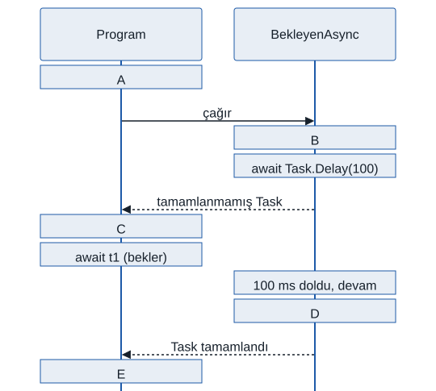

# Asenkron Programlama: `async`/`await`, İptal ve Asenkron Akışlar

Geçen haftanın servisleri zaten `async` idi. Depo `await depo.OkuAsync(iptal)` ile okunuyordu, testler `async Task` döndürüyordu, menü `CalistirAsync(iptal)` ile açılıyordu. Bu hafta bu kelimelerin içine bakıyoruz: `await` satırında program ne yapıyor, beklerken kim çalışıyor, bir işi yarıda nasıl durduruyoruz?

Haftanın taşıyıcısı yine bir **graf**, ama bu kez kenarlar bellekte değil uzakta. Bir kütüphane kataloğunda "bunu okuyanlar şunları da okudu" bağlantılarını gezeceğiz. Her bağlantıyı öğrenmek için kataloğa sormak gerekiyor ve her soru zaman alıyor. Gezinti, 5. haftanın kuyruğuyla yapılan **genişliğine gezinti**dir (BFS).

> **Dönem projesinde:** Şablondaki `IDepo<T>` metotları `Task` döndürür ve `CancellationToken` alır. `Program.cs`, Ctrl+C'yi programı öldürmek yerine bir **iptal isteğine** çevirir ve menüye iletir. Bu notun 7. bölümü o satırları açıyor.

---

## 1. Açılış: Beklerken Ne Yapıyorsunuz?

Bir lokantada tek garson var. Garson sipariş alır, mutfağa iletir, sonra **yemek pişene kadar mutfak kapısında bekler.** Bu sürede öteki masalara kimse bakmaz. Daha akıllı bir garson siparişi mutfağa bırakır ve yemek hazır olana kadar başka masalara gider. Mutfak "hazır" dediğinde yemeği götürür. Yemeğin pişme süresi değişmez, ama bekleme süresi boşa gitmez.

Programlardaki bekleyişlerin çoğu böyledir: dosya diskten gelir, ağdaki sunucu cevap verir, veritabanı sorguyu çalıştırır. Bu sürede işlemcinin yapacağı bir iş yoktur. Bu tür işlere **G/Ç'ye bağlı** (I/O-bound) iş denir.

| | G/Ç'ye bağlı iş | İşlemciye bağlı iş |
| --- | --- | --- |
| Örnek | Dosya okumak, ağdan veri çekmek, veritabanı sorgusu | Asal sayı saymak, resim işlemek, sıralamak |
| Zaman nereye gidiyor? | Beklemeye: disk, ağ, başka bir sunucu | Hesaba: işlemci sürekli çalışıyor |
| Doğru araç | `async`/`await` | `Task.Run` (6. bölüm) |

Senkron kod beklerken **iş parçacığını** (thread) tutar: `File.ReadAllText` dosya gelene kadar bulunduğu iş parçacığını kilitler. Bir konsol programında bu fark edilmez. Ama bir web sunucusu her isteğe bir iş parçacığı ayırıyorsa, bekleyen her istek bir iş parçacığını boşa harcar. Bir masaüstü uygulamasında arayüz donar. `async`/`await` bekleyen işin iş parçacığını **bırakmasını** sağlar.

---

## 2. `Task`: Gelecekteki Bir Sonucun Nesnesi

Asenkron bir metot hemen sonuç döndüremez; sonuç henüz yoktur. Bunun yerine bir **görev** (task) döndürür. Görev, "bu iş bittiğinde sonucu ya da hatası burada olacak" diyen bir nesnedir:

| Tip | Anlamı |
| --- | --- |
| `Task` | Sonucu olmayan bir iş (`void`'in asenkron karşılığı) |
| `Task<T>` | Sonunda bir `T` üretecek bir iş |

Görevin bir durumu vardır: sürüyor, başarıyla bitti (`RanToCompletion`), hata verdi (`Faulted`) ya da iptal edildi (`Canceled`). `await` görevi bekler. Görev başarıyla bittiyse sonucu verir, hata verdiyse hatayı fırlatır.

**Görev sıcak başlar.** 5. haftanın yineleyicisi `foreach` başlayana kadar tek satır çalıştırmıyordu. Görev ise **çağrıldığı anda** çalışmaya başlar; `await` onu başlatmaz, yalnızca bekler. `kod/01-await-sirasi.cs` dosyasının 3. bölümü ikisini yan yana koyar:

```csharp
Task gorev = Ornek.GorevAsync();          // ilk satırı "görev başladı" yazar
IEnumerable<int> dizi = Ornek.Dizi();     // ilk satırı "dizi başladı" yazar
Console.WriteLine("ikisi de oluşturuldu");
await gorev;
foreach (int _ in dizi) { }
```

```
görev başladı
ikisi de oluşturuldu
görev bitti
dizi başladı
```

---

## 3. `await` Satırında Ne Olur?

```csharp
Console.WriteLine("A");
Task t1 = Ornek.BekleyenAsync();   // B yazar, 100 ms bekler, D yazar
Console.WriteLine("C");
await t1;
Console.WriteLine("E");
```

Çıktı `A B C D E`. Adım adım:

1. `BekleyenAsync` **çağıranın içinde** çalışmaya başlar ve `B` yazar.
2. `await Task.Delay(100)` satırına gelir. Gecikme henüz bitmemiştir. Metot burada **askıya alınır** ve çağırana tamamlanmamış bir `Task` döndürür.
3. Çağıran yoluna devam eder: `C`.
4. `await t1` satırında artık çağıran da bekler.
5. 100 ms dolunca `BekleyenAsync` **kaldığı yerden** devam eder: `D`. Görev tamamlanır, çağıran da devam eder: `E`.



Derleyici `async` metodu bir **durum makinesine** çevirir: her `await` bir durak, yerel değişkenler bir nesnenin alanları olur. 5. haftada `yield return` için de aynısını yapıyordu. İki özellik aynı fikrin iki kullanımıdır: metot ortasında durup sonra kaldığı yerden sürebilir.

**Tamamlanmış görev beklenirse durulmaz.** `await` önce göreve bakar. Görev zaten bittiyse askıya almaz, satır satır devam eder. Dosyanın 2. bölümünde `await Task.CompletedTask` olduğu için çıktı `1 2 3 4` olur; `1 2 4 3` değil. Yani `async` metot, **ilk bekleyen** `await`'e kadar tamamen senkron çalışır.

**`async` kelimesi tek başına hiçbir şeyi asenkron yapmaz.** İçinde `await` olmayan bir `async` metot baştan sona senkron çalışır; çağıran, görevi zaten tamamlanmış olarak alır. Asenkronluk, beklenen işin kendisinden (disk, ağ, zamanlayıcı) gelir.

---

## 4. Sıralı ve Birlikte Beklemek

Üç kitabın bilgisini kataloğa soralım. Her soru bir gecikme sürsün:

```csharp
string a = await Katalog.GetirAsync("Huzur", 1);
string b = await Katalog.GetirAsync("Aylak Adam", 1);
string c = await Katalog.GetirAsync("Beş Şehir", 1);
```

Bu kod **sıralıdır**: ikinci soru, birincinin cevabı gelmeden sorulmaz. Toplam süre üç gecikmedir. Oysa sorular birbirine bağlı değildir. Üçünü birden başlatıp birlikte bekleyebiliriz:

```csharp
Task<string> ga = Katalog.GetirAsync("Huzur", 3);
Task<string> gb = Katalog.GetirAsync("Aylak Adam", 1);
Task<string> gc = Katalog.GetirAsync("Beş Şehir", 2);
string[] hepsi = await Task.WhenAll(ga, gb, gc);
```

Görevler çağrıldıkları anda başladığı için (2. bölüm) üçü aynı anda sürer. Süre **en uzun olanınki** kadardır. `kod/02-sirali-ve-eszamanli.cs` iki durumda da "≈ 3 gecikme" yazar: birincide 1 + 1 + 1, ikincide en uzun olan 3.

**`WhenAll` sırayı korur.** İkinci örnekte görevler `Aylak Adam`, `Beş Şehir`, `Huzur` sırasıyla biter. Ama `hepsi` dizisi yine `Huzur, Aylak Adam, Beş Şehir` sırasındadır: görevlerin verildiği sıra.

**`Task.WhenAny`** ilk biten görevi döndürür. Aynı kitabı hem asıl hem yedek sunucuya sorup hangisi önce cevap verirse onu kullanmak için uygundur. Kaybeden görev **durmaz**, arka planda sürer; durdurmak için iptal gerekir (7. bölüm).

| | Ne zaman biter? | Ne döndürür? |
| --- | --- | --- |
| `await a; await b;` | a bittikten sonra b başlar | Teker teker |
| `Task.WhenAll(a, b)` | Hepsi bitince | Sonuçların dizisi, **verilen sırayla** |
| `Task.WhenAny(a, b)` | İlki bitince | İlk biten **görev** (sonucu için ayrıca `await`) |

---

## 5. Hatalar Nerede Fırlar?

**Hata görevin içinde kalır.** `async` bir metodun içinde fırlatılan istisna çağırana hemen ulaşmaz. Görevin içine konur ve görev `Faulted` durumuna geçer. İstisna ancak görev **beklendiğinde** fırlar:

```csharp
Task hatali = Ornek.HataliAsync(-1);   // içeride ThrowIfNegative fırlatır
Console.WriteLine($"çağrı döndü, durum: {hatali.Status}");   // Faulted
await hatali;                           // istisna burada fırlar
```

Bu, ilk satırdaki koruma cümlesi için bile geçerlidir. 9. haftada `ThrowIfNegative` metodun ilk satırında hemen fırlıyordu. `async` metotta ise fırlatma, görev beklenene kadar ertelenir. 5. haftanın yineleyicisinde de buna benzer bir durum vardı.

**`WhenAll` birden çok hata alırsa** `await` yalnızca **birini** fırlatır. Geri kalanlar görevin `Exception` özelliğinde, bir `AggregateException` içinde durur:

```csharp
Task ikisi = Task.WhenAll(h1, h2);
try { await ikisi; }
catch (InvalidOperationException e) { /* yalnızca biri */ }
Console.WriteLine(ikisi.Exception!.InnerExceptions.Count);   // 2
```

`kod/02` dosyasında `catch`'e **ilk hata veren** görevin hatası geliyor; listede ilk sırada olanınki değil (denendi). İki görev aynı anda hata verirse hangisinin geleceği çalıştırmadan çalıştırmaya değişiyor. Bu sıraya güvenmeyin. Bütün hatalar gerekiyorsa `InnerExceptions`'a bakın.

**`async void` yazmayın.** `void` döndüren bir `async` metodun beklenecek görevi yoktur. İçinde fırlayan istisna `try` ile yakalanamaz ve programı sonlandırır. Testi de yazılamaz: test bitişini bekleyemez. Tek istisna arayüz olay işleyicileridir (`button.Click += async (s, e) => ...`), çünkü olayın imzası `void` ister.

**`.Result` ve `.Wait()` kullanmayın.** Görevi senkron olarak beklerler, yani iş parçacığını kilitlerler: `async`'in bütün kazancı gider. Masaüstü arayüz uygulamalarında **kilitlenmeye** (deadlock) de yol açabilirler: arayüz iş parçacığı görevi beklerken, görev de devam etmek için arayüz iş parçacığını bekler. Ayrıca hata `AggregateException` içine sarılı gelir. Kural: **bir kez `async`, sonuna kadar `async`.** Çağıran da `await` etsin; en üstte `Program.cs`'teki üst düzey `await` var.

---

## 6. İşlemciye Bağlı İş: `Task.Run`

Asal sayı saymak beklemek değil, hesaplamaktır. Burada `await` edilecek bir G/Ç yoktur. Böyle bir işi iş parçacığı havuzundan (thread pool) bir iş parçacığına vermek için `Task.Run` kullanılır:

```csharp
int asal = await Task.Run(() => Ornek.AsalSay(200_000));   // 17984
```

Çağıran iş parçacığı serbest kalır, hesap başka bir iş parçacığında yapılır. Masaüstü uygulamasında arayüzün donmaması böyle sağlanır.

İki yanlış kullanım sık görülür:

- **G/Ç işini `Task.Run` içine sarmak.** `Task.Run(() => File.ReadAllText(yol))` asenkron değildir. Yalnızca beklemeyi başka bir iş parçacığına taşır; o iş parçacığı yine boşa bekler. Doğrusu: `await File.ReadAllTextAsync(yol)`.
- **Kütüphane kodunda `Task.Run`.** Servisinizin metodu işini senkron yapıyorsa senkron kalsın. Arka plana alıp almamaya çağıran karar versin.

Bir hesabı çekirdeklere bölüp paralel yapmak bu dersin konusu değildir; gelecek dönem, paralel programlama seçmelisinde işleniyor. Bu derste eşzamanlılık G/Ç beklemesinde kalıyor.

---

## 7. İptal

Kullanıcı Ctrl+C'ye bastı, zaman aşımı doldu ya da sonuç artık gerekmiyor. Süren bir iş nasıl durdurulur? .NET'te iptal iki nesneyle yapılır:

| Nesne | Kimde durur? | Ne yapar? |
| --- | --- | --- |
| `CancellationTokenSource` | İptali isteyen tarafta | `Cancel()`, `CancelAfter(süre)`: "iptal et" düğmesi |
| `CancellationToken` | İşi yapan tarafta | `IsCancellationRequested`, `ThrowIfCancellationRequested()`: "iptal istendi mi?" penceresi |

İşi yapan taraf düğmeye değil yalnızca pencereye erişir; iptal edemez, yalnızca iptal edildiğini görür.

```csharp
using var kaynak = new CancellationTokenSource();
kaynak.CancelAfter(TimeSpan.FromMilliseconds(250));
await Task.Delay(TimeSpan.FromSeconds(5), kaynak.Token);   // 250 ms'de iptal
```

İptal edilen iş **`OperationCanceledException`** fırlatır. `Task.Delay` gibi bazı metotlar ondan türeyen `TaskCanceledException` fırlatır. Bu yüzden `catch (OperationCanceledException)` ikisini de yakalar. Testte `Assert.ThrowsAnyAsync<OperationCanceledException>` yazılır: 9. haftada gördüğümüz gibi `Throws` birebir tip ister, `ThrowsAny` türetilmişi de kabul eder.

**İptal işbirliğidir.** Token'ı almayan ya da ona hiç bakmayan bir iş durdurulamaz. `kod/03-iptal.cs` aynı beş adımlık işi iki kez çalıştırır, 150 ms'de iptal ister:

```
token almayan iş: 5/5 adım, iptal istendi mi? True
token alan iş: 1/5 adımda durdu
```

İki kural buradan çıkar:

- `CancellationToken` alan bir metot, onu **çağırdığı her asenkron metoda iletir.** Şablondaki `IDepo<T>`'nin her metodu bu yüzden token alır.
- İşlemciye bağlı bir döngü arada bir `iptal.ThrowIfCancellationRequested()` çağırır. Asenkron bir metot da uzun bir işe başlamadan önce böyle bir kontrol yapabilir.

**İki sebep, tek token.** Bir arama hem kullanıcı vazgeçince hem de 300 ms'de bitmezse durmalı. `CreateLinkedTokenSource` iki kaynağı birleştirir: kaynaklardan biri iptal edilirse birleşik token da iptal edilir. Hangisinin durdurduğu 9. haftanın istisna filtresiyle ayrılır:

```csharp
using var birlesik = CancellationTokenSource.CreateLinkedTokenSource(kullanici.Token);
birlesik.CancelAfter(TimeSpan.FromMilliseconds(300));
try { await Task.Delay(TimeSpan.FromSeconds(5), birlesik.Token); }
catch (OperationCanceledException) when (kullanici.IsCancellationRequested) { /* kullanıcı vazgeçti */ }
catch (OperationCanceledException) { /* zaman aşımı */ }
```

> **Şablonda:** `Program.cs` bir `CancellationTokenSource` kurar ve `Console.CancelKeyPress` olayında `Cancel()` çağırır (4. haftanın olayı). Ctrl+C programı hemen öldürmez; menüye bir iptal isteği gider. Menü bu token'ı servislerinize, servisleriniz de depoya iletmelidir.

---

## 8. Taşıyıcı: Grafı Uzaktan Gezmek

Katalogdaki bağlantılar bir graf oluşturur. Graf **döngülüdür**: Tutunamayanlar Huzur'a geri bağlanıyor. Geçen haftanın kabı döngüyü bir hata sayıyordu; burada döngü olağandır. Bir **görüldü** kümesi her kitabı en fazla bir kez gezmemizi sağlar.



**Genişliğine gezinti** önce başlangıcın bağlantılarını, sonra onların bağlantılarını gezer. Bunu 5. haftanın kuyruğu yapar: bulunan kitap kuyruğun sonuna eklenir, sıradaki kitap başından alınır. Tek fark, bağlantıların bir `await` ile gelmesidir:

```csharp
while (kuyruk.TryDequeue(out var baslik))
{
    sira.Add(baslik);
    foreach (var komsu in await katalog.BaglantilarAsync(baslik, iptal))
        if (goruldu.Add(komsu))
            kuyruk.Enqueue(komsu);
}
```

`HashSet<T>.Add` eleman zaten varsa `false` döndürür. Böylece "görülmediyse ekle ve kuyruğa koy" tek satırda yazılır.

Bu gezinti **sıralıdır**: her soru bir öncekinin cevabını bekler. Oysa aynı **düzeydeki** kitapların soruları birbirinden bağımsızdır. Huzur'un üç bağlantısını üç ayrı soruyla aynı anda sorabiliriz:

```csharp
while (duzey.Count > 0)
{
    sira.AddRange(duzey);
    var sorular = duzey.Select(b => katalog.BaglantilarAsync(b, iptal)).ToList();
    string[][] cevaplar = await Task.WhenAll(sorular);

    var sonraki = new List<string>();
    foreach (var cevap in cevaplar)          // WhenAll sırayı korur
        foreach (var komsu in cevap)
            if (goruldu.Add(komsu))
                sonraki.Add(komsu);
    duzey = sonraki;
}
```

`Select` her kitap için bir görev **başlatır**; `ToList` bunların hepsinin hemen başlamasını sağlar (5. haftanın ertelenmiş yürütmesi: `ToList` olmadan da `WhenAll` diziyi gezerek başlatırdı, ama listeyle niyet açık). `kod/04-asenkron-gezinti.cs` iki gezintiyi karşılaştırır:

| | Sıralı | Düzey düzey |
| --- | :-: | :-: |
| Gezilen sıra | Huzur → Tutunamayanlar → Saatleri A. E. → Aylak Adam → Tehlikeli Oyunlar → Beş Şehir → Anayurt Oteli | **aynı** |
| Katalog çağrısı | 7 | 7 |
| En çok aynı anda süren soru | 1 | 3 |
| Süre | ≈ 7 gecikme | ≈ 3 gecikme (düzey sayısı) |
| 5 gecikmelik zaman aşımıyla | yetişmedi | yetişti |

Sıralı gezintinin süresi **kitap sayısıyla**, düzey düzey gezintininki **düzey sayısıyla** büyür.

**Bir sınır var.** Bir düzeyde bin kitap olsaydı düzey düzey gezinti kataloğa aynı anda bin soru sorardı. Gerçek bir sunucu bunu ya reddeder ya da yavaşlar. Aynı anda süren iş sayısını sınırlamak gelecek haftanın konusu.

---

## 9. Asenkron Akışlar

Düzey düzey gezinti bütün grafı gezip listeyi **en sonda** verir. İlk dört kitap yetiyorsa? 5. haftada bu sorunun cevabı `yield return` idi: sonucu teker teker, istendiği kadar vermek. C# 8'den beri `yield return` ile `await` aynı metotta kullanılabilir. Böyle bir metot **`IAsyncEnumerable<T>`** döndürür ve `await foreach` ile gezilir:

```csharp
public static async IAsyncEnumerable<string> KesfetAsync(
    UzakKatalog katalog, string baslangic,
    [EnumeratorCancellation] CancellationToken iptal = default)
{
    // ... görüldü kümesi ve kuyruk
    while (kuyruk.TryDequeue(out var baslik))
    {
        yield return baslik;
        foreach (var komsu in await katalog.BaglantilarAsync(baslik, iptal))
            if (goruldu.Add(komsu))
                kuyruk.Enqueue(komsu);
    }
}
```

```csharp
await foreach (string kitap in Gezgin.KesfetAsync(katalog, "Huzur"))
{
    Console.WriteLine($"tüketici: {kitap}");
    if (++alinan == 4)
        break;
}
```

`kod/05-asenkron-akislar.cs` üç şey gösterir:

- **Akış oluşturulunca hiçbir soru sorulmaz** (`katalog çağrısı: 0`). Görev sıcak başlıyordu (2. bölüm); asenkron akış ise yineleyici gibi **soğuktur**. Ertelenmiş yürütme burada da geçerlidir.
- **Tüketici durunca üretici de durur.** Dört kitap alındığında katalog yalnızca **üç** kez sorulmuştur: dördüncü kitabın bağlantıları, o kitap tüketiciye verildikten sonra sorulacaktı. `break` akışı kapatır; geri kalan sorular hiç sorulmaz.
- **İptal tüketiciden gelir.** `KesfetAsync(...).WithCancellation(kaynak.Token)` ile verilen token, `[EnumeratorCancellation]` özniteliği taşıyan parametreye bağlanır. Öznitelik unutulursa derleyici `CS8425` uyarısı verir ve iptal **sessizce yok sayılır**: akış sonuna kadar gezilir (denendi).

| | `Task<List<T>>` | `IAsyncEnumerable<T>` |
| --- | --- | --- |
| Sonuç ne zaman gelir? | Hepsi bir arada, en sonda | Teker teker, bulundukça |
| Çağrılınca başlar mı? | Evet, sıcak | Hayır, `await foreach` ile |
| Erken bırakılabilir mi? | Hayır, iş zaten yapılıyor | Evet, `break` |
| Gezmek için | `await` sonra `foreach` | `await foreach` |

---

## 10. Asenkron Kodu Sınamak

Asenkron bir metodu sınayan test de `async Task` döndürür ve metodu `await` ile bekler. Proje şablonundaki `JsonDepoTestleri` böyle yazılmıştı:

```csharp
[Fact]
public async Task Duzey_duzey_gezinti_sirali_ile_ayni_sirayi_verir()
{
    var katalog = new SahteKatalog(SahteKatalog.OrnekGraf());

    var sira = await Gezgin.GezDuzeyDuzeyAsync(katalog, "Huzur");

    Assert.Equal(SahteKatalog.OrnekSira, sira);
}
```

- Test metodu **`async void` olmaz.** xUnit'in çözümleyicisi bunu `xUnit1048` ile uyarır; bir sonraki ana sürümü artık çalıştırmıyor.
- İstisna beklenirken `Assert.ThrowsAnyAsync<OperationCanceledException>(() => ...)` **`await` ile** çağrılır. `await` unutulursa xUnit'in çözümleyicisi derlemeyi `xUnit2021` hatasıyla durdurur (denendi): beklenmeyen bir doğrulama hiçbir şeyi doğrulamaz.
- Gerçek ağ ya da gerçek dosya yerine **sahte bir katalog** verilir (10. haftanın bellekte deposu gibi). Laboratuvardaki `SahteKatalog` gerçek gecikme yerine 10 ms bekler ve kendisine ne olduğunu kaydeder: kaç soru soruldu, en çok kaç soru aynı anda sürdü, token'sız soru geldi mi. Testler bu kayda bakar.

---

## 11. Laboratuvar (Ödev)

`kod/lab/` bir çözüm. 16 testten 2'si hazır kodu sınar ve baştan yeşildir, 14'ü kırmızıdır:

1. **Düzey düzey gezinti** (`GezDuzeyDuzeyAsync`): aynı sıra, her kitap bir kez, aynı düzeydeki sorular birlikte.
2. **İptal:** token her soruya iletilsin; yeni bir düzeye başlamadan önce iptale bakılsın.
3. **Asenkron akış** (`KesfetAsync`): teker teker, ertelenmiş, erken bırakılabilir, `WithCancellation` ile iptal edilebilir.
4. **Hataya dayanıklı gezinti:** bir kitabın sorusu hata verirse gezinti sürsün, hatalar listelensin; ama iptal hata gibi yutulmasın.

Ayrıntılar `kod/README.md` içinde.

---

## 12. İyi Pratikler ve Sık Yapılan Hatalar

**İyi pratikler**

- G/Ç bekleyen her metot `async` olsun ve `Task`/`Task<T>` döndürsün; adı `Async` ile bitsin
- Birbirine bağlı olmayan işleri önce başlatın, sonra `Task.WhenAll` ile birlikte bekleyin
- `CancellationToken` alın ve çağırdığınız her asenkron metoda iletin
- İptali `OperationCanceledException` olarak yakalayın; hata gibi günlüğe yazmayın
- Sonucu teker teker üreten ve erken bırakılabilecek işler için `IAsyncEnumerable<T>`

**Sık yapılan hatalar**

- `async void`: istisna yakalanamaz, program çöker (olay işleyicileri dışında)
- `.Result` / `.Wait()`: iş parçacığını kilitler, arayüz uygulamasında kilitlenme
- `await` unutmak: görev başlar ama beklenmez; hatası kaybolur. Derleyici çoğu zaman `CS4014` ile uyarır
- Bağımsız işleri art arda `await` etmek: süre toplanır
- G/Ç işini `Task.Run` içine sarmak; `Thread.Sleep` yerine `Task.Delay` kullanmamak
- Token'ı alıp iletmemek: iptal hiçbir yere ulaşmaz
- `catch (Exception)` ile iptali de yutmak
- Asenkron akışta `[EnumeratorCancellation]` unutmak (`CS8425`)

---

## 13. Örnek Kodlar

`kod/` klasöründe; çalıştırma, .NET 9 yolu, laboratuvar ve Denemeniz için soruları klasördeki `README.md` içinde.

| Dosya | Konu |
| ----- | ---- |
| `01-await-sirasi.cs` | `await` nerede durur, görev sıcak başlar, hata görevin içinde |
| `02-sirali-ve-eszamanli.cs` | Sıralı bekleme, `WhenAll`, `WhenAny`, birden çok hata |
| `03-iptal.cs` | `CancellationTokenSource`, işbirliği, birleşik token |
| `04-asenkron-gezinti.cs` | **Taşıyıcı:** grafı sıralı ve düzey düzey gezmek |
| `05-asenkron-akislar.cs` | `IAsyncEnumerable<T>`, `await foreach`, erken bırakma, iptal |
| `lab/` | **Laboratuvar:** 16 test, dört görev |

---

## Sonraki Konu

**Eşzamanlılık: yarış durumu, kilitler, eşzamanlı koleksiyonlar, kanallar.** Bu haftanın sahte kataloğunda bir `lock` vardı: sayaçlar aynı anda birden çok görev tarafından değiştiriliyordu. O satır silinirse ne olur? Düzey düzey gezintide aynı anda süren soru sayısı nasıl sınırlanır? Ve 5. haftanın kuyruğunun bir ucuna bir görev yazarken öteki ucundan başka bir görev okuyabilir mi?

---

## Kaynaklar

- Microsoft Learn — `async` ve `await` ile asenkron programlama: <https://learn.microsoft.com/dotnet/csharp/asynchronous-programming/>
- Microsoft Learn — Görev tabanlı asenkron desen: <https://learn.microsoft.com/dotnet/standard/asynchronous-programming-patterns/task-based-asynchronous-pattern-tap>
- Microsoft Learn — Yönetilen iş parçacıklarında iptal: <https://learn.microsoft.com/dotnet/standard/threading/cancellation-in-managed-threads>
- Microsoft Learn — Asenkron akışlar: <https://learn.microsoft.com/dotnet/csharp/asynchronous-programming/generate-consume-asynchronous-stream>
- Stephen Cleary, *Concurrency in C# Cookbook*, 2. baskı, O'Reilly — 1–3. ve 10. bölümler

---

*Öğr. Gör. Turgay Taymaz · Afyon Kocatepe Üniversitesi*
*Bu materyal CC BY-NC-SA 4.0 ile lisanslanmıştır. Kullanırken kaynak gösteriniz.*
*Kaynak: https://github.com/ttaymaz/ders-notlari*
