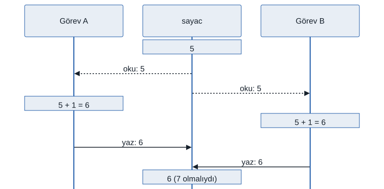

# Eşzamanlılık: Yarış Durumu, Kilitler, Eşzamanlı Koleksiyonlar ve Kanallar

Geçen haftanın sahte kataloğunda bir satır vardı: `lock (_kilit) { Cagri++; ... }`. O satır neden oradaydı? Düzey düzey gezintide birkaç soru aynı anda sürüyordu ve hepsi aynı sayacı artırıyordu. Bu hafta o satırın ne işe yaradığını görüyoruz: birden çok iş aynı veriye **aynı anda** dokunduğunda ne bozulur, nasıl korunur?

Haftanın taşıyıcısı yine **kuyruk**. 5. haftanın kuyruğunda ekleyen ve alan aynı koddu. Bu hafta kuyruğun bir ucuna bir görev yazıyor, öteki ucundan başka bir görev okuyor; ikisi aynı anda çalışıyor. .NET'te bu işi **kanal** (`Channel<T>`) yapar.

> **Kapsam:** Bu derste eşzamanlılık, birden çok işin aynı veriyi paylaşmasıyla ilgili. Bir hesabı çekirdeklere bölüp hızlandırmak (paralel hesaplama) gelecek dönem, paralel programlama seçmelisinde işleniyor.

---

## 1. Açılış: Kaybolan Artırma

Sekiz görev aynı sayacı birer milyon kez artırıyor. Sonuç sekiz milyon olmalı:

```csharp
int sayac = 0;
await Ornek.HepsiBirlikte(8, () =>
{
    for (int i = 0; i < 1_000_000; i++)
        sayac++;
});
```

`kod/01-yaris-durumu.cs` her çalıştırmada **farklı ve daha küçük** bir sayı bulur. Dosya bu yüzden sayının kendisini değil, "kayıp var mı?" sorusunun cevabını yazar: `True`.

Neden? `sayac++` tek bir işlem gibi görünür ama üç adımdır: belleğden **oku**, bir **ekle**, belleğe **yaz**. İki görev aynı anda 5 okursa ikisi de 6 yazar. İki artırmadan biri kaybolmuştur.



Bir tahtaya yazılmış sayıyı iki kişinin aynı anda silip bir fazlasını yazdığını düşünün. İkisi de 5'i görüp 6 yazarsa tahtada 7 değil 6 kalır.

---

## 2. Yarış Durumu

Bir programın sonucu, işlerin **hangi sırayla** çalıştığına bağlıysa ve bu sıra her çalıştırmada değişebiliyorsa buna **yarış durumu** (race condition) denir. Üç özelliği vardır:

- **Her seferinde ortaya çıkmaz.** Tek görevle (`GorevSayisi = 1`) kayıp yoktur; az çekirdekli bir makinede seyrek, çok çekirdeklide sık görülür. "Bende çalıştı" bir şey kanıtlamaz.
- **Hata ayıklayıcı onu saklar.** Adım adım ilerlerken görevlerin sırası değişir; hata kaybolur.
- **Sonuç yanlıştır ama program çökmez.** Sayı küçüktür, kopya eksidedir, kayıt eksiktir.

**Kontrol et, sonra yap.** En sık görülen yarış biçimi budur. Rafta tek kopya kalmış bir kitabı iki üye aynı anda istiyor:

```csharp
if (Kopya > 0)     // ikisi de 1 görür
{
    // ...
    Kopya--;       // ikisi de düşer: -1
}
```

Kontrol ile işlem arasında başka bir görev araya girebilir. Dosyanın 4. bölümü bunu 2000 kez dener; korumasız rafta kopyanın −1 olduğu denemeler vardır.

---

## 3. Atomik İşlemler: `Interlocked`

Tek bir sayıyı artırmak, eklemek ya da değiştirmek için `Interlocked` sınıfı vardır. Bu işlemler **bölünemez** (atomik) yapılır; okuma ile yazma arasına başka bir görev giremez:

```csharp
Interlocked.Increment(ref atomik);                     // atomik++
Interlocked.Add(ref toplam, 5);                        // toplam += 5
Interlocked.CompareExchange(ref deger, yeni, beklenen); // "hâlâ beklenense yeniyi yaz"
```

Dosyanın 2. bölümü sekiz milyonu tam bulur. Ama `Interlocked` **tek bir değişkeni** korur. Rafla defter gibi birbirine bağlı iki şey birlikte değişecekse kilit gerekir.

---

## 4. Kilit: Bir Kuralı Korumak

```csharp
private readonly object _kilit = new();

public bool OduncVer(string uye)
{
    lock (_kilit)
    {
        if (Raf == 0)
            return false;
        Raf--;
        Defter.Add(uye);
        return true;
    }
}
```

`lock` bloğuna aynı anda yalnızca **bir** görev girebilir; ötekiler kapıda bekler. Korunan şey tek tek alanlar değil bir **kuraldır**: "rafta kalan + defterdeki = başlangıçtaki kopya sayısı". `kod/02-kilitler.cs`, 100 üyenin 50 kopyalık rafa aynı anda başvurduğu durumda `rafta 0, defterde 50, toplam 50` yazar.

Kurallar:

- Kuralı ilgilendiren **her** okuma ve yazma aynı kilidin içinde olmalı. Bir yerde unutulan kilit bütün kilitleri boşa çıkarır.
- Kilit nesnesi `private readonly object` olsun. `lock (this)` ya da `lock ("metin")` yazmayın: dışarıdaki başka bir kod aynı nesneyi kilitleyebilir.
- Kilidin içinde kısa kalın. Kilit tutulurken dosya okumak, ağa gitmek ya da kullanıcı beklemek ötekileri de bekletir.
- `List<T>`, `Dictionary<TKey, TValue>` gibi sıradan koleksiyonlar **aynı anda yazılmaya dayanıklı değildir**. Yukarıdaki `Defter.Add` bu yüzden kilidin içinde.

.NET 9 ile kilitler için ayrı bir tip geldi: `System.Threading.Lock`. `lock` deyimi onunla da çalışır ve biraz daha hızlıdır. Bu derste .NET 8'de de derlensin diye `object` kullanıyoruz; iki yazım aynı işi yapar.

---

## 5. Kilitlenme

İki görev iki kilide ihtiyaç duyuyor. A önce raf kilidini, sonra defter kilidini istiyor. B ise önce defter kilidini, sonra raf kilidini istiyor. İkisi de ilk kilidini aldığında:

```
A: ilk kilidi tutuyorum, ikinciyi 300 ms bekledim, alamadım
B: ilk kilidi tutuyorum, ikinciyi 300 ms bekledim, alamadım
```

Her biri, ötekinin tuttuğu kilidi bekliyor. Buna **kilitlenme** (deadlock) denir. Gerçek programda ikisi de **sonsuza dek** bekler: program donar, hata vermez, işlemciyi de kullanmaz. `kod/02` bunu gösterebilmek için `Monitor.TryEnter`'a bir süre veriyor; `lock` deyiminde böyle bir süre yoktur.

Çözüm basit bir kuraldır: **birden çok kilit gerekiyorsa herkes aynı sırayla alsın.** A da B de önce raf, sonra defter kilidini isterse, ikincisi birincinin bitmesini bekler ve kilitlenme olmaz. Daha da iyisi, tek bir kuralı tek bir kilitle korumaktır.

---

## 6. Kilit ve `await`

`lock` bloğunun içinde `await` yazılamaz:

```csharp
lock (_kilit)
{
    int eski = Deger;
    await Task.Yield();    // CS1996: Bir kilit durumunun gövdesinde await kullanılamaz
    Deger = eski + 1;
}
```

Sebebi şudur: `lock` kilidi alan **iş parçacığına** bağlıdır. `await`'ten sonra metot başka bir iş parçacığında devam edebilir (11. hafta), o iş parçacığı kilidi bırakamaz. Asenkron kodda kilidin karşılığı **`SemaphoreSlim(1, 1)`**'dir:

```csharp
private readonly SemaphoreSlim _kilit = new(1, 1);

public async Task ArtirAsync()
{
    await _kilit.WaitAsync();
    try
    {
        int eski = Deger;
        await Task.Yield();
        Deger = eski + 1;
    }
    finally
    {
        _kilit.Release();
    }
}
```

`kod/02`'nin 3. bölümünde 200 artırma 200 bulur. `WaitAsync` ve `Release` satırları silinirse sonuç 200'ün çok altında kalır (bir ölçümde 29). `Release` mutlaka `finally` içinde olmalıdır: istisna fırlarsa kilit bırakılmaz ve bir sonraki gelen sonsuza dek bekler.

---

## 7. Eşzamanlı Koleksiyonlar

Her koleksiyon işlemini kilitle sarmak yerine kilidi koleksiyonun kendisine bırakabiliriz. `System.Collections.Concurrent` ad alanındaki koleksiyonlar aynı anda okunup yazılmaya dayanıklıdır:

| Tip | Karşılığı | Ne zaman? |
| --- | --- | --- |
| `ConcurrentDictionary<TKey, TValue>` | `Dictionary` | Ortak sayaçlar, önbellek |
| `ConcurrentQueue<T>` | `Queue<T>` | Sırası önemli işler |
| `ConcurrentBag<T>` | `List<T>` (sırasız) | Sonuç toplamak |

`kod/03-esanli-koleksiyonlar.cs` sekiz görevle 400 000 ödünç kaydı sayar. `ConcurrentDictionary.AddOrUpdate` her kitap için tam 100 000 bulur:

```csharp
sayilar.AddOrUpdate(kitap, 1, (_, eski) => eski + 1);
```

Sıradan bir `Dictionary` ile aynı iş ya yanlış sayılar verir (her kitap yaklaşık 64–78 bin) ya da sözlüğün iç yapısı bozulup program `IndexOutOfRangeException` ile çöker. Üç denemede ikisi yanlış saydı, biri çöktü.

**Tuzak: iki ayrı işlem.** Eşzamanlı koleksiyon her işlemi **tek başına** korur. İki işlemin arasını korumaz:

```csharp
ikiAdim.TryGetValue(kitap, out int eski);   // güvenli
ikiAdim[kitap] = eski + 1;                  // güvenli
                                            // ama ikisinin arası değil
```

Bu kod `ConcurrentDictionary` ile de kayıp verir (dosyanın 2. bölümü: `400000 mü? False`). Bu bir "kontrol et, sonra yap" yarışıdır. Çözüm, işi tek bir işlemde yapan metotlardır: `AddOrUpdate`, `GetOrAdd`, `TryUpdate`.

---

## 8. Aynı Anda Kaç İş?

Geçen hafta düzey düzey gezintide bir düzeyin bütün sorularını birlikte başlatmıştık. Düzeyde bin kitap olsaydı kataloğa aynı anda bin soru giderdi. **Aynı anda süren iş sayısını sınırlamak** için iki yol var.

**`SemaphoreSlim(n)`.** `lock` tek kişilik bir kapıysa `SemaphoreSlim(n)` n kişilik bir kapıdır:

```csharp
using var kapi = new SemaphoreSlim(2);
await Task.WhenAll(duzey.Select(async b =>
{
    await kapi.WaitAsync();
    try { return await katalog.BaglantilarAsync(b); }
    finally { kapi.Release(); }
}));
```

**`Parallel.ForEachAsync`.** Aynı işi hazır yapar:

```csharp
await Parallel.ForEachAsync(duzey,
    new ParallelOptions { MaxDegreeOfParallelism = 2 },
    async (b, iptal) => await katalog.BaglantilarAsync(b, iptal));
```

`kod/04-sinirlamak.cs` altı soruyu üç biçimde sorar:

| | En çok aynı anda | Süre |
| --- | :-: | :-: |
| Sınırsız (`WhenAll`) | 6 | ≈ 1 gecikme |
| `SemaphoreSlim(2)` | 2 | ≈ 3 gecikme |
| `Parallel.ForEachAsync`, en çok 2 | 2 | ≈ 3 gecikme |

`Parallel.ForEachAsync` sonuçları geri **döndürmez**; bir sonucu toplamak gerekiyorsa eşzamanlı bir koleksiyona yazılır ve sıra korunmaz. Sıra önemliyse `SemaphoreSlim` + `WhenAll` daha uygundur (`WhenAll` sırayı korur, 11. hafta).

---

## 9. Taşıyıcı: Kanal

İade edilen kitaplar bir masaya bırakılıyor; görevli onları alıp rafa yerleştiriyor. Bırakan ile yerleştiren ayrı kişilerdir ve aynı anda çalışırlar. Bu düzene **üretici–tüketici** (producer–consumer) denir. Aradaki masa bir **kuyruktur**: ilk bırakılan ilk yerleştirilir.



.NET'te bu kuyruk **`Channel<T>`**'dir: eşzamanlı ve asenkron bir kuyruk. `ConcurrentQueue`'dan farkı **beklemeyi** de bilmesidir. Kanal boşsa tüketici `await` ile bekler; 3. bölümdeki gibi boş kuyruğu tekrar tekrar yoklamak gerekmez.

```csharp
var kanal = Channel.CreateBounded<string>(2);       // kapasite 2

// Üretici
foreach (string kitap in iadeler)
    await kanal.Writer.WriteAsync(kitap);            // kanal doluysa bekler
kanal.Writer.Complete();                             // "başka kitap gelmeyecek"

// Tüketici
await foreach (string kitap in kanal.Reader.ReadAllAsync())
    await RafaYerlestirAsync(kitap);
```

Üç özellik:

- **Sınırlı kapasite, geri basınç.** Kanalda iki kitap varken üretici üçüncüsünü yazmak isterse **bekler**. Hızlı üretici yavaş tüketiciyi boğamaz; bellek de sınırsız büyümez. `kod/05-kanallar.cs`: `kanalda en çok 2 kitap bekledi`. `CreateUnbounded` ile aynı dosya `6` yazar: üretici her şeyi bir anda kanala döker.
- **`Complete()` şarttır.** Tüketicinin `await foreach` döngüsü kanal tamamlanana kadar biter mi diye bekler. `Complete()` unutulursa döngü hiç bitmez ve program **hiç sonlanmaz**. Hata da vermez (denendi).
- **Birden çok tüketici.** Aynı kanalı iki tüketici okursa her kitap **yalnızca birine** gider. Süre yarıya iner: tek tüketiciyle ≈ 6, iki tüketiciyle ≈ 3 yerleştirme. Tek tüketicide sıra ekleme sırasıdır; birden çok tüketicide bitiş sırası karışabilir.

5. haftada kuyruğu kendimiz yazmıştık; .NET'teki hazırı `Queue<T>` idi. Aynı anda iki uçtan kullanılacak bir kuyruğun hazırı ise `Channel<T>`'dir.

---

## 10. Eşzamanlı Kodu Sınamak

Eşzamanlılık testinin yapısı hep aynıdır: bir işi **aynı anda çok kez** yap, sonunda kuralın bozulmadığına bak.

```csharp
[Fact]
public async Task Ayni_anda_istenince_kopyadan_fazla_verilmez()
{
    var raf = new Raf("Huzur", kopya: 10, new SahteDefter());

    bool[] sonuclar = await Task.WhenAll(
        Enumerable.Range(1, 50).Select(no => raf.OduncVerAsync($"üye{no}")));

    Assert.Equal(10, sonuclar.Count(s => s));
}
```

- **Bir kez yeşil yanması yetmez.** Korumasız kod bu testlerden çoğu zaman kalır ama her zaman değil. Testi birkaç kez çalıştırın.
- **Yarışı kışkırtın.** Laboratuvardaki sahte defter her yazışta 1 ms bekler; kontrol ile işlem arasına gerçek bir bekleme girer ve korumasız raf neredeyse her seferinde yakalanır.
- **Asılı kalan testi önleyin.** Bırakılmayan bir kilit ya da kapatılmayan bir kanal testi sonsuza dek bekletir; xUnit'in varsayılan bir zaman sınırı yoktur. Laboratuvar testleri beklemeleri `.WaitAsync(TimeSpan.FromSeconds(5))` ile sarar: süre dolarsa test asılı kalmaz, `TimeoutException` ile kırmızı olur.

> **Dönem projesinde:** Konsol menüsü tek iş parçacığında çalışır; çoğu projede eşzamanlılık gerekmez. Gerekirse (örneğin aynı anda çalışan bir arka plan hatırlatıcısı) ortak veriyi `SemaphoreSlim` ya da eşzamanlı bir koleksiyonla koruyun. `JsonDepo<T>` aynı dosyaya aynı anda iki yazışa karşı korumalı **değildir**.

---

## 11. Laboratuvar (Ödev)

`kod/lab/` bir çözüm. 20 testten 2'si hazır `KilitliSayac`'ı sınar ve baştan yeşildir, 18'i kırmızıdır:

1. **Ödünç istatistiği** (`OduncIstatistigi`): aynı anda kayıt, kayıpsız sayma, en çok okunanlar.
2. **Raf** (`Raf.OduncVerAsync`): kontrol ile deftere yazma arasında `await` var; asenkron kilit.
3. **Sınırlı gezinti** (`SinirliGezgin`): geçen haftanın gezintisi, aynı anda en çok n soru.
4. **İade kuyruğu** (`IadeKuyrugu`): sınırlı kanal, birden çok tüketici, `Complete`.

Ayrıntılar `kod/README.md` içinde.

---

## 12. İyi Pratikler ve Sık Yapılan Hatalar

**İyi pratikler**

- Paylaşılan veriyi azaltın: her görev kendi sonucunu üretsin, sonuçlar en sonda birleşsin (`WhenAll`)
- Tek sayı için `Interlocked`, bir kural için `lock`, `await` varsa `SemaphoreSlim(1, 1)`
- Kilidin içinde kısa kalın; birden çok kilit gerekiyorsa her yerde aynı sırayla alın
- Eşzamanlı koleksiyonda tek işlemlik metotları kullanın: `AddOrUpdate`, `GetOrAdd`
- Üretici–tüketici için `Channel<T>`; kapasiteyi sınırlayın, işi bitince `Complete()`
- Aynı anda süren iş sayısını sınırlayın: `SemaphoreSlim(n)`, `Parallel.ForEachAsync`

**Sık yapılan hatalar**

- `sayac++` ya da `Dictionary`'yi korumasız paylaşmak
- Kontrolü kilidin içinde, işlemi dışında yapmak
- Okumayı kilitsiz bırakmak ("yalnızca okuyorum")
- `lock (this)`, `lock ("metin")`
- İki kilidi farklı yerlerde farklı sırayla almak
- `lock` içinde `await` (`CS1996`); `SemaphoreSlim`'i `finally` dışında bırakmak
- `TryGetValue` + indeksleyici: eşzamanlı koleksiyonda bile yarış
- Kanalı `Complete()` etmemek: program bitmez
- "Bende çalıştı": eşzamanlılık hatası her çalıştırmada görünmez

---

## 13. Örnek Kodlar

`kod/` klasöründe; çalıştırma, .NET 9 yolu, laboratuvar ve Denemeniz için soruları klasördeki `README.md` içinde.

| Dosya | Konu |
| ----- | ---- |
| `01-yaris-durumu.cs` | Kaybolan artırma, `Interlocked`, `lock`, kontrol et sonra yap |
| `02-kilitler.cs` | Kilit bir kuralı korur, kilitlenme, `SemaphoreSlim(1, 1)` |
| `03-esanli-koleksiyonlar.cs` | `ConcurrentDictionary`, iki ayrı işlem tuzağı, `ConcurrentQueue` |
| `04-sinirlamak.cs` | `SemaphoreSlim(n)`, `Parallel.ForEachAsync` |
| `05-kanallar.cs` | **Taşıyıcı:** sınırlı kanal, üretici–tüketici |
| `lab/` | **Laboratuvar:** 20 test, dört görev |

---

## Sonraki Konu

**Yansıma ve öznitelikler, eklenti mimarisi.** Geçen haftanın `[EnumeratorCancellation]`'ı ve xUnit'in `[Fact]`'i birer **öznitelikti**: koda iliştirilmiş bilgi. xUnit, test sınıflarınızı hiç görmeden onları nasıl buluyor ve çalıştırıyor? Bir program, derlenirken var olmayan bir sınıfı çalışırken nasıl yükleyebilir?

---

## Kaynaklar

- Microsoft Learn — İş parçacığı güvenliği ve eşitleme: <https://learn.microsoft.com/dotnet/standard/threading/overview-of-synchronization-primitives>
- Microsoft Learn — `lock` deyimi: <https://learn.microsoft.com/dotnet/csharp/language-reference/statements/lock>
- Microsoft Learn — İş parçacığı güvenli koleksiyonlar: <https://learn.microsoft.com/dotnet/standard/collections/thread-safe/>
- Microsoft Learn — `System.Threading.Channels`: <https://learn.microsoft.com/dotnet/core/extensions/channels>
- Stephen Cleary, *Concurrency in C# Cookbook*, 2. baskı, O'Reilly — 4. (paralellik temelleri), 9. (koleksiyonlar) ve 12. (eşitleme) bölümler

---

*Öğr. Gör. Turgay Taymaz · Afyon Kocatepe Üniversitesi*
*Bu materyal CC BY-NC-SA 4.0 ile lisanslanmıştır. Kullanırken kaynak gösteriniz.*
*Kaynak: https://github.com/ttaymaz/ders-notlari*
