# Yansıma ve Öznitelikler, Eklenti Mimarisi

Dokuz haftadır `[Fact]` yazıyoruz ve `dotnet test` testlerimizi buluyor. Oysa xUnit bizim test sınıflarımızı tanımıyor; o kütüphane bizim kodumuzdan yıllar önce yazıldı. Testlerimizi nasıl buluyor, nasıl çağırıyor? Cevap **yansıma** (reflection): bir program çalışırken kendi tiplerine bakabilir, onları kurabilir ve metotlarını çağırabilir. `[Fact]` ise bir **öznitelik** (attribute): koda iliştirilmiş, yansımayla okunan bir etiket.

Bu hafta önce tiplere bakmayı, sonra kendi özniteliğimizi yazmayı, sonra 30 satırlık kendi test koşucumuzu görüyoruz. Son olarak aynı fikirle bir **eklenti mimarisi** kuruyoruz: uygulama, derlenirken var olmayan sınıfları çalışırken bir klasörden yüklüyor.

Haftanın taşıyıcısı bir **ağaç**: 9. haftanın istisna ailesi. Bu kez onu elle çizmiyoruz, yansımayla kuruyoruz.

---

## 1. Açılış: xUnit Testlerinizi Nasıl Buluyor?

`dotnet test` çalıştığında xUnit şunları yapar:

1. Test projesinin derlenmiş halini (derleme, *assembly*: `Testler.dll`) açar.
2. İçindeki **her tipe** ve her tipin **her metoduna** bakar.
3. `[Fact]` etiketi taşıyan metotları ayırır.
4. Her biri için sınıfın **yeni bir nesnesini** kurar ve metodu çağırır.
5. Metot istisna fırlatırsa test kalmıştır, fırlatmazsa geçmiştir.

Bu adımların hiçbiri test sınıflarınızın adını bilmeyi gerektirmez. Hepsi çalışırken, tiplere bakarak yapılır. Haftanın sonunda (6. bölüm) aynı işi kendimiz yazacağız.

---

## 2. Tip Bilgisi

Her nesne kendi tipini bilir ve her tip bir `Type` nesnesiyle anlatılır:

```csharp
object o = "Huzur";
o.GetType().Name                       // String
typeof(int).FullName                   // System.Int32
typeof(List<int>).Name                 // List`1  (jenerik, bir tip parametresi)
typeof(List<int>).GetGenericArguments()[0].Name   // Int32
```

`GetType()` çalışırken nesnenin **gerçek** tipini verir; `typeof(...)` derlerken yazılan tipi. `Type` nesnesinden üyeler okunur:

```csharp
foreach (PropertyInfo ozellik in typeof(Kitap).GetProperties())
    Console.WriteLine($"{ozellik.Name} {ozellik.PropertyType.Name} = {ozellik.GetValue(kitap)}");
```

`kod/01-tip-bilgisi.cs` bir `record Kitap(string Baslik, int Sayfa)`'nın metotlarını listeler:

```
metotlar: <Clone>$, Deconstruct, Equals, Equals, GetHashCode, Ozet, ToString, UzunMu
```

Biz yalnızca `Ozet` ve `UzunMu`'yu yazdık. Geri kalanını derleyici üretti: 2. haftada gördüğümüz değer eşitliği (`Equals`, `GetHashCode`), `with` ifadesinin kullandığı kopya metodu (`<Clone>$`) ve yapı bozma (`Deconstruct`). Aynı sınıf `record` yerine `class` ile yazılırsa liste `Ozet, UzunMu` olur. Yansıma, derleyicinin bizim adımıza yazdıklarını da gösterir.

> **Sıra:** `GetProperties()` ve `GetMethods()` üyeleri **belirli bir sırayla döndürmeyi garanti etmez**. Tanım sırası gerekiyorsa `OrderBy(p => p.MetadataToken)` ile sıralayın; ad sırası gerekiyorsa adla.

---

## 3. Taşıyıcı: Tip Ağacı

Her sınıfın bir üst tipi vardır (`BaseType`); en tepede `object` durur. Bütün tipler birlikte bir **ağaç** oluşturur: kök `object`, her düğümün tek bir ebeveyni var.

9. haftada istisna ailesini elle çizmiştik. Bu kez yansımayla kuruyoruz. Elimizde birkaç yaprak var (`ArgumentNullException`, `TaskCanceledException`, kendi `KitapBulunamadiException`'ımız...). Her birinden `BaseType` ile köke kadar çıkıyor, geçtiğimiz her kenarı "üst → alt" olarak bir sözlüğe yazıyoruz:

```csharp
foreach (Type yaprak in yapraklar)
    for (Type? t = yaprak; t is not null && t != kok; t = t.BaseType)
        cocuklar[t.BaseType!].Add(t);       // (sözlükte yoksa önce boş küme)
```

Sonra kökten başlayıp derinlemesine gezerek yazdırıyoruz; her düzey iki boşluk içeride:

```
Exception
  SystemException
    ArgumentException
      ArgumentNullException
      ArgumentOutOfRangeException
    FormatException
    InvalidOperationException
      ObjectDisposedException
    KeyNotFoundException
      KitapBulunamadiException
    NotImplementedException
    OperationCanceledException
      TaskCanceledException
```



Ağacın iki yönü de işe yarar. **Yukarı** (yapraktan köke) tek bir yoldur: `ArgumentNullException → ArgumentException → SystemException → Exception → Object`. 9. haftada `catch (ArgumentException)` bloğunun `ArgumentNullException`'ı neden yakaladığının cevabı bu yoldur. **Aşağı** (kökten yapraklara) bir gezintidir; 10. haftanın bağımlılık grafını gezdiğimiz gibi.

> .NET'te bir sınıfın **tek** üst sınıfı olabilir; bu yüzden sınıflar bir ağaç oluşturur. Arayüzler eklenince yapı ağaç olmaktan çıkar: bir sınıf birçok arayüzü uygulayabilir.

---

## 4. Yansımayla Okumak, Yazmak, Çağırmak

| İş | Yansıma | Doğrudan karşılığı |
| --- | --- | --- |
| Özellik okumak | `ozellik.GetValue(nesne)` | `nesne.Baslik` |
| Alan yazmak | `alan.SetValue(nesne, 100)` | `nesne._adet = 100` |
| Metot çağırmak | `metot.Invoke(nesne, argumanlar)` | `nesne.Artir()` |
| Nesne kurmak | `Activator.CreateInstance(tip)` | `new Kitap(...)` |

**Yansıma erişim belirleyicilerini deler.** `kod/01`'in 4. bölümü bir sınıfın `private` alanını okur ve değiştirir:

```csharp
FieldInfo alan = typeof(OduncSayaci).GetField("_adet", BindingFlags.NonPublic | BindingFlags.Instance)!;
alan.SetValue(sayac, 100);             // Adet artık 100
```

`private` bir güvenlik önlemi değil, bir **sözleşmedir**: "buna dokunma, ileride değişebilir". Yansıma bu sözleşmeyi bozabilir ama bozmamalıdır. Testte bile `private` alana yansımayla bakmak, sınıfın iç yapısına bağlı kırılgan bir test üretir.

**Yansımayla çağrılan metodun istisnası sarılı gelir.** `Invoke` ile çağrılan metot bir istisna fırlatırsa, o istisna bir **`TargetInvocationException`**'ın içinde gelir:

```
yakalanan: TargetInvocationException
içindeki: InvalidOperationException: Sayaç sıfırlanamaz.
```

Asıl istisna `InnerException` özelliğindedir. Bir test koşucusu ya da komut tablosu yazarken kullanıcıya bunu göstermek gerekir; dıştakinin mesajı ("Exception has been thrown by the target of an invocation.") hiçbir şey söylemez.

---

## 5. Öznitelikler

Öznitelik, koda iliştirilmiş bir **bilgidir**. Kendisi hiçbir şey yapmaz; okuyan biri olursa anlam kazanır.

| Öznitelik | Kim okur? | Ne yapar? |
| --- | --- | --- |
| `[Obsolete]` | Derleyici | Çağıran koda uyarı verir (`CS0618`) |
| `[EnumeratorCancellation]` | Derleyici | `WithCancellation` token'ını parametreye bağlar (11. hafta) |
| `[Fact]`, `[Theory]` | xUnit, çalışırken | Test metotlarını bulur |
| `[JsonPropertyName("ad")]` | System.Text.Json | JSON'daki alan adını değiştirir |
| `[Komut("listele")]` | Bizim kodumuz | Menü komutunu bulur |

Kendi özniteliğimizi yazmak bir sınıf yazmaktır:

```csharp
[AttributeUsage(AttributeTargets.Method)]
class KomutAttribute(string ad) : Attribute
{
    public string Ad { get; } = ad;
    public string Aciklama { get; init; } = "";
}

[Komut("listele", Aciklama = "Bütün kitapları yazar")]
public string Listele() => ...;
```

- Sınıf `Attribute`'tan türer ve adı `Attribute` ile biter. Kullanırken ek yazılmaz: `[Komut(...)]`.
- `[AttributeUsage]` etiketin nereye yapıştırılabileceğini söyler. `[Komut]` bir sınıfa yazılırsa derleyici `CS0592` hatası verir.
- Kurucu parametreleri zorunlu, `init` özellikleri isteğe bağlı değerlerdir: `Aciklama = "..."`.
- Öznitelik argümanları **sabit** olmalıdır: sayı, metin, `typeof(...)`, enum. Çalışırken hesaplanan bir değer yazılamaz.

Etiketi okumak:

```csharp
var komutlar = typeof(KutuphaneMenusu).GetMethods()
    .Select(m => (Metot: m, Komut: m.GetCustomAttribute<KomutAttribute>()))
    .Where(x => x.Komut is not null);
```

`kod/02-oznitelikler.cs` menüyü bu etiketlerden kurar ve komutları adıyla çağırır. Yeni bir komut eklemek için menü koduna dokunmak gerekmez: metodu yazıp etiketlemek yeter. Etiketsiz `GizliBakim` metodu menüde görünmez.

> **Hazırı var:** `System.ComponentModel.DataAnnotations` ad alanındaki `[Required]`, `[Range]`, `[StringLength]` öznitelikleri ve `Validator.TryValidateObject` tam olarak laboratuvarın 1. görevindeki işi yapar. ASP.NET Core form doğrulaması bunlarla çalışır.

---

## 6. Kendi Test Koşucumuz

1. bölümdeki beş adım, `kod/03-test-kosucu.cs` içinde:

```csharp
var sinamalar = derleme.GetTypes()
    .SelectMany(t => t.GetMethods(), (tip, metot) => (Tip: tip, Metot: metot))
    .Where(x => x.Metot.GetCustomAttribute<SinamaAttribute>() is not null);

foreach (var (tip, metot) in sinamalar)
{
    object nesne = Activator.CreateInstance(tip)!;   // her sınama için YENİ nesne
    try
    {
        metot.Invoke(nesne, null);
        // geçti
    }
    catch (TargetInvocationException e)
    {
        // kaldı: e.InnerException.Message
    }
}
```

```
[GEÇTİ] CezaSinamalari.Bes_gun_on_bes_lira
[KALDI] CezaSinamalari.Bir_gun_dort_lira: beklenen 4, gelen 3
[GEÇTİ] CezaSinamalari.Kayit_her_sinamada_bostur
[GEÇTİ] CezaSinamalari.Kayit_her_sinamada_bostur_2
[GEÇTİ] CezaSinamalari.Tavan_altmis_lira
toplam 5, geçen 4
```

**Neden her sınama için yeni nesne?** `CezaSinamalari`'nın bir `_kayit` listesi var; iki sınama da ona bir öğe ekleyip sayının 1 olduğunu doğruluyor. Koşucu tek bir nesneyi paylaşsaydı ikinci sınama `beklenen 1, gelen 2` ile kalırdı (denendi): sınamalar birbirini etkilerdi ve sonuç çalışma sırasına bağlı olurdu. xUnit de her test için sınıfın kurucusunu yeniden çağırır. 10. haftanın servis testlerindeki `_saat` ve `_depo` alanlarının her testte temiz başlamasının sebebi budur.

---

## 7. Eklenti Mimarisi

Kütüphane uygulamamıza rapor eklemek isteyen herkes uygulamanın kodunu değiştirip yeniden derlemek zorunda olmasın. Raporu ayrı bir DLL olarak yazıp bir klasöre bıraksın; uygulama açılınca onu bulsun. Buna **eklenti mimarisi** (plugin architecture) denir. Tarayıcı uzantıları, editör eklentileri, oyun modları aynı fikirle çalışır.

`kod/eklenti/` dört projedir:

| Proje | Kimi tanır? | Ne içerir? |
| --- | --- | --- |
| `Sozlesme` | Kimseyi | `IRaporEklentisi` arayüzü, `Odunc` kaydı |
| `RaporEklentileri` | Yalnızca sözleşmeyi | İki rapor; ayrı bir DLL olarak derlenir |
| `Uygulama` | Yalnızca sözleşmeyi | Eklentileri **çalışırken** `eklentiler/` klasöründen yükler |
| `Testler` | Sözleşme ve uygulama | Yükleyicinin testleri |


Uygulama rapor sınıflarının adını hiçbir yerde yazmaz. Yükleyici şunu yapar:

```csharp
return derleme.GetTypes()
    .Where(t => t.IsClass && !t.IsAbstract && t.IsPublic)
    .Where(t => typeof(T).IsAssignableFrom(t))                // T'yi uyguluyor mu?
    .Where(t => t.GetConstructor(Type.EmptyTypes) is not null) // parametresiz kurulabilir mi?
    .OrderBy(t => t.FullName, StringComparer.Ordinal)
    .Select(t => (T)Activator.CreateInstance(t)!)
    .ToList();
```

`Assembly.LoadFrom(yol)` klasördeki DLL'i yükler. `RaporEklentileri` içindeki soyut `TemelRapor` ve parametresiz kurucusu olmayan `EsikliRapor` atlanır; kalan iki rapor çalışır:

```
eklentiler/ klasöründe 1 DLL, 2 rapor

[Geciken iadeler] (GecikmeRaporu)
Mert: Huzur (11 gün)
Can: Aylak Adam (6 gün)
Deniz: Huzur (2 gün)

[En çok ödünç alınanlar] (PopulerKitapRaporu)
Huzur: 3
Aylak Adam: 2
Beş Şehir: 1
```

Uygulama derlendikten sonra yazılmış üçüncü bir raporun DLL'i klasöre bırakıldığında, uygulama **yeniden derlenmeden** `2 DLL, 3 rapor` yazar (denendi).

Bu yapı 10. haftanın fikrinin bir adım ötesidir. Orada uygulama bir **arayüze** bağlıydı ve hangi sınıfın verileceğine `Program.cs` karar veriyordu. Burada hangi sınıfların var olduğuna bile uygulama değil, klasördeki dosyalar karar veriyor. Yazılım tasarımı dersindeki "değişikliğe kapalı, genişlemeye açık" ilkesinin dildeki bir karşılığı.

---

## 8. Yansımanın Bedeli ve Kaynak Üreteçleri

Yansıma güçlüdür ama üç bedeli vardır:

- **Derleyici yardım edemez.** `GetMethod("Artri")` yazım hatası çalışırken `null` döner. `nameof(OduncSayaci.Artir)` kullanmak bu hatayı derleme zamanına taşır.
- **Yavaştır.** `Invoke` doğrudan çağrıdan belirgin biçimde yavaştır. Gelecek hafta başarımı ölçmeyi görüyoruz.
- **Kırpılan programlarda bozulur.** .NET bir programı önceden makine koduna derleyebilir (AOT) ve kullanılmayan kodu atabilir (kırpma, *trimming*). Hangi tipin yansımayla kullanılacağı derlerken bilinmezse, gerekli kod atılmış olabilir.

Üçüncüsü bu derste doğrudan karşımıza çıkıyor: .NET 10'dan beri `dotnet run dosya.cs` tek dosyalık programı **AOT'ye hazır kabul eder**. `kod/03`'teki gibi bir derlemenin bütün tiplerini tarayan kod derlenirken `IL2026`, `IL2070`, `IL2077` uyarıları verir. Bu yüzden `03` ve `04` dosyalarının ilk satırı `#:property PublishAot=false`'tur. `04`'te o satır silinirse yansımalı JSON çalışırken durur:

```
System.InvalidOperationException: Reflection-based serialization has been disabled for this application.
```

**Kaynak üreteci** (source generator) bu sorunun çaresidir: yansımanın çalışırken yapacağı işi **derlerken** yapar ve C# kodu olarak programa ekler. Kaynak üretecini bir öznitelik başlatır:

```csharp
[JsonSerializable(typeof(Kitap))]
partial class KitapBaglami : JsonSerializerContext;    // gövdesini derleyici yazar

string json = JsonSerializer.Serialize(kitap, KitapBaglami.Default.Kitap);
```

```csharp
static partial class Desenler
{
    [GeneratedRegex(@"^TR-\d{3}-\d{2}$")]
    public static partial Regex RafKodu();             // gövdesini derleyici yazar
}
```

`kod/04-kaynak-ureteci.cs` iki yolla üretilen JSON'un aynı olduğunu gösterir. `partial` anahtar kelimesi "bu tipin geri kalanı başka bir yerde, derleyicinin ürettiği dosyada" demektir. 10. haftada şablonun `.editorconfig`'inde kapattığımız `CA1848` uyarısının önerdiği `[LoggerMessage]` de bir kaynak üretecidir.

> **Kural:** Uygulama kodunda önce yansımasız çözümü arayın (arayüz, delege, `switch`). Yansıma; test koşucusu, eklenti yükleyici, serileştirici gibi **genel amaçlı altyapı** yazarken yerindedir.

---

## 9. Laboratuvar (Ödev)

`kod/lab/` bir çözüm. 28 testten 2'si hazır `TipAgaci.KokeGidenYol`'u sınar ve baştan yeşildir, 26'sı kırmızıdır:

1. **Doğrulayıcı:** `[Zorunlu]`, `[EnFazlaUzunluk]`, `[Aralik]` özniteliklerine bakarak hata mesajları.
2. **Komut tablosu:** `[Komut]` metotlarını bul; komut satırındaki argümanları parametre tiplerine çevirip çağır; hataları anlaşılır mesajlara çevir.
3. **Test koşucusu:** `kod/03`'ü genişlet: asenkron sınamalar, `[Atla]`, her sınamaya yeni nesne.
4. **Fark:** aynı tipten iki nesnenin değişen özellikleri: `GecikmeGun: 0 → 3`.

Ayrıntılar `kod/README.md` içinde.

---

## 10. İyi Pratikler ve Sık Yapılan Hatalar

**İyi pratikler**

- Yansımayı genel amaçlı altyapıda kullanın; iş kodunda önce yansımasız çözümü arayın
- Üye adlarını metin olarak değil `nameof(...)` ile verin
- Tanım sırası gerekiyorsa `MetadataToken`'a göre sıralayın
- `Invoke` sonrası `TargetInvocationException`'ın `InnerException`'ını raporlayın
- Öznitelik yazarken `[AttributeUsage]` ile nereye yapıştırılabileceğini sınırlayın
- AOT ya da kırpma söz konusuysa kaynak üretecini tercih edin

**Sık yapılan hatalar**

- `GetMethod("metin")` ile yazım hatası: çalışırken `null`
- `GetProperties()`'in sırasına güvenmek
- `TargetInvocationException`'ın kendi mesajını göstermek
- Soyut sınıfı ya da parametresiz kurucusu olmayan sınıfı `Activator.CreateInstance` ile kurmaya çalışmak
- `private` üyelere yansımayla dokunmak, testte bile
- Asenkron bir metodu `Invoke` edip dönen `Task`'ı beklememek: sınama "geçti" görünür ama hatası kaybolur

---

## 11. Örnek Kodlar

`kod/` klasöründe; çalıştırma, .NET 9 yolu, laboratuvar ve Denemeniz için soruları klasördeki `README.md` içinde.

| Dosya | Konu |
| ----- | ---- |
| `01-tip-bilgisi.cs` | `Type`, üyeler, **taşıyıcı:** tip ağacı, `private` erişim, `TargetInvocationException` |
| `02-oznitelikler.cs` | Kendi özniteliğimiz `[Komut]`, etiketlerden kurulan menü, `[Obsolete]` |
| `03-test-kosucu.cs` | 30 satırlık test koşucusu |
| `04-kaynak-ureteci.cs` | `[JsonSerializable]`, `[GeneratedRegex]`, AOT |
| `eklenti/` | **Örnek çözüm:** sözleşme, eklenti DLL'i, yükleyici + 3 test |
| `lab/` | **Laboratuvar:** 28 test, dört görev |

---

## Sonraki Konu

**Başarım ölçümü ve bellek ayırma.** Bu hafta "yansıma yavaştır" dedik ama ölçmedik. Ne kadar yavaş? `Stopwatch` ile tek bir ölçüm neden yanıltıcıdır? Bir `List<T>`'ye eleman eklemek ile bir diziye eklemek arasında bellek açısından ne fark var, `string` birleştirmek neden pahalı, ve 2. haftada gördüğümüz `struct` ile `class` farkı başarıma nasıl yansır?

---

## Kaynaklar

- Microsoft Learn — Yansıma: <https://learn.microsoft.com/dotnet/fundamentals/reflection/reflection>
- Microsoft Learn — Öznitelikler: <https://learn.microsoft.com/dotnet/csharp/advanced-topics/reflection-and-attributes/>
- Microsoft Learn — Özel öznitelik yazmak: <https://learn.microsoft.com/dotnet/standard/attributes/writing-custom-attributes>
- Microsoft Learn — Eklentili bir .NET uygulaması: <https://learn.microsoft.com/dotnet/core/tutorials/creating-app-with-plugin-support>
- Microsoft Learn — System.Text.Json kaynak üreteci: <https://learn.microsoft.com/dotnet/standard/serialization/system-text-json/source-generation>
- Microsoft Learn — Düzenli ifade kaynak üreteçleri: <https://learn.microsoft.com/dotnet/standard/base-types/regular-expression-source-generators>

---

*Öğr. Gör. Turgay Taymaz · Afyon Kocatepe Üniversitesi*
*Bu materyal CC BY-NC-SA 4.0 ile lisanslanmıştır. Kullanırken kaynak gösteriniz.*
*Kaynak: https://github.com/ttaymaz/ders-notlari*
