# Başarım Ölçümü ve Bellek Ayırma

Geçen hafta "yansıma yavaştır" dedik ama ölçmedik. Bu dönem başka iddialarda da bulunduk: `HashSet` aramada hızlıdır, `struct` daha az yer tutar, `string` birleştirmek pahalıdır. Bu hafta bu iddiaları **ölçüyoruz**. Asıl öğrenilecek şey sayıların kendisi değil, doğru ölçmenin yolu: tek bir `Stopwatch` ölçümü neden yanıltır, hangi ölçüm her makinede aynı çıkar, bir kodu "hızlandırmadan" önce neye bakılır?

Haftanın taşıyıcısı dönemin yapılarının kendisi: 4. haftanın bağlı listesi, 5. haftanın kuyruğu, `List<T>`, `HashSet<T>`. Bu kez onları **ölçerek** karşılaştırıyoruz. Laboratuvarda da kuyruğun hiç büyümeyen bir sürümünü yazıyoruz: halka tampon.

---

## 1. Açılış: Ne Kadar Yavaş?

İki yol arasında karar vermek gerektiğinde ilk akla gelen şey `Stopwatch`'tır:

```csharp
var saat = Stopwatch.StartNew();
_ = Hesap.Topla(sayilar);
Console.WriteLine(saat.Elapsed.TotalMicroseconds);
```

Bu ölçüm **bir kez** yapıldığında neredeyse her zaman yanıltır. `kod/01-olcmenin-tuzaklari.cs` aynı işi (10 000 sayıyı toplamak) on kez ölçer: ilk ölçüm, sonrakilerin ortalamasının **en az 5 katı** çıkar (her çalıştırmada; denendi). Kod değişmedi; değişen, ilk çağrıda metodun henüz derlenmemiş olmasıydı.

> Başarım hakkında tahmin yürütmek yerine ölçün. Ama ölçümün kendisi de bir koddur ve yanlış yazılabilir.

---

## 2. Ölçmenin Tuzakları

| Tuzak | Ne olur? | Çaresi |
| --- | --- | --- |
| **İlk çağrı** | Metot ilk çağrıldığında JIT derleyicisi onu makine koduna çevirir; o süre ölçüme girer | Önce birkaç kez **ısınma** çalıştırması |
| **Tek ölçüm** | Arka planda başka bir program, çöp toplayıcı, işlemci frekansı ölçümü oynatır | **Çok tekrar**, ortalama ve sapma |
| **Debug derleme** | İyileştirmeler kapalıdır; sonuç gerçek programı yansıtmaz | `dotnet run -c Release` |
| **Silinen iş** | Sonucu kullanılmayan ya da derlerken hesaplanabilen kodu derleyici tamamen siler | Sonucu döndürün, girdiyi sabit değil değişken yapın |
| **Küçük iş** | Birkaç nanosaniyelik iş `Stopwatch`'ın çözünürlüğünün altında kalır | Bir döngüde çok kez çalıştırıp böl |
| **Ölçüm sırası** | Art arda ölçülen iki işten **önce ölçülen**, ısınmanın bedelini öder | Her işi ölçmeden önce ayrı ayrı ısındır |

"Silinen iş" tuzağı bu notu hazırlarken **iki kez** yaşandı. BenchmarkDotNet ile `Ikiye(21)` (`x * 2` döndüren bir metot) ölçüldüğünde süre **0,004 ns** çıktı: bir işlemci döngüsünden kısa. Derleyici `21 * 2`'yi derlerken `42` olarak hesaplamış, ölçülecek bir çağrı bırakmamıştı. Girdi bir alana taşındı; bu kez **0,01 ns** çıktı. Derleyici iki satırlık metodu çağıran yere kopyalamıştı (**satır içine alma**, *inlining*); yine ortada çağrı yoktu. Metoda `[MethodImpl(MethodImplOptions.NoInlining)]` eklenince gerçek bir çağrı ölçüldü: 0,25 ns (7. bölüm). Ders: süre "olamayacak kadar" kısaysa, ölçülen şey büyük olasılıkla yoktur.

"Ölçüm sırası" tuzağı da yaşandı. `kod/04`'ün ilk taslağı `List` ve `HashSet` aramalarını iki düz döngüyle, art arda ve ısınmasız ölçüyordu. Sonuç "HashSet en az 20 kat hızlı: True" çıkıyordu; doğru gibi görünüyordu. Sıra tersine çevrilince (önce `HashSet`) aynı ölçüm `False` verdi: `HashSet` 10 000 aramaya 20 ms harcamıştı. Önce ölçülen döngü, henüz iyileştirilmemiş kodla çalışmanın bedelini ödüyordu. Dosya ısınma ve tekrar ortalamasıyla yeniden yazıldı; şimdi oran sıradan bağımsız olarak 57 ile 79 kat arasında.

`kod/01`'in 2. bölümü ısınma ve 200 000 tekrarla yansımalı çağrıyı doğrudan çağrıyla karşılaştırır: yansıma **en az 5 kat** yavaştır. Kesin oran 7. bölümde.

---

## 3. Ne Ölçülür?



Başarımın iki yüzü vardır:

- **Süre:** işin ne kadar sürdüğü. Makineye, o anki yüke, .NET sürümüne bağlıdır; her ölçümde biraz oynar.
- **Bellek:** işin heap'te kaç bayt **ayırdığı**. Aynı .NET sürümünde **her seferinde aynıdır.** Ayrılan her bayt, ileride çöp toplayıcının (2. hafta) toplayacağı bir şeydir; çok ayıran kod dolaylı olarak da yavaşlar.

Bellek ölçmek için:

```csharp
long once = GC.GetAllocatedBytesForCurrentThread();
// ... iş ...
long ayrilan = GC.GetAllocatedBytesForCurrentThread() - once;
```

Bu yüzden bu haftanın örnek dosyaları ve laboratuvar testleri mümkün olduğunca **bayt** ölçer. Süreye bakan satırlar yalnızca büyük farkların cevabını yazar ("en az 5 kat mı? True"); sayının kendisi her makinede farklıdır.

---

## 4. Bellek Ayırma

`kod/02-bellek-ayirma.cs` dört soruyu bayt bayt cevaplar. Sayılar .NET 10'da ölçüldü; .NET 8'de ve proje biçiminde aynı çıktı.

**Metin birleştirmek.** `string` değiştirilemezdir (2. hafta); `s += "ab"` her seferinde **yeni** bir metin üretir ve eskisini kopyalar. 1000 parçada:

```
+=            : 2.027.968 bayt
StringBuilder :     8.696 bayt
```

`+=` 1000 adımda 2, 4, 6, ..., 2000 karakterlik ara metinler üretir; toplamı karesel büyür. `StringBuilder` tek bir tamponu gerektikçe büyütür.

**Kutulama.** `List<object>`'e eklenen her `int` heap'te bir kutuya konur (2. hafta):

```
List<object> :  24.000 bayt  (eleman başına 24)
List<int>    :       0 bayt
```

Liste baştan 1000 kapasiteyle kurulduğu için ölçülen yalnızca eklemedir: `List<int>` hiç ayırmaz, `List<object>` her eleman için 24 baytlık bir kutu ayırır.

**`class` dizisi, `struct` dizisi.** İki `int` tutan bir nokta:

```
class : 32.024 bayt
struct:  8.024 bayt
```

`class` dizisi 1000 **referans** (8'er bayt) ve ayrıca 1000 **nesne** (24'er bayt: 16 bayt nesne başlığı + 8 bayt veri) demektir. `struct` dizisinde değerler doğrudan dizinin içindedir. Çok sayıda küçük, değiştirilmeyen değer için `struct` (2. haftanın `readonly record struct`'ı) bu yüzden avantajlıdır.

**`List<T>` nasıl büyür?** Kapasite dolunca liste **iki katı** büyüklükte yeni bir dizi açar ve elemanları ona kopyalar:

```
kapasite: 0 → 4 → 8 → 16 → 32 → 64 → 128
büyüyerek           :  8.424 bayt
kapasite baştan 1000:  4.056 bayt
```

Kaç eleman geleceği biliniyorsa `new List<int>(1000)` hem kopyalamayı hem ayırmayı yarıya indirir. Bilinmiyorsa önemli değildir: iki katına çıkarma sayesinde ekleme ortalamada hâlâ sabit zamanlıdır.

---

## 5. `Span<T>`: Kopyalamadan Bakmak

"TR-813-07" gibi bir raf kodunu ayrıştırmanın alışılmış yolu `Split`'tir:

```csharp
string[] parcalar = kod.Split('-');          // yeni dizi + üç yeni metin
return (int.Parse(parcalar[1]), int.Parse(parcalar[2]));
```

`ReadOnlySpan<char>` ise var olan bir metnin bir parçasına bakan bir **penceredir**; kopyalamaz:

```csharp
ReadOnlySpan<char> s = kod;
return (int.Parse(s.Slice(3, 3)), int.Parse(s.Slice(7, 2)));
```

`kod/03-span.cs`: `Split` bellek ayırır, `Span` ile ayrılan **0 bayt**. `int.Parse`'ın `ReadOnlySpan<char>` alan bir aşırı yüklemesi olduğu için ara metin hiç oluşmaz.

**Pencere kopya değildir.** Bir dizinin `Span`'ı üzerinden yapılan değişiklik dizinin kendisinde görünür:

```csharp
int[] puanlar = [10, 20, 30, 40, 50];
Span<int> orta = puanlar.AsSpan(1, 3);   // 20, 30, 40
orta[0] = 99;
orta.Reverse();
// puanlar: 10, 40, 30, 99, 50
```

**`stackalloc`.** Küçük, kısa ömürlü bir tampon heap yerine stack'te açılabilir: `Span<int> tampon = stackalloc int[16];` 0 bayt ayırır; `new int[16]` 88 bayt.

`Span<T>`'nin bir sınırı vardır: yalnızca stack'te yaşayabilir. Bir sınıfın alanı olamaz, `async` metotta `await`'i aşamaz. Bu yüzden genellikle ayrıştırma gibi kısa, senkron işlerde kullanılır.

---

## 6. Taşıyıcı: Dönemin Yapıları, Ölçerek

**Yer.** `kod/04-koleksiyon-secimi.cs` 1000 sayıyı üç yapıda saklar:

```
bağlı liste      : 32.032 bayt  (düğüm başına ≈ 32)
List<int>(1000)  :  4.056 bayt
int[1000]        :  4.024 bayt
```

4. haftanın bağlı listesinde her düğüm ayrı bir nesnedir: 16 bayt başlık, 4 bayt değer, 8 bayt sonraki referansı, hizalamayla 32 bayt. Bir `int` için **8 kat** yer. Düğümler bellekte dağınık durabildiği için gezinmek de bir diziden yavaştır. Bağlı liste ortaya ekleme ve çıkarmada üstündür; ama pratikte bu nadiren belirleyicidir.

**"Var mı?" sorusu.** `List<T>.Contains` elemanlara baştan sona bakar; `HashSet<T>.Contains` özet koduyla (2. hafta) doğrudan gider. `kod/04`'te 10 000 elemana 10 000 soru: `HashSet` **en az 20 kat** hızlıdır.

Ama **küçük** koleksiyonda durum tersine dönebilir. BenchmarkDotNet ile, bu makinede (aranan eleman yokken, en kötü durum):

| Eleman | `List.Contains` | `HashSet.Contains` |
| ---: | ---: | ---: |
| 10 | 1,7 ns | 2,3 ns |
| 10 000 | 404 ns | 2,3 ns |

On elemanda liste **daha hızlıdır**: on karşılaştırma, özet kodu hesaplamaktan ucuzdur. `HashSet`'in süresi eleman sayısından bağımsızdır; listeninki onunla doğru orantılı büyür.

| İhtiyaç | Yapı | "Var mı?" / anahtarla bulma |
| --- | --- | --- |
| Sıralı liste, indeksle erişim | `List<T>`, dizi | Baştan sona: eleman sayısıyla büyür |
| "Var mı?", tekrarsız küme | `HashSet<T>` | Sabit süre |
| Anahtardan değere | `Dictionary<TKey, TValue>` | Sabit süre |
| İlk giren ilk çıkar | `Queue<T>` | — |
| Sabit sayıda son kayıt | Halka tampon (laboratuvar) | — |

---

## 7. BenchmarkDotNet

Isınma, çok tekrar, Release derleme, sapma hesabı, bellek ölçümü: hepsini elle yapmak yerine bunun için yazılmış bir araç kullanılır. `kod/olcum/` bir BenchmarkDotNet projesidir:

```csharp
[MemoryDiagnoser]
public class Arama
{
    [Params(10, 10_000)]
    public int Eleman { get; set; }

    [GlobalSetup]
    public void Hazirla() { /* listeyi ve kümeyi doldur */ }

    [Benchmark(Baseline = true)]
    public bool ListeIcinde() => _liste.Contains(-1);

    [Benchmark]
    public bool KumeIcinde() => _kume.Contains(-1);
}
```

```
dotnet run -c Release --project Olcum -- --filter "*Arama*"
```

- `[Benchmark]` ölçülecek metotları işaretler (13. haftanın öznitelikleri; araç onları yansımayla bulur).
- `[Params]` aynı ölçümü farklı girdilerle tekrarlar.
- `[MemoryDiagnoser]` ayrılan baytı da tabloya ekler.
- Araç her ölçümü ayrı bir süreçte, Release derlemeyle, ısınma turlarından sonra yapar. Debug derlemede çalışmayı **reddeder**.

Çıktı tablosundaki **Mean** ortalama süre, **Error** hata payı, **Ratio** temel ölçüme (`Baseline`) oranı, **Allocated** ölçülen işin bir çağrıda ayırdığı bellektir. Tam bir ölçüm birkaç dakika sürer.

**Birleştirme** (bu makinede: Ryzen 7 5800HS, .NET 10.0.15):

| Parça | Yöntem | Süre | Ayrılan |
| ---: | --- | ---: | ---: |
| 10 | `+=` | 55 ns | 448 B |
| 10 | `StringBuilder` | 59 ns | 272 B |
| 10 | `string.Concat` | 49 ns | 104 B |
| 1000 | `+=` | 84 562 ns | 2 027 968 B |
| 1000 | `StringBuilder` | 1 270 ns | 8 696 B |
| 1000 | `string.Concat` | 2 785 ns | 4 064 B |

On parçada üç yol arasında anlamlı bir fark yoktur; `+=` burada gayet kabul edilebilir. Bin parçada `+=` `StringBuilder`'dan yaklaşık **65 kat** yavaştır. Ayrılan bayt `kod/02`'nin bulduğuyla birebir aynıdır: bellek ölçümü kararlıdır.

**Çağrı** (13. haftanın sorusu):

| Yöntem | Süre | Oran | Ayrılan |
| --- | ---: | ---: | ---: |
| Doğrudan | 0,25 ns | 1 | — |
| Delege (`CreateDelegate`) | 0,73 ns | 2,9 | — |
| Yansıma (`Invoke`) | 15,8 ns | 63 | 24 B |

Yansımayla çağrı doğrudan çağrının yaklaşık **60 katıdır** ve her çağrıda 24 bayt ayırır: `int` sonuç `object` olarak döndüğü için kutulanır (4. bölüm). Bir kez bulunan `MethodInfo` bir delegeye çevrilince fark neredeyse kapanır. Yine de 15 nanosaniye, saniyede milyonlarca çağrı demektir: bir test koşucusu ya da eklenti yükleyici için hiçbir sorun yoktur.

---

## 8. Ne Zaman Uğraşmalı?

Bu haftanın sayıları çekici, ama çoğu programda başarım sorunu **yoktur**. Bir konsol menüsünün kullanıcı tuşa basana kadar beklediği sürenin yanında nanosaniyeler görünmez. Bir kodu "hızlandırmak" çoğunlukla onu okunmaz yapar.

Sıra şudur:

1. **Önce doğru ve okunur** yazın.
2. Yavaşlık gerçekten **hissediliyorsa ölçün**: nerede vakit geçiyor?
3. Yalnızca ölçümün gösterdiği yeri değiştirin; değişiklikten sonra **yeniden ölçün**.

Yine de baştan bilinmesi gereken birkaç alışkanlık vardır, çünkü okunurluktan bir şey götürmezler: döngüde metin birleştirirken `StringBuilder`, "var mı?" sorusu için `HashSet`, anahtarla bulmak için `Dictionary`, boyutu bilinen liste için kapasite.

> **Dönem projesinde:** Başarım değerlendirilmiyor. Şablonun `JsonDepo<T>`'si her işlemde bütün dosyayı okuyup yazar; birkaç yüz kayıtta bu fark edilmez. Bir servisin her çağrıda bütün listeyi baştan sona aradığı yerler (ör. ISBN'e göre kitap bulmak) varsa ve kayıt sayısı büyüyecekse `Dictionary` düşünün. Ölçmeden "iyileştirme" yapmayın.

---

## 9. Laboratuvar (Ödev)

`kod/lab/` bir çözüm. 24 testten 2'si hazır `Olcum.AyrilanBayt`'ı sınar ve baştan yeşildir, 22'si kırmızıdır. Testler süre değil **bayt** ölçer; makinenin hızına bağlı değildir:

1. **Raf kodu** (`RafKodu.TryAyristir`): "TR-813-07"yi doğrula ve ayrıştır; **0 bayt** ayır.
2. **Halka tampon** (`HalkaTampon<T>`): sabit kapasiteli kuyruk; doluyken en eskinin yerine yazar; ekleme **0 bayt** ayırır.
3. **Kitap indeksi** (`KitapIndeksi`): ISBN'e ve yazara göre arama; 50 000 kitapta 1 saniyeden kısa.
4. **Rapor yazıcı** (`RaporYazici.Yaz`): 2000 satırlık rapor için ayrılan bellek, metnin 5 katından az.



Ayrıntılar `kod/README.md` içinde.

---

## 10. İyi Pratikler ve Sık Yapılan Hatalar

**İyi pratikler**

- Önce doğru ve okunur yaz; ölçmeden iyileştirme yapma
- Ölçerken: ısınma, çok tekrar, Release derleme; karşılaştırma için BenchmarkDotNet
- Mümkünse süre yerine ayrılan baytı ölç: kararlıdır
- Döngüde metin birleştirmek için `StringBuilder`
- "Var mı?" için `HashSet<T>`, anahtarla bulmak için `Dictionary<TKey, TValue>`
- Boyutu bilinen listeye kapasite ver
- Ayrıştırmada `ReadOnlySpan<char>` ve `int.Parse(ReadOnlySpan<char>)`

**Sık yapılan hatalar**

- Tek bir `Stopwatch` ölçümüyle karar vermek; Debug derlemede ölçmek
- Sonucu kullanılmayan kodu ölçmek: derleyici onu silebilir
- `List<object>`, `ArrayList`: her değer tipi kutulanır
- Döngü içinde `+=` ile metin
- Büyük listede `Contains`/`FirstOrDefault` ile tekrar tekrar arama
- "HashSet her zaman daha hızlı": küçük koleksiyonda değil
- Okunurluğu, ölçülmemiş bir kazanç için feda etmek

---

## 11. Örnek Kodlar

`kod/` klasöründe; çalıştırma, .NET 9 yolu, laboratuvar ve Denemeniz için soruları klasördeki `README.md` içinde.

| Dosya | Konu |
| ----- | ---- |
| `01-olcmenin-tuzaklari.cs` | İlk çağrı, ısınma, çok tekrar; yansımalı çağrı |
| `02-bellek-ayirma.cs` | Metin birleştirme, kutulama, `class`/`struct`, `List<T>` büyümesi |
| `03-span.cs` | `ReadOnlySpan<char>` ile ayrıştırma, pencere, `stackalloc` |
| `04-koleksiyon-secimi.cs` | **Taşıyıcı:** bağlı liste, liste, dizi; `List` ve `HashSet` |
| `olcum/` | **BenchmarkDotNet:** birleştirme, arama, yansımalı çağrı |
| `lab/` | **Laboratuvar:** 24 test, dört görev |

---

## Sonraki Konu

**Genel tekrar ve dönem kapanışı.** On dört haftada bir dilin özelliklerinden (tip sistemi, jenerikler, delegeler, LINQ) bir uygulamanın iskeletine (hata yönetimi, test, bağımlılık enjeksiyonu, asenkron ve eşzamanlı kod, yansıma) geldik. Son hafta bu parçaların nasıl birbirine bağlandığına, taşıyıcı yapıların dönem boyunca nasıl geri döndüğüne ve dönem projesinin teslimine bakıyoruz.

---

## Kaynaklar

- BenchmarkDotNet belgeleri: <https://benchmarkdotnet.org/articles/overview.html>
- Microsoft Learn — Bellek ve `Span<T>` kullanım kuralları: <https://learn.microsoft.com/dotnet/standard/memory-and-spans/memory-t-usage-guidelines>
- Microsoft Learn — Çöp toplama temelleri: <https://learn.microsoft.com/dotnet/standard/garbage-collection/fundamentals>
- Microsoft Learn — Koleksiyon seçmek: <https://learn.microsoft.com/dotnet/standard/collections/selecting-a-collection-class>
- Microsoft Learn — `StringBuilder` kullanımı: <https://learn.microsoft.com/dotnet/standard/base-types/stringbuilder>

---

*Öğr. Gör. Turgay Taymaz · Afyon Kocatepe Üniversitesi*
*Bu materyal CC BY-NC-SA 4.0 ile lisanslanmıştır. Kullanırken kaynak gösteriniz.*
*Kaynak: https://github.com/ttaymaz/ders-notlari*
