# Dönem Sonu: Genel Tekrar ve Örnek Sorular

On dört haftada iki şey yaptık. İlk yarıda dilin kendisini gördük: tip sistemi, jenerikler, delegeler, yineleyiciler, LINQ. İkinci yarıda bunları bir uygulamanın iskeletine dönüştürdük: hata yönetimi ve test, bağımlılık enjeksiyonu, asenkron ve eşzamanlı kod, yansıma, başarım. Bu not ikinci yarıyı toparlıyor; ilk yarının tekrarı 7. konunun notunda.

Notun amacı yeni bir şey öğretmek değil, parçaların **nasıl birbirine bağlandığını** göstermek: aynı fikirler (ertelenmiş yürütme, soyutlamaya bağlanmak, paylaşılan durum) dönem boyunca farklı kılıklarda geri döndü. Taşıyıcı yapılar da öyle: bağlı liste, yığın, kuyruk, ağaç, graf.

---

## 1. Dönem Nasıl Değerlendiriliyor?

İki yol var:

- **Dönem projesi.** Ortak şablondan açılan katmanlı bir konsol uygulaması. Dönemin bütün konuları bir arada kullanılır; değerlendirme ölçütleri dönem klasöründeki proje kılavuzunda. 12. bölüm bir teslim kontrol listesi veriyor.
- **Yazılı sınav (bütünleme).** Kâğıt üzerinde, **kod okumaya** dayalı: verilen kodun ne yazdıracağı, derlenip derlenmeyeceği, neden; birkaç satırlık kod yazma. Kapsam dönemin tamamıdır. İlk yarı için 7. konunun notundaki sorular, ikinci yarı için bu nottaki sorular aynı biçimdedir.

Sınavda derleyici yoktur. Bu yüzden bu haftanın örnek dosyaları da ara sınav tekrarındaki gibi **önce kâğıda** çalışılacak biçimde yazıldı (9. bölüm).

---

## 2. Dönem Haritası



Her konu bir öncekinin üzerine kuruldu:

- **9 → 10:** Hata yönetimi bir servisi **sınamayı** getirdi; sınamak, servisin bağımlılıklarını dışarıdan almasını (DI) gerektirdi.
- **10 → 11:** Dışarıdan alınan bağımlılıkların çoğu (depo, ağ) **beklemek** demekti: `async`.
- **11 → 12:** Birden çok işi birlikte beklemek, aynı veriye **aynı anda** dokunmayı getirdi.
- **10 → 13:** DI bir arayüze bağlanmaktı; eklenti mimarisi arayüzü uygulayan sınıfları **çalışırken** bulmak.
- **12, 13 → 14:** "Kilit yavaşlatır mı?", "yansıma ne kadar yavaş?" soruları **ölçmeyi** getirdi.

---

## 3. Taşıyıcılar



Taşıyıcı hiçbir hafta konunun kendisi olmadı; o haftanın dil özelliğinin üzerine kurulduğu küçük bir yapıydı.

| Hafta | Yapı | Dil özelliği | Ne öğretti? |
| :-: | --- | --- | --- |
| 4 | Bağlı liste | Delege, olay | Davranışı parametre olarak vermek |
| 5 | Yığın, kuyruk | `yield return` | İş, istendiği ana kadar ertelenebilir |
| 6 | İfade ağacı | Desen eşleme | Bir ağacı tek `switch` ile değerlendirmek |
| 9 | Yığın, kuyruk | xUnit | Boşken, doluyken, sınırda sınamak |
| 10 | Bağımlılık grafı | DI kabı | Derinlemesine gezinti, döngü bulmak |
| 11 | Katalog grafı | `await`, `WhenAll` | Genişliğine gezinti, düzey düzey birlikte beklemek |
| 12 | Kuyruk | `Channel<T>` | İki ucunda iki görev, geri basınç |
| 13 | Tip ağacı | Yansıma | Ağacı çalışırken kurmak |
| 14 | Hepsi | Ölçüm | Düğüm 32 bayt; küçükte liste, büyükte küme |

Bu yapıların .NET'teki hazırları her seferinde söylendi: `LinkedList<T>`, `Stack<T>`, `Queue<T>`, `HashSet<T>`, `Dictionary<TKey, TValue>`, `Channel<T>`. Uygulama kodunda hazırını kullanın; kendi yapınızı yazmanın değeri, hazırın neden öyle olduğunu anlamaktır.

---

## 4. Dönem Boyunca Geri Dönen Fikirler

**Ertelenmiş yürütme.** 5. haftada yineleyici `foreach` başlayana kadar tek satır çalıştırmadı. 6. haftada LINQ'in `Where`'i de öyleydi. 11. haftada asenkron akış (`IAsyncEnumerable<T>`) yine öyleydi; ama `Task` değildi: görev çağrıldığı anda başlar. **Soğuk** (istenince başlayan) ve **sıcak** (hemen başlayan) ayrımı sınavda en sık sorulan şeydir.

**Metodu ortasında durdurmak.** `yield return` ve `await` aynı derleyici numarasıdır: metot bir durum makinesine çevrilir, ortasında durur, sonra kaldığı yerden sürer. Biri tüketicinin `MoveNext`'ini, öteki görevin bitişini bekler.

**Somut sınıfa değil soyutlamaya bağlanmak.** 3. haftanın `IEnumerable<T>`'si, 10. haftanın `IDepo<T>` ve `TimeProvider`'ı, 13. haftanın `IRaporEklentisi`'si. Her seferinde kazanç aynı: yerine başka bir şey koyabilmek; testte sahtesini, çalışırken bir eklentiyi.

**Koda iliştirilen bilgi.** `[Fact]`, `[EnumeratorCancellation]`, `[Obsolete]`, `[JsonSerializable]`, `[Benchmark]`. Öznitelik kendisi bir şey yapmaz; okuyan (derleyici, test çatısı, kendi kodumuz) anlam verir.

**Paylaşılan durum.** 4. haftanın kapanımı bir değişkeni lambdayla paylaşıyordu. 12. haftada aynı değişkeni birden çok görev paylaşınca yarış durumu çıktı. Kapanım tek iş parçacığında zararsızdır; aynı anda çalışan görevlerde korunması gerekir.

**İşbirliği.** İptal (11. hafta) işbirliğidir: token'ı almayan iş durdurulamaz. Kilit (12. hafta) de öyledir: kilidi almayan kod kuralı bozar. İkisinde de tek bir yerde unutmak bütün düzeni bozar.

**Ölçmeden karar vermemek.** 14. haftada "HashSet her zaman daha hızlı" iddiası 10 elemanda yanlış çıktı; ölçümün kendisi de iki kez yanlıştı. Aynı alçakgönüllülük test için de geçerli: "bende çalıştı" bir şey kanıtlamaz (12. hafta).

---

## 5. Konu Konu: Akılda Tutulacaklar

### 9 · Hata yönetimi ve birim testi
- Yanlış argüman → `ArgumentException` ailesi (koruma cümleleri). Yanlış durum → `InvalidOperationException`. Olağan başarısızlık → Try kalıbı ya da `Sonuc<T>`, istisna değil
- `catch` sırası özelden genele; genel önce yazılırsa derlenmez. `when` filtresi; `finally` her durumda çalışır, `return`'den sonra bile
- `throw;` yığın izini korur, `throw e;` siler
- `Assert.Throws<T>` birebir tip ister, `ThrowsAny<T>` türetilmişi de kabul eder

### 10 · Bağımlılık enjeksiyonu
- Bağımlılığı kurucudan al; nesneleri tek yerde bağla (bileşim kökü)
- Ömürler: tekil (bir kez), kapsamlı (kapsam başına), geçici (her istekte). Tekil servise kapsamlı servis vermek: tutsak bağımlılık
- `GetService` kayıtsızsa `null`, `GetRequiredService` istisna
- Yapılandırmada sonra eklenen kaynak kazanır; ortam değişkeninde `:` yerine `__`

### 11 · Asenkron programlama
- Bekleyen ilk `await`'e kadar metot çağıranın içinde çalışır; sonra çağırana tamamlanmamış görev döner
- `async` metottaki istisna görevin içinde kalır, `await`'te fırlar
- `WhenAll` sonuçları **verilen sırayla** döndürür; `WhenAny` ilk biten görevi
- `async void` ve `.Result` yok; token'ı al ve ilet

### 12 · Eşzamanlılık
- `sayac++` üç adımdır; tek sayı için `Interlocked`, bir kural için `lock`, içinde `await` varsa `SemaphoreSlim(1, 1)`
- Eşzamanlı koleksiyon iki işlemin **arasını** korumaz (`TryGetValue` + indeksleyici)
- Kanal: sınırlı kapasite, `Complete()` unutulursa tüketici sonsuza dek bekler

### 13 · Yansıma ve öznitelikler
- `GetType()` çalışırken gerçek tip; `typeof` derlerken yazılan
- `Invoke`'un istisnası `TargetInvocationException` içinde gelir; asenkron metodun hatası ise beklenen `Task`'tan sarılmadan
- xUnit her test için sınıfın **yeni** nesnesini kurar

### 14 · Başarım ve bellek
- Tek ölçüm yanıltır: ısınma, tekrar, Release, sıra
- Bellek ölçümü kararlıdır; kutulama, `+=`, `Substring` ayırır; `Span<T>` ayırmaz
- `dizi[1..4]` kopyadır, `span[1..4]` değildir
- Küçük koleksiyonda liste yeter; büyükte `HashSet`/`Dictionary`

---

## 6. Sık Karıştırılan Ayrımlar

| Bu | Şu | Fark |
| --- | --- | --- |
| `Assert.Throws<T>` | `Assert.ThrowsAny<T>` | Birebir tip / türetilmişi de |
| `GetService<T>` | `GetRequiredService<T>` | Kayıtsızsa `null` / istisna |
| `AddSingleton` | `AddTransient` | Bir nesne / her istekte yeni |
| `Task<List<T>>` | `IAsyncEnumerable<T>` | Hepsi en sonda, sıcak / teker teker, soğuk |
| `Task.WhenAll` | `Task.WhenAny` | Hepsi bitince, sıra korunur / ilki bitince |
| `TaskCanceledException` | `OperationCanceledException` | Biri ötekinden türer; `catch` üsttekini yazar |
| `Interlocked` | `lock` | Tek değişken / bir kural |
| `lock` | `SemaphoreSlim(1, 1)` | İçinde `await` olamaz / olabilir |
| `ConcurrentQueue<T>` | `Channel<T>` | Boşken yoklamak / boşken beklemek |
| `GetType()` | `typeof(T)` | Çalışırken gerçek tip / derlerken yazılan |
| `dizi[1..4]` | `span[1..4]` | Kopya / pencere |
| `List.Contains` | `HashSet.Contains` | Baştan sona / doğrudan; küçükte fark yok |

---

## 7. Uyarı mı, Hata mı?

Derleyicinin bu dönem karşımıza çıkan cevapları. Kod numarası sınavda sorulmaz; **uyarı mı hata mı** ve **neden** sorulur.

| Kod | Durum | Hafta |
| --- | --- | :-: |
| Hata | Genel `catch`'ten sonra özel `catch` (`CS0160`) | 9 |
| Uyarı | `async` metotta beklenmeyen görev (`CS4014`) | 11 |
| Uyarı | Asenkron akışta `[EnumeratorCancellation]` yok (`CS8425`); iptal sessizce yok sayılır | 11 |
| — | `async void` metot: **uyarısız derlenir**, ama istisnası yakalanamaz | 11 |
| Hata | `lock` içinde `await` (`CS1996`) | 12 |
| Hata | Öznitelik izin verilmeyen yerde (`CS0592`) | 13 |
| Uyarı | `[Obsolete]` metodu çağırmak (`CS0618`) | 13 |
| Hata | `Span<T>`'yi lambda içinde kullanmak (`CS8175`) | 14 |
| Hata | `Span<T>` bir sınıf alanı (`CS8345`) | 14 |
| Hata | Test çatısı: `Assert.ThrowsAnyAsync` `await` edilmeden (`xUnit2021`) | 11 |

---

## 8. Örnek Kodlar

`kod/` klasöründe; çalıştırma, .NET 9 yolu ve Denemeniz için soruları klasördeki `README.md` içinde.

| Dosya | Ne için? |
| ----- | -------- |
| `01-cikti-tahmini.cs` | On bölüm, 9–14. haftalardan; her birinin çıktısını önce kâğıda yazın |
| `02-derlenir-mi.cs` | Sekiz `//?` satırı: derlenir mi, uyarı mı, hata mı? |
| `03-yazma-provasi.cs` | Altı kısa görev; kendini denetler |

Bu haftanın laboratuvarı yok; `03` onun yerini tutuyor.

---

## 9. Nasıl Çalışmalı?

1. **Her konunun notunu bir kez baştan okuyun**; yalnızca kod bloklarına ve çıktılarına durun.
2. Her konunun `kod/README.md` dosyasındaki **Denemeniz için** sorularını yeniden, kâğıda cevaplayın; sonra `Çıktılar` bölümüne bakın.
3. Bu haftanın üç dosyasını **önce kâğıtta**, sonra bilgisayarda çalışın.
4. Laboratuvarlarınızın testlerini yeniden çalıştırın. Kırmızı kalan varsa o haftanın çözümüne dönün.
5. Yanıldığınız her soru için **neden**'i bir cümleyle yazın. Sınavda sorulan nedendir.

---

## 10. Örnek Sorular

Sınavın biçiminde, kod okumaya dayalı. Önce cevaplayın, sonra kodu kendiniz çalıştırıp doğrulayın. **Cevaplar bu notta yok.**

**Soru 1 (9. hafta).** Ne yazdırır?

```csharp
static int F()
{
    try { Console.Write("a"); return 1; }
    finally { Console.Write("b"); }
}
Console.WriteLine(F());
```

**Soru 2 (9. hafta).** Bu test geçer mi? Neden?

```csharp
[Fact]
public void Bos_baslik_reddedilir()
    => Assert.Throws<ArgumentException>(() => KitapEkle(null!));
// KitapEkle ilk satırında ArgumentNullException.ThrowIfNull(baslik) çağırıyor.
```

**Soru 3 (10. hafta).** `IDepo<Kitap>` kayıtlı değilken `kap.GetService<IDepo<Kitap>>()` ve `kap.GetRequiredService<IDepo<Kitap>>()` ne yapar?

**Soru 4 (11. hafta).** Ne yazdırır?

```csharp
static async Task<int> HesaplaAsync()
{
    Console.Write("b ");
    await Task.Delay(10);
    Console.Write("d ");
    return 5;
}

Console.Write("a ");
Task<int> t = HesaplaAsync();
Console.Write("c ");
Console.WriteLine(await t);
```

**Soru 5 (11. hafta).** `KaydetAsync`'in ilk satırı `ArgumentNullException.ThrowIfNull(baslik);`, sonra `await Task.Delay(1);`. Ne yazdırır?

```csharp
Task h = KaydetAsync(null);
Console.Write("x ");
try { await h; } catch (ArgumentNullException e) { Console.WriteLine($"y {e.ParamName}"); }
```

**Soru 6 (12. hafta).** Beş görev aynı anda başlıyor ve her biri `await kapi.WaitAsync(); try { ... } finally { kapi.Release(); }` içinde 30 ms bekliyor. `kapi = new SemaphoreSlim(2)`. Kritik bölgede en çok kaç görev aynı anda bulunur? `Release` satırı silinirse ne olur?

**Soru 7 (13. hafta).** `typeof(TaskCanceledException).BaseType!.BaseType!.Name` nedir?

**Soru 8 (14. hafta).** `int x = 5;` iken aşağıdakilerden hangileri heap'te bellek ayırır?

```csharp
int y = x;                                  // (a)
object o = x;                               // (b)
Span<int> s = stackalloc int[2];            // (c)
string m = $"{x}";                          // (d)
```

---

## 11. Bundan Sonra

Bu dönemin iskeleti, .NET ile yazılan web ve veritabanı uygulamalarının da iskeletidir; bahar döneminde, bu dersin devamında ve sonraki derslerde karşınıza bu biçimde çıkacak. ASP.NET Core'un tamamı DI kabı, yapılandırma ve `ILogger` üzerine kuruludur (10. hafta); her web isteği bir **kapsamdır**, 10. haftanın "kapsamlı" ömrü buradan gelir. İstekleri karşılayan metotlar `async`'tir ve `CancellationToken` alır (11. hafta). Öznitelikler (`[HttpGet]`, `[Required]`) her yerdedir (13. hafta).

---

## 12. Dönem Projesi: Teslim Kontrol Listesi

Teslimden önce reponuzda şunlara bakın. Ayrıntı ve puanlar proje kılavuzunda.

- [ ] `main` dalında GitHub Actions **yeşil**; `dotnet test` yerelde de yeşil
- [ ] `dotnet run --project src/Uygulama` menüsü baştan sona çalışıyor
- [ ] Kayıtlar `record`; en az iki tip `IDepo<T>` ile saklanıyor
- [ ] En az bir `event`; en az üç LINQ raporu; en az bir `switch` ifadesi
- [ ] Koruma cümleleri; olağan başarısızlıklar için `Sonuc<T>` ya da Try kalıbı
- [ ] En az **15** kendi testiniz; adları ne sınandığını söylüyor; sınır durumları var
- [ ] Servisler kurucudan bağımlılık alıyor, `Program.cs`'te kayıtlı; en az bir kural `appsettings.json`'dan
- [ ] Depo çağrıları `await` ile; `CancellationToken` servise kadar iletiliyor
- [ ] `README.md` ve `YAPAY-ZEKA.md` dolu; `bin/` ve `obj/` repoda yok
- [ ] Commit'ler haftalara dağılmış, mesajları ne yapıldığını söylüyor
- [ ] Teslim anında repo **public**

---

## Kaynaklar

- Önceki konuların notları ve `kod/README.md` dosyaları; özellikle **Denemeniz için** ve **Çıktılar** bölümleri
- 7. konu: ara sınav tekrarı (ilk yarı)
- Microsoft Learn — C# belgeleri: <https://learn.microsoft.com/dotnet/csharp/>

---

*Öğr. Gör. Turgay Taymaz · Afyon Kocatepe Üniversitesi*
*Bu materyal CC BY-NC-SA 4.0 ile lisanslanmıştır. Kullanırken kaynak gösteriniz.*
*Kaynak: https://github.com/ttaymaz/ders-notlari*
