# İşletim Sistemleri: İş Parçacıkları, Yarış Durumu ve Kilitler

Sanallaştırmayı bitirdik: her proses işlemcinin ve belleğin tamamı kendisinindir sanıyor. Bu hafta dersin ikinci büyük parçasına, **eşzamanlılığa** geçiyoruz. 1. haftada bir soru bırakmıştık: *iki iş parçacığı aynı sayacı birer milyon kez artırınca neden iki milyon çıkmıyor?* Bu hafta o programı çalıştıracak, kaybolan artışı komut komut izleyecek ve ilk çözümü kuracağız: **kilit**.

Bu haftanın C örnekleri `kod/` klasöründedir; derlerken sona `-pthread` eklenir. Kodlarda `void *` ve `&` geçer; size yabancıysa [Bu Ders İçin Yeterli C](../00-c-isaretci-ve-struct/not.md) notunun 3. ve 8. bölümlerine bakın.

---

## 1. Açılış: Kaybolan Artışlar

`kod/01-sayac-yarisi.c` iki iş parçacığı başlatır. İkisi de aynı genel değişkeni birer milyon kez artırır:

```c
volatile int sayac = 0;

void *arttir(void *arg)
{
    for (int i = 0; i < dongu; i++)
        sayac = sayac + 1;
    return NULL;
}
```

On altı çekirdekli bir makinede art arda altı çalıştırma:

```
sonuç   : 1126626
sonuç   : 1101208
sonuç   : 1312873
sonuç   : 1215187
sonuç   : 1238943
sonuç   : 1131014
```

Beklenen 2 000 000. Artışların yaklaşık üçte biri kayboldu ve **her çalıştırmada farklı sayıda** kayboldu. Kodda hata yok gibi görünüyor; aynı program aynı girdiyle farklı sonuç veriyor.

Bir ipucu: döngü sayısını küçültünce (`./01-sayac-yarisi.out 1000`) sonuç denediğimiz her seferde tam 2000 çıktı. Bin artış o kadar kısa sürer ki ilk iş parçacığı ikincisi başlamadan biter; ikisi hiç **aynı anda** çalışmaz. Sorun ancak iki iş parçacığı sayaca gerçekten birlikte dokunduğunda ortaya çıkıyor.

---

## 2. İş Parçacığı Nedir?

Şimdiye kadar her prosesin **tek** bir yürütme akışı vardı: bir program sayacı, bir yığın yazmaç, bir stack. **İş parçacığı** (thread), aynı proses içinde ikinci, üçüncü bir yürütme akışıdır. İş parçacıkları **aynı adres uzayını paylaşır**:


| | Ortak mı? |
| --- | --- |
| Kod, genel değişkenler (veri), heap | **Ortak** — bütün iş parçacıkları aynısını görür |
| Program sayacı ve diğer yazmaçlar | **Ayrı** — her iş parçacığının kendi akışı |
| Stack (yerel değişkenler) | **Ayrı** — her iş parçacığının kendi stack'i |

5. haftanın adres uzayı şemasıyla karşılaştırın: tek bir stack yerine artık birden fazla stack var. İş parçacıkları arasında geçiş de bir bağlam değişimidir, ama prosesler arası geçişten ucuzdur: adres uzayı aynı kaldığı için sayfa tablosu değişmez.

**Neden iş parçacığı?**

- **Paralellik:** Çok çekirdekli bir makinede büyük bir işi parçalara bölüp her parçayı bir çekirdekte aynı anda çalıştırmak.
- **Beklerken ilerlemek:** Bir iş parçacığı G/Ç beklerken (bloke) diğeri çalışmaya devam eder. 1. haftadaki `SWITCH_ON_IO` kazancının bir proses içindeki karşılığı.

İkisi ayrı prosesle de yapılabilirdi; ama iş parçacıkları veriyi **kopyalamadan paylaşır**. Bu haftanın bütün sorunu da tam bu paylaşımdan doğar.

---

## 3. pthread ile İş Parçacığı Oluşturmak

Linux'ta iş parçacıkları POSIX'in `pthread` kütüphanesiyle oluşturulur. `kod/02-olustur-bekle.c`:

```c
void *calis(void *arg)
{
    char *ad = arg;
    int yerel = 0;          /* her iş parçacığının KENDİ stack'inde */
    yerel++;
    ortak++;                /* genel değişken — ortak */
    printf("iş parçacığı %s: yerel = %d, &yerel = %p\n", ad, yerel, (void *) &yerel);
    return NULL;
}

pthread_create(&p1, NULL, calis, "A");
pthread_create(&p2, NULL, calis, "B");
pthread_join(p1, NULL);
pthread_join(p2, NULL);
```

Bir çalıştırmanın çıktısı:

```
main: başlıyor
iş parçacığı A: yerel = 1, &yerel = 0x74829e3feeac
iş parçacığı B: yerel = 1, &yerel = 0x74829dbfdeac
main: ikisi de bitti, ortak = 2
```

- İki `yerel` değişkeninin **adresleri farklı**: her iş parçacığının kendi stack'i var. Fark yaklaşık 8 MB'tır — Linux'ta her iş parçacığına varsayılan olarak ayrılan stack boyutu.
- `ortak` ikisinin ortak değişkenidir; ikisi de artırdığı için 2 olur.
- A'nın önce yazması garanti değildir; hangi iş parçacığının önce çalışacağı zamanlayıcının kararıdır.

2. haftanın proses API'siyle karşılaştırma:

| Proses | İş parçacığı | Fark |
| ------ | ------------ | ---- |
| `fork()` | `pthread_create(&p, NULL, fonksiyon, arg)` | `fork` adres uzayını **kopyalar**; `pthread_create` aynı adres uzayında yeni bir akış başlatır. Akış, verilen **fonksiyonu** çalıştırarak başlar |
| `wait(&durum)` | `pthread_join(p, NULL)` | İkisi de beklenen bitene kadar çağıranı bloke eder |

`pthread_create`'in son argümanı `void *` türündedir: "türü söylenmemiş bir adres". Kütüphane iş parçacığına ne vereceğinizi bilemez; siz bir adres verirsiniz, fonksiyon onu kendi bildiği türe çevirir (burada `char *ad = arg;` ile metin).

---

## 4. Yarışın Nedeni: Bir Satır, Üç Komut

`sayac = sayac + 1` C'de tek satırdır. İşlemci için üç komuttur:

```
mov  2000, %ax    # oku    : bellekteki sayacı (adres 2000) yazmaca al
add  $1, %ax      # ekle   : yazmacı bir artır
mov  %ax, 2000    # yaz    : yazmacı belleğe geri yaz
```

Her iş parçacığının **kendi** yazmaçları vardır; sayaç ise bellekte, **ortaktır**. Zamanlayıcı kesmesi bu üç komutun herhangi ikisinin arasına girebilir. Sayaç 0'ken iki iş parçacığı birer kez artırsın, kesme her **iki** komutta bir gelsin:


| Adım | İP 1 | İP 2 | sayac |
| :--: | ---- | ---- | :---: |
| 1 | oku → `ax` = 0 | | 0 |
| 2 | ekle → `ax` = 1 | | 0 |
| | *kesme* | | |
| 3 | | oku → `ax` = 0 | 0 |
| 4 | | ekle → `ax` = 1 | 0 |
| | | *kesme* | |
| 5 | yaz → sayac = 1 | | 1 |
| 6 | | yaz → sayac = 1 | **1** |

İki artış yapıldı, sayaç 1. İP 2, İP 1'in yazmadığı **eski** değeri okudu. İP 1'in artışı İP 2'nin yazmasıyla ezildi.

Aynı programı kesme her **üç** komutta bir gelecek şekilde çalıştırsaydık her iş parçacığı üç komutunu bölünmeden bitirir ve sonuç 2 olurdu. Sonucu programın kendisi değil, **kesmenin nereye düştüğü** belirliyor. Çok çekirdekte durum daha da kötüdür: iki iş parçacığı gerçekten aynı anda çalışır ve kesmeye bile gerek kalmaz.

Bu izleme OSTEP'in `x86.py` simülatörüyle birebir doğrulanır (bkz. bölüm 8):

```
python x86.py -p looping-race-nolock.s -t 2 -a bx=1 -i 2 -M 2000 -c    → sayaç 1
python x86.py -p looping-race-nolock.s -t 2 -a bx=1 -i 3 -M 2000 -c    → sayaç 2
```

---

## 5. Dört Kavram

- **Yarış durumu** (race condition): Sonucun, iş parçacıklarının komutlarının **hangi sırayla** iç içe geçtiğine bağlı olması. Program belirlenemez (indeterminate) hale gelir: aynı girdi, farklı çıktı.
- **Kritik bölge** (critical section): Ortak bir veriye erişen ve aynı anda birden fazla iş parçacığı tarafından çalıştırılmaması gereken kod parçası. Bizim örnekte `sayac = sayac + 1` satırı.
- **Karşılıklı dışlama** (mutual exclusion): Bir iş parçacığı kritik bölgedeyken diğerlerinin oraya girememesi garantisi.
- **Atomiklik**: Bir işlemin ya tamamen yapılması ya hiç yapılmaması, arada bölünmemesi. Üç komutluk artışı "tek ve bölünmez" yapabilseydik yarış olmazdı.

---

## 6. Kilit

**Kilit** (lock), kritik bölgenin etrafına konan bir kapıdır. Kilidi alan iş parçacığı kritik bölgeye girer; diğerleri kilit bırakılana kadar bekler. `kod/03-sayac-kilitli.c`:

```c
pthread_mutex_t kilit = PTHREAD_MUTEX_INITIALIZER;

for (int i = 0; i < dongu; i++) {
    pthread_mutex_lock(&kilit);     /* kilidi al — gerekirse bekle */
    sayac = sayac + 1;              /* kritik bölge */
    pthread_mutex_unlock(&kilit);   /* kilidi bırak */
}
```

Sonuç her çalıştırmada **tam 2 000 000** olur. (`mutex`, *mutual exclusion*'ın kısaltmasıdır.)

Kilit bedavaya gelmez. İki programı `time` ile çalıştırıp sürelerini karşılaştırın: kilitli sürüm belirgin biçimde yavaştır, çünkü artık her artışta kilit alınıp bırakılıyor ve iş parçacıkları sırayla bekliyor. Ölçtüğünüz oran makineden makineye değişir; kendi bilgisayarınızda deneyin.

**Bir kilidi üç ölçütle değerlendiririz:**

| Ölçüt | Soru |
| ----- | ---- |
| **Doğruluk** | Karşılıklı dışlamayı sağlıyor mu? İki iş parçacığı asla birlikte giremiyor mu? |
| **Adalet** | Bekleyen her iş parçacığı **eninde sonunda** kilidi alabiliyor mu, yoksa biri aç kalabilir mi? |
| **Performans** | Kilit alınıp bırakılırken ne kadar zaman harcanıyor — tek çekirdekte, çok çekirdekte, çekişme varken ve yokken? |

---

## 7. Kilit Nasıl Yapılır?

`pthread_mutex_lock` sihir değildir. İçini kendimiz kurmayı deneyelim ve her denemeyi üç ölçütle sınayalım.

### 7.1 Kesmeleri kapatmak

Tek çekirdekli bir makinede yarışın sebebi kesmedir. Kritik bölgeye girerken kesmeleri kapatıp çıkarken açsak yarış olmaz. Ama:

- Kesmeleri kapatmak **ayrıcalıklı** bir komuttur (2. hafta). Kullanıcı programına bu yetkiyi vermek, kesmeleri kapatıp işlemciyi hiç bırakmamasına izin vermek demektir.
- **Çok çekirdekte işe yaramaz.** Bir çekirdeğin kesmelerini kapatmak, öbür çekirdekte çalışan iş parçacığını durdurmaz.

Bu yöntem yalnızca çekirdeğin kendi içinde, çok kısa bölgeler için kullanılır.

### 7.2 Bir bayrak değişkeni

İlk akla gelen: bir `bayrak` değişkeni tutalım. 0 ise kilit boştur; giren iş parçacığı onu 1 yapar, çıkarken 0 yapar.

```c
while (bayrak == 1)
    ;               /* dolu: bekle */
bayrak = 1;         /* boş: al */
/* kritik bölge */
bayrak = 0;         /* bırak */
```

Hata, sayaçtaki hatanın aynısıdır: **bakmak ve yazmak iki ayrı adım.** Kesme ikisinin arasına girerse:


İki iş parçacığı da bayrağı 0 gördü, ikisi de 1 yazdı, ikisi de kritik bölgeye girdi. **Doğruluk** ölçütünü geçemedi. `x86.py` ile:

```
python x86.py -p flag.s -t 2 -a bx=1 -i 2 -M flag,count -c     → count 1 (2 olmalıydı)
```

### 7.3 Donanım desteği: test-and-set

Yazılım tek başına "bak ve yaz"ı bölünmez yapamıyor. Bu yüzden işlemciler buna özel bir komut sunar: **test-and-set** (atomik değiş-tokuş; x86'da `xchg`). Komut, bir bellek adresindeki eski değeri döndürür ve yerine yeni değeri yazar — **tek, bölünmez adımda**.



```c
void kilitle(int *k)
{
    while (__atomic_exchange_n(k, 1, __ATOMIC_ACQUIRE) == 1)
        ;           /* eski değer 1: başkası tutuyor, dön */
}

void birak(int *k)
{
    __atomic_store_n(k, 0, __ATOMIC_RELEASE);
}
```

Eski değer 0 döndüyse kilit boştu ve artık bizimdir (komut zaten 1 yazdı). 1 döndüyse başkası tutuyordur; bir şey değişmedi (1'in üstüne 1 yazdık), tekrar deneriz. Bu şekilde bir döngüde dönerek bekleyen kilide **dönen kilit** (spin lock) denir.

`kod/04-donen-kilit.c` bu kilitle sayacı artırır: sonuç her çalıştırmada **2 000 000**. `x86.py` ile aynı kesme düzeninde bayrak kilidi bozulurken test-and-set doğru çalışır:

```
python x86.py -p test-and-set.s -t 2 -a bx=1 -i 2 -M mutex,count -c     → count 2
```

Dönen kilidi ölçütlerle sınayalım:

- **Doğruluk:** Evet. Aynı anda yalnızca bir iş parçacığı 0 görebilir.
- **Adalet:** **Hayır.** Kilit bırakıldığında bekleyenlerden hangisinin önce değiş-tokuş yapacağı şansa kalır; talihsiz bir iş parçacığı sonsuza kadar dönebilir.
- **Performans:** Tek çekirdekte kötü. Kilidi tutan iş parçacığı kesmeyle durdurulursa bekleyen iş parçacığı **bütün zaman dilimini** dönerek harcar; kilit o dilim boyunca bırakılamaz. Çok çekirdekte, kritik bölge kısaysa iyidir: kilit başka çekirdekte kısa sürede bırakılır.

### 7.4 Bilet kilidi: sırayla, adil

Adaleti sağlamak için ikinci bir donanım komutu: **fetch-and-add** — bir değeri okur ve onu bir artırır, yine tek adımda. Bununla bir **bilet kilidi** kurulur, bankadaki sıra numarası gibi:

- İki sayaç tutulur: `bilet` (dağıtılacak sıradaki numara) ve `sira` (şu an hizmet verilen numara).
- Kilidi isteyen iş parçacığı `benim = fetch_and_add(&bilet)` ile bir numara alır.
- `sira == benim` olana kadar bekler, sonra girer.
- Çıkarken `sira`'yı bir artırır: sıradaki numaranın sahibi girer.

A, B, C sırayla bilet alırsa 0, 1, 2 numaralarını alırlar ve kilide **tam bu sırayla** girerler. Bekleyen her iş parçacığı, önündekilerin sayısı kadar beklemeden sonra mutlaka girer: **adil**. (`x86.py -p ticket.s` ile deneyin.)

### 7.5 Dönmenin bedeli: beklemek yerine uyumak

Dönen ve bilet kilitleri doğru ve (biletle) adildir, ama ikisi de **dönerek** bekler: bekleyen iş parçacığı işlemciyi boşa kullanır. Kritik bölge uzunsa ya da çekirdek sayısından fazla iş parçacığı varsa bu israf büyür. İki iyileştirme:

- **`yield`:** Kilidi dolu bulan iş parçacığı dönmek yerine işlemciyi kendi isteğiyle bırakır (çalışıyor → hazır). İsraf azalır, ama çok iş parçacığı varsa her biri sırayla uyanıp kilide bakar ve bırakır; bağlam değişimi bedeli birikir. Adalet sorunu da çözülmez.
- **Uyuyarak beklemek:** Kilidi alamayan iş parçacığı bir **bekleme kuyruğuna** girer ve **bloke** olur — 1. haftanın proses durumları. Kilit bırakılınca işletim sistemi kuyruktaki sıradakini uyandırır. Linux'ta `pthread_mutex_lock` böyle çalışır: kilidi önce atomik bir komutla almayı dener, alamazsa çekirdekten uyutulmayı ister (Linux bu mekanizmaya *futex* der). Bazı kilit türleri uyumadan önce kısa bir süre de döner: kilit birazdan bırakılacaksa uyuyup uyanmak dönmekten pahalıdır. Buna **iki aşamalı kilit** denir.

| Kilit | Doğruluk | Adalet | Beklerken işlemci |
| ----- | :------: | :----: | ----------------- |
| Kesmeleri kapatmak | Tek çekirdekte | — | — (çok çekirdekte çalışmaz) |
| Bayrak | **Hayır** | — | Döner |
| Test-and-set (dönen) | Evet | Hayır | Döner |
| Bilet (fetch-and-add) | Evet | Evet | Döner |
| Kuyruk + uyuma | Evet | Evet | **Bloke olur, harcamaz** |

---

## 8. Simülatörle Deneyin

`x86.py`, OSTEP'in küçük bir işlemci simülatörüdür: birkaç iş parçacığını, verdiğiniz bir assembly programı üzerinde, istediğiniz anda kesme oluşturarak çalıştırır. `threads-intro` ve `threads-locks` klasörlerinde bulunur (kurulum: [Çalışma Ortamı](../00-calisma-ortami/not.md)).

| Seçenek | Anlamı |
| ------- | ------ |
| `-p dosya.s` | Çalıştırılacak program |
| `-t 2` | İş parçacığı sayısı |
| `-a bx=1` | Her iş parçacığında `bx` yazmacının başlangıç değeri (döngü sayısı) |
| `-i 2` | Kaç komutta bir kesme gelir |
| `-r` | Kesmeler rastgele aralıklarla gelsin (`-s` tohumu ile) |
| `-M 2000` ya da `-M count` | İzlenecek bellek adresleri / değişkenleri |
| `-R ax` | İzlenecek yazmaçlar |
| `-c` | Cevabı (değerleri) göster |

Önce `-c` olmadan çalıştırın, tabloyu kâğıtta doldurun, sonra `-c` ile kontrol edin. Bölüm 4'teki tablo `threads-intro` klasöründe şu komutun çıktısıdır:

```
python x86.py -p looping-race-nolock.s -t 2 -a bx=1 -i 2 -M 2000 -R ax,bx -c
```

---

## 9. Sık Yapılan Hatalar

- **"Tek satır olduğu için atomiktir."** `sayac++` bile tek satırdır ve üç komuttur. Atomikliği satır sayısı değil donanım belirler.
- **"Yerel değişkenler de paylaşılır."** Paylaşılan; genel değişkenler, heap ve adresi verilen her şeydir. Yerel değişkenler her iş parçacığının kendi stack'indedir.
- **"Bir kez doğru çıktı, demek ki yarış yok."** Yarış belirlenemezdir: binlerce çalıştırmada bir kez de bozulabilir. 1000 döngüde hep 2000 çıkması güvence değildir.
- **Kilidi bırakmayı unutmak.** Bırakılmayan kilidi bekleyen iş parçacığı sonsuza kadar bekler.
- **Bayrağı kilit sanmak.** "Bak, boşsa al" iki adımsa kilit değildir; donanımın atomik komutu gerekir.
- **Dönen kilidi her yerde kullanmak.** Tek çekirdekte ve uzun kritik bölgelerde bekleyen iş parçacığı bütün dilimini boşa harcar.

---

## 10. Kendinizi Sınayın

Cevaplar verilmez. Elle çözün, sonra simülatörle kontrol edin. Komutlar `threads-intro` (1–3) ve `threads-locks` (4–7) klasörlerinde çalışır.

1. `python x86.py -p looping-race-nolock.s -t 2 -a bx=1 -i 1 -M 2000` için sayacın son değerini tahmin edin. `-i 1` ile `-i 3` arasındaki farkı açıklayın.
2. Aynı programı `-a bx=3 -t 2 -i 4` ile çalıştırın. Sayacın son değeri kaç? Hangi kesme aralıklarında doğru sonuç (6) çıkar?
3. `python x86.py -p looping-race-nolock.s -t 2 -a bx=2 -r -s 3 -M 2000` için tabloyu doldurun.
4. `python x86.py -p flag.s -t 2 -a bx=1 -i 4 -M flag,count` ile bayrak kilidi doğru çalışıyor mu? Neden `-i 2`'de bozulup burada bozulmuyor?
5. `test-and-set.s` programında `xchg` satırını `mov` ile değiştirseydik (önce oku, sonra 1 yaz) hangi kilide dönüşürdü?
6. `python x86.py -p ticket.s -t 3 -a bx=1 -i 3 -M ticket,turn,count` için iş parçacıklarının kilide giriş sırasını bulun.
7. `kod/01-sayac-yarisi.c` programını döngü sayısını 1000, 10 000, 100 000 yaparak çalıştırın. Artışlar hangi noktadan sonra kaybolmaya başlıyor? Neden?

---

## İleri Okuma

- OSTEP, 26. bölüm — *Concurrency: An Introduction*: <https://pages.cs.wisc.edu/~remzi/OSTEP/threads-intro.pdf>
- OSTEP, 27. bölüm — *Interlude: Thread API*: <https://pages.cs.wisc.edu/~remzi/OSTEP/threads-api.pdf>
- OSTEP, 28. bölüm — *Locks*: <https://pages.cs.wisc.edu/~remzi/OSTEP/threads-locks.pdf>

---

## Sonraki Konu

Kilit, iki iş parçacığının **aynı anda** bir şey yapmasını engelliyor. Ama eşzamanlılığın ikinci bir ihtiyacı daha var: bir iş parçacığının **başka birini beklemesi**. `pthread_join` bunu nasıl yapıyor? Bir iş parçacığı kuyruğa bir iş koyarken diğeri kuyruk boşsa ne yapmalı — dönmeli mi, uyumalı mı? Bir sonraki konuda bu beklemenin aracını kuracağız: **koşul değişkenleri**, ve kilitle beklemeyi tek yapıda birleştiren **semaforlar**.

---

*Öğr. Gör. Turgay Taymaz · Afyon Kocatepe Üniversitesi*
*Bu materyal CC BY-NC-SA 4.0 ile lisanslanmıştır. Kullanırken kaynak gösteriniz.*
*Kaynak: https://github.com/ttaymaz/ders-notlari*
