# İşletim Sistemleri: Koşul Değişkenleri ve Semaforlar

Geçen hafta kilitle bir sorunu çözdük: iki iş parçacığının **aynı anda** kritik bölgeye girmesini engelledik. Eşzamanlılığın ikinci ihtiyacı farklıdır: bir iş parçacığının, başka bir iş parçacığı bir şey yapana kadar **beklemesi**. `pthread_join` çocuk bitene kadar bekler; bir tüketici, kuyruğa iş konana kadar bekler. Bu hafta beklemenin iki aracını kuracağız: **koşul değişkeni** ve **semafor**.

Bu haftanın C örnekleri `kod/` klasöründedir ve `-pthread` ile derlenir. Elle izleme için Python simülatörü yok; tabloları kâğıtta doldurup C programlarıyla karşılaştıracağız.

---

## 1. Açılış: Birini Beklemek

`kod/01-donerek-bekle.c`'de çocuk iş parçacığı bir saniye çalışır, sonra bir bayrağı 1 yapar. `main` bayrağa bakarak bekler:

```c
volatile int bitti = 0;

/* çocuk: */  sleep(1);  bitti = 1;
/* main:  */  while (bitti == 0)
                  ;      /* dön */
```

Program doğru çalışır. Ama `time` ile çalıştırınca:

```
real    0m1.003s
user    0m1.003s
```

`user` satırı, programın işlemcide kullanıcı kodu çalıştırarak geçirdiği süredir: tam bir saniye. `main` beklediği bütün süre boyunca işlemciyi döngüde boşa döndürdü. Geçen haftanın dönen kilidiyle aynı sorun: **beklemek işlemci harcamamalı.** İstediğimiz şey, `main`'in **uyuması** (bloke) ve çocuk bitince **uyandırılması**.

---

## 2. Koşul Değişkeni

**Koşul değişkeni** (condition variable), iş parçacıklarının bir koşul gerçekleşene kadar uyuyabileceği bir **bekleme kuyruğudur**. İki işlemi vardır:

| İşlem | Ne yapar |
| ----- | -------- |
| `pthread_cond_wait(&kd, &kilit)` | Kilidi **bırakır** ve çağıranı **uyutur** — ikisini tek adımda. Uyandırılınca, dönmeden önce kilidi **yeniden alır** |
| `pthread_cond_signal(&kd)` | Bu kuyrukta uyuyan varsa **birini** uyandırır. Uyuyan yoksa hiçbir şey yapmaz |



`kod/02-kosul-degiskeni.c` aynı beklemeyi koşul değişkeniyle yapar — kendi `join`'imizi yazarız:

```c
int bitti = 0;                                  /* durum değişkeni */
pthread_mutex_t kilit = PTHREAD_MUTEX_INITIALIZER;
pthread_cond_t  kd    = PTHREAD_COND_INITIALIZER;

/* çocuk */                          /* main: benim_join() */
pthread_mutex_lock(&kilit);          pthread_mutex_lock(&kilit);
bitti = 1;                           while (bitti == 0)
pthread_cond_signal(&kd);                pthread_cond_wait(&kd, &kilit);
pthread_mutex_unlock(&kilit);        pthread_mutex_unlock(&kilit);
```

```
real    0m1.003s
user    0m0.002s
```

Aynı bir saniye, ama işlemci kullanımı neredeyse sıfır: `main` beklerken **bloke** idi.

`wait`'in kilidi bırakması şarttır: bırakmasaydı çocuk `bitti = 1` yazmak için kilidi alamaz, `main` sonsuza kadar uyurdu. Bırakmak ile uyumak **tek adım** olmalıdır; arada bir boşluk olsaydı, sinyal tam o boşluğa düşüp kaybolabilirdi.

---

## 3. Üç Kural

Kodda üç şey dikkat çekiyor: bir `bitti` değişkeni, her yerde kilit ve `if` yerine `while`. Üçü de süs değildir.

### 3.1 Durum değişkeni olmalı

Koşul değişkeninin **belleği yoktur**: `signal` anında uyuyan yoksa sinyal kaybolur. `bitti` değişkeni olmasaydı ve çocuk `main`'den **önce** çalışsaydı:

| Adım | Çocuk | main |
| :--: | ----- | ---- |
| 1 | `signal` — kuyrukta kimse yok, **sinyal kaybolur** | |
| 2 | biter | |
| 3 | | `wait` — uyur |
| 4 | | **sonsuza kadar uyur** |

`bitti` ile `main` önce bakar: çocuk zaten bittiyse `bitti == 1`'dir ve hiç uyumaz. Durum değişkeni, koşul değişkeninin hatırlamadığını hatırlar.

### 3.2 Kilit tutulmalı

`bitti`'ye bakmak ve uyumaya karar vermek, geçen haftanın bayrağı gibi **iki adımdır**. Kilit tutulmazsa `main` `bitti == 0` görür, tam o anda çocuk `bitti = 1` yazıp sinyal verir, sonra `main` uyur — sinyal yine kaybolur. Kural: durum değişkenine dokunurken, beklerken ve sinyal verirken kilidi tutun.

### 3.3 `if` değil, `while`

Uyandırılmak, koşulun **hâlâ** doğru olduğu anlamına gelmez. `signal` uyuyanı yalnızca hazır kuyruğuna koyar; uyanan iş parçacığı kilidi yeniden alıp çalışana kadar başka bir iş parçacığı koşulu değiştirmiş olabilir. Bu yüzden uyanan iş parçacığı koşulu **yeniden** kontrol etmelidir. Bunun neden önemli olduğunu bir sonraki bölümde, somut bir hatayla göreceğiz.

---

## 4. Üretici–Tüketici: Sınırlı Tampon

Eşzamanlılığın en klasik problemi: bir veya daha fazla **üretici** bir tampona veri koyar, bir veya daha fazla **tüketici** oradan alır. Tamponun boyutu sınırlıdır:

- Tampon **doluysa** üretici beklemelidir.
- Tampon **boşsa** tüketici beklemelidir.

Gerçek örnekleri her yerdedir: kabuktaki boru (`ls | wc -l`; `ls` üretir, `wc` tüketir), bir web sunucusunun gelen istek kuyruğu, yazıcı kuyruğu.


`kod/03-uretici-tuketici.c`: bir üretici 1'den 20'ye kadar sayıları 4 yerlik bir tampona koyar, iki tüketici alıp toplar.

```c
/* üretici */                               /* tüketici */
pthread_mutex_lock(&kilit);                 pthread_mutex_lock(&kilit);
while (sayi == MAKS)                        while (sayi == 0)
    pthread_cond_wait(&bos_var, &kilit);        pthread_cond_wait(&dolu_var, &kilit);
koy(i);                                     int deger = al();
pthread_cond_signal(&dolu_var);             pthread_cond_signal(&bos_var);
pthread_mutex_unlock(&kilit);               pthread_mutex_unlock(&kilit);
```

Bir çalıştırma:

```
tüketici B:  6 sayı aldı, toplamı  65
tüketici A: 14 sayı aldı, toplamı 145
beklenen toplam: 210
```

Paylaşım her çalıştırmada değişir (bir çalıştırmada A yirmisini birden aldı); **toplam her zaman 210'dur** — 200 çalıştırmanın 200'ünde.

Bu çözümün iki parçası var: `while` ve **iki** koşul değişkeni. Her birini kaldırınca ne bozulduğuna bakalım. Elle izlemelerde iki tüketici (Tü1, Tü2) ve bir üretici (Ür) var.

### 4.1 `while` yerine `if`: boş tampondan okumak


| Adım | Ne olur | Tampon |
| :--: | ------- | :----: |
| 1 | Tü1 kilidi alır, tampon boş, **uyur** (kilidi bırakır) | 0 |
| 2 | Ür bir eleman koyar, `signal` ile Tü1'i uyandırır (Tü1 **hazır**, ama henüz çalışmıyor) | 1 |
| 3 | Tü1 çalışmadan önce Tü2 gelir: tampon boş değil, **elemanı alır** | 0 |
| 4 | Tü1 nihayet çalışır. `if` olduğu için koşulu yeniden kontrol etmez ve **boş tampondan okur** | 0 — **hata** |

`while` olsaydı Tü1 4. adımda `sayi == 0` görür ve yeniden uyurdu. Uyandırmanın "koşul doğru" değil, "koşul **belki** doğru, bir bak" anlamına gelmesine **Mesa semantiği** denir; bugün kullanılan bütün sistemler böyle çalışır.

### 4.2 Tek koşul değişkeni: herkes uyuyor

Üretici ve tüketiciler **aynı** koşul değişkeninde beklerse, `signal` kimi uyandıracağını seçemez. Tampon 1 yerlik olsun:


| Adım | Ne olur |
| :--: | ------- |
| 1–2 | Tü1 ve Tü2 tampon boş olduğu için uyur |
| 3 | Ür bir eleman koyar, `signal` ile **Tü1**'i uyandırır |
| 4 | Ür bir eleman daha koymak ister: tampon dolu, **uyur** |
| 5 | Tü1 elemanı alır, `signal` verir — ama uyandırdığı **Tü2** olur, üretici değil |
| 6 | Tü1 tekrar gelir: tampon boş, uyur |
| 7 | Tü2 uyanır (`while` sayesinde koşula bakar): tampon boş, uyur. **Üçü de uyuyor**, kimse kimseyi uyandırmayacak |

Çözüm: iki koşul değişkeni. Üretici yalnızca `dolu_var`'a sinyal verir (tüketicileri uyandırır), tüketici yalnızca `bos_var`'a (üreticiyi uyandırır). Tüketici artık tüketiciyi uyandıramaz.

> **Kural:** Koşulu `while` ile kontrol edin; farklı türden bekleyenler için farklı koşul değişkenleri kullanın.

Bekleyenlerin **hepsini** uyandırmak gerekirse `pthread_cond_broadcast` kullanılır; her biri uyanınca `while` ile koşula bakar, koşulu uymayan yeniden uyur. Doğrudur ama gereksiz uyanmalar maliyetlidir.

---

## 5. Semafor

**Semafor** (semaphore), Dijkstra'nın önerdiği, kilit ile koşul değişkenini tek yapıda birleştiren bir araçtır: bir **tamsayı** ve iki işlem.

| İşlem | Ne yapar |
| ----- | -------- |
| `sem_wait(&s)` | Değeri bir **azaltır**. Değer sıfırın altına inerse çağıran **uyur** |
| `sem_post(&s)` | Değeri bir **artırır**. Uyuyan varsa **birini** uyandırır |

Değer negatifse, mutlak değeri o semaforda uyuyan iş parçacığı sayısıdır. (Linux'taki gerçek uygulamada değer sıfırın altına inmez, bekleyenler ayrıca sayılır; anlattığımız model OSTEP'in modelidir ve davranışı aynıdır.)

Semaforun anlamını **başlangıç değeri** belirler:

| Başlangıç | Kullanım | Örnek |
| :-------: | -------- | ----- |
| **1** | **Kilit** (ikili semafor) — ilk `wait` 0'a indirir ve girer; ikincisi −1'e indirir ve uyur | `sem_wait(&k); /* kritik bölge */ sem_post(&k);` |
| **0** | **Sıralama** — "bu olay olana kadar bekle" | `join`: main `sem_wait`, çocuk bitince `sem_post` |
| **N** | **Sayma** — N tane kaynaktan biri | Tamponda N boş yer |

`join`'in semaforla yazılışı koşul değişkeninden kısadır ve durum değişkeni gerekmez:

```c
sem_t s;                /* sem_init(&s, 0, 0); — başlangıç 0 */

/* çocuk: */  sem_post(&s);        /* 0 → 1 (ya da uyuyan main'i uyandır) */
/* main:  */  sem_wait(&s);        /* 1 → 0 ve devam; ya da 0 → −1 ve uyu */
```

Çocuk önce çalışırsa değer 1 olur ve `main` hiç uyumaz: semaforun değeri, koşul değişkeninin hatırlamadığı sinyali **hatırlar**.

---

## 6. Semaforlarla Sınırlı Tampon

`kod/04-semafor.c` aynı üretici–tüketiciyi üç semaforla kurar:

| Semafor | Başlangıç | Anlamı |
| ------- | :-------: | ------ |
| `bos` | MAKS | Tamponda kaç boş yer var — üretici azaltır, tüketici artırır |
| `dolu` | 0 | Tamponda kaç dolu yer var — tüketici azaltır, üretici artırır |
| `kilit` | 1 | `koy` ve `al` sırasında karşılıklı dışlama |

```c
/* üretici */                     /* tüketici */
sem_wait(&bos);                   sem_wait(&dolu);
sem_wait(&kilit);                 sem_wait(&kilit);
koy(i);                           deger = al();
sem_post(&kilit);                 sem_post(&kilit);
sem_post(&dolu);                  sem_post(&bos);
```

Toplam yine her çalıştırmada 210'dur (200/200).

### Elle izleme: semafor değerleri

Tampon **2 yerlik** (`bos` = 2, `dolu` = 0), bir üretici ve bir tüketici. Tüketici önce gelir; üretici üç eleman koymaya çalışır (`kilit`'i izlemiyoruz):

| Adım | Ne olur | `bos` | `dolu` | Tampon |
| :--: | ------- | :---: | :----: | :----: |
| 0 | Başlangıç | 2 | 0 | — |
| 1 | Tü: `wait(dolu)` → −1, **uyur** | 2 | −1 | — |
| 2 | Ür: `wait(bos)` → 1, koyar **1**, `post(dolu)` → 0, Tü'yü **uyandırır** | 1 | 0 | 1 |
| 3 | Ür: `wait(bos)` → 0, koyar **2**, `post(dolu)` → 1 | 0 | 1 | 1, 2 |
| 4 | Ür: `wait(bos)` → −1, **uyur** (tampon dolu) | −1 | 1 | 1, 2 |
| 5 | Tü (uyanmıştı): alır **1**, `post(bos)` → 0, Ür'ü **uyandırır** | 0 | 1 | 2 |
| 6 | Ür: koyar **3**, `post(dolu)` → 2 | 0 | 2 | 2, 3 |

Kontrol: sonda tamponda 2 eleman var; `dolu` = 2 ve `bos` = 0 = 2 − 2. Değerler her adımda tamponun durumunu söylüyor: semafor bir **sayaçtır**.

### Sıra önemlidir: kilitlenme

Tüketicide iki `wait`'in sırasını değiştirelim — önce `kilit`, sonra `dolu`:

```c
sem_wait(&kilit);       /* kilidi aldı */
sem_wait(&dolu);        /* tampon boş: KİLİDİ TUTARAK uyudu */
```

Tampon boşken tüketici kilidi tutarak uyur. Üretici eleman koymak için `kilit`'i bekler, ama kilit uyuyan tüketicidedir; tüketici de üreticinin koyacağı elemanı bekler. **İkisi birbirini sonsuza kadar bekler.** Bu değişiklikle derlenen program denediğimiz beş çalıştırmanın beşinde de asılı kaldı. Bu duruma **kilitlenme** (deadlock) denir; bir sonraki konunun tamamı bu.

> **Kural:** Önce "kaynak var mı" semaforunu (`bos`/`dolu`) bekleyin, kilidi en son alın ve kritik bölgeyi kısa tutun.

---

## 7. Okuyucu–Yazıcı Kilidi

Bazı veri yapılarında işlemlerin çoğu **okumadır** (bir sözlükte arama), azı **yazmadır** (ekleme). Okumalar birbirini bozmaz; sorun yalnızca yazma sırasındadır. **Okuyucu–yazıcı kilidi** buna göre ayarlanır:

- **Aynı anda birçok okuyucu** girebilir.
- Yazıcı girdiğinde **yalnız** girer: ne başka yazıcı ne okuyucu.

Semaforlarla kurulabilir: ilk giren okuyucu yazıcı kilidini alır, son çıkan bırakır. Bedeli **adalettir**: okuyucular arka arkaya gelirse yazıcı hiç giremeyebilir (aç kalma). Linux'ta `pthread_rwlock_t` olarak hazır bulunur.

---

## 8. Koşul Değişkeni mi, Semafor mu?

| | Koşul değişkeni | Semafor |
| --- | --- | --- |
| **Belleği** | Yok — sinyal anında bekleyen yoksa kaybolur | Var — değer bekleyen sinyali tutar |
| **Durum** | Ayrı bir durum değişkeni + kilit gerekir | Değerin kendisi durumdur |
| **Koşul** | Herhangi bir koşul (`sayi == MAKS`, `bitti == 0`, ...) | Yalnızca "değer > 0" |
| **Kilit** | Ayrıca bir `mutex` ile birlikte kullanılır | Başlangıç değeri 1 ile kendisi kilit olur |

Semafor daha kısa kod yazdırır; koşul değişkeni daha esnektir. Karmaşık koşullar ("en az üç eleman ve hiç yazıcı yokken") koşul değişkeniyle daha açık yazılır.

---

## 9. Evde Deneyin: OSTEP Ödevleri

OSTEP'in `threads-cv` ve `threads-sema` klasörlerinde Python simülatörü yoktur; derlenmesi gereken C programları vardır. WSL'de klasöre girip `make` yazın.

- `threads-cv`: üretici–tüketicinin dört sürümü. `main-two-cvs-while` doğrudur; `main-two-cvs-if` ve `main-one-cv-while` bu notun 4.1 ve 4.2 bölümlerindeki hataları içerir. `-v` ile adım adım izleme yazdırır; `-C` ve `-P` ile iş parçacıklarını kodun belirli noktalarında uyutarak hatayı tetiklemeyi deneyebilirsiniz.

  ```
  ./main-two-cvs-while -p 1 -c 2 -m 1 -l 3 -v
  ```

  Hatalar **zamanlamaya bağlıdır**: aynı komut çoğu çalıştırmada doğru sonuç verip arada bir bozulabilir. Bu, 4. bölümdeki izlemelerin neden elle yapıldığını da açıklar.

- `threads-sema`: semaforlarla `fork-join`, buluşma (rendezvous), engel (barrier) ve okuyucu–yazıcı alıştırmaları. Dosyalardaki eksik yerleri siz doldurursunuz.

---

## 10. Sık Yapılan Hatalar

- **`if` ile beklemek.** Uyandırılmak koşulun doğru olduğunu garanti etmez; `while` kullanın.
- **Durum değişkeni olmadan sinyal vermek.** Kimse beklemiyorsa sinyal kaybolur.
- **Kilit tutmadan `wait` ya da durum kontrolü.** Bakmak ve uyumak arasında sinyal kaybolabilir.
- **Tek koşul değişkeniyle iki türden bekleyen.** Tüketici tüketiciyi uyandırır; herkes uyuyabilir.
- **Semaforda kilidi önce almak.** Kilidi tutarak uyuyan iş parçacığı kilitlenmeye yol açar.
- **Semaforun başlangıç değerini yanlış vermek.** Kilit için 1, sıralama için 0, sayma için N. Kilidi 0 ile başlatırsanız ilk giren sonsuza kadar uyur.
- **`signal` ile `broadcast`'i karıştırmak.** `signal` bir tanesini uyandırır; hangisi olduğu garanti değildir.

---

## 11. Kendinizi Sınayın

Cevaplar verilmez. Tabloları kâğıtta doldurun; C sorularını programı değiştirip çalıştırarak kontrol edin.

1. `02-kosul-degiskeni.c`'de `while` yerine `if` yazsak bu programda bir hata görür müyüz? Hangi durumda görürüz?
2. Bölüm 6'daki semafor tablosunu, **üretici önce** gelecek şekilde (tüketici 4. adımda gelsin) yeniden doldurun. Sonda değerler ne olur?
3. Başlangıç değeri 3 olan bir semafora dört iş parçacığı art arda `sem_wait` yapıyor, sonra biri `sem_post` yapıyor. Her adımdan sonra değer kaçtır, kaç iş parçacığı uyuyor?
4. Tampon 1 yerlik, iki üretici ve bir tüketici **tek** koşul değişkeniyle çalışıyor. 4.2'dekine benzer, herkesin uyuduğu bir sıra bulabilir misiniz?
5. `04-semafor.c`'de `kilit` semaforunun başlangıç değerini 0 yapın. Ne olur? 2 yapın. Ne olur, neden her zaman görünmeyebilir?
6. Bir semaforla iki iş parçacığını "A'nın 1. satırı, B'nin 1. satırından önce çalışsın" diye sıralayın. Başlangıç değeri kaç olmalı, `wait` ve `post` nereye gelir?
7. Okuyucu–yazıcı kilidinde yazıcının aç kalmasını önlemek için ne değiştirirdiniz?

---

## İleri Okuma

- OSTEP, 30. bölüm — *Condition Variables*: <https://pages.cs.wisc.edu/~remzi/OSTEP/threads-cv.pdf>
- OSTEP, 31. bölüm — *Semaphores*: <https://pages.cs.wisc.edu/~remzi/OSTEP/threads-sema.pdf>

---

## Sonraki Konu

Semaforun sırasını değiştirince program sonsuza kadar asılı kaldı: iki iş parçacığı birbirinin tuttuğunu bekledi. Bir sonraki konu bu duruma ayrılmış: **kilitlenme**. Beş filozofun bir masada beş çatalı paylaştığı ünlü problemle başlayacak, kilitlenmenin oluşması için gereken **dört koşulu** göreceğiz. Sonra işletim sisteminin elindeki üç yolu karşılaştıracağız: kilitlenmeyi **önlemek**, ondan **kaçınmak** (Banker algoritması) ve oluştuktan sonra **tespit etmek**.

---

*Öğr. Gör. Turgay Taymaz · Afyon Kocatepe Üniversitesi*
*Bu materyal CC BY-NC-SA 4.0 ile lisanslanmıştır. Kullanırken kaynak gösteriniz.*
*Kaynak: https://github.com/ttaymaz/ders-notlari*
