# İşletim Sistemleri: Kilitlenme

Geçen hafta semaforlu tamponda iki satırın yerini değiştirdik ve program sonsuza kadar asılı kaldı: tüketici kilidi tutarak uyudu, üretici o kilidi bekledi. İki iş parçacığı **birbirinin tuttuğunu** bekliyordu. Bu duruma **kilitlenme** (deadlock) denir. Bu hafta kilitlenmenin ne zaman oluştuğunu kesin olarak tanımlayacak, sonra işletim sisteminin elindeki üç yolu karşılaştıracağız: kilitlenmeyi **önlemek**, ondan **kaçınmak** ve oluşunca **tespit etmek**.

Bu haftanın C örnekleri `kod/` klasöründedir ve `-pthread` ile derlenir.

---

## 1. Açılış: Beş Filozof

Dijkstra'nın ünlü problemi: beş filozof yuvarlak bir masada oturur. Aralarında **beş çatal** vardır, her filozofun solunda bir, sağında bir. Bir filozof yemek için **iki** çatala da ihtiyaç duyar.

`kod/01-filozoflar.c`'de her filozof önce sol çatalını, sonra sağ çatalını alır. İki adım arasında kısa bir bekleme vardır:

```c
pthread_mutex_lock(&catal[sol]);
usleep(100000);                     /* herkes solunu alsın */
pthread_mutex_lock(&catal[sag]);    /* burada kalınır */
```

Çıktı:

```
filozof 0: sol çatalı (0) aldı, sağı (1) bekliyor
filozof 1: sol çatalı (1) aldı, sağı (2) bekliyor
filozof 2: sol çatalı (2) aldı, sağı (3) bekliyor
filozof 3: sol çatalı (3) aldı, sağı (4) bekliyor
filozof 4: sol çatalı (4) aldı, sağı (0) bekliyor
```

Sonra hiçbir şey olmaz. Program denediğimiz beş çalıştırmanın beşinde de burada asılı kaldı. Her filozofun beklediği sağ çatal, sağındaki filozofun **sol** çatalıdır ve o filozof da kendi sağını bekliyor. Kimse bırakmıyor, kimse yiyemiyor.

---

## 2. Kaynak Tahsis Grafiği

Kilitlenmeyi görmenin en açık yolu bir grafik çizmektir:

- **Proses (ya da iş parçacığı) → kaynak:** "Bu kaynağı istiyor, bekliyor"
- **Kaynak → proses:** "Bu kaynak ona verilmiş, o tutuyor"

Filozof masasının grafiği (F: filozof, Ç: çatal):



F0, Ç1'i istiyor; Ç1, F1'de; F1, Ç2'yi istiyor; ... F4, Ç0'ı istiyor; Ç0, F0'da. Okları izleyince başladığınız yere dönersiniz: grafikte bir **döngü** var.

> **Kural:** Her kaynaktan **tek** örnek varsa (bir çatal, bir kilit), grafikte döngü olması kilitlenme demektir. Bir kaynaktan **birden fazla** örnek varsa (üç yazıcı, on bellek çerçevesi), döngü kilitlenme için gereklidir ama yeterli değildir: döngüdeki birine başka bir örnek verilebilir.

---

## 3. Kilitlenmenin Dört Koşulu

Kilitlenme yalnızca aşağıdaki dört koşul **aynı anda** sağlandığında oluşur (Coffman koşulları):

| Koşul | Anlamı | Filozoflarda |
| ----- | ------ | ------------ |
| **Karşılıklı dışlama** | Kaynak aynı anda tek bir iş parçacığına aittir | Bir çatalı iki filozof birden tutamaz |
| **Tut ve bekle** | Elinde kaynak olan, başka bir kaynağı beklerken elindekini tutmaya devam eder | Sol çatalı tutarak sağı bekliyor |
| **Kesintisizlik** | Bir kaynak sahibinin elinden zorla alınamaz; yalnızca sahibi bırakır | Kimse komşusunun çatalını elinden alamaz |
| **Döngüsel bekleme** | Her birinin bir sonrakinin tuttuğunu beklediği kapalı bir zincir vardır | F0 → F1 → F2 → F3 → F4 → F0 |

Dördünden **biri** bile ortadan kaldırılırsa kilitlenme oluşamaz. Önleme yöntemlerinin hepsi bu fikre dayanır.

---

## 4. Önleme: Bir Koşulu Kırmak

### 4.1 Döngüsel bekleme: kilitleri hep aynı sırayla almak

En pratik ve en yaygın yöntem. Bütün kilitlere bir **sıra** verilir ve herkes kilitleri **bu sırayla** alır. Böylece bekleme zinciri hiçbir zaman kapanamaz: herkes "daha büyük numaralı" bir kilidi bekler ve en büyük numaralı kilidi tutanın bekleyeceği bir şey kalmaz.

`kod/02-filozoflar-sirali.c`'de her filozof önce **numarası küçük** çatalı alır. 0–3 numaralı filozoflar için bu yine sol çataldır. 4 numaralı filozofun çatalları 4 ve 0'dır; o önce **0'ı** (sağını) alır:

```c
int ilk    = sol < sag ? sol : sag;    /* numarası küçük olan önce */
int ikinci = sol < sag ? sag : sol;
pthread_mutex_lock(&catal[ilk]);
pthread_mutex_lock(&catal[ikinci]);
```


F4 artık Ç0'ı beklerken elinde hiçbir şey tutmuyor. Ç4 boş kalıyor; F3 onu alıp yiyor, bitince Ç3'ü ve Ç4'ü bırakıyor; F2 yiyebiliyor... Program aynı bekleme süreleriyle denediğimiz on çalıştırmanın onunda da bitti:

```
filozof 3: 3 ve 4 numaralı çatallarla yiyor
filozof 2: 2 ve 3 numaralı çatallarla yiyor
filozof 1: 1 ve 2 numaralı çatallarla yiyor
filozof 0: 0 ve 1 numaralı çatallarla yiyor
filozof 4: 0 ve 4 numaralı çatallarla yiyor
hepsi yedi
```

Kilitler numaralı değilse **adreslerine** göre sıralanabilir: önce bellekte adresi küçük olan kilit alınır. Büyük programlarda kilit sırası belgelenir; Linux çekirdeği bu sırayı çalışırken denetleyen bir araç bile içerir (*lockdep*).

### 4.2 Tut ve bekle: hepsini bir seferde almak

İhtiyaç duyulan bütün kilitler, tek bir "genel" kilidin koruması altında **bir seferde** alınır. Biri bütün çatallarını alırken başka kimse çatal alamaz; elinde bir çatalla bekleyen olmaz.

Bedeli: kilitleri almak tek kişilik bir kapıdan geçmeye döner, eşzamanlılık azalır. Ayrıca hangi kilitlerin gerekeceği **önceden** bilinmelidir.

### 4.3 Kesintisizlik: alamıyorsan bırak

Kilit zorla alınamaz, ama sahibi **kendi isteğiyle** bırakabilir. `pthread_mutex_trylock` kilidi almayı dener; kilit doluysa beklemek yerine hemen hata döner. İkinci kilidi alamayan iş parçacığı elindekini bırakıp baştan dener.

`kod/03-trylock.c`'de iki iş parçacığı iki kilide **ters sırayla** ihtiyaç duyar — filozof döngüsünün en küçük hali:

```c
pthread_mutex_lock(w->ilk);
if (pthread_mutex_trylock(w->ikinci) == 0)
    break;                              /* ikisi de bizde */
pthread_mutex_unlock(w->ilk);           /* alamadık: BIRAK */
usleep(rand_r(&tohum) % 20000);         /* rastgele bekle, tekrar dene */
```

```
iş parçacığı 2 (B sonra A): 5 turu bitirdi, 3 kez geri çekildi
iş parçacığı 1 (A sonra B): 5 turu bitirdi, 4 kez geri çekildi
kilitlenme olmadı
```

Program her seferinde biter. Ama bir risk vardır: iki iş parçacığı aynı anda alır, aynı anda bırakır, aynı anda yeniden dener... İkisi de çalışıyor, ama hiçbiri ilerlemiyor. Buna **canlı kilitlenme** (livelock) denir — dar bir koridorda karşılaşıp ikisi de aynı yöne kenara çekilen iki kişi gibi. Her geri çekilmeden sonra **rastgele** kısa bir süre beklemek iki tarafın adımlarını ayırır.

### 4.4 Karşılıklı dışlama: kilitsiz yapılar

Kilit hiç kullanılmazsa kilitlenme de olmaz. 9. haftanın test-and-set gibi atomik komutlarıyla bazı veri yapıları kilitsiz güncellenebilir: örneğin bir sayaç, `sayac = sayac + 1` yerine atomik bir **fetch-and-add** komutuyla tek adımda artırılır. Bu yaklaşım yalnızca basit yapılar için pratiktir; karmaşık yapılarda doğru yazmak çok zordur.

| Kırılan koşul | Yöntem | Bedeli |
| ------------- | ------ | ------ |
| Döngüsel bekleme | Kilitleri sabit bir sırayla al | Sıranın herkesçe bilinmesi ve uyulması |
| Tut ve bekle | Hepsini bir seferde al | Eşzamanlılık azalır, ihtiyaç önceden bilinmeli |
| Kesintisizlik | `trylock`, alamazsan bırak | Canlı kilitlenme riski, boşa iş |
| Karşılıklı dışlama | Atomik komutlarla kilitsiz yapı | Yalnızca basit yapılarda pratik |

---

## 5. Kaçınma: Banker Algoritması

Önleme, kilitlenmeyi **imkânsız** kılmak için programın yazılışını kısıtlar. **Kaçınma** başka bir yol izler: işletim sistemi her kaynak isteğinde "bu isteği verirsem ileride kilitlenme **olabilir** mi?" diye bakar ve olabilecekse isteği bekletir. Bunun için her prosesin **en fazla** kaç kaynağa ihtiyaç duyacağını baştan bilmesi gerekir.

Dijkstra'nın **Banker algoritması** adını bir bankacıdan alır: banka bütün müşterilerine aynı anda kredi limitlerinin tamamını veremez, ama parayı öyle dağıtır ki her müşteri sırayla limitine ulaşıp borcunu kapatabilsin.

### 5.1 Tanımlar

| Ad | Anlamı |
| -- | ------ |
| **Toplam** | Sistemdeki her kaynak türünün örnek sayısı |
| **Tahsis** | Her prosese şu an verilmiş olan |
| **Maks** | Her prosesin toplamda en fazla isteyeceği |
| **İhtiyaç** | Maks − Tahsis: bitirmek için daha ne kadar isteyebileceği |
| **Müsait** | Toplam − (bütün tahsislerin toplamı) |

Bir durum **güvenlidir**, eğer prosesler için öyle bir sıra varsa ki her biri sırası geldiğinde **ihtiyacının tamamını** alıp bitirebilsin. Biten proses tuttuğu her şeyi bırakır; bırakılanlar müsaite eklenir ve sıradakine yeter.

### 5.2 Örnek: güvenli mi?

İki kaynak türü (A ve B), dört proses. **Toplam: A = 6, B = 4.**

| Proses | Tahsis (A, B) | Maks (A, B) | İhtiyaç (A, B) |
| :----: | :-----------: | :---------: | :------------: |
| P0 | 0, 0 | 3, 3 | 3, 3 |
| P1 | 1, 0 | 4, 1 | 3, 1 |
| P2 | 1, 2 | 4, 3 | 3, 1 |
| P3 | 3, 0 | 4, 1 | 1, 1 |
| **Toplam tahsis** | **5, 2** | | |

**Müsait** = (6 − 5, 4 − 2) = **(1, 2)**.

Güvenlik denetimi: her adımda ihtiyacı müsaite sığan bir proses ararız (birden fazla varsa numarası küçük olanı alırız).

| Adım | Müsait | İhtiyacı sığan | Biter, bırakır | Yeni müsait |
| :--: | :----: | -------------- | -------------- | :---------: |
| 1 | (1, 2) | yalnızca **P3** (1, 1) | (3, 0) | (4, 2) |
| 2 | (4, 2) | **P1** (3, 1) — P2 de sığar | (1, 0) | (5, 2) |
| 3 | (5, 2) | **P2** (3, 1) | (1, 2) | (6, 4) |
| 4 | (6, 4) | **P0** (3, 3) | (0, 0) | (6, 4) |

Güvenli sıra: **P3, P1, P2, P0**. Durum **güvenlidir**. (Toplam 24 sıralamadan yalnızca 3'ü güvenlidir: P3 P1 P2 P0, P3 P2 P0 P1, P3 P2 P1 P0. Hepsi P3 ile başlıyor, çünkü başta ihtiyacı müsaite sığan tek proses o.)

### 5.3 Bir isteğe karar vermek

Bir proses kaynak istediğinde Banker şunu yapar: isteğin ihtiyacı aşmadığını ve müsaite sığdığını kontrol eder, isteği **geçici olarak** verir ve yeni durumun güvenli olup olmadığına bakar. Güvenliyse istek kalıcı olur; değilse geri alınır ve proses bekler.



**İstek 1: P3, (0, 1) istiyor.** İhtiyacı (1, 1), müsait (1, 2): sığar. Geçici olarak verilince müsait (1, 1), P3'ün ihtiyacı (1, 0) olur. P3'ün tahsisi (3, 1) olur. Güvenlik denetimi: P3 hâlâ sığar, bitince tahsisi olan (3, 1)'i bırakır → müsait (4, 2); sonra P1, P2, P0 yukarıdaki gibi biter. **Güvenli → izin verilir.**

**İstek 2: P0, (1, 0) istiyor.** Bu da ihtiyacı (3, 3) aşmıyor ve müsaite (1, 2) sığıyor. Geçici olarak verilince müsait **(0, 2)** olur. Güvenlik denetimi:

| Proses | İhtiyaç | (0, 2)'ye sığar mı? |
| :----: | :-----: | :-----------------: |
| P0 | (2, 3) | Hayır |
| P1 | (3, 1) | Hayır |
| P2 | (3, 1) | Hayır |
| P3 | (1, 1) | **Hayır** — A kalmadı |

Hiçbir proses ilerleyemiyor: güvenli sıra yok. **Güvensiz → istek geri alınır, P0 bekler.** Tek bir A örneği, P3'ün bitmesi için gereken son A'ydı.

Aynı (1, 0) isteğini **P3** yapsaydı ne olurdu? P3'ün ihtiyacı (0, 1)'e iner, müsait (0, 2) olur; P3 sığar, biter ve (4, 0) bırakır. Durum güvenli kalır. **Aynı istek, isteyene göre farklı karar alır**: Banker neyin istendiğine değil, verilince kimlerin bitebileceğine bakar.

Bu örneğin bütün sayıları iki ayrı yoldan doğrulandı: Banker algoritmasını adım adım uygulayan bir program ve 24 sıralamanın hepsini tek tek deneyen bir program aynı sonucu verdi.

> **Güvensiz durum kilitlenme değildir.** Güvensiz durumda kilitlenme **olabilir** — prosesler maksimumlarını gerçekten isterse. Banker, olabileceği bir durumu hiç oluşturmamayı seçer.

### 5.4 Neden pek kullanılmaz?

- Her prosesin **maksimum** ihtiyacını önceden bilmek gerekir; genel amaçlı programlar bunu bilmez.
- Proses sayısı sabit kabul edilir; gerçek sistemde prosesler sürekli gelir ve gider.
- Her istekte güvenlik denetimi çalışır; proses ve kaynak sayısı büyüdükçe bu maliyetlidir.

Banker, kaynakların ve iş yükünün önceden bilindiği özel sistemlerde anlamlıdır. Asıl değeri, **güvenli durum** kavramıdır.

---

## 6. Tespit ve Kurtarma

Üçüncü yol: kilitlenmeye izin verip ara sıra aramak. Her kaynaktan tek örnek varsa kaynak tahsis grafiği sadeleştirilerek bir **bekleme grafiği** elde edilir: P1 → P2, "P1, P2'nin tuttuğu bir kaynağı bekliyor" demektir.



P1, P2 ve P3 bir döngüdedir: **kilitlenmişlerdir**. P4 döngüde değildir ama P1'i beklediği için o da hiç ilerleyemeyecektir. P5 ve P6 ise yalnızca birbirini bekliyor; döngü yok, P6 bitince P5 devam eder.

Döngü bulununca **kurtarma** gerekir:

- **Sonlandırmak:** Döngüdeki proseslerden birini (ya da hepsini) sonlandırmak. Hangisi? En az iş kaybettirecek olan.
- **Geri almak:** Prosesi daha önceki bir noktaya geri sarmak ve kaynaklarını almak. Veritabanları bunu yapar: kilitlenme tespit edilince bir işlem (transaction) iptal edilir ve baştan çalıştırılır.

**Devekuşu yaklaşımı:** Linux ve Windows dahil genel amaçlı işletim sistemlerinin çoğu, uygulama programlarındaki kilitlenmeler için hiçbir şey yapmaz — başını kuma gömer. Gerekçe maliyettir: kilitlenme seyrektir, her istekte denetim yapmak ise her zaman pahalıdır. Kilitlenen programı kullanıcı kapatır. Önleme (kilit sıralaması) programcının sorumluluğundadır.

---

## 7. Kilitlenme Dışı Hatalar

Eşzamanlılık hatalarının hepsi kilitlenme değildir. OSTEP, gerçek programlardaki hataları inceleyen bir çalışmaya dayanarak iki türün çok yaygın olduğunu söyler:

- **Atomiklik ihlali:** Birlikte, bölünmeden yapılması gereken iki adım arasına başka bir iş parçacığı girer. Örnek: bir iş parçacığı `if (p != NULL)` kontrolünü geçer, tam o anda diğeri `p = NULL` yapar, ilki `p`'yi kullanınca program çöker. Çözüm: iki adımı aynı kilitle korumak — 9. haftanın yarış durumu.
- **Sıra ihlali:** Bir iş parçacığı, diğerinin hazırlamasını beklemesi gereken bir şeyi **önce** kullanır. Örnek: ana iş parçacığı bir yapıyı başlatmadan yeni iş parçacığı onu okur. Çözüm: koşul değişkeni ya da semaforla sıralamak — 10. hafta.

---

## 8. Evde Deneyin: OSTEP `threads-bugs`

OSTEP'in `threads-bugs` klasöründe iki vektörü toplayan küçük bir programın beş sürümü vardır. WSL'de klasöre girip `make` yazın. `-d` seçeneği iş parçacıklarının vektörleri **ters sırayla** kilitlemesini sağlar (kilitlenme davetiyesi):

| Program | Yaklaşım | `-d -n 2 -l 100000` ile ölçtüğümüz |
| ------- | -------- | ---------------------------------- |
| `vector-deadlock` | Kilitleri gelen sırayla alır | 10 çalıştırmanın 10'u asılı kaldı |
| `vector-global-order` | Adrese göre sıralı alır (4.1) | 10'un 10'u bitti |
| `vector-try-wait` | `trylock`, alamazsa bırak (4.3) | Bitti; 0,12 saniyede 619 357 geri çekilme |
| `vector-avoid-hold-and-wait` | Genel kilit altında hepsini birden (4.2) | — |
| `vector-nolock` | Kilitsiz, atomik fetch-and-add (4.4) | — |

`-t` seçeneği süreyi ölçer; sürümleri aynı ayarlarla karşılaştırın. Sayılar makineden makineye değişir.

---

## 9. Sık Yapılan Hatalar

- **"Döngü varsa kesin kilitlenme."** Yalnızca her kaynaktan tek örnek varsa. Çok örnekli kaynakta döngü olup kilitlenme olmayabilir.
- **"Güvensiz durum = kilitlenme."** Güvensiz durum, kilitlenmenin **olabileceği** durumdur.
- **Banker'da müsaiti güncellemeyi unutmak.** Biten proses **tahsisini** bırakır, ihtiyacını değil.
- **Banker'da isteği yalnızca müsaitle karşılaştırmak.** Müsaite sığan istek de güvensiz duruma götürebilir (5.3, istek 2).
- **Kilit sırasını bir yerde bozmak.** Sıralama yalnızca **herkes** uyarsa işe yarar; tek bir ters sıra döngüyü geri getirir.
- **`trylock`'ta sabit bekleme.** İki taraf aynı anda geri çekilip aynı anda yeniden dener; rastgele bekleme kullanın.
- **Kilitlenmeyi canlı kilitlenmeyle karıştırmak.** Kilitlenmede herkes uyur; canlı kilitlenmede herkes çalışır ama kimse ilerlemez.

---

## 10. Kendinizi Sınayın

Cevaplar verilmez. Banker sorularında güvenlik denetimini tablo olarak yazın.

1. Bölüm 5.2'deki durumda **P2, (0, 1)** isterse Banker ne karar verir? **P1, (1, 0)** isterse?
2. Aynı durumda P3 bitmiş ve kaynaklarını bırakmış olsun. Yeni müsait nedir? Şimdi P0 (1, 0) isterse karar ne olur?
3. Toplam A = 5. Üç prosesin tahsis/maks değerleri: P0 1/4, P1 2/3, P2 1/3. Durum güvenli mi? Güvenliyse bütün güvenli sıraları bulun.
4. Aşağıdaki bekleme grafiğinde kilitlenmiş prosesler hangileri? P1 → P2, P2 → P4, P3 → P1, P4 → P3, P5 → P4.
5. `01-filozoflar.c` için dört koşulun her birini kıran bir değişiklik önerin. Hangisi en az kod değişikliği ister?
6. Filozof problemini "aynı anda en fazla dört filozof masaya oturabilir" kuralıyla çözmek mümkün mü? Hangi koşulu kırar? (İpucu: başlangıç değeri 4 olan bir semafor.)
7. İki kaynağı ters sırayla alan iki iş parçacığı **tek çekirdekli** bir makinede her zaman kilitlenir mi? Hangi kesme anı kilitlenmeye yol açar?

---

## İleri Okuma

- OSTEP, 32. bölüm — *Common Concurrency Problems*: <https://pages.cs.wisc.edu/~remzi/OSTEP/threads-bugs.pdf>
- Tanenbaum, *Modern Operating Systems*, 4. baskı, 6. bölüm — *Deadlocks* (Banker algoritması, kaynak grafikleri, tespit). Kütüphanede basılı.

---

## Sonraki Konu

Eşzamanlılık bölümü bitti. Dersin üçüncü büyük parçası **kalıcılıktır**: bilgisayar kapanınca da kaybolmayan veri. Bir sonraki konuda işletim sisteminin aygıtlarla nasıl konuştuğunu (sorgulama mı, kesme mi, DMA mı?), bir sabit diskin içinde neler olduğunu ve diske gelen istekleri hangi sırayla karşılamanın en iyisi olduğunu göreceğiz: **disk zamanlama** — 3. haftanın zamanlama sorusu, bu kez dönen bir plak üzerinde.

---

*Öğr. Gör. Turgay Taymaz · Afyon Kocatepe Üniversitesi*
*Bu materyal CC BY-NC-SA 4.0 ile lisanslanmıştır. Kullanırken kaynak gösteriniz.*
*Kaynak: https://github.com/ttaymaz/ders-notlari*
