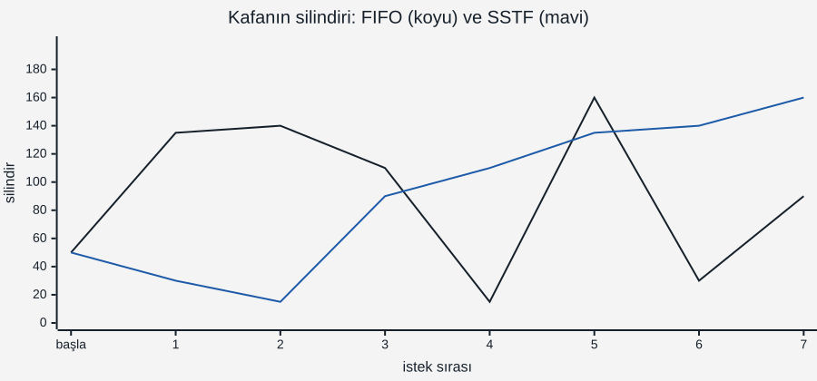

# İşletim Sistemleri: G/Ç Aygıtları, Disk ve Disk Zamanlama

1. haftada dersin üç büyük kavramını saymıştık: sanallaştırma, eşzamanlılık, **kalıcılık**. İlk ikisini bitirdik. Bellekteki her şey bilgisayar kapanınca kaybolur; kalıcılık, verinin **kapandıktan sonra da** yerinde durmasıdır. Bunun için işletim sistemi disk gibi aygıtlarla konuşmak zorundadır. Bu hafta üç soruya cevap arıyoruz: işletim sistemi bir aygıtla **nasıl konuşur**, bir disk isteği **neden bu kadar yavaştır** ve bekleyen istekler **hangi sırayla** karşılanmalıdır?

Bu haftanın C örneği yok. Gösterimler WSL'de iki komutla ve OSTEP'in `disk.py` simülatörüyle yapılıyor.

---

## 1. Basit Bir Aygıt Modeli

Her aygıtın iki yüzü vardır:


- **Arayüz:** İşletim sisteminin gördüğü kısım. Çoğu aygıtta üç yazmaçtan oluşur: **durum** (aygıt meşgul mü?), **komut** (ne yapılacak?) ve **veri** (aygıta gidecek ya da aygıttan gelen veri).
- **İç yapı:** Aygıtın kendi işi: bir mikrodenetleyici, kendi belleği, özel yongalar. Bugünkü bir diskin içinde koca bir program çalışır; işletim sistemi bunu görmez.

İşletim sisteminin bir aygıta iş yaptırma protokolü dört adımdır:

```
while (DURUM == MEŞGUL)
    ;                       /* 1. aygıt boşalana kadar bekle */
VERİ yazmacına veriyi yaz   /* 2. */
KOMUT yazmacına komutu yaz  /* 3. aygıt çalışmaya başlar */
while (DURUM == MEŞGUL)
    ;                       /* 4. aygıt bitirene kadar bekle */
```

Bu protokolde iki israf var: 1. ve 4. adımlarda **dönerek bekleme** (9. haftanın dönen kilidi gibi), 2. adımda ise veriyi **işlemcinin** tek tek kopyalaması.

---

## 2. Sorgulama ve Kesme

**Sorgulama** (polling), durum yazmacına tekrar tekrar bakmaktır — yukarıdaki `while` döngüleri. Aygıt yavaşsa işlemci bu sürede başka hiçbir şey yapamaz.

**Kesme** (interrupt) bunu çözer: işletim sistemi komutu verir, isteği yapan prosesi **bloke** eder ve işlemciyi başka bir prosese verir. Aygıt işini bitirince donanım bir kesme üretir; çekirdekteki **kesme işleyicisi** çalışır, bekleyen prosesi uyandırır. 1. haftanın `SWITCH_ON_IO` kazancı tam olarak budur: G/Ç ile işlemci **örtüşür**.

Ama kesme her zaman daha iyi değildir:

| Durum | Daha iyi olan | Neden |
| ----- | ------------- | ----- |
| Aygıt yavaş (sabit disk, klavye) | **Kesme** | Beklerken işlemci başka iş yapar |
| Aygıt çok hızlı (iş neredeyse anında bitiyor) | **Sorgulama** | Kesmenin bedeli — bağlam değişimi, işleyici — beklemekten pahalı |
| Hızı bilinmiyor | **Karma** | Kısa bir süre sorgula, bitmediyse kesmeye geç |

Karma yaklaşım 9. haftanın **iki aşamalı kilidiyle** aynı fikirdir: önce kısa bir süre dön, sonra uyu.

Bir de **kesme fırtınası** tehlikesi vardır: çok hızlı paket alan bir ağ kartı her paket için kesme üretirse işlemci yalnızca kesme işlemekten başka bir şey yapamaz. Çözüm, birkaç olayı tek kesmede **birleştirmek** ya da yükte sorgulamaya geçmektir.

**Gösterim:** WSL'de `cat /proc/interrupts` her kesme kaynağının her çekirdekte kaç kez kesme ürettiğini gösterir. Komutu birkaç saniye arayla iki kez çalıştırın: sayılar sürekli artar.

---

## 3. DMA: Veriyi İşlemci Taşımasın

Protokolün 2. adımında işlemci veriyi aygıta bayt bayt kopyalar. 4 KB'lık bir blok için bu, binlerce gereksiz komut demektir. **DMA** (Direct Memory Access, doğrudan bellek erişimi) denetleyicisi bu işi devralır:

1. İşletim sistemi DMA denetleyicisine "bellekteki şu adresten şu kadar veriyi şu aygıta aktar" der.
2. İşlemci başka işe geçer.
3. Aktarım bitince DMA denetleyicisi bir **kesme** üretir.

Kesme 1. ve 4. adımlardaki beklemeyi, DMA 2. adımdaki kopyalamayı işlemcinin üzerinden alır.

### Aygıt sürücüsü

Her aygıtın arayüzü farklıdır; bir dosya sistemi her disk modelinin yazmaçlarını bilemez. Bu ayrıntıyı **aygıt sürücüsü** (device driver) gizler: çekirdeğin, belirli bir aygıtla konuşmayı bilen parçası. Üst katmanlar yalnızca "şu bloğu oku" der. 1. haftanın **soyutlama** fikri burada da işler. Bedeli kod miktarıdır: OSTEP'e göre Linux çekirdeğinin kodunun **%70'inden fazlası** sürücülerdir — ve çekirdek çökmelerinin büyük kısmı da oradan gelir.

---

## 4. Sabit Disk

Bir sabit disk (HDD), üst üste duran ve sürekli dönen **plaklardan** oluşur. Her plakta iç içe halkalar, yani **izler** (track) vardır; her iz **sektörlere** bölünmüştür (çoğunlukla 512 bayt ya da 4 KB). Bir **kol**, ucundaki **okuma-yazma kafasını** izler arasında taşır.

Bir sektörü okumak üç adımdır:


> **G/Ç süresi = arama süresi + dönme gecikmesi + aktarım süresi**

- **Arama** (seek): Kolun kafayı doğru ize götürmesi. Mekanik bir hareket; milisaniyeler sürer.
- **Dönme gecikmesi** (rotational delay): Doğru sektörün dönerek kafanın altına gelmesini beklemek. Ortalama yarım tur.
- **Aktarım** (transfer): Sektör kafanın altından geçerken verinin okunması.

### Hesap: rastgele mi, sıralı mı?

Örnek bir disk: **7200 RPM**, ortalama arama **9 ms**, aktarım hızı **150 MB/s**.

| Adım | Hesap | Sonuç |
| ---- | ----- | ----- |
| Bir tur | 60 000 ms / 7200 | 8,333 ms |
| Ortalama dönme gecikmesi | yarım tur | 4,167 ms |
| 4 KB aktarım | 4 KB / 150 MB/s | 0,026 ms |
| **Rastgele bir 4 KB okuma** | 9 + 4,167 + 0,026 | **≈ 13,19 ms** |
| Rastgele okumada verim | 4 KB / 13,19 ms | **≈ 0,30 MB/s** |
| **Sıralı 100 MB okuma** | 9 + 4,167 + 100 MB / 150 MB/s | ≈ 680 ms → **≈ 147 MB/s** |

Aynı disk, okuma deseni değişince **yaklaşık 500 kat** farklı hızda çalışıyor. Rastgele okumada zamanın %99'undan fazlası mekanik beklemeye gidiyor; veri aktarımı neredeyse bedava. Diskle ilgili bütün tasarımların — dosya sistemleri dahil — temel kuralı buradan çıkar: **mümkünse sıralı oku ve yaz.**

---

## 5. Disk Zamanlama

Diske aynı anda birçok istek gelir. Bunları geliş sırasıyla mı, yoksa başka bir sırayla mı karşılamalıyız? 3. haftanın sorusu, bu kez bir işlemci yerine dönen bir plak için. Ölçüt: **kafanın toplam yolu** (kaç silindir hareket ettiği) — arama süresi buna bağlıdır.

**Örnek:** Disk 0–199 numaralı silindirlerden oluşuyor. Kafa **50**'de. Kuyruk geliş sırasıyla: **135, 140, 110, 15, 160, 30, 90**.

### 5.1 FIFO

Geliş sırasıyla:

| Gidiş | 50→135 | 135→140 | 140→110 | 110→15 | 15→160 | 160→30 | 30→90 | **Toplam** |
| ----- | :----: | :-----: | :-----: | :----: | :----: | :----: | :---: | :--------: |
| Yol | 85 | 5 | 30 | 95 | 145 | 130 | 60 | **550** |

Adil ama kafa diskin bir ucundan öbürüne boşuna gidip geliyor.

### 5.2 SSTF: en yakın iş önce

**SSTF** (Shortest Seek Time First) her adımda kafaya **en yakın** isteği seçer — 3. haftanın SJF'sinin disk karşılığı.

| Gidiş | 50→30 | 30→15 | 15→90 | 90→110 | 110→135 | 135→140 | 140→160 | **Toplam** |
| ----- | :---: | :---: | :---: | :----: | :-----: | :-----: | :-----: | :--------: |
| Yol | 20 | 15 | 75 | 20 | 25 | 5 | 20 | **180** |



FIFO'nun üçte biri. Ama SJF gibi bir sorunu var: **aç kalma**. Kafanın çevresine sürekli yeni istekler gelirse uzaktaki bir istek hiç karşılanmayabilir. Ayrıca işletim sistemi diskin içini (hangi bloğun hangi izde olduğunu) tam bilmez; "en yakın" yaklaşık olarak blok numarasıyla hesaplanır.

### 5.3 SCAN ve LOOK: asansör

**SCAN** kafayı bir asansör gibi hareket ettirir: bir yönde **diskin ucuna kadar** gider, yolundaki istekleri karşılar, sonra döner. Kafa başta **yukarı** (büyük silindirlere doğru) gidiyor olsun:

| Gidiş | 50→90 | 90→110 | 110→135 | 135→140 | 140→160 | 160→199 | 199→30 | 30→15 | **Toplam** |
| ----- | :---: | :----: | :-----: | :-----: | :-----: | :-----: | :----: | :---: | :--------: |
| Yol | 40 | 20 | 25 | 5 | 20 | 39 | 169 | 15 | **333** |

Kısaca: (199 − 50) + (199 − 15) = 149 + 184 = 333.

**LOOK**, SCAN'in akıllı halidir: diskin ucuna değil, o yöndeki **son isteğe** kadar gider:

> LOOK = (160 − 50) + (160 − 15) = 110 + 145 = **255**

Asansör aç kalmayı önler: her istek, kafa en fazla bir gidiş-dönüş yaptığında karşılanır. Bu örnekte SSTF'den daha uzun yol alıyor — adalet bedavaya gelmiyor. Başlangıç yönü de önemlidir: SCAN önce **aşağı** gitseydi toplam 210 olurdu.

### 5.4 C-SCAN: tek yönlü asansör

SCAN'de diskin ortasındaki silindirler iki kez (gidişte ve dönüşte), uçtakiler bir kez hizmet alır. **C-SCAN** (dairesel SCAN) yalnızca **bir yönde** hizmet verir: uca varınca istek karşılamadan başa **atlar** ve aynı yönde devam eder.

| Gidiş | 50→90 | … → 160 | 160→199 | 199→0 (atlama) | 0→15 | 15→30 | **Toplam** |
| ----- | :---: | :-----: | :-----: | :------------: | :--: | :---: | :--------: |
| Yol | 40 | 70 | 39 | 199 | 15 | 15 | **378** |

Atlama hareketi sayılmazsa 179'dur; kaynaklar bu konuda farklı davranır, sınavda soru hangisini istediğini söyler. Aynı fikrin LOOK'lu hali **C-LOOK**'tur: son isteğe kadar git, en küçük isteğe atla.

| Algoritma | Toplam yol | Aç kalma | Not |
| --------- | :--------: | :------: | --- |
| FIFO | 550 | Yok | Adil, verimsiz |
| SSTF | **180** | **Var** | 3. haftanın SJF'si |
| SCAN (yukarı) | 333 | Yok | Uca kadar |
| LOOK (yukarı) | 255 | Yok | Son isteğe kadar |
| C-SCAN | 378 (atlama dahil) | Yok | Tek yön, daha eşit bekleme |

---

## 6. Dönme de Önemli: SATF

Kafanın en az yol alması, isteğin en kısa sürede bitmesi demek değildir: arama süresi kadar **dönme gecikmesi** de vardır. **SATF** (Shortest Access Time First) her adımda arama **ve** dönme süresini birlikte hesaplar ve **toplam erişim süresi** en kısa isteği seçer.

OSTEP'in `disk.py` simülatörü küçük bir disk modeller: 3 iz, her izde 12 sektör (dış iz 0–11, orta 12–23, iç 24–35); kafa dış izde, 6. sektörün ortasında başlar; bir izden komşu ize arama 40 birim, tam bir tur 360 birim, bir sektörün aktarımı 30 birim sürer. İstekler 11, 20 ve 1. bloklar:

```
python disk.py -a 11,20,1 -p FIFO -c
python disk.py -a 11,20,1 -p SSTF -c
python disk.py -a 11,20,1 -p SATF -c
```

| Politika | Sıra | Arama | Dönme | Aktarım | **Toplam** |
| -------- | ---- | :---: | :---: | :-----: | :--------: |
| FIFO | 11, 20, 1 | 80 | 415 | 90 | **585** |
| SSTF | 11, 1, 20 | **40** | 305 | 90 | **435** |
| SATF | 20, 11, 1 | 80 | **55** | 90 | **225** |

SSTF kafayı en az hareket ettirdi (arama 40), ama dönmeyi beklerken 305 birim harcadı. SATF iki kat arama yaptı, buna karşın doğru sektörü hemen yakaladı ve en kısa sürede bitirdi. Bugünkü disklerde arama ile dönme süreleri aynı büyüklüktedir; ikisini birlikte hesaplamak gerekir.

SATF için diskin iç yapısını (sektörlerin nerede olduğunu) bilmek gerekir. İşletim sistemi bunu bilmez; bu yüzden SATF genellikle **diskin kendi içinde** çalışır. İşletim sistemi birkaç isteği birlikte gönderir, disk kendi sırasını seçer.

---

## 7. Bugünün Sistemleri

Linux birkaç disk zamanlayıcısı sunar ve her disk için hangisinin kullanıldığı bir dosyada yazar:

```
cat /sys/block/sda/queue/scheduler
[none] mq-deadline kyber
```

Köşeli parantezdeki seçilidir. `mq-deadline` her isteğe bir **son tarih** verir ve sırayı verime göre kurarken süresi dolan isteği öne alır (aç kalmaya karşı); `bfq` prosesler arasında adil pay dağıtır; `none` hiçbir şey yapmaz.

### SSD: hareketli parça yok

**SSD** (katı hal diski) veriyi flaş bellek yongalarında tutar; kol yok, plak yok, dolayısıyla **arama ve dönme yok**. Rastgele okuma ile sıralı okuma arasındaki fark HDD'deki yüzlerce kat yerine birkaç kata iner. Kafa yolunu kısaltmaya çalışan zamanlayıcıların burada kazandıracağı bir şey yoktur; SSD'lerde zamanlayıcı çoğunlukla `none` seçilir. SSD'nin kendi sorunları vardır (bir bloğu yazmadan önce silmek gerekir, her blok sınırlı sayıda silinebilir); bunlar bu dersin kapsamı dışında.

---

## 8. RAID: Birçok Disk, Tek Disk Gibi

Tek bir disk hem yavaştır hem bozulabilir. **RAID** (Redundant Array of Inexpensive Disks), birkaç diski işletim sistemine **tek bir disk** gibi gösterir. Arkadaki düzenleme farklı hedefler için seçilir. Dört diskte üç düzey:



- **RAID 0 (şeritleme):** Bloklar disklere sırayla dağıtılır. Dört disk aynı anda çalışır; hızlıdır ama **hiç yedek yok**: tek bir disk bozulursa veri gider.
- **RAID 1 (aynalama):** Her blok iki diske yazılır. Bir disk bozulunca kopyası kalır; bedeli kapasitenin yarısıdır.
- **RAID 5 (dağıtılmış eşlik):** Her şeritte bir blok **eşlik** (parity) tutar: diğer blokların XOR'u. Bir disk bozulunca kalanlardan yeniden hesaplanır. Eşlik blokları disklere sırayla dağıtılır.

Dört adet 1 TB diskle:

| Düzey | Kullanılabilir kapasite | Kaç disk arızasına dayanır | Not |
| ----- | :---------------------: | :------------------------: | --- |
| RAID 0 | 4 TB | 0 | En hızlı, en riskli |
| RAID 1 | 2 TB | 1 (doğru çiftlerden 2) | Basit, pahalı |
| RAID 5 | 3 TB | 1 | Küçük rastgele yazma yavaş: eski veri ve eşlik okunur, ikisi yazılır — 4 G/Ç |

RAID yedekleme değildir: yanlışlıkla silinen bir dosya bütün kopyalardan birden silinir.

---

## 9. Sık Yapılan Hatalar

- **"Disk hızı = aktarım hızı."** Rastgele okumada zaman aramaya ve dönmeye gider; aktarım binde birdir.
- **Dönme gecikmesini tam tur almak.** Ortalama **yarım** turdur.
- **SSTF'de başlangıç konumunu unutmak.** İlk adım kafanın bulunduğu yerden ölçülür.
- **SCAN ile LOOK'u karıştırmak.** SCAN diskin **ucuna** kadar gider, LOOK son **isteğe** kadar.
- **C-SCAN'de atlamayı sormadan saymak ya da saymamak.** Soruda belirtilmiş olana bakın.
- **"En az kafa hareketi = en kısa süre."** Dönme gecikmesi de var: SATF.
- **"RAID 1 yedektir."** Aynı anda bozulmaya karşı korur, silmeye karşı korumaz.

---

## 10. Kendinizi Sınayın

Cevaplar verilmez. Disk zamanlama sorularını tablo olarak çözün; `disk.py` sorularını `-c` ile kontrol edin (komutlar `file-disks` klasöründe).

1. Bölüm 5'teki kuyruğu kafa **100**'deyken FIFO, SSTF, SCAN (yukarı) ve LOOK (yukarı) için çözün.
2. Aynı kuyrukta SCAN başta **aşağı** gitseydi toplam 210 olurdu. Tabloyu yazarak doğrulayın.
3. 15 000 RPM'lik bir diskte ortalama dönme gecikmesi kaç ms'dir? Ortalama arama 4 ms, aktarım 200 MB/s ise rastgele bir 4 KB okuma kaç ms sürer?
4. `python disk.py -a 0,6,30 -c` için arama, dönme ve aktarım sürelerini elle bulun. Sonra `-p SATF` ile karşılaştırın.
5. `python disk.py -a 7,30,8 -p SSTF` ile `-p SATF` aynı sırayı mı seçiyor? Neden?
6. Dört diskli RAID 5'te 2. disk bozuldu. A5 bloğu nasıl okunur? Hangi diskler okunmak zorunda?
7. SSTF'nin aç bıraktığı bir istek dizisi kurun: kafa 50'de, 190'a bir istek var; sonraki istekler nasıl gelirse 190 hiç karşılanmaz?

---

## İleri Okuma

- OSTEP, 36. bölüm — *I/O Devices*: <https://pages.cs.wisc.edu/~remzi/OSTEP/file-devices.pdf>
- OSTEP, 37. bölüm — *Hard Disk Drives*: <https://pages.cs.wisc.edu/~remzi/OSTEP/file-disks.pdf>
- OSTEP, 38. bölüm — *Redundant Arrays of Inexpensive Disks (RAIDs)*: <https://pages.cs.wisc.edu/~remzi/OSTEP/file-raid.pdf>

---

## Sonraki Konu

Disk bir blok dizisidir: "1234 numaralı bloğu oku". Ama biz dosyalarla ve klasörlerle çalışırız: `/home/ogrenci/notlar.txt`. Bir sonraki konuda bu ikisi arasındaki katmanı kuracağız: **dosya sistemi**. Bir dosyanın adı, boyutu ve bloklarının nerede olduğu nerede tutulur (*inode*)? Klasör nedir? Bir yazma işleminin ortasında elektrik kesilirse dosya sistemi nasıl tutarlı kalır? Cevap: **günlükleme**.

---

*Öğr. Gör. Turgay Taymaz · Afyon Kocatepe Üniversitesi*
*Bu materyal CC BY-NC-SA 4.0 ile lisanslanmıştır. Kullanırken kaynak gösteriniz.*
*Kaynak: https://github.com/ttaymaz/ders-notlari*
