# İşletim Sistemleri: Dosya Sistemleri ve Günlükleme

Geçen hafta diski bir **blok dizisi** olarak gördük: "1234 numaralı bloğu oku". Oysa biz dosyalarla çalışırız: `/home/ogrenci/notlar.txt`. Bu ikisi arasındaki katman **dosya sistemidir**. Bu hafta üç soruya cevap arıyoruz: bir dosyanın adı, boyutu ve blokları **nerede** tutulur? Bir dosyayı açmak ve okumak diske **kaç** erişim gerektirir? Bir yazma işleminin ortasında elektrik kesilirse dosya sistemi nasıl **tutarlı** kalır?

Bu haftanın C örneği `kod/` klasöründedir. Bağlarla ilgili gösterimler WSL'de kabuk komutlarıyla yapılıyor.

---

## 1. Dosya ve Klasör

İşletim sisteminin sunduğu iki soyutlama:

- **Dosya:** Bir bayt dizisi. Dosya sistemi içeriğin ne olduğunu bilmez ve umursamaz; bir resim de bir metin de baytlardır. Her dosyanın düşük düzeyli bir adı vardır: **inode numarası**. Dosyanın bütün bilgileri — boyutu, sahibi, izinleri, bloklarının yeri — bu numaralı **inode**'da durur.
- **Klasör** (dizin): O da bir dosyadır, ama içeriği belirlidir: **(ad, inode numarası)** çiftlerinden oluşan bir liste.

Buradan şaşırtıcı bir sonuç çıkar: **dosyanın adı dosyanın içinde değildir**, onu içeren klasördedir. Bir dosyanın birden fazla adı olabilir.

WSL'de görmek için:

```
$ echo merhaba > a
$ ls -i a
9150 a
$ stat -c "%n inode=%i bağ=%h boyut=%s" a
a inode=9150 bağ=1 boyut=8
```

`ls -i` inode numarasını, `stat` inode'daki bilgileri gösterir.

---

## 2. Dosya API'si

`kod/01-dosya-api.c` bir dosyayı açar, yazar, içinde gezinir ve okur:

```c
int fd = open("deneme.txt", O_CREAT | O_TRUNC | O_RDWR, 0644);
write(fd, "merhaba dunya", 13);
lseek(fd, 8, SEEK_SET);            /* konumu 8. bayta taşı */
read(fd, tampon, 5);               /* "dunya" */
int fd2 = open("deneme.txt", O_RDONLY);
read(fd2, tampon, 7);              /* "merhaba" — kendi konumu 0'dan */
```

```
open   → dosya tanımlayıcı 3
write  → 13 bayt yazıldı, konum artık 13
read   → 0 bayt okundu (konum dosyanın sonunda)
lseek 8, read 5 → "dunya"
ikinci open → 4, kendi konumu 0'dan: "merhaba"
```

- `open` bir **dosya tanımlayıcı** (file descriptor) döndürür: prosesin açık dosyalar tablosundaki bir sıra numarası. 0, 1 ve 2 her prosese baştan açık gelir — standart girdi, çıktı ve hata. Bu yüzden ilk açılan dosya **3**'tür. 2. haftada `dup2` ile çıktıyı dosyaya yönlendirirken değiştirdiğimiz tablo budur; 1. haftanın `struct proses` yapısındaki `acik_dosyalar` alanı da.
- Her açık dosyanın bir **konumu** vardır. `write` ve `read` kaldığı yerden devam eder; `lseek` konumu değiştirir. Aynı dosyayı iki kez açmak iki ayrı konum verir.
- `write` döndüğünde veri büyük olasılıkla henüz diskte **değildir**; işletim sistemi onu bellekte bir süre tutar ve sonra toplu yazar (12. haftanın "sıralı yaz" kuralı). Verinin hemen diske gitmesi gerekiyorsa `fsync(fd)` çağrılır. Veritabanları her işlemi kesinleştirirken bunu yapar.

`strace -e trace=openat,write,lseek,read,close ./01-dosya-api.out` ile programın yaptığı sistem çağrılarını görebilirsiniz.

### Bağlar ve `rm`'nin sırrı

```
$ echo merhaba > a
$ ln a b              # sert bağ: aynı inode'a ikinci ad
$ ln -s a c           # sembolik bağ: "a" adını tutan ayrı bir dosya
$ ls -li a b c
9150 -rw-r--r-- 2 ... a
9150 -rw-r--r-- 2 ... b
9151 lrwxrwxrwx 1 ... c -> a
$ rm a
$ cat b
merhaba
$ cat c
cat: c: No such file or directory
```

- `a` ve `b` **aynı inode'u** (9150) gösteriyor; ikisi eşit iki addır. Üçüncü sütun **bağ sayısı**dır: 2.
- `rm a` dosyayı silmez; `unlink` sistem çağrısıyla yalnızca **bir adı** siler ve bağ sayısını bir azaltır. Dosyanın kendisi, bağ sayısı **0**'a inince (ve onu açık tutan proses kalmayınca) silinir. Bu yüzden `b` hâlâ okunur.
- `c` bir **sembolik bağ**dır: kendi inode'u (9151) olan, içinde yalnızca `"a"` **adını** tutan küçük bir dosya. Ad silinince sembolik bağ boşa düşer. Sembolik bağ klasörleri de gösterebilir ve başka bir dosya sistemine uzanabilir; sert bağ ikisini de yapamaz.

---

## 3. VSFS: Çok Basit Bir Dosya Sistemi

OSTEP'in öğretim için tasarladığı küçük dosya sistemi. 64 bloklu (4 KB'lık bloklar) küçük bir diske yerleşimi:


| Bölge | Ne tutar |
| ----- | -------- |
| **Süperblok** | Dosya sisteminin kendisi hakkında bilgi: kaç inode, kaç veri bloğu, inode tablosu nerede başlıyor |
| **inode bitmap'i** | Her inode için bir bit: 1 kullanımda, 0 boş |
| **Veri bitmap'i** | Her veri bloğu için bir bit |
| **inode tablosu** | inode'ların kendisi. 5 blok × 4 KB, inode başına 256 bayt → **80 inode** |
| **Veri blokları** | Dosyaların ve klasörlerin içerikleri: 56 blok |

### inode'un içi



Bir inode dosya hakkındaki her şeyi tutar — **adı hariç**: tür (dosya mı, klasör mü), boyut, bağ sayısı, sahip, izinler, erişim ve değişiklik zamanları ve dosyanın bloklarının **nerede** olduğu. Blok yerleri **işaretçilerle** tutulur:

- **Doğrudan işaretçiler:** Doğrudan bir veri bloğunu gösterir. Küçük dosyalar için yeterlidir.
- **Dolaylı işaretçi:** İçi işaretçilerle dolu bir bloğu gösterir. 4 KB'lık bir blok 4 baytlık işaretçiden **1024** tane tutar.

**Hesap — en büyük dosya:** 12 doğrudan ve 1 tek dolaylı işaretçi, 4 KB blok, 4 baytlık işaretçi:

| Kısım | Hesap | Boyut |
| ----- | ----- | :---: |
| Doğrudan | 12 × 4 KB | 48 KB |
| Tek dolaylı | 1024 × 4 KB | 4096 KB = 4 MB |
| **Toplam** | 48 KB + 4096 KB | **4144 KB ≈ 4 MB** |

Bir **çift dolaylı** işaretçi eklenirse (işaretçi bloklarını gösteren bir işaretçi bloğu) 1024 × 1024 × 4 KB = **4 GB** daha gelir. Bu dengesiz tasarımın gerekçesi gözlemdir: **dosyaların çoğu küçüktür**. Küçük dosya hiç dolaylı bloğa ihtiyaç duymadan hızla okunur; büyük dosya ek bir okuma bedelini öder.

---

## 4. Bir Dosyayı Açmak ve Okumak

`/home/ogrenci/notlar.txt` dosyasını açmak için dosya sistemi yolu **adım adım çözer**. Kök klasörün inode numarası bilinir (çoğu Unix dosya sisteminde 2):


Bellekte önbellek **yokken**, her klasör için önce inode'u (verisi nerede?), sonra veri bloğu (içinde aradığım ad hangi inode'a karşılık geliyor?) okunur.

| İşlem | Disk erişimleri | Okuma | Yazma |
| ----- | --------------- | :---: | :---: |
| `open("/home/ogrenci/notlar.txt")` | kök inode, kök veri, home inode, home veri, ogrenci inode, ogrenci veri, notlar inode | **7** | 0 |
| `read(fd, ..., 4096)` — ilk blok | notlar inode (blok nerede?), veri bloğu; inode'a erişim zamanı yazılır | 2 | 1 |

Yol ne kadar derinse açmak o kadar pahalıdır. Gerçek sistemlerde sık kullanılan inode'lar ve klasör blokları **bellekte önbelleğe** alınır; ikinci açılış neredeyse hiç disk erişimi gerektirmez.

### Yeni bir dosya oluşturmak

`/home/ogrenci/yeni.txt` oluşturmak daha da pahalıdır:

| Adım | Okuma | Yazma |
| ---- | :---: | :---: |
| Yolu çöz: kök, home, ogrenci (inode + veri) — aynı adda dosya var mı? | 6 | |
| inode bitmap'inden boş bir inode bul ve işaretle | 1 | 1 |
| ogrenci klasörünün veri bloğuna (yeni.txt, inode) girişini ekle | | 1 |
| Yeni inode'u oku ve başlat | 1 | 1 |
| ogrenci klasörünün inode'unu güncelle (boyut, zaman) | | 1 |
| **Toplam** | **8** | **4** |

Tek bir `creat` için 12 disk erişimi, ve henüz tek bayt veri yazılmadı.

---

## 5. Elle İzleme: `vsfs.py`

OSTEP'in `vsfs.py` simülatörü 8 inode ve 8 veri bloğu olan minik bir VSFS üzerinde işlemler yapar ve her işlemden sonra durumu yazdırır (kurulum: [Çalışma Ortamı](../00-calisma-ortami/not.md), klasör `file-implementation`). Gösterim:

- `inode bitmap 11000000` — 0 ve 1 numaralı inode'lar kullanımda
- `[d a:0 r:2]` — **d**: klasör (**f**: dosya), **a:0**: verisi 0 numaralı blokta (`a:-1`: henüz bloğu yok), **r:2**: bağ sayısı 2
- `[(.,0) (..,0) (t,1)]` — bir klasörün veri bloğu: (ad, inode) çiftleri

```
python vsfs.py -s 5 -n 4 -c
```

Başlangıçta yalnızca kök klasör vardır (inode 0, veri bloğu 0):

```
inode bitmap  10000000
inodes       [d a:0 r:2][][][][][][][]
data bitmap   10000000
data         [(.,0) (..,0)][][][][][][][]
```

| İşlem | inode bitmap | Değişen inode'lar | data bitmap | Değişen veri blokları |
| ----- | :----------: | ----------------- | :---------: | --------------------- |
| `mkdir("/t")` | 11000000 | kök `r:3` (alt klasörün `..`'su köke işaret ediyor) · inode 1 `[d a:1 r:2]` | 11000000 | blok 0'a `(t,1)` · blok 1 `[(.,1) (..,0)]` |
| `creat("/y")` | 11100000 | inode 2 `[f a:-1 r:1]` — boş dosya, bloğu yok | 11000000 | blok 0'a `(y,2)` |
| `link("/y", "/t/c")` | 11100000 | inode 2 `r:2` — yeni inode yok | 11000000 | blok 1'e `(c,2)` |
| `/t/c`'ye bir blok yaz | 11100000 | inode 2 `[f a:2 r:2]` | 11100000 | blok 2 `[o]` (veri) |

Dikkat edilecek üç nokta:

- `mkdir` **iki** bağ sayısını değiştirir: yeni klasörün `r:2`'si (kendi `.`'su ve üst klasördeki adı), kökün `r:3`'ü (yeni klasördeki `..`).
- `link` yeni inode **ayırmaz**; yalnızca bir klasöre yeni bir (ad, inode) girişi ekler ve bağ sayısını artırır.
- Son işlem dosyaya `/t/c` adıyla yazdı, ama değişen inode yine 2: `/y` ile `/t/c` aynı dosyadır.

Simülatörü `-r` seçeneğiyle çalıştırırsanız soru tersine döner: size durumlar verilir, hangi işlemin yapıldığını siz bulursunuz.

---

## 6. Çökme Tutarlılığı

Bir dosyanın sonuna bir blok eklemek **üç** ayrı yazma ister:

1. **Veri bitmap'i:** yeni blok "kullanımda" işaretlenir
2. **inode:** yeni bloğun işaretçisi eklenir, boyut artar
3. **Veri bloğu:** verinin kendisi

Disk bunları tek tek yazar. Elektrik ikisinin arasında kesilirse — **çökme** — disk yarım bir güncelleme ile kalır. Yalnızca biri yazılmışsa:

| Yalnızca bu yazıldı | Sonuç |
| ------------------- | ----- |
| Veri bloğu | Sorun yok gibi: blok kimseye ait değil, bitmap'te boş. Yazılan veri kayboldu ama dosya sistemi tutarlı |
| inode | inode bir bloğu gösteriyor ama orada **eski çöp** var; bitmap de bloğu boş sanıyor → **tutarsız** |
| Veri bitmap'i | Blok kullanımda işaretli ama hiçbir inode onu göstermiyor → **sızıntı**, blok bir daha kullanılamaz |

İkisi yazılmışsa da benzer tutarsızlıklar oluşur (örneğin inode ve bitmap yazıldı, veri yazılmadı: dosyada çöp okunur). İstediğimiz şey: üç yazmanın **ya hepsi ya hiçbiri** — 9. haftanın **atomiklik** kavramı, bu kez disk için.

### `fsck`: sonra tara ve onar

İlk çözüm: çökmeye izin ver, yeniden açılışta bütün diski tara. `fsck` (file system check) şunları denetler: süperblok makul mü, bitmap'ler inode'larla uyuşuyor mu, her inode'un bağ sayısı onu gösteren klasör girişlerinin sayısına eşit mi, iki inode aynı bloğu gösteriyor mu?

`fsck` doğru çalışır ama **yavaştır**: süresi diskin boyutuyla büyür. Birkaç terabaytlık bir diskte saatler sürebilir — bütün bir evi, bir odadaki tek dağınıklığı bulmak için baştan sona aramak gibi.

### Günlükleme: önce not al, sonra yap

**Günlükleme** (journaling, yazmadan önce kaydetme): diske asıl yerine yazmadan önce, ne yapılacağını diskin ayrı bir bölgesine — **günlüğe** — yazmak.



1. **Günlüğe yaz:** Bir işlem başlangıcı (**TxB**), yazılacak blokların (inode, bitmap, veri) kopyaları.
2. **Kesinleştir** (commit): İşlem sonu (**TxE**) bloğu yazılır. TxE tek bir sektör olacak şekilde seçilir; disk tek sektörü atomik yazar.
3. **Asıl yerine yaz** (checkpoint): Bloklar normal yerlerine yazılır.
4. Günlükteki kayıt **serbest bırakılır**.

Çökmeden sonra açılışta yalnızca **günlüğe** bakılır, bütün diske değil:

- TxE **yoksa** (1. adımda çöktü): işlem hiç olmamış sayılır, günlük kaydı atılır. Asıl yerlerde hiçbir şey değişmemişti.
- TxE **varsa** (2. adımdan sonra çöktü): günlükteki bloklar asıl yerlerine **yeniden yazılır** (yeniden oynatma, *replay*). Aynı bloğu iki kez yazmak zarar vermez.

Kurtarma süresi diskin boyutuna değil, **günlüğün** boyutuna bağlıdır: saniyeler.

**Bedeli:** Her blok **iki kez** yazılır — bir günlüğe, bir asıl yerine. Bu yüzden çoğu sistem yalnızca **üst veriyi** (inode, bitmap, klasör blokları) günlüğe yazar; verinin kendisi doğrudan asıl yerine yazılır. Sıra önemlidir: **önce veri** asıl yerine yazılır, **sonra** onu gösteren üst veri günlüğe. Böylece bir inode hiçbir zaman çöp bir bloğu göstermez. Linux'un ext4 dosya sisteminin varsayılan kipi (`data=ordered`) budur.

Başka bir yaklaşım, **log yapılı dosya sistemleri**dir (LFS): diskteki hiçbir şeyin üzerine yazılmaz, her değişiklik diskin sonuna eklenir. Eski kopyalar arka planda temizlenir. Bu yaklaşım bugün SSD'lerin içinde ve bazı dosya sistemlerinde yaşıyor; bu dersin kapsamı dışında.

---

## 7. Sık Yapılan Hatalar

- **"Dosyanın adı inode'da durur."** Ad klasördedir; inode adı bilmez.
- **"`rm` dosyayı siler."** `rm` bir **adı** siler. Dosya, bağ sayısı 0 olunca silinir.
- **Sert bağ ile sembolik bağı karıştırmak.** Sert bağ aynı inode'a ikinci ad; sembolik bağ, bir ad tutan ayrı bir dosya.
- **"`write` döndü, veri diskte."** Bellekte olabilir; emin olmak için `fsync`.
- **En büyük dosya hesabında dolaylı bloğun işaretçi sayısını unutmak.** Blok boyutu / işaretçi boyutu.
- **Yol çözümlemede inode'u atlamak.** Her klasör için önce inode, sonra veri bloğu.
- **"Günlükleme veriyi korur."** Yalnızca üst veri günlüğe yazılıyorsa, çökmede son yazılan veri kaybolabilir; korunan şey dosya sisteminin **tutarlılığıdır**.

---

## 8. Kendinizi Sınayın

Cevaplar verilmez. `vsfs.py` (klasör `file-implementation`) ve `fsck.py` (klasör `file-journaling`) sorularını `-c` ile kontrol edin.

1. Bir inode'da 10 doğrudan, 1 tek dolaylı ve 1 çift dolaylı işaretçi var; blok 1 KB, işaretçi 4 bayt. En büyük dosya kaç bayttır?
2. `/a/b/c/d.txt` dosyasını açmak, önbellek yokken kaç disk okuması gerektirir? Dosyanın ikinci bloğunu okumak?
3. `python vsfs.py -s 2 -n 5` için her işlemden sonraki durumu yazın. `unlink` işlemleri bağ sayılarını nasıl değiştiriyor?
4. `python vsfs.py -s 10 -n 5 -r` ile size durumlar verilir: hangi işlemlerin yapıldığını bulun.
5. `python fsck.py -s 0 -S 2` ve `-S 3` ile oluşturulan bozulmaları bulun. `fsck` bunları nasıl onarırdı?
6. Günlükleme sırasında TxE yazılırken çökme olursa ne olur? TxE neden tek bir sektör olmalıdır?
7. `ln a b; rm a` sonrası `b`'nin inode numarası ve bağ sayısı nedir? Aynısını `ln -s a b` ile yaparsanız?

---

## İleri Okuma

- OSTEP, 39. bölüm — *Files and Directories*: <https://pages.cs.wisc.edu/~remzi/OSTEP/file-intro.pdf>
- OSTEP, 40. bölüm — *File System Implementation*: <https://pages.cs.wisc.edu/~remzi/OSTEP/file-implementation.pdf>
- OSTEP, 42. bölüm — *Crash Consistency: FSCK and Journaling*: <https://pages.cs.wisc.edu/~remzi/OSTEP/file-journaling.pdf>

---

## Sonraki Konu

Dosya sistemi her dosyanın bir **sahibi** ve **izinleri** olduğunu inode'da tutuyor. Ama kim kimdir, kim neye erişebilir, ve bir proses başka bir prosesin belleğine ya da dosyasına erişmeye çalışırsa ne olur? Bir sonraki konuda dönemin başından beri adını andığımız bir kavrama döneceğiz: **koruma**. Kullanıcı ve çekirdek modundan dosya izinlerine, erişim denetiminden bir programın kendi sınırlarını aşmaya çalıştığı saldırılara kadar: **koruma ve güvenlik**.

---

*Öğr. Gör. Turgay Taymaz · Afyon Kocatepe Üniversitesi*
*Bu materyal CC BY-NC-SA 4.0 ile lisanslanmıştır. Kullanırken kaynak gösteriniz.*
*Kaynak: https://github.com/ttaymaz/ders-notlari*
