# İşletim Sistemleri: Koruma ve Güvenlik

Koruma bu dersin her haftasında vardı, ama adını hep geçerken andık. 2. haftada kullanıcı programının donanıma doğrudan dokunamadığını, 5. haftada bir prosesin başka bir prosesin belleğini göremediğini, 13. haftada her inode'un bir sahibi ve izinleri olduğunu gördük. Bu hafta bu parçaları bir araya getiriyoruz: işletim sistemi **kimin** sisteme girdiğini nasıl bilir, **kimin neye** erişebileceğine nasıl karar verir ve bir program kendi sınırlarını aşmaya çalışırsa ne olur?

Bu haftanın C örnekleri `kod/` klasöründedir. Gösterimler WSL'de yapılıyor. Konuların derinlemesine işlenişi son sınıfta, siber güvenlik ve kriptolojide.

---

## 1. Koruma ve Güvenlik

İki kelime çoğu zaman birbirinin yerine kullanılır ama ayrıdırlar:

- **Koruma** (protection): İşletim sisteminin **mekanizmaları** — bir prosesin, kullanıcının ya da programın yalnızca izin verilen kaynaklara erişebilmesini sağlayan araçlar.
- **Güvenlik** (security): **Politika** — kimin neye erişmesi gerektiği, kime karşı korunduğumuz ve bir şey ters giderse ne olacağı.

1. haftanın **mekanizma–politika** ayrımının bir örneği daha. Dönem boyunca gördüğümüz mekanizmalar:

| Hafta | Mekanizma | Neyi korur |
| :---: | --------- | ---------- |
| 2 | Kullanıcı ve çekirdek modu, tuzak tablosu | Donanımı ve çekirdeği kullanıcı programlarından |
| 2 | Zamanlayıcı kesmesi | İşlemciyi tek bir programın tekelinden |
| 5 | Taban ve sınır yazmaçları | Bir prosesin belleğini diğerlerinden |
| 6 | Sayfa tablosundaki koruma bitleri | Sayfaları yazmaya ya da çalıştırmaya karşı |
| 13 | inode'daki sahip ve izinler | Dosyaları başka kullanıcılardan |

### Üç hedef

Güvenlik genellikle üç hedefle tanımlanır:

- **Gizlilik** (confidentiality): Bilgiyi yalnızca görmesi gerekenler görür. Örnek: başka bir öğrencinin notlarını okuyamamak.
- **Bütünlük** (integrity): Bilgiyi yalnızca değiştirmesi gerekenler değiştirir. Örnek: kendi notunu değiştirememek.
- **Erişilebilirlik** (availability): Sistem, kullanması gerekenlere hizmet vermeye devam eder. Örnek: sınav sırasında sistemin çökmemesi.

### En az yetki ilkesi

Her program ve her kullanıcı, işini yapmak için gereken **en az** yetkiye sahip olmalıdır. Bir metin düzenleyicinin ağ ayarlarını değiştirmesine, bir web sunucusunun parola dosyasını okumasına gerek yoktur. Bir program ele geçirilirse saldırgan o programın yetkileriyle sınırlı kalır. Bu ilke, bu haftanın bütün konularının ortak noktasıdır.

---

## 2. Kimlik Doğrulama: Sen Kimsin?

Erişim kararı vermeden önce işletim sistemi isteği **kimin** yaptığını bilmelidir. Bunu öğrenmenin üç yolu vardır:

- **Bildiğin bir şey:** parola, PIN
- **Sahip olduğun bir şey:** telefon, akıllı kart, güvenlik anahtarı
- **Olduğun bir şey:** parmak izi, yüz

İkisini birlikte isteyen sistemlere **çok faktörlü** kimlik doğrulama denir: parola çalınsa bile telefon olmadan girilemez.

### Parolalar nasıl saklanır?

Parolalar diskte **düz metin olarak saklanmaz**. Saklansaydı, o dosyayı okuyabilen herkes — ya da çalınan bir yedek — bütün parolaları öğrenirdi. Bunun yerine parolanın **özeti** (hash) saklanır:



- **Özet fonksiyonu** tek yönlüdür: parola → özet kolay, özet → parola pratikte imkânsız. Girişte kullanıcının yazdığı parolanın özeti yeniden hesaplanır ve kayıtlı özetle karşılaştırılır. Sistem parolanın kendisini hiç bilmez.
- **Tuz** (salt): Her parolaya, özet alınmadan önce rastgele bir değer eklenir ve bu değer özetin yanına açıkça yazılır. Böylece iki kullanıcı aynı parolayı seçse bile özetleri farklı olur. Saldırgan "sık kullanılan parolaların hazır özet listesi"ni kullanamaz; her kullanıcı için ayrı hesap yapmak zorunda kalır.
- Parola özet fonksiyonları bilerek **yavaştır**: tek bir giriş için birkaç milisaniye fark edilmez, ama milyarlarca tahmini deneyen bir saldırganı ciddi biçimde yavaşlatır.

**Gösterim:** WSL'de `openssl passwd` komutu bir parolanın, verilen tuzla özetini üretir:

```
$ openssl passwd -6 -salt tuz1 deneme123
$6$tuz1$Jr5XmWrgb8dWUBfJa/FA3X.cWVlpSkQhk7z29TpKTA67ZGO0/O/c4ihvBMutXD5kLlsq6Si8k1grg4C3PLEHn0
$ openssl passwd -6 -salt tuz2 deneme123
$6$tuz2$wFeqB9IJs2GTlmKAOMF7j0u2xyKMIaZDai783PbJ0LWXZ/Y3hyi697Z/Xe5NPYb8i.18H6mNQhFcnCVBpP3HD0
```

Aynı parola, farklı tuz: tamamen farklı özet. Aynı komut aynı tuzla tekrar çalıştırılırsa aynı özet çıkar — girişte karşılaştırma bu sayede yapılır. Biçim `$algoritma$tuz$özet`'tir; `6` bir algoritmanın (SHA-512 tabanlı) numarasıdır.

Linux'ta bu satırlar `/etc/shadow` dosyasında durur:

```
$ ls -l /etc/passwd /etc/shadow
-rw-r--r-- 1 root root   1601 ... /etc/passwd
-rw-r----- 1 root shadow  897 ... /etc/shadow
```

`/etc/passwd` herkesçe okunur (kullanıcı adları, kullanıcı numaraları, ev klasörleri); özetler ise yalnızca `root`'un ve `shadow` grubunun okuyabildiği `/etc/shadow`'dadır. Özet bile olsa saklanır — en az yetki ilkesi.

---

## 3. Erişim Denetimi: Kim Neye Erişebilir?

Kimlik doğrulandıktan sonra her erişimde bir karar verilir: bu **özne** (kullanıcı ya da proses) bu **nesneye** (dosya, aygıt, bellek) bu **işlemi** (okuma, yazma, çalıştırma) yapabilir mi?

### Erişim matrisi

Bütün kararlar kuramsal olarak tek bir tabloyla gösterilebilir:



Gerçek bir sistemde bu matris çok büyüktür ve çoğu hücresi boştur. İki saklama yolu vardır:

- **Sütun sütun: ACL** (erişim denetim listesi). Her nesne, kimlerin ona ne yapabileceğinin listesini taşır. "not.txt'yi kim okuyabilir?" sorusu kolay; "ali neleri okuyabilir?" zor. Unix izinleri ve Windows'un dosya izinleri bu türdendir.
- **Satır satır: yetenek** (capability). Her özne, neye ne yapabileceğinin listesini — bir anahtarlık gibi — taşır. Anahtar elindeyse erişirsin. Dosya tanımlayıcı (13. hafta) küçük bir yetenektir: dosya bir kez açıldıktan sonra her `read` için izinler yeniden denetlenmez, tanımlayıcı yeterlidir.

### Unix izinleri

Unix, ACL'yi çok küçük bir biçime sıkıştırır: her dosya için üç sınıf ve her sınıf için üç bit.

```
-rw-r----- 1 hoca asistan ... not.txt
 rw- r-- ---    ← izinler: sahip · grup · diğer
                  dosyanın sahibi: hoca · grubu: asistan
```

| Harf | Dosyada | Klasörde |
| :--: | ------- | -------- |
| `r` | İçeriği oku | İçindeki adları listele |
| `w` | İçeriği değiştir | Ad ekle, sil, değiştir |
| `x` | Program olarak çalıştır | İçine gir, içindeki dosyalara eriş |

Her üçlü bir **sekizli** (octal) rakamla yazılır: r = 4, w = 2, x = 1. `rw-r-----` = 6 4 0 → **640**; `rwxr-xr-x` = **755**. `chmod 640 not.txt` bu izinleri verir.

**Karar kuralı — ilk eşleşen kazanır:**



Önemli olan, **yalnızca bir sınıfın** bitlerine bakılmasıdır. Dosyanın sahibine, grup ya da diğer izinleri daha geniş olsa bile yalnızca **sahip** bitleri uygulanır.

### Elle izleme: kim ne yapabilir?

Kullanıcılar ve grupları: **ali** (ogrenci), **ayse** (ogrenci, asistan), **hoca** (asistan).

| Dosya | İzinler | Sekizli | Sahip | Grup | ali | ayse | hoca |
| ----- | ------- | :-----: | ----- | ---- | :-: | :--: | :--: |
| not.txt | `rw-r-----` | 640 | hoca | asistan | — | r | rw |
| odev.c | `rw-rw-r--` | 664 | ali | ogrenci | rw | rw | r |
| betik.sh | `rwxr-x---` | 750 | ayse | asistan | — | rwx | rx |
| gizli | `---rw-rw-` | 066 | ali | ogrenci | **—** | rw | rw |

Son satırda dikkat: `gizli` dosyasını **sahibi ali okuyamıyor**, ama ayse (grup) ve hoca (diğer) okuyabiliyor. ali'nin sahip bitleri `---`; ona grup ya da diğer bitlerine bakılmaz. Bu kural WSL'de denendi: kendi dosyasının izinlerini `077` yapan kullanıcı `cat` ile "Permission denied" alıyor. (Sahip, dosyanın izinlerini değiştirebildiği için kendini kilitlemiş sayılmaz: `chmod` ile geri açabilir.)

### setuid ve root

Bir kullanıcı kendi parolasını değiştirmek istiyor. Parolalar `/etc/shadow`'da ve o dosyaya yalnızca `root` yazabilir. Nasıl olur?

```
$ ls -l /usr/bin/passwd
-rwsr-xr-x 1 root root 64152 ... /usr/bin/passwd
```

Sahip izinlerindeki `s` harfi **setuid** bitidir: bu program, **çalıştıranın değil, dosya sahibinin** (burada `root`) yetkileriyle çalışır. `passwd` programı yalnızca çalıştıranın kendi parolasını değiştirecek şekilde dikkatle yazılmıştır. Bedeli: setuid bir programdaki tek bir hata, saldırgana `root` yetkisi verebilir. Bu yüzden setuid programların sayısı az tutulur.

**root** (kullanıcı numarası 0), Unix'te bütün izin denetimlerinden muaf olan kullanıcıdır. En az yetki ilkesi gereği kimse sürekli root olarak çalışmaz; `sudo` yalnızca **tek bir komutu** root yetkisiyle çalıştırır ve bunu kayda geçirir. `id` komutu hangi gruplarda olduğunuzu gösterir; `sudo` grubunda olmak `sudo` kullanabilmek demektir.

---

## 4. Saldırılar ve Savunmalar

İşletim sisteminin koruma mekanizmaları doğru çalışsa bile, **yetkili bir programdaki hata** saldırganın kapısı olabilir. Saldırgan bir programı, programcının hiç düşünmediği bir şeyi yapmaya zorlar.

### Tampon taşması

C'de bir diziye yazarken dizinin boyutu denetlenmez. `kod/01-tampon-tasmasi.c`'de bir kullanıcı kaydı var:

```c
struct kullanici {
    char ad[8];         /* 7 harf + '\0' sığar */
    int  yetki;         /* 0: sıradan kullanıcı, başka her değer: yönetici */
};

strcpy(k.ad, argv[1]);  /* boyut denetimi YOK */
```

```
$ ./01-tampon-tasmasi.out ali
strcpy : ad = "ali...", yetki = 0 (0x00000000) → sıradan kullanıcı

$ ./01-tampon-tasmasi.out ABCDEFGHIJK
strcpy : ad = "ABCDEFGH...", yetki = 4934217 (0x004b4a49) → YÖNETİCİ
snprintf: ad = "ABCDEFG", yetki = 0 → sıradan kullanıcı
```

11 harflik ad, 8 baytlık diziye sığmadı; fazlası bellekte hemen ardından gelen **yetki** alanına yazıldı. 0x49, 0x4a, 0x4b sırasıyla I, J ve K harflerinin kodlarıdır; en üstteki 00 ise metnin sonundaki `'\0'`'dır. Kullanıcı yalnızca adını yazarak "yönetici" oldu. Aynı kopya `snprintf` ile, hedefin boyutu verilerek yapıldığında taşma olmuyor.

Gerçek saldırılarda taşan şey bir kayıt alanı değil, **stack'teki dönüş adresidir**:


Bir fonksiyonun yerel dizisi taşarsa, yukarısındaki **dönüş adresi** ezilebilir. Fonksiyon bittiğinde işlemci o adrese atlar. Saldırgan dönüş adresini kendi seçtiği bir yere çevirebilirse programı istediği kodu çalıştırmaya yönlendirebilir. Klasik saldırıda saldırgan girdinin içine küçük bir makine kodu parçası yerleştirir ve dönüş adresini oraya çevirir; bu koda **kabuk kodu** (shellcode) denir, çünkü amacı genellikle saldırgana bir komut kabuğu açmaktır. Program setuid ise, açılan kabuk root yetkisiyle çalışır.

### İşletim sisteminin ve derleyicinin savunmaları

| Savunma | Ne yapar | Derste nerede |
| ------- | -------- | ------------- |
| **Yığın koruması (kanarya)** | Dizinin ardına gizli bir değer koyar; fonksiyon dönmeden kontrol eder, bozulmuşsa programı durdurur | `kod/02-yigin-korumasi.c` |
| **Adres uzayı rastgeleleştirmesi (ASLR)** | Stack, heap ve kodun adresleri her çalıştırmada değişir; saldırgan atlayacağı adresi önceden bilemez | 5. hafta |
| **Çalıştırılamaz bellek (NX)** | Stack ve heap sayfaları "çalıştırılamaz" işaretlenir; oraya yerleştirilen kod çalışmaz | 6. haftanın sayfa koruma bitleri |

`kod/02-yigin-korumasi.c`'de 16 baytlık bir tampona 40 harf kopyalanıyor:

```
$ ./02-yigin-korumasi.out kisa
merhaba, kisa
selamla() normal döndü
$ ./02-yigin-korumasi.out AAAAAAAAAAAAAAAAAAAAAAAAAAAAAAAAAAAAAAAA
*** stack smashing detected ***: terminated
Aborted (core dumped)
```

Ubuntu'daki `gcc` kanaryayı **varsayılan olarak** ekler; program taşmayı fark edip dönüş adresini kullanmadan durdu.

Bu savunmaların hiçbiri tek başına yetmez. Saldırganlar her birini atlatmanın yollarını bulmuştur — örneğin NX yüzünden kendi kodunu çalıştıramayan saldırgan, programda **zaten var olan** kod parçalarını zincirler. Güvenlik araştırmacıları da saldırıları incelemek için bu korumaları laboratuvarda bilerek kapatır. Bunlar son sınıfta, siber güvenlikte işlenir. Bu dersin çıkarımı şudur: **savunmalar katmanlıdır** ve en iyi savunma taşmayı hiç yazmamaktır: hedefin boyutunu alan fonksiyonlar (`strcpy` yerine `snprintf`) ya da dizi sınırını kendisi denetleyen diller.

### TOCTOU: kontrol ile kullanım arasındaki yarış

9. haftanın yarış durumunun güvenlik karşılığı. Setuid bir program, bir dosyaya yazmadan önce çalıştıranın o dosyaya yazma izni olup olmadığını kontrol ediyor:

```c
if (access("/tmp/rapor", W_OK) == 0)    /* kontrol (time of check) */
    fd = open("/tmp/rapor", O_WRONLY);  /* kullanım (time of use) */
```

İki satır arasında saldırgan `/tmp/rapor`'u silip yerine `/etc/shadow`'u gösteren bir sembolik bağ koyarsa, kontrol eski dosya için yapılmış, açılan ise yeni dosya olur. Buna **TOCTOU** (time of check to time of use) denir. Çözüm 9. haftadakiyle aynı fikir: kontrol ile kullanımı **bölünmez** yapmak. Burada bu, kontrolü ayrıca yapmak yerine programın geçici olarak **çalıştıranın yetkilerine inmesi** ve dosyayı doğrudan açmayı denemesidir: izin denetimini `open`'ın kendisi, tek adımda yapar.

---

## 5. Sık Yapılan Hatalar

- **Koruma ile güvenliği aynı sanmak.** Koruma mekanizmadır, güvenlik politikadır.
- **"Parolalar şifrelenerek saklanır."** Şifreleme geri çözülebilir; parolaların **özeti** saklanır.
- **"Tuz gizlidir."** Tuz özetin yanında açıkça durur; amacı aynı parolaların özetlerini farklılaştırmaktır.
- **Unix izinlerinde en geniş izni almak.** İlk eşleşen sınıf kazanır: sahibe yalnızca sahip bitleri uygulanır.
- **Sekizli dönüşümde sırayı karıştırmak.** r = 4, w = 2, x = 1; `rw-` = 6, `r-x` = 5.
- **Klasördeki `x`'i unutmak.** `r` olup `x` olmayan bir klasörün adlarını görürsünüz ama içindeki dosyalara erişemezsiniz.
- **"Kanarya varsa taşma zararsız."** Kanarya yalnızca dönüş adresini korur; 01'deki gibi diğer verilerin ezilmesini durdurmaz.

---

## 6. Kendinizi Sınayın

Cevaplar verilmez. İzin sorularını tablo olarak çözün; WSL'de kendi dosyalarınızla deneyebilirsiniz.

1. `rwxr-x--x`, `r--r--r--` ve `rw-------` izinlerini sekizli yazın. `754` ve `600` izinlerini harflerle yazın.
2. Bölüm 3'teki kullanıcılarla: `-rw-rw---- 1 ayse ogrenci rapor.txt` dosyasını kim okuyabilir, kim yazabilir?
3. `---rwx---` izinli, sahibi `hoca`, grubu `asistan` olan bir program var. hoca onu çalıştırabilir mi? ayse? Neden?
4. Bir klasörün izinleri `r--r--r--`. İçindeki `not.txt`'nin izinleri `rw-rw-rw-`. Diğer bir kullanıcı `cat klasor/not.txt` yapabilir mi? `ls klasor` ?
5. `01-tampon-tasmasi.out ABCDEFGH` (tam 8 harf) çalıştırıldığında taşma olur mu? Yetki neden yine 0 görünüyor?
6. İki kullanıcının parolası aynı. Tuz kullanılmasaydı `/etc/shadow`'u ele geçiren saldırgan bunu nasıl fark ederdi? Tuz bunu nasıl engeller?
7. Erişim matrisinde "ayse'nin erişebildiği her şeyi bir anda geri almak" için ACL mi yetenek listesi mi daha uygundur? "betik.sh'ye kimin erişebildiğini görmek" için?

---

## İleri Okuma

- OSTEP, 53. bölüm — *Introduction to Operating System Security*: <https://pages.cs.wisc.edu/~remzi/OSTEP/security-intro.pdf>
- OSTEP, 54. bölüm — *Authentication*: <https://pages.cs.wisc.edu/~remzi/OSTEP/security-authentication.pdf>
- OSTEP, 55. bölüm — *Access Control*: <https://pages.cs.wisc.edu/~remzi/OSTEP/security-access.pdf>

---

## Sonraki Konu

Bu hafta bir prosesin başka bir prosese ve dosyalarına erişimini sınırladık. Peki bütün bir işletim sistemini, aynı makinedeki başka bir işletim sisteminden yalıtmak istersek? Dönemin son konusu dönemin ilk konusuna geri dönüyor: **sanallaştırma**, bu kez prosesler için değil, bütün bir bilgisayar için. **Sanal makineler** ve onların hafif kardeşi **konteynerler** — ve dönemin genel bir özeti.

---

*Öğr. Gör. Turgay Taymaz · Afyon Kocatepe Üniversitesi*
*Bu materyal CC BY-NC-SA 4.0 ile lisanslanmıştır. Kullanırken kaynak gösteriniz.*
*Kaynak: https://github.com/ttaymaz/ders-notlari*
