# İşletim Sistemleri: Sanal Makineler, Konteynerler ve Dönemin Kapanışı

Dönemin ilk haftasında sanallaştırmayı şöyle tanımlamıştık: tek bir işlemciyi ve tek bir belleği, her programa **yalnızca kendisininmiş gibi** göstermek. Dönemin son konusu aynı fikri bir kat yukarı taşıyor: tek bir bilgisayarı, birden fazla **işletim sistemine** yalnızca kendisininmiş gibi göstermek. Sonra daha hafif bir yalıtım biçimine, **konteynerlere** bakacak ve dönemi tek bir haritada toplayacağız.

Bu haftanın C örneği `kod/` klasöründedir. Gösterimler WSL'de yapılıyor.

---

## 1. Açılış: Dönem Boyunca Bir Sanal Makinedeydiniz

C örneklerini çalıştırdığınız WSL, Windows'un içinde çalışan bir **sanal makinedir**. WSL'de:

```
$ systemd-detect-virt
wsl
$ uname -r
6.6.87.2-microsoft-standard-WSL2
$ grep -c hypervisor /proc/cpuinfo
16
```

`kod/01-hipervizor.c` aynı şeyi doğrudan işlemciye sorar. x86 işlemcilerin `cpuid` komutunun cevabındaki bir bit "bir hipervizörün üzerinde çalışıyorsun" demektir; bit 1 ise başka bir soru hipervizörün adını döndürür:

```
$ ./01-hipervizor.out
hipervizör biti: 1 → bir sanal makinedeyiz
hipervizör adı : Microsoft Hv
```

"Microsoft Hv", Windows'un hipervizörü Hyper-V'dir. Bir ilginç ayrıntı daha: WSL ya da benzeri özellikler açık olan bir Windows 11 bilgisayarında **Windows'un kendisi de** Hyper-V'nin üzerinde çalışır; hipervizör önce açılır, Windows onun üzerindeki ilk "misafir"dir.

---

## 2. Sanal Makine İzleyicisi

Bir **sanal makine izleyicisi** (virtual machine monitor, VMM) ya da **hipervizör**, donanımı birden fazla **misafir** işletim sistemi arasında paylaştırır. Her misafir, makinenin tamamının kendisine ait olduğunu sanır: kendi çekirdeği, kendi sayfa tabloları, kendi kesme işleyicileri vardır.

Neden isteriz?

- **Birleştirme:** Az kullanılan on sunucuyu tek bir fiziksel makinede çalıştırmak. Bulut bilişimin temeli budur: kiraladığınız "sunucu" çoğu zaman bir sanal makinedir.
- **Yalıtım:** Bir misafir çökse ya da ele geçirilse diğerleri etkilenmez.
- **Farklı işletim sistemleri:** Windows'un üzerinde Linux (WSL) ya da tersi.
- **Taşıma ve anlık görüntü:** Bir sanal makinenin bütün durumu birkaç dosyadır; kopyalanabilir, durdurulup başka bir makinede sürdürülebilir.

### İki tür hipervizör


- **Tür 1** (çıplak donanım): Hipervizör doğrudan donanımın üzerinde çalışır, kendisi küçük bir işletim sistemi gibidir. Sunucularda ve bulutta yaygındır. Hyper-V, Xen, VMware ESXi bu türdendir.
- **Tür 2** (barındırılan): Hipervizör sıradan bir işletim sisteminin üzerinde bir uygulama olarak çalışır. Kişisel bilgisayarlardaki VirtualBox, VMware Workstation bu türdendir.

### Tuzakla ve taklit et

Misafir çekirdeğin kendisini çekirdek modunda çalıştırmak olmaz: o zaman donanımın gerçekten sahibi olur, diğer misafirleri ve hipervizörü ezebilirdi. Çözüm 2. haftanın **sınırlı doğrudan çalıştırma** fikrinin bir kat yukarısıdır:



- Misafirin hem programları hem **çekirdeği** ayrıcalıksız modda çalışır. Sıradan komutlar doğrudan işlemcide, tam hızda çalışır.
- Misafir çekirdek **ayrıcalıklı** bir komut çalıştırmaya çalıştığında (kesmeleri kapatmak, sayfa tablosunu değiştirmek, bir aygıta yazmak) işlemci **tuzağa** düşer ve denetim hipervizöre geçer.
- Hipervizör, o komutun **o misafir için** yapması gerekeni taklit eder ve misafire geri döner. Misafir bir şey fark etmez.

Misafirdeki bir program sistem çağrısı yaptığında da tuzak önce hipervizöre düşer; hipervizör onu misafirin tuzak tablosuna yönlendirir. Her tuzak bir bağlam değişimidir; sanal makineler bu yüzden G/Ç ve sistem çağrısı yoğun işlerde yavaşlar.

**x86'nın sorunu ve çözümleri.** Tuzakla-ve-taklit-et yalnızca bütün hassas komutlar ayrıcalıksız modda **tuzağa düşerse** çalışır. Eski x86 işlemcilerde bazı komutlar tuzağa düşmeden, sessizce farklı davranıyordu. Üç yol bulundu:

- **İkili çeviri:** Hipervizör misafirin çekirdek kodunu çalıştırmadan önce tarar, sorunlu komutları güvenli karşılıklarıyla değiştirir.
- **Paravirtualization:** Misafir işletim sistemi bir sanal makinede çalıştığını **bilerek** değiştirilir; ayrıcalıklı komut yerine hipervizörü doğrudan çağırır.
- **Donanım desteği:** Bugünkü işlemcilerde (Intel VT-x, AMD-V) misafir için ayrı bir çalışma kipi vardır; hassas komutlar donanım tarafından yakalanır. Bugün yaygın olan budur.

### Belleği sanallaştırmak

6. haftada her bellek erişimi bir çeviriydi: sanal adres → fiziksel adres. Bir sanal makinede **iki** çeviri vardır:


Misafir çekirdek kendi sayfa tablosunu kurar ve "fiziksel" sandığı adreslere çevirir; ama o adresler de sanaldır. Hipervizör her misafirin "fiziksel" belleğini gerçek makinenin belleğinde bir yere yerleştirir ve ikinci bir tabloyla çevirir.

- Eski yol, **gölge sayfa tabloları:** Hipervizör iki tabloyu birleştiren üçüncü bir tablo tutar ve donanıma onu verir. Misafir kendi tablosunu her değiştirdiğinde tuzak düşer, gölge tablo güncellenir — pahalı.
- Bugünkü yol, **iç içe sayfalama:** Donanım iki tabloyu da kendisi yürür. TLB ıskası artık daha pahalıdır (her düzeyde iki tablo okunur), bu yüzden 6. haftanın TLB'si burada daha da önemlidir.

---

## 3. Konteynerler

Sanal makine güçlü bir yalıtım sağlar, ama her misafir **kendi çekirdeğini** çalıştırır: açılması saniyeler sürer, bellekte yüzlerce MB tutar. Çoğu zaman istediğimiz daha azdır: aynı Linux üzerinde çalışan birkaç uygulamayı **birbirinden yalıtmak**.

Bir **konteyner**, ana makineyle **aynı çekirdeği** kullanan, ama çekirdeğin ona dünyanın yalnızca bir kısmını gösterdiği bir proses grubudur. Linux bunu iki mekanizmayla yapar:

- **Ad alanları** (namespaces): Prosesin **ne gördüğünü** sınırlar. Her tür için ayrı bir görünüm: proses numaraları (pid), dosya sistemi bağlama noktaları (mnt), ağ (net), kullanıcılar (user), makine adı (uts). Bir prosesin ad alanları `/proc/self/ns` altında görülür.
- **Kontrol grupları** (cgroups): Prosesin **ne kadar kullanabileceğini** sınırlar: işlemci payı (4. haftanın orantılı payı), bellek üst sınırı, G/Ç hızı. `/sys/fs/cgroup` altında dosyalar olarak görülür.

Bunlara bir de uygulamanın ve bütün kütüphanelerinin paketlendiği **imaj** eklenince Docker ya da Podman gibi araçların çalıştırdığı konteyner ortaya çıkar. İmajlar katmanlıdır: aynı temel katmanı kullanan on konteyner onu diskte bir kez tutar.

### Gösterim: Docker olmadan bir konteyner

`unshare` komutu yeni ad alanları açıp içinde bir program çalıştırır. WSL'de `sudo` gerektirmez:

```
$ echo "dışarıda: $(hostname), PID $$, $(id -un)"
dışarıda: FlowX13, PID 581, turgay

$ unshare --user --map-root-user --pid --fork --mount-proc --uts bash
# hostname konteyner
# echo "içeride: $(hostname), PID $$, $(id -un)"
içeride: konteyner, PID 1, root
# ps -e
    PID TTY          TIME CMD
      1 pts/0    00:00:00 bash
      5 pts/0    00:00:00 ps
# cat /etc/shadow
cat: /etc/shadow: Permission denied
# exit
$ hostname
FlowX13
```

İçerideki kabuk (proses numaraları sizde farklı olabilir; önemli olan kabuğun 1 olması):

- Kendini **1 numaralı proses** sanıyor ve yalnızca kendi proseslerini görüyor (pid ad alanı). Dışarıda 70'ten fazla proses vardı. 2. haftanın proses ağacında 1 numaralı prosesin özel bir yeri vardı; konteynerin içinde o görevi bu kabuk üstleniyor.
- **Makine adını** değiştirdi; dışarıdaki makinenin adı değişmedi (uts ad alanı).
- Kendini **root** sanıyor, ama `/etc/shadow`'u okuyamıyor (user ad alanı). İçerideki root, dışarıdaki sıradan kullanıcıya eşlenmiş; yetkisi o kadar. 14. haftanın **en az yetki** ilkesi.

Docker ve Podman bunun üzerine imaj, ağ ve cgroups ayarlarını ekleyen araçlardır. (Windows'ta Podman Desktop, konteynerleri çalıştırmak için arka planda ayrı bir **WSL sanal makinesi** açar: konteynerlerin altında yine bir sanal makine vardır.) Bu dönem bulut bilişim seçmelisinde konteynerler ayrıca işleniyor.

### Sanal makine mi, konteyner mi?


| | Sanal makine | Konteyner |
| --- | --- | --- |
| **Çekirdek** | Her misafirin kendi çekirdeği | Ortak tek çekirdek |
| **Farklı işletim sistemi** | Evet (Linux içinde Windows) | Hayır — aynı çekirdeğin üzerinde |
| **Açılış** | Saniyeler – dakikalar | Milisaniyeler |
| **Boyut** | GB'ler | MB'ler |
| **Yalıtım** | Güçlü — donanım düzeyinde | Daha zayıf — tek çekirdek, tek açık hepsini etkiler |
| **Mekanizma** | Tuzakla-ve-taklit-et, iç içe sayfalama | Ad alanları, cgroups |

İkisi birlikte de kullanılır: bulutta kiralanan bir sanal makinenin içinde onlarca konteyner çalıştırmak yaygındır.

---

## 4. Dönemin Haritası


| Kavram | Hafta | Temel soru | Anahtar mekanizmalar |
| ------ | :---: | ---------- | -------------------- |
| **Sanallaştırma — işlemci** | 1–4 | Tek işlemci birçok programa nasıl paylaştırılır? | Proses, `fork`/`exec`/`wait`, sistem çağrısı ve tuzak, zamanlayıcı kesmesi, FIFO/SJF/STCF/RR, MLFQ, piyango, adım |
| **Sanallaştırma — bellek** | 5–7 | Her proses kendi belleğini nasıl görür? | Adres uzayı, taban-sınır, segmentasyon, sayfalama, TLB, takas, OPT/LRU/FIFO/saat |
| **Eşzamanlılık** | 9–11 | Paylaşılan veriye aynı anda erişmek nasıl güvenli olur? | İş parçacığı, kilit, test-and-set, koşul değişkeni, semafor, kilitlenme, Banker |
| **Kalıcılık** | 12–13 | Veri kapanınca nasıl yaşar? | Kesme, DMA, disk zamanlama, RAID, inode, günlükleme |
| **Koruma** | 14 | Kim neye erişebilir? | İki mod, kimlik doğrulama, izinler, kanarya, ASLR |
| **Hepsi bir arada** | 15 | Bütün bir bilgisayar nasıl sanallaştırılır? | Hipervizör, iç içe sayfalama, ad alanları, cgroups |

### Dönem boyunca tekrar eden fikirler

Konular farklı, ama aynı birkaç fikir her bölümde yeniden karşımıza çıktı:

- **Mekanizma ile politika ayrımı.** Bağlam değişimi mekanizma, zamanlayıcı politika (3. hafta); sayfa hatası işleme mekanizma, sayfa değiştirme politika (7. hafta); izin bitleri mekanizma, kimin neye erişeceği politika (14. hafta).
- **Sınırlı doğrudan çalıştırma.** Program doğrudan, tam hızda çalışır; ama yetkisinin bittiği yerde tuzağa düşer ve denetim çekirdeğe geçer (2. hafta). Bu hafta aynı fikir misafir çekirdek ile hipervizör arasında tekrarlandı.
- **Önbellek ve yerellik.** Son kullanılanı yakında tut: TLB (6. hafta), sayfa değiştirme (7. hafta), dosya sistemi önbelleği (13. hafta), işlemci önbelleği (4. hafta, çok çekirdek).
- **Atomiklik.** Ya hepsi ya hiçbiri: `sayac++` (9. hafta), test-and-set (9. hafta), günlüklemedeki TxE (13. hafta), TOCTOU (14. hafta).
- **Geçmişe bakarak geleceği tahmin etmek.** MLFQ işin geçmişine bakıp süresini tahmin eder (4. hafta), LRU sayfanın geçmişine bakıp geleceğini (7. hafta).
- **Adalet ile verim arasındaki gerilim.** SJF ve SSTF verimlidir ama aç bırakır (3. ve 12. hafta); bilet kilidi adildir ama döner (9. hafta).

### Final sınavına nasıl çalışmalı?

- **Haritadaki her satırın temel sorusunu** kendi cümlenizle cevaplayabilmelisiniz.
- **Elle izleme** soruları dönemin her bölümünde var: zamanlama çizelgesi, adres çevirme, sayfa değiştirme, Banker, disk zamanlama, `vsfs.py` durumları, izin tabloları. Her birini bir kez `-c` olmadan çözüp kontrol edin.
- Her haftanın **Sık Yapılan Hatalar** ve **Kendinizi Sınayın** bölümlerine dönün.
- Tekrar eden fikirler listesindeki bağlantıları kurun: bir kavramı başka bir haftadakiyle karşılaştırmak, iki haftayı birden öğrenmenin en kısa yoludur.

---

## 5. Sık Yapılan Hatalar

- **"Konteyner küçük bir sanal makinedir."** Konteynerin kendi çekirdeği yoktur; ana makinenin çekirdeğini paylaşır.
- **"Misafir çekirdek, çekirdek modunda çalışır."** Ayrıcalıksız çalışır; ayrıcalıklı komutları tuzakla hipervizöre gider.
- **Tür 1 ile tür 2'yi karıştırmak.** Tür 1 doğrudan donanımda, tür 2 bir işletim sisteminin üzerinde.
- **"Konteynerdeki root, makinenin root'udur."** User ad alanında içerideki root dışarıdaki sıradan bir kullanıcıya eşlenir.
- **"Sanal makinede bellek erişimi bir çeviridir."** İki çeviridir: misafir sanal → misafir fiziksel → makine.
- **Ad alanı ile cgroups'u karıştırmak.** Ad alanı **ne gördüğünü**, cgroups **ne kadar kullandığını** sınırlar.

---

## 6. Kendinizi Sınayın

Cevaplar verilmez.

1. `01-hipervizor.out`'u WSL'de ve (varsa) doğrudan Linux kurulu bir bilgisayarda çalıştırın. Sonuçlar neden farklı?
2. Misafir çekirdek kesmeleri kapatmak istiyor. Tuzakla-ve-taklit-et yaklaşımında adım adım ne olur? Hipervizör kesmeleri gerçekten kapatır mı?
3. Bir sanal makinede TLB ıskası, 6. haftadaki bir TLB ıskasından neden daha pahalıdır?
4. `unshare --user --map-root-user --pid --fork --mount-proc bash` içinde `ps -e` ile kaç proses görürsünüz? `--pid` olmadan?
5. Bir web sunucusunu ve veritabanını aynı makinede yalıtmak istiyorsunuz. Sanal makine mi, konteyner mi seçerdiniz? Hangi durumda kararınız değişir?
6. Dönemin haritasındaki her satırdan bir elle izleme sorusu seçin ve `-c` olmadan çözün.
7. "Tekrar eden fikirler" listesine bu dönemden bir örnek daha ekleyin.

---

## İleri Okuma

- OSTEP, ek bölüm — *Virtual Machine Monitors*: <https://pages.cs.wisc.edu/~remzi/OSTEP/vmm-intro.pdf>
- Tanenbaum, *Modern Operating Systems*, 4. baskı, 7. bölüm — *Virtualization and the Cloud*. Kütüphanede basılı.

---

## Dönemin Sonu

1. haftada üç kavramla başladık: sanallaştırma, eşzamanlılık, kalıcılık. On beş haftada her birinin arkasındaki mekanizmaları — bir sayaçtaki kaybolan artıştan bir diskin içindeki dönen plağa kadar — tek tek açtık. Artık bilgisayarınızda "yanıt vermiyor" uyarısını, yavaşlayan bir diski ya da bir konteynerin içinde açılan uygulamayı gördüğünüzde arkasında ne olduğunu biliyorsunuz. Bu derste kurulan temel, gelecek dönem mimari tarafında, sistem programlama seçmelisinde ve son sınıfta gerçek zamanlı sistemler, siber güvenlik derslerinde yeniden karşınıza çıkacak.

---

*Öğr. Gör. Turgay Taymaz · Afyon Kocatepe Üniversitesi*
*Bu materyal CC BY-NC-SA 4.0 ile lisanslanmıştır. Kullanırken kaynak gösteriniz.*
*Kaynak: https://github.com/ttaymaz/ders-notlari*
