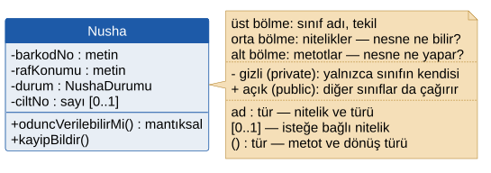
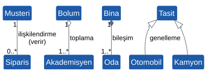
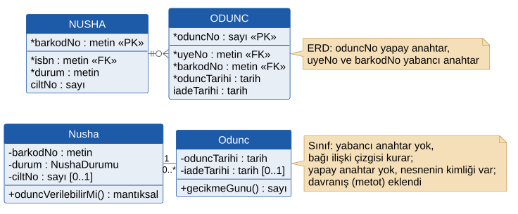
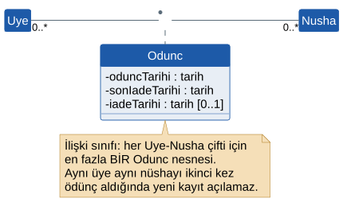
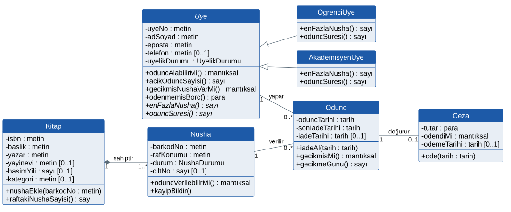
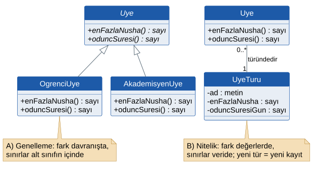

# 9. Hafta: Nesneye Yönelik Tasarım — UML Sınıf Diyagramları

## Giriş: Karar Tablosu Nereye Yazılacak?

6. haftada *3.2 Uygunluğu Denetle* sürecinin mantığını bir karar tablosuyla yazdık: önce gecikme, sonra borç, sonra nüsha sınırı. 7. haftada aynı kuralın veri modeline **girmediğini**, ERD'nin yalnızca verinin yapısını tuttuğunu gördük.

Şimdi sistemi kodlayacak bir geliştiricinin gözünden bakalım. Elinde süreçleri anlatan bir DFD, veriyi anlatan bir ERD ve kuralları anlatan bir karar tablosu var. Sorusu basit: **"Bu karar tablosunu programın hangi parçasına yazayım?"** DFD süreci gösterir ama veriyi tutmaz; ERD veriyi gösterir ama davranışı tutmaz. İkisi ayrı belgelerde durur ve aralarındaki bağı kuran kişi her seferinde geliştiricinin kendisidir.

Nesneye yönelik yaklaşımın cevabı şudur: kuralı, **o kuralın ihtiyaç duyduğu veriye sahip olan nesneye** yazın. Bir üyenin ödünç alıp alamayacağına üyenin kendi ödünçlerini ve cezalarını bilen *Uye* nesnesi karar verir. Veri ve onu işleyen davranış aynı yerde durur.

Ara sınavla birlikte dönemin analiz bölümünü kapattık. Bu hafta **tasarıma** geçiyoruz ve tasarımın ilk aracı olan **UML sınıf diyagramını** öğreneceğiz. Yeni bir şey icat etmeyeceğiz: 7. haftanın ERD'sini alıp ona 5. ve 6. haftaların davranışlarını ekleyeceğiz.

---

## 1. Analizden Tasarıma

1. haftada analisti iş birimi ile yazılımcı arasında bir köprü olarak tarif etmiştik. Dönemin ilk yarısında köprünün iş birimi tarafında, onların diliyle çalıştık. Şimdi aynı sistemi yazılımcı tarafından tarif etmeye başlıyoruz.

| | Analiz (1–7. hafta) | Tasarım (9–13. hafta) |
| :--- | :--- | :--- |
| **Soru** | Sistem **ne** yapmalı? | Sistem bunu **nasıl** yapacak? |
| **Dil** | İş biriminin dili: üye, nüsha, ceza | Yazılımın dili: sınıf, metot, katman, tablo |
| **Araçlar** | Use case, DFD, ERD, karar tablosu | Sınıf, sıralama ve durum diyagramları, mimari, arayüz taslağı, veritabanı şeması |
| **Okuru** | Kullanıcı ve analist | Geliştirici ve test uzmanı |

### Yapısal ve Nesneye Yönelik Bakış

Şu ana kadar kullandığımız araçlar **yapısal analiz** geleneğinden gelir. Bu gelenekte süreç ve veri ayrı modellenir:

| | Yapısal yaklaşım | Nesneye yönelik yaklaşım |
| :--- | :--- | :--- |
| **Temel birim** | Süreç (DFD) ve varlık (ERD), ayrı ayrı | Nesne: veri ve davranış birlikte |
| **Kural nerede?** | Süreç tanımında (karar tablosu) | Verinin sahibi olan sınıfın metodunda |
| **Değişiklik** | Bir veri değişince onu kullanan bütün süreçler taranır | Değişiklik çoğunlukla tek sınıfın içinde kalır |
| **Modelleme dili** | DFD, ERD | UML |

İki yaklaşım birbirinin rakibi değildir. Analizde ürettiğiniz her şey tasarımda kullanılır: use case'ler UML'in bir parçasıdır, ERD sınıf diyagramının iskeletini verir, DFD süreçleri ve karar tabloları metotlara dönüşür.

**UML** (*Unified Modeling Language*, Birleşik Modelleme Dili) 1990'ların ortasında Grady Booch, James Rumbaugh ve Ivar Jacobson'ın yöntemlerinin birleştirilmesiyle doğdu; 1997'den beri Object Management Group (OMG) tarafından bir standart olarak yönetilir. 5. haftada kullandığımız use case diyagramı da bir UML diyagramıydı.

---

## 2. Nesne ve Sınıf

Günlük hayattan başlayalım. Kütüphanenin rafında duran, barkodu *00012345* olan nüsha bir **nesnedir**: kendine ait bir kimliği vardır (başka hiçbir nüsha o değildir), o anki bir durumu vardır (rafta mı, ödünçte mi) ve onunla bir şeyler yapılabilir (ödünç verilebilir, kayıp bildirilebilir).

> **Nesne** (*object*), kimliği, durumu ve davranışı olan bir şeydir.
> - **Kimlik:** Onu diğer bütün nesnelerden ayırır; iki nüshanın bütün bilgileri aynı olsa bile ikisi ayrı nesnedir.
> - **Durum:** Niteliklerinin o anki değerleridir: *durum = ödünçte*, *rafKonumu = B-12*.
> - **Davranış:** Nesnenin yapabildikleri, yani metotlarıdır: *oduncVerilebilirMi()*.

> **Sınıf** (*class*), aynı nitelik ve davranışlara sahip nesnelerin şablonudur. *Nusha* bir sınıftır; barkodu *00012345* olan nüsha onun bir **örneğidir** (*instance*).

ERD'deki varlık ve varlık örneği ayrımı burada da geçerlidir: *NUSHA* varlığı → *Nusha* sınıfı, bir nüsha kaydı → bir *Nusha* nesnesi. Fark, sınıfın yalnızca ne **bildiğini** değil ne **yaptığını** da söylemesidir.

---

## 3. Dört Temel İlke

| İlke | Anlamı | Kütüphanede |
| :--- | :--- | :--- |
| **Soyutlama** (*abstraction*) | Yalnızca sistemin işine yarayan özellikleri modellemek | *Uye* sınıfında boy, kilo, göz rengi yoktur; ödünç vermek için gerekmezler. |
| **Kapsülleme** (*encapsulation*) | Veriyi gizlemek, ona yalnızca nesnenin metotlarıyla erişilmesini sağlamak | Bir nüshanın *durum* niteliğine dışarıdan "kayıp" yazılamaz; *kayipBildir()* çağrılır ve kayıt kuralları o metodun içinde uygulanır. |
| **Kalıtım** (*inheritance*) | Bir sınıfın başka bir sınıfın nitelik ve davranışlarını devralması | *OgrenciUye* ve *AkademisyenUye*, *Uye*'nin her şeyini devralır. |
| **Çok biçimlilik** (*polymorphism*) | Aynı mesajın, nesnenin sınıfına göre farklı sonuç vermesi | *enFazlaNusha()* bir öğrenciye sorulduğunda 3, bir akademisyene sorulduğunda 10 döndürür. |

**Kapsüllemenin bir analist için anlamı** şudur: bir kuralın tek bir yerde uygulanmasını garanti eder. Nüshanın durumunu değiştirmenin tek yolu nüshanın kendi metotlarıysa, "kayıp nüsha ödünç verilemez" kuralı da tek yerde yazılır ve hiçbir ekran onu atlayamaz. 2. haftadaki veri hatalarının çoğu, aynı veriyi birden çok yerin kendi bildiği gibi değiştirmesinden doğmuştu.

UML'de kalıtımı gösteren ilişkinin adı **genelleme**dir (*generalization*). İki kelime aynı bağın iki ucunu anlatır: üst sınıf alt sınıfların **genellemesidir**, alt sınıf üst sınıftan **kalıtım** alır.

---

## 4. Sınıf Gösterimi

Bir sınıf üç bölmeli bir dikdörtgenle çizilir:

| Bölme | İçerik | Kural |
| :--- | :--- | :--- |
| **Üst** | Sınıf adı | Tekil, büyük harfle başlar, Türkçe karakter yok: *Nusha*, *OgrenciUye* |
| **Orta** | Nitelikler: nesne ne **bilir**? | `görünürlük ad : tür [çokluk]` |
| **Alt** | Metotlar: nesne ne **yapar**? | `görünürlük ad(parametre : tür) : dönüş türü` |

UML metoda **operasyon** (*operation*) der; biz depodaki diğer derslerle tutarlı kalmak için *metot* diyoruz.

### Görünürlük

| İşaret | Ad | Kim erişebilir? |
| :-: | :--- | :--- |
| `-` | gizli (*private*) | Yalnızca sınıfın kendisi |
| `+` | açık (*public*) | Bütün sınıflar |
| `#` | korumalı (*protected*) | Sınıfın kendisi ve alt sınıfları |
| `~` | paket (*package*) | Aynı paketteki sınıflar |

Kapsülleme kuralının diyagramdaki karşılığı basittir: **nitelikler gizli (`-`), metotlar açık (`+`)**. Bu dersteki diyagramlar bu kurala uyar.

### Tür ve Çokluk

Türler bu derste programlama dilinden bağımsız yazılır ve 7. haftanın veri sözlüğüyle aynıdır: *metin*, *sayı*, *tarih*, *para*, *mantıksal*. Bir nitelik veri sözlüğündeki "geçerli değerler" listesinden birini alıyorsa türü o listenin adıdır: *durum : NushaDurumu* (rafta, ödünçte, kayıp). UML bu listeleri «enumeration» başlıklı ayrı bir kutuyla gösterebilir; diyagramı sade tutmak için çizmiyoruz.

Niteliğin yanındaki **`[0..1]`**, niteliğin isteğe bağlı olduğunu söyler: *ciltNo : sayı [0..1]*. Çokluk yazılmamışsa nitelik zorunludur (`[1]`). ERD'deki zorunlu ve isteğe bağlı nitelik ayrımı burada böyle görünür.

**Soyut sınıf** (*abstract class*) kendi başına nesnesi oluşturulamayan, yalnızca alt sınıfları için şablon olan sınıftır. Adı *eğik* yazılır. Kütüphanede "türü belli olmayan üye" yoktur: her üye ya öğrenci ya akademisyendir. Bu yüzden *Uye* soyut bir sınıftır. Gövdesi olmayan, alt sınıfın doldurması gereken **soyut metotlar** da eğik yazılır.

### Kavramsal ve Tasarım Sınıf Diyagramı

Aynı diyagram iki ayrı ayrıntı düzeyinde çizilebilir. Bu ayrım 6. haftadaki mantıksal ve fiziksel DFD ayrımına benzer:

| | Kavramsal sınıf diyagramı (alan modeli) | Tasarım sınıf diyagramı |
| :--- | :--- | :--- |
| **Amaç** | İş alanındaki kavramları ve bağlarını göstermek | Yazılımın sınıflarını kodlanabilir ayrıntıda göstermek |
| **İçerik** | Sınıf adları, nitelikler, ilişkiler; metot çoğu zaman yok | Görünürlük, türler, metotlar, parametreler |
| **Ne zaman?** | Analizin sonu, ERD ile birlikte | Bu hafta ve dönem projenizin tasarım paketi |

---

## 5. Sınıfları ve Metotları Bulmak

### 5.1. İsim–Fiil Analizi

Sınıf adaylarını bulmanın en eski yollarından biri, Russell Abbott'un 1983'te önerdiği **isim–fiil analizidir**: gereksinim metnindeki **isimler** sınıf veya nitelik adayıdır, **fiiller** metot veya ilişki adayıdır. 5. haftadaki UC-03 Nüsha Ödünç Ver senaryosunun ana akışına uygulayalım:

| Adım | Metin | İsimler | Fiiller |
| :-: | :--- | :--- | :--- |
| 1 | Kütüphaneci **üye kartını** okutur. | kütüphaneci, üye kartı | okutur |
| 2 | Sistem **üyeyi** bulur ve **üye durumunu** denetler. | üye, üye durumu | bulur, denetler |
| 3 | Sistem üyenin ödünç alabileceğini ve **kalan nüsha hakkını** gösterir. | kalan nüsha hakkı | ödünç alabilir, gösterir |
| 5 | Sistem **nüshanın** rafta olduğunu doğrular. | nüsha | doğrular |
| 6 | Sistem **ödüncü** kaydeder, nüshanın **durumunu** "ödünçte" yapar, **son iade tarihini** üye türüne göre hesaplar. | ödünç, durum, son iade tarihi, üye türü | kaydeder, yapar, hesaplar |

### 5.2. Adayları Elemek

Her isim sınıf olmaz. Adaylar şu sorulardan geçirilir:

| Aday | Soru | Karar |
| :--- | :--- | :--- |
| *üye*, *nüsha*, *ödünç* | Sistem bunun hakkında bilgi saklıyor mu, kendi davranışı var mı? | **Sınıf:** *Uye*, *Nusha*, *Odunc* |
| *son iade tarihi*, *durum* | Kendi başına bir şey mi, yoksa başka bir şeyin özelliği mi? | **Nitelik:** *Odunc.sonIadeTarihi*, *Nusha.durum* |
| *kalan nüsha hakkı* | Saklanıyor mu, hesaplanıyor mu? | **Metot:** hesaplanır (türetilmiş nitelik saklanmaz, 7. hafta) |
| *üye türü* | Türe göre davranış değişiyor mu? | **Alt sınıf** (bkz. 8.4) |
| *kütüphaneci* | Aktör mü, sistemin kaydını tuttuğu bir şey mi? | Bu sistemde **sınıf değil**: aktördür, hakkında bilgi saklanmıyor |
| *üye kartı* | Gerçek dünyadaki taşıyıcı mı, bilginin kendisi mi? | **Sınıf değil:** kart yalnızca *uyeNo*'yu taşır |
| *sistem* | Her işi yapan "sistem" bir sınıf mıdır? | **Hayır:** her iş, verisine sahip sınıfa dağıtılır |

*Kütüphaneci* satırına dikkat edin. Sistem kütüphanecilerin giriş bilgilerini ve hangi ödüncü kimin verdiğini saklasaydı (FOG-02 bunu ister gibi görünüyor), *Kutuphaneci* bir sınıf olurdu. Bir aktörün sınıf olup olmadığı, sistemin onun hakkında bir şey **hatırlayıp hatırlamadığına** bağlıdır.

### 5.3. Metot Kime Ait? Bilgi Uzmanı İlkesi

Fiilleri bulduk; şimdi her birini bir sınıfa vermemiz gerekiyor. Craig Larman'ın sorumluluk atama ilkelerinden en çok kullanılanı **bilgi uzmanı** (*information expert*) ilkesidir: **bir işi, o işi yapmak için gereken bilgiye sahip olan sınıfa verin.**

- *"Üye ödünç alabilir mi?"* — Cevap için üyenin açık ödünçleri, gecikmeleri, cezaları ve türü gerekir. Bunların hepsini *Uye* bilir (kendi ödünçleri üzerinden). → *Uye.oduncAlabilirMi()*
- *"Bu ödüncün gecikmesi kaç gün?"* — Son iade tarihi ve iade tarihi *Odunc*'tadır. → *Odunc.gecikmeGunu()*
- *"Bu nüsha ödünç verilebilir mi?"* — Nüshanın durumu *Nusha*'dadır. → *Nusha.oduncVerilebilirMi()*

Bu ilkenin tersi, bütün işleri tek bir *Sistem* veya *KutuphaneYonetimi* sınıfına toplamaktır. Böyle bir sınıf birkaç ay içinde yüzlerce metotlu, herkesin değiştirdiği ve kimsenin tamamını anlamadığı bir yapıya dönüşür.

Analiz çıktılarının sınıf diyagramının hangi parçasını beslediği özetle şöyledir:

---

## 6. Sınıflar Arası İlişkiler

| İlişki | Gösterim | Anlamı | Örnek |
| :--- | :--- | :--- | :--- |
| **İlişkilendirme** (*association*) | Düz çizgi | İki sınıfın nesneleri birbirini tanır | Müşteri sipariş verir |
| **Toplama** (*aggregation*) | Bütün tarafında içi boş elmas | Bütün–parça; parça bütünden bağımsız yaşar | Bölüm ve akademisyenleri |
| **Bileşim** (*composition*) | Bütün tarafında içi dolu elmas | Bütün–parça; parça tek bir bütüne aittir, bütünle birlikte yok olur | Bina ve odaları |
| **Genelleme** (*generalization*) | Üst sınıfa bakan içi boş üçgen | "… bir türüdür" | Otomobil bir taşıttır |

Bir de **bağımlılık** (*dependency*) vardır: kesikli okla çizilir ve bir sınıfın başka bir sınıfı yalnızca geçici olarak kullandığını söyler. Bu dersteki diyagramlarda gerekmeyecek.

### 6.1. İlişkilendirme ve Çokluk

İlişkilendirme çizgisinin iki ucuna **çokluk** (*multiplicity*) yazılır. Okuma kuralı Crow's Foot ile aynıdır: bir sınıftan başlayın, çizgi boyunca yürüyün ve **karşı uçtaki** sayıyı okuyun.

| Crow's Foot (7. hafta) | UML çokluğu | Okunuşu |
| :-: | :-: | :--- |
| ǁ | `1` | tam bir |
| o\| | `0..1` | sıfır veya bir |
| \|< | `1..*` | bir veya çok |
| o< | `0..*` (veya `*`) | sıfır veya çok |

Yani 7. haftadaki kardinaliteleri yeniden düşünmeniz gerekmez; simgeyi sayıya çevirmeniz yeterlidir. *UYE ‖—o< ODUNC*, sınıf diyagramında *Uye "1" — "0..\*" Odunc* olur.

Çizginin ortasına ilişkinin adı yazılır (*yapar*, *verilir*); okunma yönünü küçük bir ok ucu gösterir. Çizginin ucuna konan **açık ok başı** ise başka bir şey söyler: **gezinme yönünü**, yani hangi sınıfın diğerini bildiğini. Analiz düzeyinde çoğunlukla çizilmez; çizgi iki yönlü kabul edilir.

### 6.2. Toplama mı, Bileşim mi?

İkisi de bütün–parça ilişkisidir. Ayırmak için iki soru sorun:

1. **Parça aynı anda birden çok bütüne ait olabilir mi?** Bir akademisyen hem bir bölümde hem bir araştırma merkezinde olabilir → bileşim olamaz.
2. **Bütün yok olunca parça da yok olur mu?** Bir bölüm kapatılınca akademisyenler yok olmaz, başka bir bölüme geçer → toplama. Bina yıkılınca odaları da yok olur → bileşim.

Bileşimde bütün tarafının çokluğu her zaman `1` (veya `0..1`) olur; parça tek bir bütüne aittir.

> **Toplama konusunda dikkatli olun.** UML standardı toplamanın kesin anlamını tanımlamaz ve anlamın modelciden modelciye değiştiğini kendisi kabul eder. Martin Fowler gibi yazarlar onu hiç kullanmamayı önerir. Bir ilişkinin toplama mı düz ilişkilendirme mi olduğundan emin değilseniz **düz ilişkilendirme çizin**; ondan bir bilgi kaybetmezsiniz. Bileşimin ise açık bir anlamı vardır ve kullanılmaya değer.

### 6.3. Genelleme ve Çok Biçimlilik

Genelleme bir "**… bir türüdür**" (*is-a*) ilişkisidir. Testi basittir: cümleyi kurun ve her zaman doğru olup olmadığına bakın. *"Öğrenci üye bir üyedir"* her zaman doğrudur. *"Nüsha bir kitaptır"* doğru değildir; nüsha bir kitabın **kopyasıdır**, bu bir ilişkilendirmedir.

Alt sınıf üst sınıfın bütün nitelik ve metotlarını devralır; diyagramda bunlar alt sınıfta **tekrar yazılmaz**. Alt sınıfta yalnızca yeni eklenenler ve üst sınıftan farklı davrananlar yazılır.

Çok biçimliliğin değeri, metodu çağıranın karşısındakinin hangi alt sınıftan olduğunu bilmek zorunda olmamasıdır. *Uye.oduncAlabilirMi()* metodu şu sırayla karar verir:

1. Gecikmiş nüsha varsa hayır (İK-04).
2. Ödenmemiş ceza varsa hayır (İK-04).
3. Açık ödünç sayısı *enFazlaNusha()* değerine ulaşmışsa hayır (İK-01, İK-02).
4. Aksi halde evet.

Üçüncü adımda *enFazlaNusha()* çağrıldığında öğrenci nesnesi 3, akademisyen nesnesi 10 döndürür. *oduncAlabilirMi()* bunu bilmez ve bilmesi de gerekmez. Bu sıra 6. haftadaki karar tablosunun ve UC-03'teki 3a–3c alternatif akışlarının sırasıyla aynıdır; aynı kural üçüncü kez, bu sefer bir metot olarak yazılmıştır.

---

## 7. ERD'den Sınıf Diyagramına

Sınıf diyagramını sıfırdan çizmeniz gerekmez. ERD iskeleti verir; geri kalanı eklenir.

| ERD'de | Sınıf diyagramında | Not |
| :--- | :--- | :--- |
| Varlık | Sınıf | *UYE* → *Uye*; adı büyük harfle başlar, gerisi küçük |
| Nitelik | Gizli nitelik, türüyle | *- adSoyad : metin* |
| Zorunlu / isteğe bağlı | `[1]` / `[0..1]` | *- iadeTarihi : tarih [0..1]* |
| Doğal birincil anahtar | Nitelik olarak kalır | *uyeNo*, *isbn*, *barkodNo* iş için anlamlıdır |
| Yapay birincil anahtar | **Çizilmez** | Her nesnenin zaten bir kimliği vardır; *oduncNo* veritabanının ihtiyacıdır |
| Yabancı anahtar | **Nitelik değil, ilişki** | *NUSHA.isbn* yerine Kitap ile Nusha arasında çizgi |
| Kardinalite | Karşı uçtaki çokluk | ǁ—o< → `1` — `0..*` |
| İlişkisel varlık | Sıradan bir sınıf | *ODUNC* → *Odunc* (ilişki sınıfı değil, bkz. 7.2) |
| Türetilmiş nitelik | Metot | *gecikme günü* → *gecikmeGunu()* |
| Tür niteliği | Davranış farklıysa genelleme | *uyeTuru* → *OgrenciUye*, *AkademisyenUye* |
| — | Metotlar | Use case ve DFD süreçlerinden gelir; ERD'de karşılığı yoktur |

### 7.1. Yabancı Anahtar İlişkiye Dönüşür

En sık yapılan hata, yabancı anahtarı sınıfa nitelik olarak taşımaktır:

ERD'de *ODUNC*'un hangi nüshaya ait olduğunu *barkodNo* yabancı anahtarı söyler, çünkü bir tablo başka bir tabloyu ancak bir değer üzerinden işaret edebilir. Bir nesne ise başka bir nesneyi **doğrudan tanır**: bir *Odunc* nesnesi kendi *Nusha* nesnesine bağlıdır. Bu bağı ilişki çizgisi gösterir. Hem çizgi hem *barkodNo* niteliği çizilirse aynı bilgi iki kez yazılmış olur ve iki kopyanın birbirini tutmadığı gün gelir.

### 7.2. İlişki Sınıfı Tuzağı

UML'de çoktan çoğa bir ilişkiye bilgi eklemek için özel bir gösterim vardır: **ilişki sınıfı** (*association class*), ilişki çizgisine kesikli bir çizgiyle bağlanan sınıf. ERD'deki ilişkisel varlığın doğal karşılığı gibi görünür:

Ama ilişki sınıfının bir kısıtı vardır: **her nesne çifti için en fazla bir örneği olur.** Bu çizime göre bir üye ile bir nüsha arasında yalnızca **bir** ödünç bulunabilir. 7. haftada *ODUNC*'a yapay anahtar verirken tam bu durumu konuşmuştuk: aynı üye aynı nüshayı farklı zamanlarda iki kez ödünç alabilir. Bu yüzden *Odunc*, *Uye* ve *Nusha* ile ayrı ayrı ilişkilendirilmiş **sıradan bir sınıf** olarak çizilir.

İlişki sınıfı, çift başına gerçekten tek kayıt olduğunda doğru araçtır: bir öğrencinin bir dersten aldığı **harf notu** gibi (aynı dersi tekrar alma ayrıca modellenmediyse).

---

## 8. Vaka Çalışması: Kütüphane Otomasyonu

### 8.1. Sınıf Diyagramı

| Sınıf | ERD'deki karşılığı | Ne değişti? |
| :--- | :--- | :--- |
| *Uye* (soyut) | UYE | *uyeTuru* niteliği kalktı, yerine iki alt sınıf geldi; ödünç kararını veren metotlar eklendi |
| *OgrenciUye*, *AkademisyenUye* | UYE (*uyeTuru* değerleri) | İK-01 ve İK-02'deki sınır ve süre kendi metotlarında |
| *Kitap* | KITAP | Nüsha ekleme ve raftaki nüsha sayısı davranışı eklendi |
| *Nusha* | NUSHA | *isbn* yabancı anahtarı kalktı, bağı bileşim çizgisi kuruyor |
| *Odunc* | ODUNC | *oduncNo*, *uyeNo*, *barkodNo* kalktı; gecikme hesabı eklendi |
| *Ceza* | CEZA | *cezaNo* ve *oduncNo* kalktı; ödeme davranışı eklendi |

Diyagram bütün metotları göstermez. Bir sınıf diyagramı kodun eksiksiz bir dökümü değildir; tasarımın önemli kararlarını gösterir. Örneğin hiçbir sınıfta *getAdSoyad()* veya *setTelefon()* gibi erişim metotları yazılmadı: nitelikler gizli olduğuna göre bunların bulunacağı zaten bellidir ve diyagrama eklenmeleri asıl davranışı gölgeler.

### 8.2. Metotlar Nereden Geldi?

| Metot | Kaynağı | Hafta |
| :--- | :--- | :-: |
| *Uye.oduncAlabilirMi()* | 3.2 Uygunluğu Denetle, karar tablosu; *Üye Durumunu Denetle* (include) | 5, 6 |
| *Uye.enFazlaNusha()*, *oduncSuresi()* | İK-01, İK-02; FG-04, FG-05 | 5 |
| *Uye.gecikmisNushaVarMi()*, *odenmemisBorc()* | İK-04; UC-03 alternatif akış 3a, 3b | 5 |
| *Kitap.nushaEkle()* | *Kitap ve Nüsha Kaydet*; 2.0 süreci; FG-02 | 5, 6 |
| *Nusha.oduncVerilebilirMi()* | UC-03 adım 5 ve alternatif akış 5a | 5 |
| *Odunc.iadeAl()* | *Nüsha İadesi Al*; 4.0 süreci | 5, 6 |
| *Odunc.gecikmeGunu()* | Türetilmiş nitelik *gecikme günü*; *Gecikme Cezası Hesapla* (extend); İK-03 | 5, 7 |
| *Odunc.gecikmisMi()* | *Gecikme Bildirimi Gönder* (aktör: Zaman); 5.0 süreci; FG-07 | 5, 6 |
| *Ceza.ode()* | CEZA varlığının *odendiMi* ve *odemeTarihi* nitelikleri | 7 |

Her metodun bir kaynağı vardır. Kaynağı olmayan bir metot ya analizde unutulmuş bir gereksinimi işaret eder ya da gereksizdir. Tersi de geçerlidir: hiçbir metotta karşılığı olmayan bir use case varsa, tasarım o ihtiyacı karşılamıyordur.

*Katalogda Ara* ve *Rapor Al* bu tabloda yok. Bu ikisi tek bir nesnenin davranışı değildir; birçok nesneyi tarayan sorgulardır ve sınıf diyagramındaki alan sınıflarına değil, 11. haftada göreceğimiz mimarinin servis katmanına aittir.

### 8.3. Kitap ile Nüsha Neden Bileşim?

İki soruyu soralım: Bir nüsha aynı anda iki kitaba ait olabilir mi? Hayır; barkodu *00012345* olan nüsha tek bir eserin kopyasıdır. Kitap katalogdan çıkarılınca nüshaları yaşamaya devam eder mi? Hayır; hangi eserin kopyası olduğu bilinmeyen bir nüsha anlamsızdır. İki cevap da bileşimi gösteriyor.

Gerçek bir kütüphanede kayıtlar silinmez, geçmiş ödünçler yüzünden "pasif" işaretlenir. Bileşim bunu değiştirmez: elmas, nüshanın **hangi bütüne ait olduğunu ve başka bir bütüne taşınamayacağını** söyler. 2. haftadaki ISBN krizinin dersi de buydu: kitap ve nüsha ayrı şeylerdir, ama nüsha kitabından bağımsız değildir.

*Uye* ile *Odunc* arasında ise bileşim **yoktur**. Ödünç bir üyenin "parçası" değildir; üye ile nüsha arasındaki bir olaydır ve iki tarafa da eşit ölçüde bağlıdır.

### 8.4. Tartışmaya Açık Karar: Kalıtım mı, Nitelik mi?

7. haftada öğrenci ve akademisyen için ayrı varlık açmamıştık, çünkü tuttukları **veri** aynıydı; farkları yalnızca iş kurallarındaydı. Sınıf diyagramı veriyle birlikte **davranışı** da modeller ve fark tam olarak davranıştadır. Bu, alt sınıfları haklı kılar. 5. haftadaki use case diyagramında da Öğrenci ve Akademisyen, Üye'nin alt türleri olarak çizilmişti.

Ama aynı farkı tutmanın ikinci bir yolu vardır:

| | A) Genelleme | B) Kuralı tutan sınıf |
| :--- | :--- | :--- |
| **Sınır ve süre nerede?** | Alt sınıfların metotlarında | *UyeTuru* nesnelerinin niteliklerinde, yani veride |
| **Kural değişirse** (öğrenci sınırı 3 → 4) | Kod değişir | Bir kayıt güncellenir |
| **Yeni tür eklenirse** (misafir okuyucu) | Yeni alt sınıf | Yeni bir *UyeTuru* kaydı |
| **Üye tür değiştirirse** (öğrenci mezun olup araştırma görevlisi olursa) | Nesne sınıf değiştiremez; yeni nesne gerekir | Bağlantı başka bir *UyeTuru*'na çevrilir |
| **Türe göre algoritma farkı olursa** | Doğal yeri burasıdır | Zorlaşır |

Ölçüt şudur: **türler arasındaki fark davranışta mı, yoksa yalnızca değerlerde mi?** Kütüphanemizde fark şimdilik iki sayıdan ibarettir (nüsha sınırı ve gün sayısı), bu yüzden B seçeneği de savunulabilir ve kural değişikliğine daha dayanıklıdır. Vakada A'yı seçtik, çünkü genelleme ve çok biçimliliği göstermek istiyoruz. Kurallar sık değişen bir kurumda B daha doğru olurdu. Dönem projenizde ikisinden birini seçebilirsiniz; önemli olan seçimin **gerekçesini** yazmanızdır.

Veritabanı tarafında iki seçenek de 7. haftadaki ERD'ye geri döner: A seçeneğinde iki alt sınıf tek bir *UYE* tablosunda tutulur ve hangisi olduğunu *uyeTuru* sütunu söyler. Sınıfların tablolara nasıl eşlendiği 13. haftanın konusu.

---

## 9. Dönem Projenize Yansıması

Sınıf diyagramı, dönem projesinin **detaylı tasarım paketinin** ilk parçasıdır. Takımınızla:

1. ERD'nizdeki her varlığı bir sınıfa çevirin. Yabancı anahtarları ve yapay anahtarları çıkarın, yerlerine ilişki çizgilerini koyun.
2. Kardinaliteleri UML çokluğuna çevirin; çokluğu **karşı uca** yazdığınızı kontrol edin.
3. Use case senaryolarınızın sistem adımlarına isim–fiil analizi uygulayın. Fiilleri metot adayı olarak listeleyin.
4. Her metodu bilgi uzmanı ilkesiyle bir sınıfa verin: o işin verisi hangi sınıfta?
5. Karar tablolarınızı bulun ve her birinin hangi sınıfın hangi metoduna dönüştüğünü yazın.
6. Bütün–parça ilişkilerinizi iki soruyla sınayın (birden çok bütüne ait olabilir mi, bütünle birlikte yok olur mu?). Emin olmadığınızda düz ilişkilendirme çizin.
7. Bir "tür" niteliğiniz varsa kalıtım mı nitelik mi kararını verin ve gerekçesini bir paragrafla yazın.
8. Bir metot–kaynak tablosu hazırlayın (8.2'deki gibi). Kaynağı olmayan metodu ve metodu olmayan use case'i işaretleyin.

Teslim biçimi ve zamanı için dönem projesi kılavuzuna bakın.

---

## 10. İyi Pratikler ve Sık Yapılan Hatalar

| Hata | Neden Tehlikeli? | Doğru Pratik |
| :--- | :--- | :--- |
| **Yabancı anahtarı nitelik yapmak** | Aynı bağ hem çizgide hem nitelikte yazılır; ikisi zamanla birbirini tutmaz. | Yabancı anahtar sınıf diyagramında ilişki çizgisidir. |
| **Her sınıfa ekle–sil–güncelle–getir yazmak** | Diyagram dolar, asıl iş davranışı kaybolur. | Metotlar iş davranışını anlatsın: *oduncAlabilirMi()*, *iadeAl()*. Erişim metotları yazılmaz. |
| **Tek bir "Sistem" sınıfı** | Bütün işler tek yerde toplanır; kimse tamamını anlamaz, her değişiklik onu bozar. | Bilgi uzmanı: işi verinin sahibine verin. |
| **Tekrarlanan olay için ilişki sınıfı** | Aynı çift için ikinci kayıt açılamaz. | Olay tekrarlanabiliyorsa sıradan bir sınıf çizin. |
| **Her "sahiptir" ilişkisine elmas** | Toplama ve bileşimin anlamı kaybolur. | İki soruyu sorun; emin değilseniz düz çizgi. |
| **"Bir türüdür" testini atlamak** | *Nusha*'yı *Kitap*'tan türetmek gibi yanlış hiyerarşiler doğar. | Cümleyi kurun: "Nüsha bir kitaptır" doğru mu? |
| **Çokluğu yanlış uca yazmak** | Model tam tersini söyler: "bir ödüncün çok üyesi var". | Her ilişkiyi 7. haftadaki gibi iki cümleyle okuyun. |
| **Ekran ve veritabanı sınıflarını alan modeline karıştırmak** | *OduncEkrani*, *VeritabaniBaglantisi* gibi sınıflar iş kavramlarını gölgeler. | Alan sınıfları iş kavramlarıdır; ekran ve veri erişimi 11. haftanın katmanlarına aittir. |

---

## 11. Kendinizi Deneyin

1. **Eksik metot:** Kütüphane diyagramında bir nüshanın durumunu "ödünçte" veya "rafta" yapan bir metot yok, ama UC-03'ün 6. adımı bunu istiyor. Bu metodu hangi sınıfa, hangi adla eklerdiniz? Neden *durum* niteliğini açık (`+`) yapmak bir çözüm değil?
2. **Toplama mı, bileşim mi, ilişkilendirme mi?** (a) Fatura ve fatura kalemleri (b) Futbol takımı ve oyuncuları (c) Sepet ve sepetteki ürünler (d) Sipariş ve müşteri. Her biri için iki soruyu cevaplayın ve kararınızı gerekçelendirin.
3. **Yazar:** 7. haftanın bölüm sonu sorularında kitap ile yazar arasındaki çoktan çoğa ilişkiyi ERD'de çözmeniz istenmişti. Sınıf diyagramında bu ilişki için ilişki sınıfı kullanılabilir mi? *Odunc* için neden kullanılamadığını hatırlayarak karar verin.
4. **Misafir okuyucu:** Kütüphane, yalnızca okuma salonunu kullanan ve hiç ödünç alamayan bir "misafir okuyucu" türü eklemek istiyor. Bu, 8.4'teki kalıtım mı nitelik mi kararını değiştirir mi? Fark şimdi davranışta mı, değerlerde mi?
5. **Kim karar verir?** "Bir nüshanın şu an kimde olduğu" sorusunu hangi sınıf cevaplamalı? Bilgi uzmanı ilkesini uygulayın ve diyagramdaki ilişkileri izleyerek cevaba nasıl ulaşıldığını anlatın.
6. **Hatayı bulun:** Bir öğrenci *Odunc* sınıfını şu niteliklerle çizmiş: *oduncNo*, *uyeNo*, *barkodNo*, *oduncTarihi*, *sonIadeTarihi*, *iadeTarihi*, *gecikmeGunu*, *uyeAdSoyad*. Ayrıca *Uye* ile *Odunc* arasına bir çizgi de çekmiş. Kaç hata görüyorsunuz? Her biri için 7. bölümdeki tablonun hangi satırı geçerli?
7. **Kendi projeniz:** ERD'nizdeki en çok ilişkisi olan varlığı seçin ve sınıfa çevirin. Bu sınıfa en az üç metot bulun; her birinin kaynağını (use case adımı, süreç veya iş kuralı) yazın.

---

*Öğr. Gör. Turgay Taymaz · Afyon Kocatepe Üniversitesi*
*Bu materyal CC BY-NC-SA 4.0 ile lisanslanmıştır. Kullanırken kaynak gösteriniz.*
*Kaynak: https://github.com/ttaymaz/ders-notlari*
