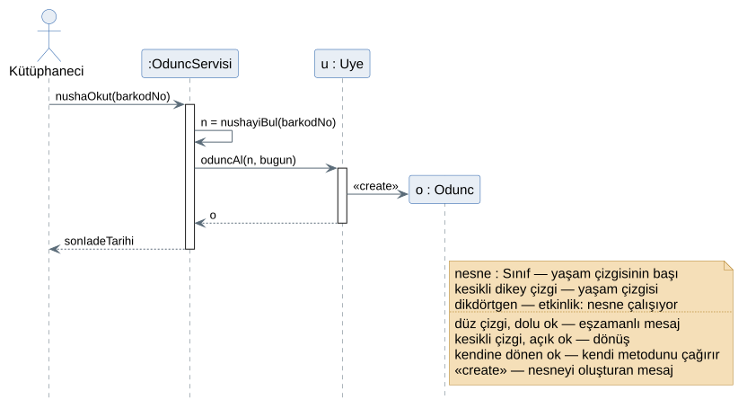
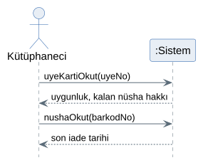
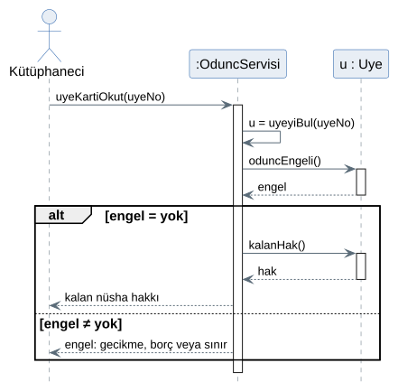
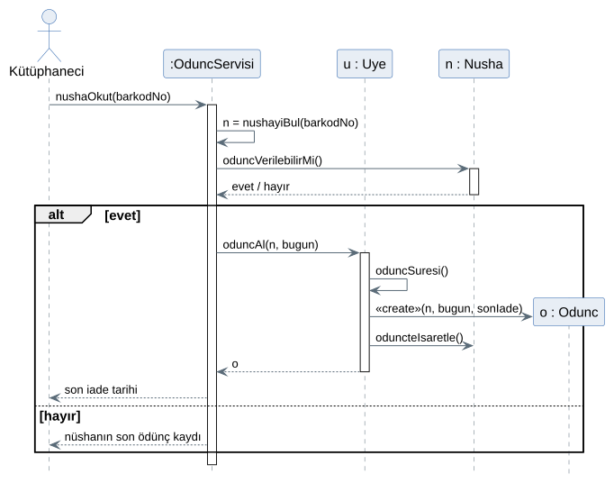
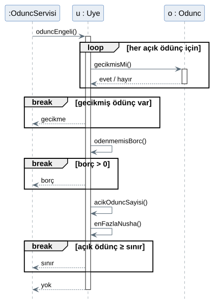
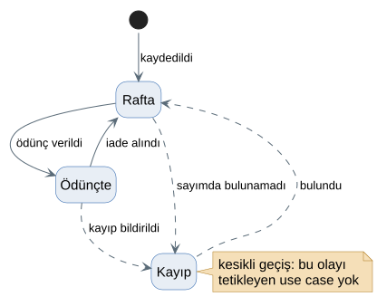
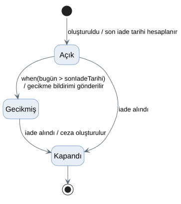
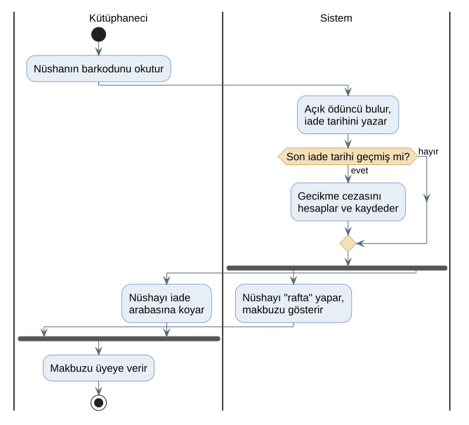

# 10. Hafta: Davranışsal Modelleme — UML Sıralama, Durum ve Aktivite Diyagramları

## Giriş: Ödüncü Kim Oluşturur?

Geçen hafta kütüphanenin sınıf diyagramını çizdik ve bir soruyu bilerek açık bıraktık: kütüphaneci gişede nüshanın barkodunu okuttuğunda yeni *Odunc* nesnesini **kim** oluşturur? Denetleyen sınıf mı, üye mi, nüsha mı? Sınıf diyagramı bu soruya cevap vermez. Sınıfların ne bildiğini, ne yapabildiğini ve birbirine nasıl bağlı olduğunu gösterir, ama hangi metodun hangi sırayla, kimin tarafından çağrıldığını göstermez.

Sınıf diyagramını bir binanın kat planına benzetebiliriz: odaları, kapıları ve koridorları gösterir. Bir sabah binaya giren bir ziyaretçinin hangi kapıdan girip hangi odalara uğradığını görmek için ise plan yetmez; bir yol tarifi gerekir. **Davranışsal diyagramlar** sistemin bu yol tarifleridir.

Bu hafta üç davranışsal diyagram öğreneceğiz:

- **Sıralama diyagramı:** Bir senaryoda nesneler birbirine hangi sırayla mesaj gönderir?
- **Durum diyagramı:** Tek bir nesne ömrü boyunca hangi durumlardan geçer, geçişleri ne tetikler?
- **Aktivite diyagramı:** Bir iş akışında hangi adımlar, kim tarafından, hangi sırayla ve hangileri aynı anda yapılır?

Üçünün ortak bir yan etkisi de var: çizerken sınıf diyagramındaki ve use case'lerdeki eksikleri ortaya çıkarırlar. Bu hafta kütüphane vakasında iki eksik bulacağız.

---

## 1. Yapı ve Davranış

UML 2.5 on dört diyagram türü tanımlar. Yedisi **yapısal** diyagramdır: sistemin parçalarını ve aralarındaki kalıcı bağları gösterir. Sınıf diyagramı bunların en çok kullanılanıdır. Diğer yedisi **davranışsal** diyagramdır: sistemin zaman içinde ne yaptığını gösterir. 5. haftanın use case diyagramı da davranışsal bir diyagramdı.

| Diyagram | Cevapladığı soru | Odak | Bu derste |
| :--- | :--- | :--- | :-: |
| **Sınıf** | Sistemde ne var, nasıl bağlı? | Yapı | 9. hafta |
| **Use case** | Kim sistemle ne yapar? | Dış davranış | 5. hafta |
| **Sıralama** (*sequence*) | Bir senaryoda nesneler hangi sırayla konuşur? | Nesneler arası etkileşim | Bu hafta |
| **Durum** (*state machine*) | Bir nesne hangi hallerden geçer? | Tek nesnenin ömrü | Bu hafta |
| **Aktivite** (*activity*) | Bir iş akışı nasıl ilerler, kim ne yapar? | Süreç | Bu hafta |

Kalan davranışsal diyagramlar (iletişim, zamanlama, etkileşime genel bakış) sıralama diyagramının farklı görünümleridir ve bu derste gerekmeyecek.

---

## 2. Sıralama Diyagramı

### 2.1. Gösterim

Bir restoranı düşünün. Garson siparişi alır, mutfağa iletir, aşçı yemeği hazırlar, garson yemeği masaya getirir. Kimin kime ne söylediğini ve bunun hangi sırayla olduğunu bir kâğıda yazmak isteseniz, her kişiye bir sütun açıp sütunlar arasına oklar çizersiniz. Zaman yukarıdan aşağı akar. Sıralama diyagramı tam olarak budur.

> **Sıralama diyagramı** (*sequence diagram*), bir senaryoda nesnelerin birbirine gönderdiği mesajları zaman sırasıyla gösterir. Yatay eksen katılımcıları, dikey eksen zamanı gösterir.

| Öğe | Gösterim | Anlamı |
| :--- | :--- | :--- |
| **Katılımcı** | Üstte kutu: `u : Uye` | Senaryoya katılan nesne. `nesneAdı : Sınıf` biçiminde yazılır; ad önemli değilse `:Uye` yeterlidir. Aktör çöp adamla çizilir. |
| **Yaşam çizgisi** (*lifeline*) | Kutudan aşağı inen kesikli çizgi | Nesnenin senaryo boyunca var olduğu süre |
| **Etkinlik çubuğu** (*activation*) | Yaşam çizgisi üzerinde ince dikdörtgen | Nesnenin bir metodu çalıştırdığı süre |
| **Eşzamanlı mesaj** | Düz çizgi, dolu ok ucu | Bir metot çağrısı; gönderen cevap gelene kadar bekler |
| **Eşzamansız mesaj** | Düz çizgi, açık ok ucu | Gönderen beklemez; örneğin e-posta sunucusuna bildirim bırakmak |
| **Dönüş** | Kesikli çizgi, açık ok ucu | Çağrının sonucu; dönen değer üzerine yazılır |
| **Kendine mesaj** | Aynı yaşam çizgisine dönen ok | Nesnenin kendi metodunu çağırması |
| **Oluşturma** | «create» etiketli ok, ok yeni nesnenin kutusuna gider | Senaryo sırasında yeni bir nesne doğar; kutusu o yükseklikte başlar |

Mesajın üzerine yazılan ad, **alıcı sınıftaki bir metodun adıdır**. Bu kural, sıralama diyagramını sınıf diyagramına bağlayan iptir: `oduncAl(n, bugun)` mesajı *Uye*'ye gidiyorsa *Uye* sınıfında bir *oduncAl()* metodu bulunmalıdır.

### 2.2. Birleşik Parçalar: Koşul ve Tekrar

Senaryoların alternatif akışları ve tekrarları vardır. Sıralama diyagramı bunları **birleşik parça** (*combined fragment*) denen çerçevelerle gösterir. Çerçevenin sol üst köşesine türü, köşeli parantez içine koşulu yazılır.

| Parça | Anlamı | Kütüphanede |
| :--- | :--- | :--- |
| `alt` | Seçenekler; koşulu doğru olan bölüm çalışır (eğer–değilse) | Nüsha verilebilir mi: evet / hayır |
| `opt` | Koşul doğruysa çalışır, değilse atlanır (yalnızca eğer) | Gecikme varsa ceza oluştur |
| `loop` | Koşul sürdükçe tekrarlanır | Üyenin her açık ödüncü için |
| `break` | Koşul doğruysa bu bölüm çalışır ve çevreleyen akış **biter** | İlk engelde dur |
| `ref` | Başka bir diyagrama atıf | Ayrıntısı ayrı çizilmiş bir mesaj |

`alt` çerçevesinin bölümleri kesikli yatay çizgiyle ayrılır. Koşullar 5. haftadaki alternatif akışların koşullarıyla aynı dille yazılmalıdır; diyagramı senaryoyla karşılaştıran okur aynı cümleleri görsün.

### 2.3. Önce Kara Kutu: Sistem Sıralama Diyagramı

Bir use case'ten sıralama diyagramına geçmenin en güvenli yolu iki adımdır. İlk adımda sistemin içine hiç bakılmaz: aktör ve tek bir *:Sistem* kutusu çizilir. Bu çizime **sistem sıralama diyagramı** (*system sequence diagram*) denir. Craig Larman'ın önerdiği bu ara adım, senaryodaki aktör adımlarını sistemin karşılaması gereken **sistem olaylarına** çevirir.

| UC-03 adımı | Sistem sıralama diyagramında |
| :--- | :--- |
| 1. Kütüphaneci üye kartını okutur. | Sistem olayı: `uyeKartiOkut(uyeNo)` |
| 2–3. Sistem üyeyi bulur, durumunu denetler, kalan hakkı gösterir. | Dönüş: uygunluk, kalan nüsha hakkı |
| 4. Kütüphaneci nüshanın barkodunu okutur. | Sistem olayı: `nushaOkut(barkodNo)` |
| 5–7. Sistem doğrular, kaydeder, son iade tarihini gösterir. | Dönüş: son iade tarihi |

UC-03'ün iki sistem olayı vardır. İkinci adımda her sistem olayı için ayrı bir tasarım düzeyi sıralama diyagramı çizilir ve kara kutu açılır. Bu ayrım diyagramları küçük tutar ve her birinin tek bir soruya cevap vermesini sağlar.

### 2.4. Kutuyu Açmak: Denetleyici ve Yaratıcı

Kara kutuyu açınca iki soru hemen karşımıza çıkar. Larman'ın sorumluluk atama ilkelerinden ikisi bu sorulara cevap verir; 9. haftanın bilgi uzmanı ilkesi de aynı ailedendir.

**1. Sistem olayını ilk kim karşılar?** Kütüphanecinin okuttuğu kart bir ekrana düşer, ama ekranın işi göstermek ve okumaktır; ödünç kuralları ekrana yazılırsa her yeni ekranda (gişe, mobil, kiosk) yeniden yazılması gerekir. **Denetleyici ilkesi** (*controller*): sistem olayını, kullanıcı arayüzü olmayan ve use case'i temsil eden bir nesne karşılar. Bu nesne işi kendisi yapmaz; uygun nesnelere dağıtır. Vakada bu nesnenin adı *OduncServisi*: ödünç use case'ini yürüten servis. Adında "denetleyici" geçmemesi bilinçli: 11. haftada göreceğimiz MVC yapısında bu kelime başka bir nesneye verilir ve iki nesne karışmasın istiyoruz. *OduncServisi*'nin yazılım mimarisindeki yeri de 11. haftanın konusu.

Denetleyicinin üyeyi ve nüshayı nasıl bulduğunu (`uyeyiBul`, `nushayiBul`) şimdilik kendi metodu olarak çiziyoruz. Bu nesnelerin veritabanından nasıl okunacağı da 11. ve 13. haftaların konusu.

**2. Yeni *Odunc* nesnesini kim oluşturur?** **Yaratıcı ilkesi** (*creator*): B sınıfı, A sınıfının nesnelerini şu durumlarda oluşturmalıdır:

- B, A'ları kaydediyor veya içeriyorsa,
- B, A'yı yakından kullanıyorsa,
- B, A'yı oluşturmak için gereken bilgiye sahipse.

Adaylar *Uye* ve *Nusha*'dır; ikisinin de çok sayıda ödüncü vardır. Ama son iade tarihini hesaplamak için gereken bilgi, yani *oduncSuresi()* (öğrenci 15 gün, akademisyen 30 gün), *Uye*'dedir. Üçüncü madde kararı verir: ödüncü **üye** oluşturur. Sınıf diyagramına yeni bir metot eklenir: *Uye.oduncAl(nusha, tarih) : Odunc*.

### 2.5. Vaka: UC-03 Nüsha Ödünç Ver

Birinci sistem olayı, üye kartının okutulması:

İkinci sistem olayı, nüsha barkodunun okutulması ve ödüncün oluşturulması:

Diyagramları 5. haftadaki senaryoyla yan yana okuyun:

| Senaryo | Sıralama diyagramında |
| :--- | :--- |
| 3a, 3b, 3c (gecikme, borç, sınır) | Birinci diyagramda `alt [engel ≠ yok]` bölümü |
| 5a (nüsha sistemde "ödünçte" görünür) | İkinci diyagramda `alt [hayır]` bölümü |
| 6. adım (ödünç kaydı, durum, son iade tarihi) | `oduncAl()` içinde «create», `oduncteIsaretle()`, `oduncSuresi()` |
| 4a (barkod elle girilir) | **Görünmez:** sistem için olay yine `nushaOkut(barkodNo)` |
| 2a (üye bulunamaz veya askıda) | **Çizilmedi** — bölüm sonu sorusu |

4a satırına dikkat edin. Bir alternatif akış yalnızca aktörün dünyasında farklıysa (kart okuyucu yerine klavye), sistemin içinde hiçbir şey değişmez ve sıralama diyagramına yansımaz.

Nüshanın durumunu "ödünçte" yapan mesaj ödüncü oluşturan *Uye*'den *Nusha*'ya gider ve nüshanın kendi metodunu çağırır: *oduncteIsaretle()*. Geçen hafta bölüm sonunda bu metodun hangi sınıfa konacağını sormuştuk; vakada verdiğimiz cevap budur ama tek doğru cevap değildir. Önemli olan, durumun **dışarıdan bir atamayla değil**, nüshanın kendi metoduyla değişmesidir. Böylece "kayıp nüsha ödünç verilemez" gibi bir kural da tek yerde, *Nusha*'nın içinde denetlenir.

### 2.6. Bir Mesajın İçi: Engel Denetimi

Birinci diyagramdaki `oduncEngeli()` mesajı tek bir okla çizildi, ama içinde 6. haftanın karar tablosu çalışır. Bir mesajın içini ayrı bir diyagramda açmak hem okunurluk sağlar hem de ana diyagramı küçük tutar:

`break` parçaları karar tablosunun "ilk engel gösterilir" kuralını birebir taşır: gecikmiş ödünç varsa metot "gecikme" döndürür ve borca hiç bakmaz. `loop` parçası üyenin her açık ödüncüne *gecikmisMi()* sorusunu sorar. Bu, bilgi uzmanı ilkesinin bir sonucudur: gecikmeyi *Uye* hesaplamaz, her *Odunc* kendi gecikmesini bilir. Üçüncü `break` içindeki *enFazlaNusha()* çağrısı 9. haftadaki çok biçimliliktir: *u* bir öğrenciyse 3, akademisyense 10 döner ve diyagram bunu bilmek zorunda değildir.

Aynı kural bu dönem dördüncü kez yazılmış oldu: senaryoda alternatif akış (5. hafta), karar tablosu (6. hafta), metot (9. hafta), mesaj sırası (bu hafta). Dördü birbirini tutmak zorundadır.

### 2.7. Sıralama Diyagramı Sınıf Diyagramını Düzeltir

Sıralama diyagramını çizerken 9. haftanın sınıf diyagramına dört kez geri döndük:

| Bulgu | Sınıf diyagramındaki değişiklik |
| :--- | :--- |
| Ödüncü oluşturan bir metot yoktu | *Uye*'ye **oduncAl(nusha : Nusha, tarih : tarih) : Odunc** (yaratıcı ilkesi) |
| Nüshanın durumunu değiştiren bir metot yoktu | *Nusha*'ya **oduncteIsaretle()**; iade için **raftaIsaretle()** |
| *oduncAlabilirMi() : mantıksal* yalnızca evet/hayır döndürüyordu, ama senaryo 3a–3c'de engelin **nedeni** gösteriliyor | Metot **oduncEngeli() : Engel** oldu; *Engel* değerleri: yok, gecikme, borç, sınır |
| Senaryonun 3. adımı kalan nüsha hakkını gösteriyor, karşılığı yoktu | *Uye*'ye **kalanHak() : sayı** |

Üçüncü satırda başka bir seçenek de vardı: metot evet/hayır döndürmeye devam eder, denetleyici "hayır" cevabı aldığında nedeni bulmak için *gecikmisNushaVarMi()*, *odenmemisBorc()* ve sınırı kendisi sırayla sorar. Bu durumda karar sırası iki yerde yazılır: *Uye*'de ve denetleyicide. Biri değişip diğeri unutulduğunda sistem bir engeli gösterir ama başka bir engel yüzünden reddeder. Kural tek yerde kalsın diye nedeni döndüren metodu seçtik.

Bu tablo bir hata listesi değildir. Modeller birlikte olgunlaşır: sınıf diyagramı sıralama diyagramına girdi olur, sıralama diyagramı da sınıf diyagramını düzeltir. Dönem projenizde de böyle olacak; değişiklikleri sınıf diyagramınıza işlemeyi unutmayın.

---

## 3. Durum Diyagramı

### 3.1. Gösterim

Bir internet siparişini düşünün: *hazırlanıyor*, *kargoda*, *teslim edildi*. Sipariş bir anda bu hallerden yalnızca birindedir ve bir halden diğerine belirli olaylarla geçer: kargo firması paketi alır, kurye teslim eder. "Kargoda olan sipariş iptal edilebilir mi?" sorusunun cevabı, siparişin o anki haline bağlıdır.

> **Durum diyagramı** (*state machine diagram*), tek bir nesnenin ömrü boyunca bulunabileceği durumları ve bir durumdan diğerine geçişleri gösterir.

| Öğe | Gösterim | Anlamı |
| :--- | :--- | :--- |
| **Başlangıç** | Dolu siyah daire | Nesnenin doğduğu nokta |
| **Durum** | Köşeleri yuvarlatılmış dikdörtgen | Nesnenin bir süre kaldığı hal: *Rafta*, *Ödünçte* |
| **Geçiş** | Ok | Bir durumdan diğerine geçiş |
| **Geçiş etiketi** | `olay [koşul] / eylem` | Geçişi **olay** tetikler; **koşul** (*guard*) doğruysa geçilir; geçerken **eylem** yapılır. Üç parça da isteğe bağlıdır. |
| **Bitiş** | Halka içinde dolu daire | Nesnenin ömrünün sonu |

Geçişi tetikleyen olay üç türlü olabilir:

- **Çağrı olayı:** Nesnenin bir metodu çağrılır. *iade alındı* olayı *raftaIsaretle()* çağrısıdır.
- **Zaman olayı:** Belirli bir süre geçer: `after(30 gün)`.
- **Değişim olayı:** Bir koşul doğru hale gelir: `when(bugün > sonIadeTarihi)`.

Durumların adları bir **hal** bildirir (*Ödünçte*, *Kayıp*), olayların adları **olup biten bir şeyi** bildirir (*ödünç verildi*, *bulundu*). Bir kutunun içine fiil yazıyorsanız ("Ödünç ver") büyük olasılıkla bir aktivite diyagramı çiziyorsunuz.

### 3.2. Hangi Nesneye Durum Diyagramı Çizilir?

Her sınıfa durum diyagramı çizilmez. Ölçüt şudur: **nesnenin durumu, ona gelen mesajlara verdiği cevabı değiştiriyor mu?** Rafta olan bir nüsha ödünç verilebilir, kayıp olan verilemez; nüshanın durumu davranışını değiştirir. Bir *Kitap*'ın ise anlamlı bir durumu yoktur; ona hangi gün sorarsanız sorun aynı cevabı verir.

Kütüphanede durum diyagramına aday üç sınıf vardır: *Nusha* (rafta, ödünçte, kayıp), *Odunc* (açık, gecikmiş, kapandı) ve *Ceza* (ödenmedi, ödendi). İlk ikisini çizeceğiz, üçüncüsü bölüm sonu sorusu.

### 3.3. Vaka: Nüshanın Ömrü

7. haftanın veri sözlüğünde *NUSHA.durum* niteliğinin geçerli değerleri "rafta, ödünçte, kayıp" olarak yazılmıştı. Durum diyagramı bu listeyi alır ve her değerin **nasıl** kazanıldığını sorar:

Her geçişin karşısına onu tetikleyen use case'i ve metodu yazalım:

| Geçiş | Tetikleyen use case | Metot |
| :--- | :--- | :--- |
| başlangıç → Rafta: *kaydedildi* | UC-07 Kitap ve Nüsha Kaydet | *Kitap.nushaEkle()* |
| Rafta → Ödünçte: *ödünç verildi* | UC-03 Nüsha Ödünç Ver | *Nusha.oduncteIsaretle()* |
| Ödünçte → Rafta: *iade alındı* | UC-05 Nüsha İadesi Al | *Nusha.raftaIsaretle()* |
| Ödünçte → Kayıp: *kayıp bildirildi* | **yok** | *Nusha.kayipBildir()* |
| Rafta → Kayıp: *sayımda bulunamadı* | **yok** | **yok** |
| Kayıp → Rafta: *bulundu* | **yok** | **yok** |

Tablonun alt yarısı boş. "Kayıp" değeri veri sözlüğünde vardı, sınıf diyagramında *kayipBildir()* metodu bile vardı, ama **hiçbir use case bir nüshayı kayıp yapmıyor ve hiçbir use case kayıp nüshayı rafa geri döndürmüyor.** Dönemin başından beri kütüphanenin en büyük sorununun kayıp nüshalar olduğunu (%15'in üzerinde) söylüyoruz; analiz paketinde bu durumu yönetecek tek bir use case yok.

Bu, durum diyagramının en değerli yanıdır: **eksik use case'leri sistematik olarak bulur.** Use case diyagramı aktörlerden yola çıkar ve aktörün aklına gelmeyen işleri kaçırabilir. Durum diyagramı nesneden yola çıkar ve "bu durum nasıl kazanılıyor, nasıl kaybediliyor?" sorusunu her durum için sorar.

Boşluğu kapatmak için kesikli geçişlerden yeni use case'ler çıkarmak gerekir. Ama önce Daire Başkanı'na sorulması gereken iş kuralı soruları vardır:

- Ödünçteki bir nüshayı üye kaybettiğini bildirirse ödünç kaydı nasıl kapanır? Üye bir bedel öder mi, öderse ne kadar?
- Kütüphane düzenli sayım yapıyor mu? Rafta görünüp bulunamayan nüsha kimin kararıyla kayıp sayılır?
- Kayıp sayılan bir nüsha bulunursa, kaybedildiği sırada ödünçteyse ödünç kaydına ne olur?

Bu sorulara cevap gelmeden geçişleri tamamlamak, analistin iş kuralı **uydurması** olur. Durum diyagramı burada analizi geri çağırmıştır: tasarım sırasında bulunan eksik analiz belgelerine işlenir.

### 3.4. Vaka: Ödüncün Ömrü

Bu diyagram üç yeni öğe gösterir:

- **Değişim olayı:** *Açık → Gecikmiş* geçişini bir aktör tetiklemez; `when(bugün > sonIadeTarihi)` koşulu doğru hale geldiğinde geçiş kendiliğinden olur. 5. haftadaki use case diyagramında *Gecikme Bildirimi Gönder*'in aktörünün **Zaman** olması bu yüzdendi.
- **Geçişteki eylem:** `/ gecikme bildirimi gönderilir` (UC-09) ve `/ ceza oluşturulur` (UC-06). İki use case de bir geçişin yan etkisi olarak ortaya çıkar.
- **Aynı olay, iki farklı sonuç:** *iade alındı* olayı hem *Açık*'tan hem *Gecikmiş*'ten *Kapandı*'ya götürür, ama yalnızca *Gecikmiş*'ten geçerken ceza oluşur. Olayın sonucunu nesnenin o anki durumu belirler. Durum diyagramının var olma sebebi tam olarak budur.

*Odunc* sınıfında *durum* adında bir nitelik **yoktur**. "Gecikmiş" durumu saklanmaz, *gecikmisMi()* metoduyla hesaplanır (7. haftanın türetilmiş nitelik kuralı). Durum diyagramındaki bir durumun veritabanında bir sütun olması gerekmez; nesnenin davranışının değiştiği bir hal olması yeterlidir.

---

## 4. Aktivite Diyagramı

### 4.1. Gösterim

Aktivite diyagramı, programlamada gördüğünüz akış şemasının UML'deki karşılığıdır, ama iki şey ekler: işi **kimin** yaptığını gösteren kulvarlar ve **aynı anda** yapılan işleri gösteren çatallanma.

> **Aktivite diyagramı** (*activity diagram*), bir iş akışındaki eylemleri, aralarındaki kontrol akışını, kararları ve paralel yürüyen kolları gösterir.

| Öğe | Gösterim | Anlamı |
| :--- | :--- | :--- |
| **Başlangıç** | Dolu siyah daire | Akışın başladığı yer |
| **Eylem** | Köşeleri yuvarlatılmış dikdörtgen | Yapılan bir iş; adı fiille yazılır: *Barkodu okutur* |
| **Karar düğümü** | Elmas, çıkan oklarda koşul | Akış koşula göre ayrılır |
| **Birleştirme düğümü** | Elmas, birden çok giriş | Ayrılan seçenekler yeniden tek akışa döner |
| **Çatallanma** (*fork*) | Kalın çubuk, bir giriş birden çok çıkış | Kollar aynı anda yürür; sıraları önemsizdir |
| **Birleşme** (*join*) | Kalın çubuk, birden çok giriş bir çıkış | Bütün kollar bitmeden akış devam etmez |
| **Kulvar** (*swimlane*) | Dikey şeritler | Her şerit bir aktör veya birim; eylem kimin şeridindeyse o yapar |
| **Bitiş** | Halka içinde dolu daire | Aktivitenin sonu |

Karar ve birleştirme düğümü aynı elmasla çizilir; birinin tek girişi birden çok çıkışı, diğerinin birden çok girişi tek çıkışı vardır. Çatallanma ile karar düğümünü karıştırmayın: karar düğümünden **bir** kol çalışır, çatallanmadan **bütün** kollar çalışır.

### 4.2. Vaka: Nüsha İadesi

5. haftada iade use case'ini (UC-05) yalnızca diyagramda bir elips olarak göstermiştik. Senaryosunun ana akışı şöyledir:

1. Kütüphaneci nüshanın barkodunu okutur.
2. Sistem nüshanın açık ödünç kaydını bulur.
3. Sistem bugünün tarihini iade tarihi olarak ödünç kaydına yazar.
4. Sistem iade tarihini son iade tarihiyle karşılaştırır. *Uzatma noktası "son iade tarihi geçmişse": burada Gecikme Cezası Hesapla (UC-06) çalışır.*
5. Sistem nüshanın durumunu "rafta" yapar.
6. Sistem iade makbuzunu gösterir: barkod, iade tarihi ve varsa ceza tutarı.

Alternatif akış **2a**: nüshanın açık ödünç kaydı yoktur; sistem nüshanın son ödünç kaydını ve durumunu gösterir, kütüphaneci kaydı kontrol eder, use case biter.

Diyagramda senaryoda olmayan iki şey görünüyor:

- **Kulvarlar** işin sahibini gösterir. Senaryoda her adımın tek öznesi vardı; burada özne şerit olarak çizilir ve okuyan, kütüphanecinin kaç kez gişeye dokunduğunu bir bakışta görür.
- **Çatallanma**, sistem kaydı güncellerken kütüphanecinin nüshayı iade arabasına koyduğunu gösterir. Bu iki iş birbirini beklemez. Ama kütüphaneci makbuzu üyeye ancak sistem makbuzu gösterdikten **ve** nüsha arabaya konduktan sonra verir; birleşme çubuğu bunu söyler.

Uzatma noktası, karar düğümüne dönüştü: `extend` ilişkisinin koşulu ("son iade tarihi geçmişse") aktivite diyagramında bir elmasın koşuludur. Alternatif akış 2a çizilmedi; bölüm sonunda eklemeniz istenecek.

### 4.3. Akış Şeması, DFD ve Aktivite Diyagramı

Üçü de bir süreci anlatır, ama farklı sorulara cevap verir:

| | Akış şeması | DFD (6. hafta) | Aktivite diyagramı |
| :--- | :--- | :--- | :--- |
| **Neyi gösterir?** | Adımların sırası | Verinin nereden nereye aktığı | Adımların sırası, sahibi ve paralelliği |
| **Sıra var mı?** | Var | **Yok:** DFD sıra göstermez | Var |
| **Kim yapıyor?** | Gösterilmez | Dış varlık ve süreç | Kulvar |
| **Paralellik** | Gösterilmez | Gösterilmez | Çatallanma ve birleşme |
| **Ne zaman?** | Tek bir algoritma | Sistemin veri ihtiyacını analiz ederken | Birden çok aktörlü iş süreçleri; mevcut durum analizi |

Aktivite diyagramı yalnızca yeni sistemi anlatmak için değil, **mevcut durumu** anlamak için de kullanılır. 1. haftada konuştuğumuz cuma taramasını (kütüphanecinin defteri sayfa sayfa gezip gecikmiş ödünçleri bulması) kulvarlı bir aktivite diyagramıyla çizseydik, sürecin kaç el değiştirdiği ve nerede beklediği görünür olurdu.

---

## 5. Hangi Diyagram, Ne Zaman?

| Soru | Diyagram |
| :--- | :--- |
| Bu use case'i karşılamak için nesneler hangi sırayla, hangi metotları çağırır? | Sıralama |
| Bu nesne hangi hallerde bulunabilir, hangi olay onu hangi hale geçirir? | Durum |
| Bu iş süreci nasıl ilerler, kim ne yapar, neler aynı anda olur? | Aktivite |
| Bu metodun içinde karar sırası nasıldır? | Sıralama (`loop`, `break`) veya aktivite |

Davranışsal diyagramlar tek başına değil, diğer modellerle birlikte anlam kazanır. Her biri başka bir modeli **denetler**:

Tasarım paketinizi teslim etmeden önce şu denetimleri yapın:

- Sıralama diyagramındaki **her mesaj**, alıcı sınıfta bir metot olarak var mı?
- Durum diyagramındaki **her geçişi** tetikleyen bir use case veya zaman olayı var mı?
- Sınıf diyagramındaki **her durum niteliğinin** geçerli değerleri, durum diyagramındaki durumlarla aynı mı?
- Aktivite diyagramındaki **her eylem** bir senaryo adımına karşılık geliyor mu?

---

## 6. Dönem Projenize Yansıması

Davranışsal modeller, dönem projesinin **detaylı tasarım paketine** girer (nihai rapor şablonunda *Davranışsal Modelleme* bölümü). En az bir kritik senaryo için sıralama diyagramı ve en az bir sınıf için durum diyagramı beklenir. Takımınızla:

1. Tam senaryosunu yazdığınız en kritik use case'i seçin. Aktör adımlarından **sistem olaylarını** çıkarın ve bir sistem sıralama diyagramı çizin.
2. Her sistem olayı için bir tasarım düzeyi sıralama diyagramı çizin. Sistem olayını karşılayan **denetleyici** nesnesine bir ad verin.
3. Senaryodaki her alternatif akışın diyagramda nereye düştüğünü işaretleyin (`alt`, `opt`, `break`). Sisteme yansımayan alternatif akışları bir cümleyle not edin.
4. Yeni nesneleri kimin oluşturduğunu **yaratıcı ilkesiyle** gerekçelendirin.
5. Diyagramdaki her mesajın sınıf diyagramınızda bir metodu olduğunu denetleyin. Eksikleri sınıf diyagramına ekleyin ve değişikliği raporunuzda yazın.
6. Durumu davranışını değiştiren bir sınıf seçin (sipariş, randevu, başvuru, rezervasyon gibi). Durum diyagramını çizin; durumlar veri sözlüğünüzdeki geçerli değerlerle aynı olsun.
7. Her geçişin karşısına tetikleyen use case'i yazın (3.3'teki tablo gibi). Boş kalan satır, eksik bir use case'tir; ya ekleyin ya da açık konu olarak yazın.
8. İsteğe bağlı: birden çok aktörün yer aldığı bir süreç için kulvarlı aktivite diyagramı çizin.

Teslim biçimi ve zamanı için dönem projesi kılavuzuna bakın.

---

## 7. İyi Pratikler ve Sık Yapılan Hatalar

| Hata | Neden Tehlikeli? | Doğru Pratik |
| :--- | :--- | :--- |
| **Bütün use case'i tek sıralama diyagramına sığdırmak** | Diyagram okunmaz hale gelir, iç içe `alt` çerçeveleri birbirine karışır. | Her sistem olayına bir diyagram; uzun bir mesajın içini ayrı diyagramda açın. |
| **Sınıf diyagramında olmayan mesajlar** | İki model birbirini tutmaz; geliştirici hangisine güveneceğini bilemez. | Her mesaj alıcı sınıfta bir metot olsun; eksikse sınıf diyagramına ekleyin. |
| **Her işi denetleyiciye yaptırmak** | Denetleyici 9. haftadaki "Sistem" sınıfına dönüşür; kurallar alan sınıflarından kaçar. | Denetleyici işi dağıtır; kuralı verinin sahibi uygular (bilgi uzmanı). |
| **Ekran ayrıntısını mesaj yapmak** | *dugmeyeTikla()*, *formuDoldur()* gibi mesajlar tasarımı arayüze bağlar. | Mesajlar iş olaylarını anlatsın: *nushaOkut(barkodNo)*. |
| **Durum adına fiil yazmak** | "Ödünç ver" bir eylemdir; durum diyagramı aktivite diyagramına dönüşür. | Durum bir haldir: *Ödünçte*. Olay olup biten şeydir: *ödünç verildi*. |
| **Her sınıfa durum diyagramı** | Durumu olmayan sınıflar için anlamsız diyagramlar çoğalır. | Yalnızca durumu davranışını değiştiren sınıflara çizin. |
| **Tetikleyicisi olmayan geçişler** | Diyagramda görünen geçişi sistemde yapacak bir işlem yoktur. | Her geçişin karşısına use case yazın; boşsa eksik use case'tir. |
| **Çatallanmayı karar yerine kullanmak** | "Ya şu ya bu" yerine "ikisi birden" söylenmiş olur. | Seçenek için elmas, eşzamanlılık için kalın çubuk. |

---

## 8. Kendinizi Deneyin

1. **İade için sıralama diyagramı:** UC-05 Nüsha İadesi Al için önce sistem sıralama diyagramını, sonra tasarım düzeyi sıralama diyagramını çizin. Gecikme varsa yeni bir *Ceza* nesnesi oluşur. Onu kim oluşturmalı: denetleyici, *Uye*, *Odunc*? Yaratıcı ilkesinin üç maddesinden hangisi kararınızı destekliyor? `alt` mı, `opt` mu kullandınız, neden?
2. **Eksik alternatif akış:** 2.5'teki birinci diyagrama UC-03'ün 2a alternatif akışını (üye bulunamaz veya üyeliği askıdadır) ekleyin. Bu kontrol denetleyicide mi yapılmalı, *Uye*'de mi? Askıdaki üye *oduncEngeli()* için yeni bir *Engel* değeri mi olmalı?
3. **Cezanın ömrü:** *Ceza* sınıfı için bir durum diyagramı çizin. Her geçişin karşısına tetikleyen use case'i yazın. Hangi satır boş kalıyor? Bu boşluk *Uye.oduncEngeli()* metodunun davranışını nasıl etkiler?
4. **Kayıp nüsha ve ödünç:** Ödünçteki bir nüsha kayıp bildirildiğinde *Odunc* durum diyagramına hangi geçiş eklenmeli? Bu geçiş *Kapandı*'ya mı gider, yeni bir duruma mı? Karar vermek için Daire Başkanı'na hangi soruyu sorardınız?
5. **Durum mu, nitelik mi?** *Uye* sınıfının *uyelikDurumu* niteliği "aktif" veya "askıda" olabilir. *Uye* için durum diyagramı çizmeye değer mi? 3.2'deki ölçütü uygulayın.
6. **Aktivite diyagramını tamamlayın:** 4.2'deki iade diyagramına alternatif akış 2a'yı ekleyin. Akış nerede ayrılır, nerede biter? Yeni bir karar düğümü mü gerekir, yoksa var olan birini mi kullanırsınız?
7. **Hatayı bulun:** Bir öğrencinin UC-03 sıralama diyagramında *:OduncServisi* şu mesajları gönderiyor: *u.getUyeTuru()*, *n.setDurum("ödünçte")*, *new Odunc()*, *o.setSonIadeTarihi(bugun + 15)*. Bu tasarımda hangi ilkeler çiğneniyor? Akademisyen bir üye ödünç aldığında ne olur?
8. **Kendi projeniz:** Projenizde durumu en çok değişen nesneyi bulun. Durumlarını ve geçişlerini çizin, her geçişin karşısına tetikleyen use case'i yazın. Kaç satır boş kaldı?

---

*Öğr. Gör. Turgay Taymaz · Afyon Kocatepe Üniversitesi*
*Bu materyal CC BY-NC-SA 4.0 ile lisanslanmıştır. Kullanırken kaynak gösteriniz.*
*Kaynak: https://github.com/ttaymaz/ders-notlari*
