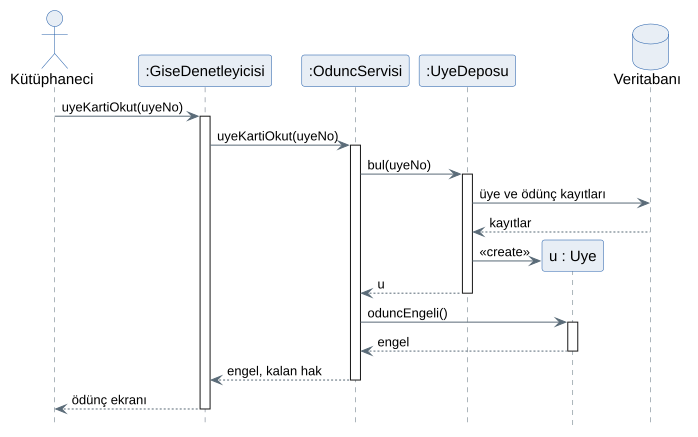
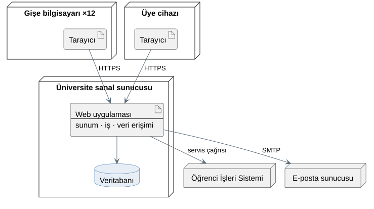
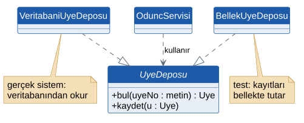
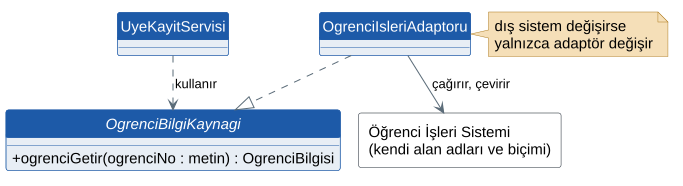

# 11. Hafta: Sistem Mimarisi ve Tasarım Desenleri — Üç Katmanlı Mimari ve MVC

## Giriş: Denetleyici Nerede Yaşar?

Geçen hafta ödünç senaryosunu sıralama diyagramlarıyla çizdik ve sistem olaylarını *:OduncServisi* adlı bir nesneye karşılattık. İki soruyu bilerek açık bıraktık: Bu nesne yazılımın hangi parçasında durur? Diyagramda kendine mesaj olarak çizdiğimiz `uyeyiBul(uyeNo)` aslında nereye gider?

2. haftadaki şelale senaryosunu da hatırlayın. Projenin dördüncü ayında Rektörlük, öğrencilerin cep telefonuyla karekod okutarak ödünç alabilmesini istemişti ve ekip "veritabanı buna göre çizilmedi" diye cevap vermişti. Bir isteğin sistemin her yerini sarsması, sistemin parçalarının birbirine nasıl bağlandığıyla ilgilidir. Ödünç kuralları gişe ekranının koduna gömülmüşse, yeni bir ekran demek kuralların yeniden yazılması demektir.

Bu hafta sistemin **büyük parçalarını** ve aralarındaki bağları tasarlayacağız. Tek tek sınıflardan bir basamak yukarı çıkıyoruz: ekran nerede, kural nerede, veri nerede?

---

## 1. Yazılım Mimarisi Nedir?

Bir binanın mimarisi, odaların duvar rengini değil taşıyıcı sistemini, katların yerleşimini ve tesisatın nereden geçtiğini belirler. Duvar rengi bir haftada değişir; taşıyıcı kolonun yerini değiştirmek binayı yıkmayı gerektirir.

> **Yazılım mimarisi**, sistemin ana parçalarını, bu parçaların sorumluluklarını ve aralarındaki bağları belirleyen, sonradan değiştirilmesi pahalı kararların bütünüdür.

Mimarinin girdisi çoğunlukla **fonksiyonel olmayan gereksinimler ve kısıtlardır**. "Sistem ödünç kaydeder" gereksinimi her mimariyle karşılanabilir. "Ödünç onayı 2 saniyede görünür", "kurallar kod değiştirmeden değiştirilir", "sistem üniversitenin mevcut sunucusunda çalışır" gibi cümleler ise mimariyi şekillendirir.

5. haftanın notunda fonksiyonel olmayan gereksinimlere üç örnek vermiştik. Kütüphanenin gereksinim analizi paketinin tamamında altı fonksiyonel olmayan gereksinim ve dört kısıt vardır. Mimariyi etkileyenler şunlardır:

| Kimlik | Gereksinim veya kısıt |
| :--- | :--- |
| FOG-01 | Barkod okutulduktan sonra ödünç onayı en geç 2 saniyede görünür. |
| FOG-02 | Ödünç ve iade işlemlerini yalnızca kütüphaneci rolündeki kullanıcılar yapabilir. |
| FOG-04 | Veritabanı her gece yedeklenir; bir arızada en fazla bir günlük veri kaybolur. |
| FOG-05 | Ödünç süresi, nüsha sınırı ve ceza tutarı kod değiştirmeden ayarlardan değiştirilebilir. |
| K-01 | Sistem üniversitenin mevcut sanal sunucusunda çalışır. |
| K-04 | İlk sürüm web tabanlıdır; mobil uygulama yoktur. |

4. haftanın teknik fizibilitesinden iki bilgi de buraya eklenir: 12 gişe bilgisayarı güncel web tarayıcılarını çalıştırıyor ve geliştirme ekibi web uygulamalarında deneyimli.

Gereksinim listesi tasarım başladı diye donmaz. Mimari kararlar verilirken yeni bir fonksiyonel olmayan gereksinim veya kısıt ortaya çıkabilir: "gişe ağ kesildiğinde de çalışmalı mı?" sorusu böyledir (7.2). Böyle bir gereksinim bulunduğunda gereksinim listesine kimliğiyle eklenir, kaynağı yazılır ve raporun değişiklik tablosuna işlenir. 10. haftada durum diyagramının analizi geri çağırdığını görmüştük; mimari de aynısını yapabilir.

---

## 2. Sorumlulukları Ayırmak: Uyum ve Bağlaşım

Bir restoranda garson siparişi alır, aşçı yemeği pişirir, kilerci malzemeyi saklar. Garson mutfağa girip yemek pişirmeye başlarsa ya da aşçı salona çıkıp sipariş almaya kalkarsa iş yürür, ama menü değiştiğinde kimin neyi öğrenmesi gerektiği belirsizleşir. Mimari tasarımın iki ölçütü bu sezgiyi adlandırır:

> **Uyum** (*cohesion*): Bir parçanın içindeki işlerin birbiriyle ne kadar ilgili olduğu. Yüksek uyum iyidir: mutfak yalnızca pişirir.
>
> **Bağlaşım** (*coupling*): Bir parçanın başka parçalara ne kadar bağımlı olduğu. Düşük bağlaşım iyidir: garson, aşçının hangi tencereyi kullandığını bilmek zorunda değildir.

İyi bir mimari **yüksek uyum, düşük bağlaşım** hedefler. 9. haftadaki bilgi uzmanı ilkesi sınıf düzeyinde uyumu artırıyordu; bu hafta aynı fikri sistemin büyük parçalarına uyguluyoruz. Buna **sorumlulukların ayrılması** (*separation of concerns*) denir.

---

## 3. Katmanlı Mimari

### 3.1. Üç Katman

İş uygulamalarında en yaygın ayrım, sistemi üç **katmana** (*layer*) bölmektir:

| Katman | Sorumluluğu | Bilmediği |
| :--- | :--- | :--- |
| **Sunum** | Ekranı göstermek, kullanıcının girdisini almak | Ödünç kurallarını, veritabanını |
| **İş mantığı** | İş kurallarını uygulamak, use case'i yürütmek | Ekranın nasıl göründüğünü, verinin hangi tabloda durduğunu |
| **Veri erişimi** | Veriyi okumak ve yazmak, dış sistemlerle konuşmak | Verinin ne için kullanıldığını |

Katmanlı mimarinin tek bir kuralı vardır: **her katman yalnızca altındaki katmanı çağırır.** Sunum iş katmanını çağırır, iş katmanı veri katmanını çağırır. Ters yönde çağrı yoktur; veri katmanı hangi ekranın kendisini kullandığını bilmez. Bir katmanın yalnızca hemen altındakini çağırabildiği biçime **katı katmanlama**, alttaki herhangi bir katmanı çağırabildiği biçime **gevşek katmanlama** denir. Sunum katmanının iş katmanını atlayıp veritabanına doğrudan gitmesi, iki biçimde de kaçınılması gereken bir kısayoldur: o ekran iş kurallarını atlamış olur.

Bu kuralın getirisi değişikliğin yayılmamasıdır:

- Gişe ekranının tasarımı değişirse yalnızca sunum katmanı değişir.
- Gecikme cezası kuralı değişirse yalnızca iş katmanı değişir.
- Veritabanı ürünü değişirse yalnızca veri erişim katmanı değişir.
- Yeni bir ekran türü (mobil uygulama) eklenirse yeni bir sunum katmanı yazılır; iş ve veri katmanları **aynen kullanılır**.

Son madde 2. haftadaki krizin teknik cevabıdır. Ama yalnızca teknik cevabıdır: üyenin kendi telefonundan ödünç alması, FOG-02'deki "yalnızca kütüphaneci" kuralıyla çelişir. Bu bir **iş kuralı** değişikliğidir ve mimari ne kadar iyi olursa olsun önce analizden geçmesi gerekir.

### 3.2. Mantıksal Katman, Fiziksel Düğüm

İngilizcede *layer* kodun mantıksal ayrımını, *tier* ise fiziksel ayrımı (hangi makinede çalıştığı) anlatır. Türkçede ikisine de çoğu zaman "katman" denir ve karışıklık buradan doğar. Bu notta mantıksal ayrım için **katman**, fiziksel ayrım için UML'deki adıyla **düğüm** (*node*) diyoruz.

**Üç katman, üç makine demek değildir.** Üç katmanlı bir uygulama tek bir sunucuda çalışabilir; tersine, iki katmanlı bir uygulama birçok makineye dağıtılabilir. Fiziksel yerleşim için iki yaygın seçenek vardır:

| | İki düğümlü istemci–sunucu | Web tabanlı |
| :--- | :--- | :--- |
| **İstemcide ne çalışır?** | Masaüstü programı: sunum ve çoğu zaman iş mantığı | Yalnızca tarayıcı; sayfayı gösterir |
| **Sunucuda ne çalışır?** | Veritabanı | Web uygulaması (sunum, iş, veri erişimi) ve veritabanı |
| **Kurulum** | Her istemci bilgisayara | Yalnızca sunucuya |
| **Güncelleme** | Her istemcide tekrar | Sunucuda bir kez |
| **Dışarıdan erişim** | Zor | Tarayıcısı olan her cihazdan |

Web tabanlı uygulamada sunum katmanı **sunucuda** çalışır ve sayfayı üretir; tarayıcı yalnızca bu sayfayı gösterir ve kullanıcının girdisini geri gönderir.

---

## 4. MVC: Sunum Katmanının İçi

### 4.1. Model, Görünüm, Denetleyici

Sunum katmanı da kendi içinde karışabilir: ekranın HTML'i, kullanıcının tıkladığı düğmeye ne olacağı ve gösterilecek veri aynı dosyaya yazılırsa, ekranın görünüşünü değiştirmek isteyen biri akışı bozabilir. **MVC** (*Model–View–Controller*) bu üç işi ayırır. Fikir Trygve Reenskaug'un 1979'da Xerox PARC'ta Smalltalk için yaptığı çalışmadan doğdu; bugün web uygulama çatılarının çoğu bu yapıyı kullanır.

| Parça | Sorumluluğu | Kütüphanede |
| :--- | :--- | :--- |
| **Model** | Veri ve iş mantığı; MVC açısından iş katmanına açılan kapı | *OduncServisi* ve alan sınıfları |
| **Görünüm** (*view*) | Veriyi kullanıcıya göstermek | Ödünç ekranı, üyenin "üzerimdeki nüshalar" sayfası |
| **Denetleyici** (*controller*) | Kullanıcının isteğini almak, modeli çağırmak, hangi görünümün gösterileceğini seçmek | *GiseDenetleyicisi* |

Web uygulamasında bir isteğin yolculuğu şöyledir:

Görünüm iş kuralı içermez; "bu üye ödünç alabilir mi?" sorusunu hiçbir zaman kendisi cevaplamaz, denetleyicinin verdiği sonucu gösterir. Denetleyici de kuralı uygulamaz; modeli çağırır. Kuralın tek yeri modeldir.

### 4.2. MVC ve Üç Katman Aynı Şey Değildir

İki yapı sık karıştırılır, çünkü ikisi de üç parçalıdır:

| | Üç katmanlı mimari | MVC |
| :--- | :--- | :--- |
| **Kapsam** | Bütün uygulama | Sunum katmanının içi |
| **Ayırdığı** | Sunum, iş, veri | Görünüm, akış denetimi, model |
| **Veri erişimi** | Ayrı bir katman | Ele almaz; modelin arkasında kalır |

Doğru okuma şudur: MVC, üç katmanlı mimarinin **sunum katmanını** düzenler. MVC'deki "model", iş katmanına açılan kapıdır.

### 4.3. İki Denetleyici: Adlandırma Kararı

"Denetleyici" kelimesi artık iki yerde geçiyor:

- **Larman'ın denetleyicisi** (10. hafta): sistem olayını karşılayan, kullanıcı arayüzünden **bağımsız** nesne. Use case'i yürütür.
- **MVC denetleyicisi**: kullanıcı arayüzünden gelen isteği alan, sunum katmanındaki nesne.

Küçük bir sistemde ikisi aynı sınıf olabilir. Kütüphanede olamaz: gişe ekranı, üyenin web sayfası ve ileride bir mobil uygulama aynı ödünç kurallarını kullanacak. Her arayüzün kendi MVC denetleyicisi olur, hepsi **aynı** use case nesnesini çağırır. Vakada use case nesnesine 10. haftadan beri *OduncServisi* dememizin sebebi budur: katmanlı mimaride bu nesnelerin yaygın adı **uygulama servisidir**. Sistem olayını karşılar, işi alan sınıflarına dağıtır ve iş katmanının en üstünde durur. "Denetleyici" adı MVC'ye kalır.

9. haftada *Katalogda Ara* ve *Rapor Al* için "tek bir nesnenin davranışı değil, servis katmanına ait" demiştik. Yerleri de burasıdır: *KatalogServisi* ve *RaporServisi*.

---

## 5. Vaka: Kütüphane Otomasyonunun Mimarisi

### 5.1. Katmanlar ve İçerikleri

| Katman | İçinde ne var? | Burada **olmayan** |
| :--- | :--- | :--- |
| **Sunum** | Görünümler; MVC denetleyicileri: gişe (kütüphaneci), üye portalı (katalog, üzerimdeki nüshalar), rapor (Daire Başkanı) | Ödünç kuralı, SQL |
| **İş mantığı** | Uygulama servisleri (her use case grubu için bir tane) ve 9. haftanın alan sınıfları | Ekran, HTML, SQL |
| **Veri erişimi** | Her kalıcı varlık için bir depo; Öğrenci İşleri Sistemi ve e-posta sunucusu bağlantıları | İş kuralı |

İki kurala dikkat edin:

- **FOG-02 iş katmanında denetlenir.** Gişe ekranında "ödünç ver" düğmesini yalnızca kütüphaneciye göstermek kullanıcı deneyimi için iyidir ama güvenlik sağlamaz: bir istek ekranı atlayıp doğrudan sunucuya gönderilebilir. *OduncServisi* her çağrıda kullanıcının rolünü kendisi denetlemelidir.
- **Alan sınıfları veritabanını tanımaz.** *Uye.oduncEngeli()* metodu SQL çalıştırmaz; ödünçleri zaten nesne olarak elindedir. Nesneleri veritabanından okuyup oluşturmak deponun işidir.

### 5.2. Sıralama Diyagramı Katmanlardan Geçerken

10. haftadaki birinci sistem olayını, üye kartının okutulmasını, katmanlarla yeniden çizelim:

10. haftaya göre değişenler:

- Olayı önce sunum katmanındaki *GiseDenetleyicisi* alır ve hiçbir karar vermeden *OduncServisi*'ne iletir.
- 10. haftanın kendine mesajı `uyeyiBul(uyeNo)`, artık *UyeDeposu*'na giden `bul(uyeNo)` mesajıdır. Depo veritabanından kayıtları okur ve *Uye* nesnesini oluşturur. Yaratıcı ilkesinin bir maddesi daha işledi: nesneyi oluşturmak için gereken **bilgiye** depo sahiptir.
- **Değişmeyen:** kararı yine *u : Uye* verir. Mimari, iş kuralının yerini değiştirmedi; yalnızca etrafına katmanlar koydu.

### 5.3. Mantıksal DFD'den Mimariye

6. haftada mantıksal DFD çizerken fiziksel ayrıntının tasarıma kaldığını söylemiştik. DFD'nin öğeleri mimaride şöyle karşılık bulur:

| DFD'de | Mimaride | Kütüphanede |
| :--- | :--- | :--- |
| Dış varlık (insan) | Sunum katmanında bir görünüm ve denetleyici | Kütüphaneci → gişe ekranları |
| Dış varlık (sistem) | Veri erişim katmanında bir bağlantı | Öğrenci İşleri Sistemi → *OgrenciIsleriAdaptoru* |
| Süreç | Uygulama servisinin metodu ve alan sınıflarının metotları | 3.0 Nüsha Ödünç Ver → *OduncServisi*, *Uye.oduncAl()* |
| Temel süreç ve karar tablosu | Alan sınıfının metodu | 3.2 Uygunluğu Denetle → *Uye.oduncEngeli()* |
| Veri deposu | Veritabanı tablosu ve depo sınıfı | D1 Üyeler → *UyeDeposu* ve üye tablosu |
| Veri akışı | Katmanlar arası çağrı ve dönüş | "üye no" → `bul(uyeNo)` |

Bir adlandırma rastlantısına dikkat: DFD'nin **veri deposu** ile mimarinin **depo sınıfı** aynı kelimeyi taşır ve gerçekten akrabadır. Biri verinin durduğu yeri, diğeri o yere giden kapıyı anlatır.

### 5.4. Fiziksel Görünüm: Dağıtım Diyagramı

Katmanların hangi makinede çalıştığını UML **dağıtım diyagramı** (*deployment diagram*) gösterir. Kutular **düğümdür** (fiziksel veya sanal makine), içlerindeki belge simgeli kutular çalışan yazılım parçalarıdır.

K-01 kısıtı yüzünden web uygulaması ve veritabanı **aynı** sanal sunucuda çalışıyor: üç mantıksal katman, iki fiziksel düğüm türü (istemci ve sunucu). Bu bir zayıflık değil, ölçeğe uygun bir karardır. Kütüphanenin yükü 12 gişe ve üyelerin sorgularıdır; ayrı bir veritabanı sunucusu kurmak maliyet getirir, FOG-01'in 2 saniyesi için gerekmez. Bedeli de yazılmalıdır: tek sunucu tek arıza noktasıdır. FOG-04'teki gece yedeği bu riski bir günlük veri kaybıyla sınırlar.

Katmanlar mantıksal olarak ayrıldığı için bu karar geri alınabilir: yük artarsa veritabanı ayrı bir sunucuya taşınır ve yalnızca veri erişim katmanının bağlantı ayarı değişir.

---

## 6. Tasarım Desenleri

### 6.1. Desen Nedir?

Mimar Christopher Alexander 1977'de, şehir ve bina tasarımında tekrar tekrar ortaya çıkan sorunlara verilen iyi çözümleri adlandırıp bir katalogda toplamıştı. Yazılımda aynı fikri 1994'te dört yazar (Gamma, Helm, Johnson, Vlissides; kısaca "Dörtlü Çete", *Gang of Four*) uyguladı ve 23 desen tanımladı.

> **Tasarım deseni** (*design pattern*), tekrar eden bir tasarım sorununa verilmiş, adı konmuş ve denenmiş bir çözümdür.

Bir analist desenleri kodlamaz, ama adlarını bilmelidir: geliştirici "buraya bir adaptör koyalım" dediğinde ne söylendiğini anlamak ve bir tasarım kararının gerekçesini okuyabilmek için. MVC de bir desendir (mimari düzeyde). Bu bölümde kütüphanede doğrudan karşılığı olan üç desene bakıyoruz.

Desenler çoğu zaman **arayüz** (*interface*) üzerinden kurulur. UML'de arayüz, adının üstünde «interface» yazan ve yalnızca metot imzaları taşıyan bir sınıf kutusudur; gövdesi yoktur. Bir sınıfın bu metotları gerçekten yazdığını kesikli çizgili, içi boş üçgen uçlu ok gösterir: **gerçekleştirme** (*realization*). Bu "arayüzü" kullanıcı arayüzüyle karıştırmayın; burada bir sözleşmeyi anlatır: "bu metotları sunan her sınıf iş görür."

### 6.2. Depo (Repository)

**Sorun:** İş katmanı, nesneleri veritabanından okumak zorunda. SQL'i servisin içine yazarsak iş katmanı veritabanına bağlanır; veritabanı değişince kurallar da elden geçer, servisi veritabanı olmadan test etmek imkânsız olur.

**Çözüm:** Her kalıcı varlık için, nesneleri sanki bellekteki bir koleksiyondan alıyormuş gibi sunan bir **depo** arayüzü tanımlanır. İş katmanı yalnızca bu arayüzü tanır.

Gerçek sistemde *VeritabaniUyeDeposu* veritabanına gider. Testte *BellekUyeDeposu* kullanılır: "gecikmiş ödüncü olan bir öğrenci" bellekte birkaç satırla kurulur ve *OduncServisi*'nin bu üyeye ödünç vermediği saniyeler içinde sınanır. Test planı 13. haftanın konusu; bu desen onu mümkün kılan şeydir.

### 6.3. Adaptör (Adapter)

**Sorun:** Üye kaydında (UC-08) öğrenci bilgileri Öğrenci İşleri Sistemi'nden gelir. O sistemi biz yazmadık; alan adları, numara biçimi ve çağrı yöntemi kendine özgüdür ve bizden habersiz değişebilir.

**Çözüm:** İş katmanı, kendi diliyle yazılmış bir arayüzü (*OgrenciBilgiKaynagi*) tanır. Dış sistemle konuşan ve onun biçimini bizim biçimimize çeviren sınıf **adaptördür**; tıpkı yurt dışında prizi uydurmak için kullanılan adaptör gibi.

1. haftada Öğrenci İşleri Sistemi'ni sistem sınırının **dışına** koymuştuk. Adaptör, o sınırın koddaki karşılığıdır: sınırın öbür tarafındaki değişiklik, sınırın bu tarafına yalnızca bir sınıf kadar sızar.

### 6.4. Strateji (Strategy)

**Sorun:** Bir hesaplamanın **yöntemi** değişebilir veya duruma göre farklılaşabilir.

**Çözüm:** Her yöntem aynı arayüzü gerçekleştiren ayrı bir sınıfa yazılır; hesaplamayı kullanan nesne hangi yöntemin seçildiğini bilmez.

Kütüphanede ceza bugün "gecikme günü × 2 TL" ile hesaplanıyor. FOG-05 bu **tutarın** kod değiştirmeden değişebilmesini istiyor; bunun için desen gerekmez, tutar ayarlardan okunur. Ama Daire Başkanı bir gün "cezaya üst sınır koyalım, kitabın bedelini geçmesin" derse değişen tutar değil **formüldür**. O zaman *Odunc*, bir *CezaKurali* arayüzüne sorar; "günlük sabit ceza" ve "tavanlı ceza" bu arayüzün iki gerçekleştirmesi olur. Değer değişiyorsa ayar, formül değişiyorsa strateji: bu ayrım bir analistin gereksinim yazarken sorması gereken sorudur.

| Desen | Sorun | Kütüphanede |
| :--- | :--- | :--- |
| **MVC** | Ekran, akış ve veri iç içe | Gişe, üye portalı, rapor sayfaları |
| **Depo** | İş katmanı veritabanına bağlanıyor | *UyeDeposu*, *NushaDeposu*, *OduncDeposu* |
| **Adaptör** | Dış sistemin biçimi içeri sızıyor | *OgrenciIsleriAdaptoru* |
| **Strateji** | Hesaplama yöntemi değişebiliyor | Ceza kuralı (henüz gerekmiyor) |

Son satır bilinçli: bir deseni **gerekmeden** uygulamak da bir tasarım hatasıdır. Her esneklik noktası koda bir sınıf ve bir dolaylılık ekler; ihtiyaç doğmadan eklenen esneklik çoğu zaman hiç kullanılmaz.

---

## 7. Mimari Kararı Gerekçelendirmek

### 7.1. Mimari Karar Kaydı

Mimari kararlar sonradan değiştirilmesi pahalı kararlardır. Bir yıl sonra ekibe katılan biri "neden masaüstü değil de web?" diye sorduğunda cevabın bir yerde yazılı olması gerekir. Michael Nygard'ın 2011'de önerdiği **mimari karar kaydı** (*architecture decision record*) bunun için kısa bir kalıptır:

| Bölüm | İçerik |
| :--- | :--- |
| **Bağlam** | Kararı zorlayan gereksinimler, kısıtlar ve durum |
| **Karar** | Ne seçildi, tek cümleyle |
| **Değerlendirilen seçenekler** | Seçilmeyenler ve neden seçilmedikleri |
| **Sonuçlar** | Kararın getirdikleri ve **bedeli** |

### 7.2. Vaka: MK-01

**MK-01. Web tabanlı, üç katmanlı mimari; tek sanal sunucu**

- **Bağlam:** 12 gişe bilgisayarı tarayıcı çalıştırıyor. Üyeler katalogda arama ve üzerlerindeki nüshaları görme işlerini kütüphane dışından yapmak istiyor. Sistem üniversitenin mevcut sanal sunucusunda çalışacak (K-01). İlk sürümde mobil uygulama yok (K-04), ama 2. haftadaki gibi bir mobil isteği gelecekte beklenmeli. Ekip web uygulamalarında deneyimli; geliştirme dört ay.
- **Karar:** Sunum (MVC), iş mantığı ve veri erişimi katmanlarından oluşan bir web uygulaması; uygulama ve veritabanı aynı sanal sunucuda.
- **Değerlendirilen seçenekler:**
  - *Masaüstü istemci–sunucu:* 12 gişeye kurulum ve her sürümde güncelleme gerektirir; üyelerin dışarıdan erişimini karşılamaz.
  - *Ayrı veritabanı sunucusu:* Yük bunu gerektirmiyor ve K-01 tek sunucu öngörüyor. Katmanlar ayrıldığı için ileride yapılabilir.
- **Sonuçlar:**
  - (+) Kurulum ve güncelleme yalnızca sunucuda.
  - (+) Mobil uygulama eklemek yeni bir sunum katmanı demek; iş ve veri katmanları aynen kalır.
  - (−) Tek sunucu tek arıza noktasıdır; FOG-04'teki gece yedeğiyle en fazla bir günlük veri kaybı kabul edildi.
  - (−) Gişeler ağ bağlantısına bağımlı; ağ kesilirse ödünç verilemez. Bu riskin karşılığı Daire Başkanı'yla konuşulmalı.

Diğer kararlar aynı kalıpla daha kısa yazılır:

| Kayıt | Karar | Dayandığı gereksinim |
| :--- | :--- | :--- |
| MK-02 | Sunum katmanında MVC; her arayüzün kendi denetleyicisi, hepsi aynı uygulama servislerini çağırır | Üç ayrı kullanıcı grubu; gelecekteki mobil istek |
| MK-03 | Rol denetimi iş katmanında, her servis çağrısında | FOG-02 |
| MK-04 | Ödünç süresi, nüsha sınırı ve ceza tutarı ayar tablosunda; alt sınıflar bu değerleri ayardan okur | FOG-05 |
| MK-05 | Veriye erişim depo arayüzleri üzerinden; dış sistemlere adaptörle | Test edilebilirlik; Öğrenci İşleri'nin bağımsız değişmesi |

### 7.3. MK-04 ve 9. Haftanın Kararı

MK-04'e dikkat edin. 9. haftada üye türleri için iki seçenek tartışmış ve **kalıtımı** seçmiştik; o seçimin bir bedelini de yazmıştık: "kural değişirse kod değişir." FOG-05 tam olarak bunu yasaklıyor. Yani 9. haftanın tasarımı bir fonksiyonel olmayan gereksinimle çelişiyordu.

MK-04 çelişkiyi şöyle çözer: *OgrenciUye* ve *AkademisyenUye* alt sınıfları kalır, çünkü türler arasındaki **davranış** farkı (hangi kural uygulanır) hâlâ onlardadır. Ama *enFazlaNusha()* artık sabit bir 3 döndürmez, ayardaki "öğrenci nüsha sınırı" değerini okur. Sayılar veriye, davranış sınıfa gider. Bu, 9. haftadaki iki seçeneğin arasında üçüncü bir yoldur ve bir modelin başka bir modeli düzelttiği bir örnek daha.

Dönem projenizde de böyle bir çelişki bulabilirsiniz: daha önce yazdığınız bir gereksinim, sonradan çizdiğiniz bir tasarımla uyuşmaz. Bu bir başarısızlık değildir; modelleri birbirine karşı denetlediğinizin kanıtıdır. Hangisinin değişeceğine karar verin (gereksinim mi yanlıştı, tasarım mı?), düzeltmeyi yapın ve raporunuzun değişiklik tablosuna gerekçesiyle yazın.

---

## 8. Dönem Projenize Yansıması

Sistem mimarisi, dönem projesinin **detaylı tasarım paketine** girer (nihai rapor şablonunda *Sistem Mimarisi* bölümü). Takımınızla:

1. Fonksiyonel olmayan gereksinimlerinizi ve kısıtlarınızı listeleyin; her birinin mimariyi etkileyip etkilemediğini işaretleyin.
2. Katmanlarınızı çizin (5.1'deki gibi) ve her katmanda hangi sınıfların bulunduğunu yazın. Sınıf diyagramınızdaki her sınıfın bir katmanı olmalı.
3. Her use case grubu için bir uygulama servisi adlandırın. Sistem olaylarınızı hangi servisin karşıladığını yazın.
4. En kritik sistem olayınızın sıralama diyagramını katmanlardan geçerek yeniden çizin.
5. DFD'nizdeki her öğenin mimarideki karşılığını tabloyla gösterin (5.3'teki gibi).
6. Bir dağıtım diyagramı çizin: hangi yazılım parçası hangi makinede çalışıyor?
7. Dış sistemleriniz varsa her biri için bir adaptör adlandırın.
8. En az bir mimari karar kaydını tam kalıpla yazın (bağlam, karar, seçenekler, sonuçlar). Bedeli olmayan bir karar kaydı eksiktir.

Teslim biçimi ve zamanı için dönem projesi kılavuzuna bakın.

---

## 9. İyi Pratikler ve Sık Yapılan Hatalar

| Hata | Neden Tehlikeli? | Doğru Pratik |
| :--- | :--- | :--- |
| **İş kuralını ekrana yazmak** | Her yeni ekranda kural yeniden yazılır; ekranlar birbirini tutmaz. | Kural iş katmanında, alan sınıfının metodunda. Ekran sonucu gösterir. |
| **Yetkiyi yalnızca ekranda denetlemek** | Gizlenen düğme güvenlik sağlamaz; istek ekranı atlayabilir. | Rol denetimi iş katmanında, her çağrıda. |
| **Sunumdan veritabanına kısayol** | O ekran iş kurallarını atlar; veri tutarsızlaşır. | Her istek iş katmanından geçer. |
| **"Üç katman = üç sunucu" sanmak** | Gereksiz donanım maliyeti veya yanlış gerekçe. | Katman mantıksal, düğüm fizikseldir; ikisini ayrı kararlar olarak yazın. |
| **MVC ile üç katmanı aynı saymak** | Veri erişimi ve iş kuralları "model" adı altında karışır. | MVC sunum katmanının içini düzenler. |
| **Gerekçesiz mimari** | "Modern olduğu için mikroservis" gibi kararlar savunulamaz. | Her kararı bir gereksinime veya kısıta bağlayın; bedelini yazın. |
| **Her yere desen** | Gereksiz arayüzler ve sınıflar tasarımı okunmaz yapar. | Deseni bir sorun varsa kullanın; sorunun adını koyun. |
| **Dış sistemin biçimini içeri taşımak** | Dış sistem değişince iş katmanı da değişir. | Sınırda bir adaptör. |

---

## 10. Kendinizi Deneyin

1. **Hangi katman?** Aşağıdakilerin her biri hangi katmana aittir? (a) Son iade tarihinin hesaplanması (b) Son iade tarihinin gün.ay.yıl biçiminde gösterilmesi (c) Ödünç kaydının tabloya yazılması (d) Barkod okuyucudan gelen numaranın alınması (e) Öğrenci İşleri'nden gelen "OGR_NO" alanının *uyeNo*'ya çevrilmesi (f) Gecikme e-postasının metninin hazırlanması. Hangisinde karar vermekte zorlandınız? Neden?
2. **Mobil ödünç:** Rektörlük yine karekodla mobil ödünç istiyor. Mimaride hangi parçalar eklenir, hangileri aynen kalır? Hangi gereksinim ve iş kuralı önce değişmeli? Bu değişiklik için bir mimari karar kaydı taslağı yazın.
3. **Ağ kesildiğinde:** MK-01'in son sonucunda gişelerin ağa bağımlı olduğu yazıyor. Bu riski azaltmak için ne önerirsiniz? Önerinizin mimariye ve hangi gereksinime maliyeti olur?
4. **İade, katmanlarla:** UC-05 Nüsha İadesi Al için sıralama diyagramını katmanlardan geçerek çizin. Hangi depolar çağrılır? Ceza oluşursa onu veritabanına kim yazar?
5. **Ayar mı, strateji mi?** Şu değişiklik istekleri için ayar mı, strateji mi, yoksa ikisi de değil mi? (a) Öğrenci ödünç süresi 15 günden 21 güne çıksın (b) Hafta sonları gecikme gününe sayılmasın (c) Akademisyenlere ceza uygulanmasın (d) Lisansüstü öğrenciler için yeni bir üye türü eklensin.
6. **Hatayı bulun:** Bir takımın mimari şemasında sunum katmanındaki *OduncSayfasi*, nüsha durumunu doğrudan veritabanında "ödünçte" yapıyor; *Uye* sınıfı ödünçlerini saymak için kendi içinde SQL sorgusu çalıştırıyor; *RaporServisi* görünüm sınıflarını çağırıp HTML üretiyor. Kaç kural çiğneniyor? Her biri hangi değişiklikte sorun çıkarır?
7. **Kendi projeniz:** Projenizin en önemli fonksiyonel olmayan gereksinimini seçin. Bu gereksinim mimarinizde hangi kararı zorunlu kılıyor? O kararın bedeli ne?

---

*Öğr. Gör. Turgay Taymaz · Afyon Kocatepe Üniversitesi*
*Bu materyal CC BY-NC-SA 4.0 ile lisanslanmıştır. Kullanırken kaynak gösteriniz.*
*Kaynak: https://github.com/ttaymaz/ders-notlari*
