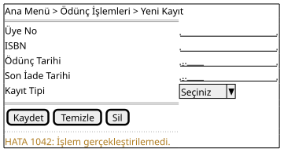
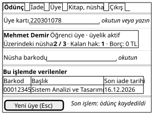
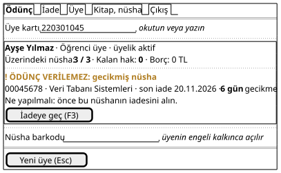
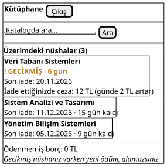

# 12. Hafta: Arayüz Tasarımı ve İBE İlkeleri — Nielsen'in 10 Sezgisi, Wireframe ve Mockup

## Giriş: Gişede Sıra Var

Pazartesi sabahı, dönemin ilk haftası. Gişenin önünde on iki kişilik bir sıra var ve kütüphanede işe yeni başlamış bir kütüphaneci ilk ödüncünü veriyor. Ekranda "Üye No", "ISBN", "Ödünç Tarihi" ve "Son İade Tarihi" alanları var. Kütüphaneci son iade tarihini takvimden sayıyor, "Kaydet"e basıyor ve ekranda "HATA 1042" yazıyor. Neyin yanlış gittiğini kimse bilmiyor; sıra uzuyor.

Bu sistemin sınıf diyagramı kusursuz olabilir. Mimarisi doğru katmanlara ayrılmış, kuralları doğru yere yazılmış olabilir. Kullanıcı için sistem yine de **ekrandır**; gördüğü ve dokunduğu tek şey odur. 5. haftada yazdığımız iki gereksinim doğrudan ekranla ilgiliydi:

- **FOG-01:** Barkod okutulduktan sonra ödünç onayı en geç 2 saniyede görünür.
- **FOG-03:** Yeni bir kütüphaneci, 30 dakikalık eğitimden sonra ödünç işlemini yardımsız tamamlayabilir.

Geçen hafta görünümlerin mimarideki **yerini** belirledik. Bu hafta görünümlerin **kendisini** tasarlayacağız: neyi göstereceğiz, nereye koyacağız, kullanıcının hata yapmasını nasıl önleyeceğiz?

---

## 1. Kullanılabilirlik

**İnsan–bilgisayar etkileşimi** (İBE; *human–computer interaction*), insanların bilgisayar sistemlerini nasıl kullandığını ve bu sistemlerin insanlara göre nasıl tasarlanacağını inceleyen alandır. Alanın merkezindeki kavram kullanılabilirliktir.

> **Kullanılabilirlik** (*usability*): Belirli kullanıcıların, belirli bir kullanım bağlamında, belirli hedeflere **etkililik**, **verimlilik** ve **memnuniyetle** ulaşabilme derecesi (ISO 9241-11).

Tanımdaki üç "belirli" kelimesi önemlidir: kullanılabilirlik ekranın kendi özelliği değil, **kim, nerede ve ne için** kullandığıyla birlikte ölçülür. Gişede günde yüz ödünç veren bir kütüphaneci için hızlı olan ekran, ayda bir giren bir üye için anlaşılmaz olabilir.

Jakob Nielsen kullanılabilirliği beş bileşene ayırır. Her birinin ölçülebilir bir karşılığı vardır, bu yüzden fonksiyonel olmayan gereksinim yazarken doğrudan kullanılabilir:

| Bileşen | Soru | Kütüphanede |
| :--- | :--- | :--- |
| **Öğrenilebilirlik** | İlk kez kullanan, temel işleri ne kadar çabuk yapabiliyor? | FOG-03: 30 dakikalık eğitim |
| **Verimlilik** | Öğrendikten sonra işleri ne kadar hızlı yapıyor? | FOG-01: 2 saniye; gişede sıra |
| **Hatırlanabilirlik** | Bir süre kullanmayan, geri döndüğünde yeniden öğrenmek zorunda mı? | Ayda bir rapor alan Daire Başkanı |
| **Hatalar** | Ne sıklıkla hata yapıyor, hatadan kolay dönebiliyor mu? | Yanlış nüshayı okutmak |
| **Memnuniyet** | Kullanmak hoşuna gidiyor mu? | Üyenin portalı tekrar ziyaret etmesi |

---

## 2. Kullanıcıyı ve Bağlamı Tanımak

Ekran tasarımına kullanıcıyla başlanır, ekranla değil. 4. haftadaki paydaş analizinden ve 5. haftadaki aktörlerden kütüphanenin üç kullanıcı grubu çıkar:

| | Kütüphaneci | Üye | Daire Başkanı |
| :--- | :--- | :--- | :--- |
| **Sıklık** | Her gün, yüzlerce işlem | Ayda birkaç kez | Ayda bir |
| **Ortam** | Gişe bilgisayarı, barkod okuyucu, önünde sıra | Telefon veya kendi bilgisayarı | Ofis bilgisayarı |
| **Uzmanlık** | Sistemde uzmanlaşır | Her seferinde acemi sayılır | Konuda uzman, sistemde acemi |
| **Öncelik** | Verimlilik, hata önleme | Öğrenilebilirlik, açıklık | Hatırlanabilirlik, özet |

Bu tablonun sonucu, **tek bir "iyi ekran" olmadığıdır**. Kütüphanecinin ekranı yoğun olabilir, kısayollarla dolu olabilir; çünkü o ekranı her gün kullanır ve fareye uzanmak sırayı uzatır. Üyenin ekranı ise sade olmalı ve her şeyi açık cümlelerle söylemelidir; çünkü üye ekranı en son bir ay önce görmüştür.

---

## 3. Nielsen'in 10 Sezgisi

Nielsen, Rolf Molich ile 1990'da yaptığı çalışmayı 1994'te gözden geçirerek kullanılabilirlik sorunlarının çoğunu yakalayan on genel ilke yayımladı. Bunlara **sezgi** (*heuristic*) denir: kesin kurallar değil, deneyimden süzülmüş başparmak kurallarıdır.

| # | Sezgi | Anlamı | Kütüphanede |
| :-: | :--- | :--- | :--- |
| 1 | **Sistem durumunun görünürlüğü** | Kullanıcı ne olduğunu, makul bir sürede, her zaman bilmeli | Kart okutulunca üyenin durumu ve kalan hakkı hemen görünür; "ödünç kaydedildi" bildirimi |
| 2 | **Sistem ile gerçek dünya arasında uyum** | Kullanıcının dili, kavramları ve sırası | "Nüsha", "son iade tarihi", "barkod"; "kayıt tipi", "işlem kodu" değil |
| 3 | **Kullanıcı denetimi ve özgürlüğü** | Yanlışlıkla girilen yoldan kolay çıkış, geri alma | "Yeni üye (Esc)" ile işlem temizlenir |
| 4 | **Tutarlılık ve standartlar** | Aynı şey her yerde aynı adla, aynı yerde | Ödünç ve iade ekranlarının yerleşimi aynı; tarih biçimi her yerde gün.ay.yıl |
| 5 | **Hata önleme** | Hatayı mesajla düzeltmek yerine hiç yapılamaz kılmak | Son iade tarihi elle girilmez, sistem hesaplar; engeli olan üyeye nüsha alanı kapalıdır |
| 6 | **Hatırlamak yerine tanıma** | Kullanıcı bilgiyi akılda tutmak zorunda kalmamalı | Üyenin üzerindeki nüshalar ekranda; kütüphaneci kuralları ezberlemez |
| 7 | **Esneklik ve kullanım verimliliği** | Acemiye yol, uzmana kısayol | Barkod okuyucu alanı kendisi doldurur; F3 ile iadeye geçiş |
| 8 | **Estetik ve sade tasarım** | İlgisiz bilgi, ilgili bilgiyle yarışır | Ödünç ekranında üyenin adresi, doğum tarihi yok |
| 9 | **Hataları tanıma, anlama ve düzeltmeye yardım** | Hata mesajı sade dille sorunu söyler ve çözüm önerir | "HATA 1042" değil, "Gecikmiş nüsha: 6 gün. Önce iadesini alın." |
| 10 | **Yardım ve belgeler** | Gerekirse aranabilir, işe odaklı yardım | Alanların yanında kısa ipucu: "okutun veya yazın" |

Beşinci sezgi ile dokuzuncu arasındaki sıraya dikkat edin: **önce hatayı önleyin**, önleyemediğinizi iyi bir mesajla anlatın. En iyi hata mesajı hiç gösterilmeyen mesajdır.

Dokuzuncu sezginin kütüphanedeki karşılığı 10. haftada tasarıma çoktan girdi. *Uye.oduncEngeli()* metodunu evet/hayır yerine engelin **nedenini** döndürecek biçimde değiştirmiştik, çünkü senaryo nedeni göstermek istiyordu. O kararın ekrandaki karşılığı aşağıdaki "gecikmiş nüsha" mesajıdır: tasarımın alt katmanlarında verilen bir karar, kullanıcının gördüğü mesajın kalitesini belirledi.

---

## 4. Sezgisel Değerlendirme

### 4.1. Yöntem

Sezgiler yalnızca tasarlarken değil, var olan bir ekranı **değerlendirirken** de kullanılır. **Sezgisel değerlendirme** (*heuristic evaluation*), birkaç değerlendiricinin bir arayüzü tek tek inceleyip her sorunu ihlal ettiği sezgiyle birlikte yazdığı ucuz ve hızlı bir yöntemdir.

- Değerlendiriciler önce **ayrı ayrı** çalışır, sonra bulgularını birleştirir. Birlikte çalışan değerlendiriciler birbirinin gördüğünü görür.
- Nielsen'in verilerine göre tek bir değerlendirici sorunların yaklaşık üçte birini bulur; **beş** değerlendirici yaklaşık dörtte üçünü bulur. Beşten sonra her yeni değerlendiricinin katkısı azalır.
- Her bulguya bir **önem derecesi** verilir:

| Derece | Anlamı |
| :-: | :--- |
| 0 | Kullanılabilirlik sorunu değil |
| 1 | Kozmetik; zaman kalırsa düzeltilir |
| 2 | Küçük; düşük öncelik |
| 3 | Büyük; yüksek öncelik |
| 4 | Felaket; ürün bu haliyle çıkmamalı |

Sezgisel değerlendirme gerçek kullanıcıyla yapılan testin yerini tutmaz; uzmanın gözünden kaçan sorunları ancak kullanıcı gösterir. Ama kullanıcı testinden önce yapıldığında en bariz sorunları ucuza ayıklar.

### 4.2. Vaka: Sorunlu Bir Ödünç Formu

Girişteki ekran şuna benziyordu:

| Bulgu | Sezgi | Derece |
| :--- | :--- | :-: |
| **ISBN alanı:** Ödünç verilen kitap değil nüshadır (2. haftanın krizi). ISBN aynı kitabın bütün nüshalarında aynıdır; hangi nüshanın kimde olduğu bilinemez. | 2 | 4 |
| **Son iade tarihi elle giriliyor:** Kural (İK-01, İK-02) sistemin hesaplaması gereken bir şey; kütüphaneci yanlış sayabilir. 11. haftada kuralın yerinin iş katmanı olduğunu söylemiştik; ekran bu kuralı kullanıcıya devretmiş. | 5 | 3 |
| **Üyenin durumu görünmüyor:** Kütüphaneci üyenin gecikmesi veya borcu olduğunu ancak "Kaydet"e bastıktan sonra öğreniyor. | 1 | 3 |
| **"HATA 1042":** Sorunu da çözümü de söylemiyor. | 9 | 3 |
| **"Sil" düğmesi "Kaydet"in yanında, onaysız:** Neyi sildiği de belli değil. | 3, 5 | 3 |
| **Her alan fareyle ve elle dolduruluyor:** Barkod okuyucu kullanılmıyor; FOG-01'in 2 saniyesi ekran yüzünden tutturulamaz. | 7 | 2 |
| **Ödünç tarihi elle giriliyor:** Ödünç her zaman bugün yapılır. | 5 | 2 |
| **"Kayıt Tipi: Seçiniz":** Kütüphanecinin dünyasında karşılığı olmayan bir alan. | 2, 8 | 1 |

İlk satırın derecesi 4: bu bir arayüz hatasından çok bir **model** hatasıdır ve ekranda görünür hale gelmiştir. Sezgisel değerlendirme bazen ekranın arkasındaki analizi de sorgular.

---

## 5. Modelden Ekrana

### 5.1. Bilgi Mimarisi: Ekran Haritası

Tek tek ekranları çizmeden önce ekranların **nasıl örgütlendiğine** karar verilir. Buna **bilgi mimarisi** (*information architecture*) denir: hangi ekranlar var, nasıl gruplanıyor, kullanıcı birinden ötekine nasıl geçiyor? En basit gösterimi bir ekran haritasıdır:

Harita 5. haftanın use case diyagramından türetildi ve onu **denetler**:

- **Gruplama aktöre göredir.** Kütüphaneci üye portalının ekranlarını görmez; giriş, kullanıcının rolüne göre doğru bölüme götürür. FOG-02'nin ekrandaki karşılığı budur (denetimin asıl yeri ise 11. haftada söylediğimiz gibi iş katmanıdır).
- **Her use case bir ekrana düşer mi?** UC-04 ve UC-06 kendi ekranları olmayan, ödünç ve iade ekranlarının içinde çalışan use case'lerdir (`include` ve `extend`). UC-09 Gecikme Bildirimi Gönder'in hiç ekranı yoktur; aktörü Zaman'dır ve "arayüzü" üyeye giden e-postadır. O e-postanın metni de bir arayüz tasarımıdır ve aynı sezgilerle değerlendirilir.
- Katalog ekranından açılan kitap ayrıntısı, raftaki nüsha sayısını gösterir (9. haftanın *Kitap.raftakiNushaSayisi()* metodu).

### 5.2. Ekranın Öğeleri Nereden Gelir?

Bir ekranı boş sayfadan değil, önceki haftaların modellerinden kurarsınız:

| Modelde | Ekranda | Kütüphanede |
| :--- | :--- | :--- |
| Use case senaryosunun aktör adımları | Kullanıcının yaptıkları; ekranın akışı | "Üye kartını okutur" → üye kartı alanı odakta |
| Sistem olayı (10. hafta) | Girdi alanı veya düğme | `uyeKartiOkut(uyeNo)` → üye kartı alanı |
| Sistem olayının dönüşü | Gösterilen bilgi | engel, kalan hak → üye bilgi kutusu |
| Alternatif akışlar | Uyarı ve hata durumları | 3a–3c → engel kutusu |
| Veri sözlüğü biçimi (7. hafta) | Girdi denetimi | barkod 8 rakam → 8 rakam değilse alan kabul etmez |
| İş kuralı | Kullanıcıya gösterilen açıklama | İK-04 → "Gecikmiş nüshanız varken yeni ödünç alamazsınız" |
| Durum diyagramı (10. hafta) | Durum gösterimi | *Ödünç* durumu Gecikmiş → "GECİKMİŞ" etiketi |

Bu tablo, arayüzü izlenebilirlik zincirine bağlar. Ekranda kaynağı olmayan bir alan ya gereksizdir ya da analizde unutulmuş bir veriyi işaret eder. "Kayıt Tipi" alanının kaynağı yoktu.

---

## 6. Eskiz, Wireframe, Mockup, Prototip

### 6.1. Sadakat Düzeyleri

Bir ekranı tasarlamak tek bir adım değildir; ayrıntı, kararlar netleştikçe eklenir. Ayrıntının düzeyine **sadakat** (*fidelity*) denir:

| | Eskiz | Wireframe | Mockup | Prototip |
| :--- | :--- | :--- | :--- | :--- |
| **Ne gösterir?** | Kabaca fikir | Yerleşim, içerik, öğeler | Renk, yazı tipi, görsel ayrıntı | Tıklanınca ne olduğu |
| **Ne göstermez?** | Hemen hemen hiçbir şey | Renk, görsel stil | Davranış | — |
| **Araç** | Kâğıt, kalem, tahta | Kâğıt veya wireframe aracı | Tasarım aracı | Tasarım aracı veya kod |
| **Maliyet** | Dakikalar | Saatler | Günler | Günler, haftalar |
| **Ne zaman?** | İlk fikir, ekip içi | Yapı tartışması, kullanıcıyla ilk görüşme | Görsel onay | Kullanıcı testi |

**Wireframe** (tel kafes), bir ekranın iskeletidir: hangi bilgi nerede, hangi alan hangi sırayla, hangi düğme nerede. Bilerek gri ve sadedir. Renk ve görsel ayrıntı yoksa toplantıdakiler mavinin tonunu tartışmaz, yapıyı tartışır. **Mockup** aynı ekranın görsel olarak bitmiş halidir ama tıklanmaz. **Prototip** tıklanabilir, kullanıcı onunla bir görevi deneyebilir.

Düşük sadakatin değeri ucuzluğudur: kâğıda çizilmiş bir ekranı kullanıcı rahatça eleştirir ve atmaktan kimse üzülmez. Günlerce emek verilmiş, renkli bir mockup ise eleştiriyi frenler. Bu yüzden tasarım **düşükten yükseğe** ilerler.

Bu derste ve dönem projesinde wireframe düzeyinde kalıyoruz. Kâğıda çizip fotoğraflamak da, bir çizim aracı kullanmak da kabul edilir; önemli olan yapının okunması ve kararların gerekçesidir. Bu notun wireframe'leri metinden çizim üreten bir araçla yapıldı; kaynakları şemalarla birlikte duruyor.

### 6.2. Vaka: Gişe Ödünç Ekranı

Kütüphanecinin en sık kullandığı ekran, UC-03'ün ekranıdır. Üye kartı okutulmuş, engeli yok, bir nüsha verilmiş:

Aynı ekran, üyenin engeli varsa:

Tasarım kararları ve gerekçeleri:

| Karar | Gerekçe |
| :--- | :--- |
| Ekran açıldığında imleç üye kartı alanında; barkod okuyucu numarayı yazıp kendisi onaylar | Fareye uzanmadan işlem (sezgi 7; FOG-01) |
| Kart okutulunca üye kutusu hemen dolar: ad, tür, durum, üzerindeki nüsha, kalan hak, borç | Kütüphaneci sormadan görür (sezgi 1, 6) |
| Engel varsa nüsha alanı kapalı | Engelli üyeye ödünç vermeyi denemek bile mümkün değil (sezgi 5) |
| Engel mesajı nedeni, ilgili nüshayı ve ne yapılacağını söyler; iadeye tek tuşla geçilir | Sezgi 9; kütüphaneci kuralı ezberlemez (sezgi 6) |
| Engel, simge ve metinle ("! ÖDÜNÇ VERİLEMEZ") gösterilir, yalnızca renkle değil | Erişilebilirlik (bölüm 7) |
| Verilen nüshalar ve son iade tarihleri listede kalır | Kütüphaneci tarihi üyeye söyler (UC-03 adım 7) |
| Üst sekmeler ekran haritasıyla aynı; iade ekranı aynı yerleşimde | Sezgi 4; FOG-03'teki 30 dakika |
| Ekranda üyenin adresi, telefonu, doğum tarihi yok | Ödünç için gerekmez (sezgi 8) |

Engel ekranındaki üyenin üç nüshası da var, yani sınırı da dolu. Ama mesaj yalnızca gecikmeyi söylüyor. Bu bir eksik değil: 6. haftadaki karar tablosunun "ilk engel gösterilir" kuralı, 10. haftada `break` parçalarıyla sıralama diyagramına, şimdi de ekrana taşındı.

Bu wireframe bir soruyu da ortaya çıkardı: kütüphaneci **yanlış nüshayı okutursa** ne olur? Ödünç kaydı anında oluşuyor ve ekranda geri alma yolu yok. Üçüncü sezgi bir geri alma ister. Bu, yeni bir use case mi, iadenin bir kullanım biçimi mi, yoksa bir onay adımı mı gerektirir? Bölüm sonunda tartışacağız; bir wireframe'in analize soru sorabildiğini görmek bu haftanın amaçlarından biridir.

### 6.3. Vaka: Üye Portalı

Üyenin ekranı, farklı bir kullanıcı ve farklı bir cihaz içindir. İlk sürüm web tabanlıdır (K-04), ama üyelerin önemli bir kısmının siteye telefondan girmesi beklenir. Bu yüzden wireframe telefon genişliğinde çizildi:

- Kütüphanecinin ekranındaki kısaltmalar ve kısayollar yok; her bilgi bir cümleyle söyleniyor (öğrenilebilirlik).
- Gecikmiş nüsha en üstte ve etiketli. Ceza tutarı "iade ettiğinizde" diye yazıldı, çünkü 10. haftanın ödünç durum diyagramına göre ceza iade anında oluşur; o ana kadar tutar her gün artar. Ekran, modelin söylediğini söylemeli.
- Son satır İK-04'ü üyenin diliyle anlatır: üye gişeye gelmeden neden ödünç alamayacağını öğrenir.

---

## 7. Erişilebilirlik

Bir arayüz, görme, işitme, hareket veya algı farklılıkları olan kullanıcılar tarafından da kullanılabilmelidir. Web için uluslararası referans W3C'nin **WCAG** (*Web Content Accessibility Guidelines*) yönergeleridir; güncel sürümü 2023'te yayımlanan WCAG 2.2'dir. Tasarım aşamasında akılda tutulması gereken birkaç ilke:

- **Bilgi yalnızca renkle verilmez.** Renk körlüğü olan bir kullanıcı kırmızı ile yeşili ayırt edemeyebilir. "Gecikmiş" durumu renkle birlikte bir simge ve kelimeyle de gösterilir.
- **Yeterli kontrast.** Normal metin ile arka planı arasında en az 4,5:1 kontrast oranı önerilir.
- **Klavyeyle erişim.** Her işlem fare olmadan yapılabilmelidir. Gişe ekranında bu zaten verimlilik gereksinimiydi; erişilebilirlik için de gereklidir.
- **Alanların etiketi vardır.** Ekran okuyucu, etiketi olmayan bir alanın ne istediğini söyleyemez.
- **Metin büyütülebilir.** Yazı büyütüldüğünde yerleşim bozulmamalıdır.

Erişilebilirlik bir "ek özellik" değildir. Kamu kurumlarının siteleri için çoğu ülkede yasal bir yükümlülüktür ve dönem projenizin yasal fizibilitesinde değerlendirilmesi gereken bir konudur.

---

## 8. Dönem Projenize Yansıması

Arayüz tasarımı, dönem projesinin **detaylı tasarım paketine** girer (nihai rapor şablonunda *Kullanıcı Deneyimi ve Arayüz Tasarımı* bölümü). Takımınızla:

1. Kullanıcı gruplarınızı 2. bölümdeki tablo gibi çıkarın: sıklık, ortam, uzmanlık, öncelik.
2. Use case diyagramınızdan bir ekran haritası çizin. Her use case'in hangi ekranda karşılandığını yazın; ekranı olmayan use case'ler için nedenini belirtin.
3. En kritik iki veya üç ekranınızın wireframe'ini çizin. Kritik senaryonuzun ekranı mutlaka bunlardan biri olsun.
4. Her ekran için önemli bir alternatif akışın (hata veya engel durumu) ekranını da çizin.
5. Her wireframe'in altına bir karar–gerekçe tablosu yazın (6.2'deki gibi); kararları sezgilere, FOG'lara ve iş kurallarına bağlayın.
6. Ekranlarınızdaki her alanın kaynağını gösterin (5.2'deki gibi): sistem olayı, veri sözlüğü, iş kuralı.
7. Takım içinde bir sezgisel değerlendirme yapın: her üye ekranları **ayrı ayrı** incelesin, bulgular sezgi ve önem derecesiyle birleştirilsin, en az bir düzeltme wireframe'e yansısın.

Teslim biçimi ve zamanı için dönem projesi kılavuzuna bakın.

---

## 9. İyi Pratikler ve Sık Yapılan Hatalar

| Hata | Neden Tehlikeli? | Doğru Pratik |
| :--- | :--- | :--- |
| **Ekranla başlamak** | Kullanıcı ve görev bilinmeden çizilen ekran, tasarımcının kendisi için çizilmiştir. | Önce kullanıcı grupları ve use case'ler; sonra ekran haritası; en son ekran. |
| **Veritabanı tablosunu forma çevirmek** | Her sütun bir alan olur; kullanıcının görevi kaybolur. ISBN ve "kayıt tipi" böyle gelir. | Alanlar sistem olaylarından ve senaryo adımlarından gelsin. |
| **Hesaplanabileni kullanıcıya sordurmak** | Kullanıcı yanlış hesaplar; kural iki yerde yazılır. | Son iade tarihi, ceza tutarı sistemden gelir. |
| **Hata kodu göstermek** | Kullanıcı sorunu ve çözümü öğrenemez. | Sade dille sorun ve ne yapılacağı. |
| **Herkese aynı ekran** | Uzman yavaşlar, acemi kaybolur. | Kullanıcı grubuna göre yoğunluk ve dil. |
| **İlk çizimi mockup yapmak** | Renk tartışılır, yapı tartışılmaz; değiştirmek pahalılaşır. | Düşük sadakatten başlayın. |
| **Bilgiyi yalnızca renkle vermek** | Renk körü kullanıcı ve siyah-beyaz çıktı bilgiyi kaybeder. | Renk + simge + metin. |
| **Wireframe'i gerekçesiz teslim etmek** | Okuyan, kararların bilinçli mi rastlantı mı olduğunu bilemez. | Her ekrana karar–gerekçe tablosu. |

---

## 10. Kendinizi Deneyin

1. **İade ekranı:** UC-05 Nüsha İadesi Al için gişe ekranının wireframe'ini çizin. Ödünç ekranıyla tutarlı olmalı (sezgi 4). Gecikme varsa ceza tutarı nerede ve nasıl gösterilir? Alternatif akış 2a (açık ödünç kaydı yok) ekranda nasıl görünür?
2. **Yanlış okutulan nüsha:** 6.2'nin sonundaki soruyu tartışın. Kütüphaneci yanlış nüshayı okuttuğunda ne olmalı? Üç seçeneği (yeni bir "ödüncü iptal et" use case'i, iadeyle düzeltme, kaydetmeden önce onay adımı) FOG-01, sezgi 3 ve sezgi 5 açısından karşılaştırın. Hangisi sınıf diyagramını değiştirir?
3. **Rapor ekranı:** Daire Başkanı ayda bir giriş yapıyor. Gecikme raporu ekranını onun için tasarlayın. Hatırlanabilirlik bu ekranda neyi değiştirir?
4. **Gecikme e-postası:** UC-09'un ekranı yok ama üyeye bir e-posta gidiyor. Bu e-postanın metnini yazın ve dokuzuncu sezgiyle değerlendirin: üye sorunu ve ne yapacağını anlıyor mu?
5. **Değerlendirin:** Sık kullandığınız bir uygulamanın (ders kayıt sistemi, bir bankacılık uygulaması, bir yemek siparişi uygulaması) bir ekranını seçin. En az beş sorun bulun; her birine sezgi numarası ve önem derecesi verin. Sonra bir arkadaşınızın listesiyle karşılaştırın: aynı sorunları mı buldunuz?
6. **Kaynağı olmayan alan:** Bir takım üye kayıt ekranına "Doğum Yeri", "Medeni Durum" ve "T.C. Kimlik No" alanlarını koymuş. 4. haftanın yasal fizibilitesi ve 5.2'deki tablo açısından bu alanları değerlendirin.
7. **Kendi projeniz:** Kritik ekranınızın wireframe'ini kâğıda çizin ve projenizi bilmeyen birine gösterin. Ona bir görev verin ("şunu yapmaya çalış") ve hiç yardım etmeden izleyin. Nerede durakladı?

---

*Öğr. Gör. Turgay Taymaz · Afyon Kocatepe Üniversitesi*
*Bu materyal CC BY-NC-SA 4.0 ile lisanslanmıştır. Kullanırken kaynak gösteriniz.*
*Kaynak: https://github.com/ttaymaz/ders-notlari*
