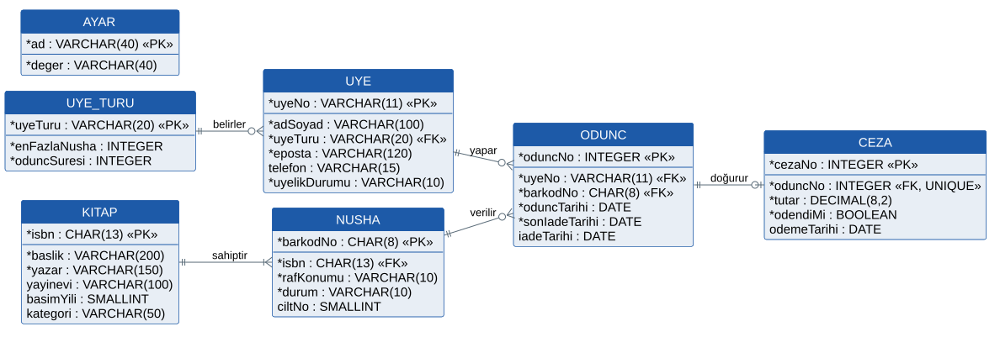

# 13. Hafta: Veritabanı Tasarımı, Normalizasyon, Test ve Geçiş

## Giriş: Defterin Kırk Sayfası

1. haftada kütüphanenin defterini anlatmıştık: her ödünç bir satıra yazılıyor, satırda üyenin adı, numarası, kitabın adı ve tarih var. Bir öğrencinin soyadı evlilikle değiştiğinde ne olur? Adı, defterin kırk ayrı sayfasında kırk ayrı satırda yazılıdır. Birkaçı düzeltilir, gerisi unutulur. Bir yıl sonra aynı numaranın iki farklı adla göründüğü satırlar vardır ve hangisinin doğru olduğunu kimse bilmez.

Bu sorunun adı **veri tekrarıdır** ve çözümü yeni bir yazılım değil, verinin doğru **yapılandırılmasıdır**. Kötü yapılandırılmış bir veritabanı, defterin bütün sorunlarını hızla ve büyük ölçekte yeniden üretir.

Bu hafta tasarım paketinin son parçalarını tamamlıyoruz:

- 7. haftanın mantıksal ERD'sini **fiziksel bir veritabanı şemasına** çevireceğiz.
- Şemanın veri tekrarından arındığını **normalizasyonla** doğrulayacağız.
- Bütün dönem boyunca ürettiğimiz modellerden bir **test planı** çıkaracağız.
- Sistemin defterin yerini nasıl alacağını, yani **canlıya geçişi** planlayacağız.

---

## 1. Mantıksal Modelden Fiziksel Şemaya

### 1.1. Ne Değişiyor?

7. haftada üç model düzeyinden söz etmiştik: kavramsal, mantıksal ve fiziksel. Mantıksal ERD hangi verinin tutulacağını ve nasıl ilişkilendiğini söyler, ama belirli bir veritabanı ürününe bağlı değildir. **Fiziksel şema**, aynı modelin bir ilişkisel veritabanında **tablolar, sütunlar, veri türleri ve kısıtlar** olarak yazılmış halidir.

| Mantıksal modelde | Fiziksel şemada |
| :--- | :--- |
| Varlık | Tablo |
| Nitelik | Sütun ve veri türü |
| Birincil anahtar | `PRIMARY KEY` kısıtı |
| İlişki | Yabancı anahtar sütunu ve `FOREIGN KEY` kısıtı |
| Zorunlu nitelik | `NOT NULL` |
| Benzersiz değer | `UNIQUE` |
| Veri sözlüğündeki geçerli değerler | `CHECK` kısıtı veya başvuru tablosu |
| Sık yapılan arama | İndeks |

Bu notta SQL'in standart türlerini kullanıyoruz. Ürünler arasında küçük farklar vardır (bazısı `BOOLEAN` yerine sayı kullanır); dönem projenizde seçtiğiniz ürünün türlerini yazın.

### 1.2. Dönüşüm Kuralları

| Kural | Kütüphanede |
| :--- | :--- |
| **Veri sözlüğündeki tür → SQL türü.** metin → `VARCHAR(n)` veya sabit uzunluktaysa `CHAR(n)`; sayı → `INTEGER`; tarih → `DATE`; para → `DECIMAL`; mantıksal → `BOOLEAN` | *barkodNo* her zaman 8 rakam → `CHAR(8)`; *tutar* → `DECIMAL(8,2)` |
| **Rakamdan oluşan kimlik metin olarak tutulur.** Üzerinde hesap yapılmaz, baştaki sıfır kaybolmamalıdır | *barkodNo* "00012345" bir sayı olsaydı "12345" olurdu |
| **1:N ilişki → "çok" tarafına yabancı anahtar** | *NUSHA.isbn*, *ODUNC.uyeNo*, *ODUNC.barkodNo* |
| **1:0..1 ilişki → yabancı anahtar + `UNIQUE`** | *CEZA.oduncNo* benzersiz: bir ödüncün en fazla bir cezası |
| **N:M ilişki → ara tablo** | Kitap–yazar ilişkisi çoktan çoğaysa (7. haftanın bölüm sonu sorusu) *KITAP_YAZAR* tablosu |
| **Geçerli değer listesi → `CHECK`** | *NUSHA.durum* yalnızca rafta, ödünçte, kayıp |
| **Türetilmiş nitelik → sütun yok** | *gecikme günü* hesaplanır |

**`NOT NULL` kararı veri sözlüğünün "Zorunlu" sütunudur.** *iadeTarihi* boş olabilir, çünkü açık bir ödüncün iade tarihi yoktur; boş olması "henüz iade edilmedi" anlamına gelir. *telefon* boş olabilir, çünkü 7. haftada isteğe bağlı bıraktık.

### 1.3. Sınıflar Tablolara Nasıl Eşlenir?

9. haftada iki soruyu bu haftaya bırakmıştık: *OgrenciUye* ve *AkademisyenUye* alt sınıfları veritabanında nasıl tutulur, ve bir nesnenin kimliği tabloda neye karşılık gelir?

Kalıtımı ilişkisel tablolara eşlemenin üç yaygın yolu vardır:

| | Tek tablo | Alt sınıf başına tablo | Her sınıfa tablo |
| :--- | :--- | :--- | :--- |
| **Yapı** | Bütün üyeler *UYE*'de; tür sütunu (*uyeTuru*) hangisi olduğunu söyler | *OGRENCI_UYE* ve *AKADEMISYEN_UYE*, ortak sütunlar ikisinde de | *UYE* ortak sütunlarla; her alt sınıf yalnızca kendine özgü sütunlarla ayrı tabloda |
| **Ne zaman uygun?** | Alt sınıflar aynı veriyi tutuyor, fark davranışta | Alt sınıfların verisi çok farklı, birlikte sorgulanmıyor | Alt sınıfların ortak ve özgü verileri var |
| **Bedeli** | Alt sınıfa özgü sütunlar diğerinde boş kalır | "Bütün üyeler" sorgusu iki tabloyu birleştirir | Her okuma bir birleştirme ister |

Kütüphanede iki alt sınıf **aynı veriyi** tutar; farkları yalnızca kurallardadır (7. haftada ayrı varlık açmamamızın gerekçesi buydu). Bu yüzden **tek tablo** seçildi: *UYE.uyeTuru* sütunu, depo sınıfının veritabanından okuduğu satırdan hangi alt sınıfın nesnesini oluşturacağını söyler (11. haftadaki *UyeDeposu*).

Diğer eşlemeler:

- **Nesnenin kimliği.** 9. haftada yapay anahtarları sınıf diyagramına çizmemiştik, çünkü bellekteki her nesnenin zaten bir kimliği vardır. Veritabanı satırının ise yoktur; *oduncNo* ve *cezaNo* bu kimliğin tablodaki karşılığıdır.
- **Bileşim.** *Kitap* ◆ *Nusha* bileşimi: *NUSHA.isbn* `NOT NULL`, yani kitabı olmayan nüsha kaydedilemez. Kitap silinmek istendiğinde nüshaları varsa silme reddedilir; kütüphanede kayıt silinmez.
- **Kural değerleri.** 11. haftadaki MK-04 kararı (sınır ve süre ayardan okunur) burada **UYE_TURU** tablosu olur: her üye türü için bir satır, *enFazlaNusha* ve *oduncSuresi* sütunlarıyla. Türe bağlı olmayan tek değerli ayarlar (günlük ceza tutarı gibi) **AYAR** tablosunda durur. Aşağıda normalizasyonun da *UYE_TURU* tablosunu kendiliğinden çıkardığını göreceğiz.

---

## 2. Normalizasyon

### 2.1. Neden? Anomaliler

Defteri olduğu gibi tek bir tabloya aktardığımızı düşünelim. Her satır bir ödünçtür ve ödüncün bütün bilgisi satırın içindedir:

**ODUNC_LISTESI**

| uyeNo | adSoyad | uyeTuru | hak | barkodNo | isbn | baslik | oduncTarihi | iadeTarihi |
| :--- | :--- | :--- | :-: | :--- | :--- | :--- | :--- | :--- |
| 220301045 | Ayşe Yılmaz | Öğrenci | 3 | 00045678 | 978…011 | Veri Tabanı Sistemleri | 05.11.2026 | |
| 220301045 | Ayşe Yılmaz | Öğrenci | 3 | 00012346 | 978…028 | Sistem Analizi ve Tasarımı | 26.11.2026 | |
| 220301078 | Mehmet Demir | Öğrenci | 3 | 00012345 | 978…028 | Sistem Analizi ve Tasarımı | 01.12.2026 | |

(Sığması için *sonIadeTarihi* sütunu gösterilmedi.) Bu tablo üç tür soruna, yani **anomaliye** açıktır:

- **Güncelleme anomalisi:** Ayşe Yılmaz'ın soyadı değişirse, adının geçtiği **bütün** satırlar güncellenmelidir. Biri unutulursa aynı üyenin iki adı olur; defterin kırk sayfası sorunu.
- **Ekleme anomalisi:** Hiç ödünç almamış yeni bir üye kaydedilemez, çünkü satır bir ödünçtür. Kütüphaneye yeni gelen, henüz kimseye verilmemiş bir nüsha da kaydedilemez.
- **Silme anomalisi:** Bir kitabın tek ödünç kaydı silinirse kitabın başlığı da veritabanından kaybolur.

Üç anomalinin ortak kaynağı, **bir bilginin birden çok yerde** durmasıdır: "220301045 numaralı üyenin adı Ayşe Yılmaz'dır" bilgisi her ödünç satırında tekrar yazılmıştır. **Normalizasyon**, tabloları her bilginin tek bir yerde durduğu biçime getirme yöntemidir. Edgar F. Codd 1970'te ilişkisel modeli tanımladığında birinci normal formu, hemen ardından ikinci ve üçüncüyü tanımladı.

### 2.2. Fonksiyonel Bağımlılık

Normal formların hepsi tek bir kavrama dayanır:

> **Fonksiyonel bağımlılık:** A sütununun değeri biliniyorsa B sütununun değeri **tek bir değer olarak** belirlenebiliyorsa, B, A'ya fonksiyonel olarak bağımlıdır. Yazılışı: A → B.

Günlük hayattan: T.C. kimlik numaranızı bilen biri doğum tarihinizi tek bir değer olarak bulabilir (kimlik no → doğum tarihi). Doğum tarihinizi bilen biri kimlik numaranızı bulamaz; o gün doğmuş binlerce kişi vardır.

Bağımlılıklar tablodaki verilerden değil, **iş kurallarından** okunur. *ODUNC_LISTESI*'nde:

- uyeNo → adSoyad, uyeTuru
- uyeTuru → hak
- barkodNo → isbn (bir nüsha tek bir kitabın kopyasıdır)
- isbn → baslik
- (uyeNo, barkodNo, oduncTarihi) → sonIadeTarihi, iadeTarihi

Tablonun birincil anahtarı (uyeNo, barkodNo, oduncTarihi) üçlüsüdür: aynı üye aynı nüshayı farklı günlerde tekrar alabilir.

### 2.3. Üç Normal Form


**Birinci normal form (1NF): Her hücrede tek bir değer, tekrar eden grup yok.**

Defterde bazen bir üyenin satırına birkaç kitap yan yana yazılırdı: "00045678, 00012346". 7. haftada "*kitap1*, *kitap2*, *kitap3* diye alan açmayın" demiştik; bu iki hata da 1NF'i bozar. Çözüm, her nüshanın kendi satırına yazılmasıdır. Yukarıdaki *ODUNC_LISTESI* 1NF'tedir, ama anomalilerinin hepsi duruyor. 1NF yalnızca başlangıçtır.

**İkinci normal form (2NF): 1NF + anahtar olmayan her sütun anahtarın tamamına bağlı.**

Anahtar birden çok sütundan oluşuyorsa, bazı sütunlar anahtarın yalnızca bir **parçasına** bağlı olabilir. Buna **kısmi bağımlılık** denir. *adSoyad* yalnızca *uyeNo*'ya bağlıdır; hangi nüshanın alındığı ve hangi gün alındığı adı değiştirmez. Kısmi bağımlılıklar kendi tablolarına ayrılır:

- **UYE**(uyeNo, adSoyad, uyeTuru, hak)
- **NUSHA_KITAP**(barkodNo, isbn, baslik)
- **ODUNC**(uyeNo, barkodNo, oduncTarihi, sonIadeTarihi, iadeTarihi)

Ekleme anomalisi çözüldü: hiç ödünç almamış üye artık *UYE*'ye eklenebilir.

**Üçüncü normal form (3NF): 2NF + anahtar olmayan hiçbir sütun, anahtar olmayan başka bir sütuna bağlı değil.**

*NUSHA_KITAP*'ta *baslik*, anahtara (*barkodNo*) doğrudan değil, *isbn* üzerinden bağlıdır: barkodNo → isbn → baslik. Buna **geçişli bağımlılık** denir. Aynı kitabın on nüshası varsa başlık on kez yazılır. *UYE*'de de aynısı var: uyeNo → uyeTuru → hak. Geçişli bağımlılıklar ayrılır:

- **NUSHA**(barkodNo, isbn) ve **KITAP**(isbn, baslik)
- **UYE**(uyeNo, adSoyad, uyeTuru) ve **UYE_TURU**(uyeTuru, hak)

Kısa bir ezber cümlesi üç formu birlikte özetler: anahtar olmayan her sütun **anahtara, anahtarın tamamına ve anahtardan başka hiçbir şeye** bağlı olmalıdır.

### 2.4. Sonuç: 7. Haftanın ERD'si

3NF'e ulaştığımız tablolar 7. haftada çizdiğimiz ERD'nin varlıklarıdır: *UYE*, *KITAP*, *NUSHA*, *ODUNC*. Tek fark, ödüncün üçlü anahtarı yerine 7. haftada verdiğimiz yapay anahtar *oduncNo*'dur. Bir de yeni bir tablo çıktı: *UYE_TURU*. 11. haftada FOG-05 için aldığımız MK-04 kararı da aynı tabloyu istemişti. İki farklı yoldan aynı sonuca ulaşmak, iki kararın da doğru olduğuna iyi bir işarettir.

Buradan çıkan ders şudur: **iyi çizilmiş bir ERD çoğu zaman zaten 3NF'tedir.** Normalizasyon bu durumda tasarımı **doğrulama** aracıdır. Varlıkları dikkatli ayırmadan tek bir büyük tabloyla başlayan bir takım için ise tasarımın kendisidir.

### 2.5. Bilinçli Tekrar

Her tekrar hata değildir. İki örnek:

- ***ODUNC.sonIadeTarihi*** aslında hesaplanabilir: ödünç tarihi + üye türünün süresi. Ama FOG-05'e göre süre değişebilir. Öğrenci süresi 15 günden 21 güne çıkarsa, **geçen ay** verilmiş bir ödüncün son iade tarihi değişmemelidir; üyeye o gün söylenen tarih geçerlidir. Bu yüzden son iade tarihi ödünç anında hesaplanır ve **o anın kaydı** olarak saklanır. *CEZA.tutar* da aynı gerekçeyle saklanır.
- ***NUSHA.durum***'un "ödünçte" değeri açık ödünç kayıtlarından türetilebilir. 7. haftada yine de saklamaya karar vermiştik, çünkü "kayıp" türetilemez. Bedeli, ödünç ve iadede durumun iki yerde tutarlı tutulmasıdır. 10. haftada bu işi *Nusha.oduncteIsaretle()* ve *raftaIsaretle()* metotlarına vermiştik: tekrarın riskini kapsülleme yönetiyor.

Performans için tabloları bilerek normalize edilmemiş bırakmaya **denormalizasyon** denir; rapor tablolarında sık görülür. Kural şudur: önce normalize edin, sonra ölçülmüş bir gerekçeyle ve bedelini yazarak denormalize edin.

Normal formlar 3NF'te bitmez. Codd ve Raymond Boyce'un 1974'te tanımladığı **BCNF** gibi daha sıkı formlar da vardır. İş uygulamalarında 3NF, hedeflenen ve yeterli görülen düzeydir.

---

## 3. Fiziksel Şema ve Fiziksel Veri Sözlüğü

### 3.1. Şema



7. haftanın ERD'sine göre değişenler: türler SQL türü oldu, *UYE.uyeTuru* yeni *UYE_TURU* tablosuna yabancı anahtar oldu, ayarlar için *AYAR* tablosu eklendi, *CEZA.oduncNo* benzersiz yapıldı.

*AYAR* tablosunun bir zayıflığı var: *deger* sütunu metindir, çünkü farklı türde ayarlar aynı sütunda durur. Bu yüzden veritabanı "günlük ceza tutarı bir sayıdır" kuralını denetleyemez; denetim, ayarı okuyan iş katmanına kalır. Ayar sayısı azken kabul edilebilir bir bedel; çoğalırsa her ayar grubu kendi tablosuna taşınır.

Bir ödüncün tablo olarak tanımı şöyledir:

```sql
CREATE TABLE ODUNC (
    oduncNo        INTEGER      PRIMARY KEY,
    uyeNo          VARCHAR(11)  NOT NULL REFERENCES UYE (uyeNo),
    barkodNo       CHAR(8)      NOT NULL REFERENCES NUSHA (barkodNo),
    oduncTarihi    DATE         NOT NULL,
    sonIadeTarihi  DATE         NOT NULL,
    iadeTarihi     DATE,
    CHECK (sonIadeTarihi > oduncTarihi),
    CHECK (iadeTarihi IS NULL OR iadeTarihi >= oduncTarihi)
);
```

Analist bu kodu yazmak zorunda değildir, ama okuyabilmelidir: her satır veri sözlüğündeki bir kararın karşılığıdır.

### 3.2. Fiziksel Veri Sözlüğü

7. haftanın veri sözlüğü **anlamı** tanımlıyordu. Fiziksel veri sözlüğü her sütunun veritabanındaki karşılığını tanımlar:

| Sütun | SQL türü | Boş olabilir | Anahtar | Kısıt | Açıklama |
| :--- | :--- | :-: | :--- | :--- | :--- |
| oduncNo | INTEGER | H | PK | otomatik artan | Ödünç kaydının kimliği |
| uyeNo | VARCHAR(11) | H | FK → UYE | | Ödünç alan üye |
| barkodNo | CHAR(8) | H | FK → NUSHA | | Verilen nüsha |
| oduncTarihi | DATE | H | | | Ödünç günü |
| sonIadeTarihi | DATE | H | | > oduncTarihi | Ödünç anındaki kurala göre hesaplanır, sonradan değişmez |
| iadeTarihi | DATE | E | | ≥ oduncTarihi | Boşsa ödünç açıktır |

### 3.3. Veritabanı Kısıtı mı, İş Kuralı mı?

"Bir nüshanın aynı anda en fazla bir açık ödüncü olur" kuralı nerede denetlenmeli? Bu kural basit bir `UNIQUE` ile yazılamaz: aynı nüshanın geçmişte birçok **kapanmış** ödüncü vardır. Bazı veritabanı ürünleri yalnızca belirli satırlar için geçerli benzersizlik tanımlamaya izin verir; bazıları vermez.

Kural vakada zaten iş katmanında denetleniyor: *Nusha.oduncVerilebilirMi()*. Genel ilke şudur: **verinin kendi içindeki tutarlılığı** (tür, zorunluluk, ilişki, geçerli değer) veritabanında; **iş akışına bağlı kurallar** (üyenin engeli, nüsha sınırı) iş katmanında denetlenir. Veritabanı kısıtı son savunma hattıdır; uygulamadaki bir hata, veriyi bozmadan önce orada durur.

### 3.4. İndeks

Bir indeks, kitabın sonundaki dizin gibi çalışır: bütün sayfaları okumadan aranan satıra götürür. Birincil anahtarlar zaten indekslidir. Ek indeksler en sık yapılan aramalara konur:

- **ODUNC(barkodNo):** İadede barkod okutulunca o nüshanın açık ödüncü aranır. FOG-01'in 2 saniyesi bu aramaya bağlıdır.
- **ODUNC(uyeNo):** Üye kartı okutulunca üyenin ödünçleri sayılır; üye portalı da aynı sorguyu yapar.

İndeks ücretsiz değildir: her ekleme ve güncelleme indeksi de günceller. Bu yüzden her sütuna değil, ölçülmüş bir ihtiyaca konur.

---

## 4. Test Planı

### 4.1. Test Seviyeleri

2. haftada V-Modelinin kuralını görmüştük: **test durumları, tasarım yapılırken yazılır.** Dönem boyunca ürettiğiniz her model bir test seviyesinin girdisidir:



| Seviye | Neyi sınar? | Kütüphanede | Kim? |
| :--- | :--- | :--- | :--- |
| **Birim** | Tek bir sınıfın metodu, diğer parçalardan yalıtılmış | *Uye.oduncEngeli()*, bellek deposuyla kurulmuş üyelerle (11. hafta) | Geliştirici |
| **Entegrasyon** | Parçaların birlikte çalışması | *OduncServisi* + gerçek veritabanı; *OgrenciIsleriAdaptoru* + Öğrenci İşleri'nin test ortamı | Geliştirici, test uzmanı |
| **Sistem** | Bütün sistem, use case'ler ve FOG'lar | UC-03 baştan sona; 12 gişeden aynı anda ödünçte FOG-01 | Test uzmanı |
| **Kabul** | İş biriminin beklentisi karşılanıyor mu? | Kabul ölçütleri (3. hafta); Daire Başkanı ve kütüphaneciler | Kullanıcı |

### 4.2. Test Durumlarını Nereden Bulursunuz?

Test durumu (*test case*) uydurulmaz; modellerden türetilir:

- **Her alternatif akış en az bir test durumudur.** 5. haftada "her alternatif akış ileride bir test senaryosuna dönüşür" demiştik. UC-03'ün 3a, 3b, 3c akışları üç test durumudur.
- **Karar tablosunun her kuralı bir test durumudur.** 6. haftanın sadeleştirilmiş karar tablosundaki dört kural, dört test durumudur. Eksiksiz tablo, eksiksiz test demektir.
- **Sınır değerler ayrıca sınanır.** Hatalar en çok sınırlarda olur. Öğrenci sınırı 3 ise 2 nüshalı ve 3 nüshalı üye ayrı ayrı denenir. Ceza için iade **son iade gününde** (ceza yok) ve **bir gün sonra** (2 TL) denenir. Buna **sınır değer analizi** denir.
- **Veri sözlüğündeki biçimler geçersiz girdi testleridir.** Barkod 8 rakamsa 7 rakamlı barkod denenir.
- **Durum diyagramındaki her geçiş bir test durumudur;** izin verilmeyen geçişler de denenir: "ödünçte" görünen bir nüsha tekrar ödünç verilebiliyor mu?

### 4.3. Vaka: UC-03 ve UC-05 Test Durumları

| No | Seviye | Ön koşul | Girdi | Beklenen sonuç | Kaynak |
| :--- | :--- | :--- | :--- | :--- | :--- |
| T-01 | Sistem | Engelsiz öğrenci, 2 nüsha | Rafta bir nüsha | Ödünç kaydı; son iade = bugün + 15 | UC-03 ana akış, İK-01 |
| T-02 | Birim | Engelsiz öğrenci, **3** nüsha | — | Engel: sınır | 3c, sınır değeri |
| T-03 | Birim | Engelsiz akademisyen, **9** nüsha | — | Engel yok, kalan hak 1 | İK-02, sınır değeri |
| T-04 | Birim | Engelsiz akademisyen, **10** nüsha | — | Engel: sınır | 3c, sınır değeri |
| T-05 | Birim | Gecikmiş nüsha **ve** ödenmemiş ceza | — | Engel: **gecikme** (ilk engel) | Karar tablosu, 10. haftanın `break` sırası |
| T-06 | Birim | Gecikme yok, ödenmemiş ceza var | — | Engel: borç | 3b |
| T-07 | Sistem | Durumu "ödünçte" olan nüsha | Bu nüshanın barkodu | Ödünç verilmez, son ödünç kaydı gösterilir | 5a, durum diyagramı |
| T-08 | Sistem | — | 7 rakamlı barkod | Alan kabul etmez | Veri sözlüğü |
| T-09 | Sistem | Açık ödünç, son iade **bugün** | İade | İade kaydı, ceza yok | UC-05, sınır değeri |
| T-10 | Sistem | Açık ödünç, son iade **dün** | İade | İade kaydı, ceza 2 TL | UC-06, İK-03, sınır değeri |
| T-11 | Sistem | 12 gişeden eş zamanlı ödünç | Barkod okutma | Onay ≤ 2 saniye | FOG-01 |
| T-12 | Kabul | Yeni kütüphaneci, 30 dk eğitim | Ödünç görevi | Yardımsız tamamlar | FOG-03 |

Son sütun önemlidir: kaynağı yazılmamış bir test durumunun neden var olduğu bilinemez. Tersine, hiçbir test durumunun kaynağı olmayan bir gereksinim **test edilmemiş** demektir.

### 4.4. Test Yazılamayan Metot

Tabloyu kurarken bir metodun test edilemediği ortaya çıkar: *Ceza.ode()*. Birim testi yazılabilir, ama **sistem testi yazılamaz**, çünkü bu metodu çağıran bir use case yok: hiçbir ekran, hiçbir süreç bir cezanın ödendiğini kaydetmiyor. Durum diyagramı (10. hafta) kayıp nüsha için aynı türden bir boşluk göstermişti.

Bu iki boşluk dönem boyunca açık konu olarak taşındı. Nihai raporda ya yeni bir use case ve senaryoyla kapatılır ya da gerekçesiyle açık konu olarak yazılır. Test planı, analizdeki boşlukları bulan son ve en ucuz yerdir; canlıya geçtikten sonra bulunan boşluk, gişede sıra bekleyen bir üyedir.

---

## 5. Canlıya Geçiş

### 5.1. Geçiş Stratejileri

Yeni sistemin eski sistemin (kütüphanede: defter ve karton fişler) yerini alma biçimine **geçiş stratejisi** denir:

| Strateji | Nasıl? | Avantajı | Riski |
| :--- | :--- | :--- | :--- |
| **Doğrudan** | Belirli bir günde eski sistem bırakılır, yeni sisteme geçilir | Hızlı, ucuz | Yeni sistem çökerse geri dönülecek yer yoktur |
| **Paralel** | Bir süre iki sistem birlikte çalışır, sonuçlar karşılaştırılır | En güvenli | Her iş iki kez yapılır; personel yükü ikiye katlanır |
| **Pilot** | Önce bir birimde (bir şube, bir gişe) yeni sistem, diğerlerinde eskisi | Risk tek birimle sınırlı | Birimler arasında veri bölünür |
| **Aşamalı** | Sistem modül modül devreye girer | Her aşama küçük ve yönetilebilir | Geçiş süresince eski ve yeni modüller birbirine bağlanmalı |

### 5.2. Vaka: Kütüphane Nasıl Geçmeli?

Seçenekleri kütüphanenin koşullarıyla sınayalım:

- **Paralel geçiş** gişede her ödüncün hem deftere hem sisteme yazılması demektir. 12 gişede sıra varken bu, FOG-01'in kazandırdığı hızı tersine çevirir. Elenir.
- **Gişe bazında pilot** ilk bakışta çekici: önce iki gişe sistemle çalışsın. Ama bir üye pilot gişeden ödünç alıp ertesi gün defterle çalışan bir gişeye giderse, sistem defterdeki ödünçleri bilmez ve **İK-04 denetlenemez**. Engel kuralı iki kayıt ortamına bölünür. Elenir.
- **Aşamalı + doğrudan** uygun görünür:
  1. **Hazırlık:** Kitap ve nüsha kaydı (UC-07) canlıya geçmeden yapılır. Her nüshaya bir barkod etiketi yapıştırılır; bu, geçişin en uzun işidir ve kütüphane personelinin zamanını planlamak gerekir. Üyeler Öğrenci İşleri'nden aktarılır (UC-08, adaptör).
  2. **Birinci aşama:** Katalog arama (UC-01) ve üye portalı açılır. Bunlar yalnızca okuma yapar, defterle çelişmez; sistem gerçek kullanıcıyla düşük riskle sınanır.
  3. **İkinci aşama:** Ödünç ve iade, **yarıyıl tatilinde** doğrudan geçişle açılır. O gün defterdeki **açık ödünçler** sisteme girilir; kapanmış eski kayıtlar aktarılmaz.
  4. **Geri dönüş planı:** İlk iki hafta defter gişede hazır tutulur. Sistem çökerse ödünçler deftere yazılır ve sistem açılınca girilir.

Kararın gerekçesi, kütüphanenin en önemli kuralıdır: İK-04'ün denetlenebilmesi için bir üyenin **bütün** ödünçleri aynı yerde olmalıdır. Geçiş stratejisi de bir tasarım kararıdır ve iş kurallarından türetilir.

### 5.3. Geçişin Diğer İşleri

- **Veri dönüştürme:** Defterdeki veri temizlenmeden aktarılmaz. 1. haftada söylenen kayıp oranı (%15'in üzerinde), geçiş öncesi bir **sayımın** gerektiğini gösterir; rafta olmayan nüsha "rafta" diye kaydedilmemelidir. Kayıp nüshayı yöneten use case'in (10. haftanın açık konusu) bu yüzden geçişten önce kapanması gerekir.
- **Eğitim:** FOG-03'ün 30 dakikası bir eğitim planına dönüşür: hangi kütüphaneci, ne zaman, kim tarafından eğitilecek?
- **Bakım:** Canlıya geçiş bitiş değildir. 2. haftada bir yazılımın ömür boyu maliyetinin yarısından fazlasının canlıdan sonra harcandığını görmüştük. Kitap ayırtma gibi ilk sürümün kapsamına alınmayan istekler ve 11. haftada konuştuğumuz mobil ödünç, bir sonraki sürümün adaylarıdır.

---

## 6. İzlenebilirlik: Dönemin Özeti

Dönem boyunca tek bir iş kuralını, İK-04'ü, her hafta başka bir modelde yeniden yazdık:



Bu zincir bir projenin **tutarlılığının** kanıtıdır. Zincirin bir halkası kırıksa, örneğin bir kural karar tablosunda var ama hiçbir metotta yoksa, ya da bir metot var ama onu sınayan test yoksa, bu bir eksiktir. Nihai raporun en değerli sayfası çoğu zaman bu zinciri gösteren izlenebilirlik tablosudur.

---

## 7. Dönem Projenize Yansıması

Bu hafta, dönem projesinin **nihai raporunu** tamamlıyorsunuz (nihai rapor şablonunda *Fiziksel Veritabanı Tasarımı ve 3NF Normalizasyon*, *Fiziksel Veri Sözlüğü*, *Test Planı* ve *Canlıya Geçiş* bölümleri). Takımınızla:

1. ERD'nizi fiziksel şemaya çevirin: tablolar, SQL türleri, `PRIMARY KEY`, `FOREIGN KEY`, `NOT NULL`, `UNIQUE`, `CHECK`.
2. Kalıtımınız varsa üç eşleme yolundan birini seçin ve gerekçesini yazın.
3. En az bir tablonuz için normalizasyonu adım adım gösterin: fonksiyonel bağımlılıklar, 1NF, 2NF, 3NF. Bilinçli tekrarlarınızı gerekçesiyle yazın.
4. Fiziksel veri sözlüğünü en az ana tablolarınız için yazın.
5. Test planınızı yazın: seviyeler ve en az on test durumu. Her test durumunun kaynağını yazın; sınır değerleri ayrıca sınayın.
6. Test edilemeyen bir metot veya gereksinim bulursanız açık konu olarak yazın.
7. Geçiş stratejinizi seçin; elediğiniz stratejileri **sizin** kurumunuzun koşullarıyla eleyin. Veri dönüştürme, eğitim ve geri dönüş planını ekleyin.
8. Nihai rapor için son kontrol:
   - İzlenebilirlik tablosu: use case → gereksinim → DFD süreci → sınıf ve metot → ekran → tablo → test durumu. Boş hücreler açıklandı mı?
   - Değişiklik tablosu güncel mi?
   - Her bölümün altında hazırlayanın adı var mı?

Teslim biçimi ve zamanı için dönem projesi kılavuzuna bakın.

---

## 8. İyi Pratikler ve Sık Yapılan Hatalar

| Hata | Neden Tehlikeli? | Doğru Pratik |
| :--- | :--- | :--- |
| **Tek büyük tablo** | Güncelleme, ekleme ve silme anomalileri; defterin sorunları geri gelir. | Her bilgi tek yerde; 3NF'e kadar normalize edin. |
| **Bir hücreye birden çok değer** | "00045678, 00012346" aranamaz, sayılamaz, ilişkilendirilemez. | Tekrar eden bilgiyi ayrı satıra, gerekirse ayrı tabloya. |
| **Numarayı sayı türünde tutmak** | Baştaki sıfırlar kaybolur; barkod ve telefon bozulur. | Üzerinde hesap yapılmayan kimlikler metin. |
| **Her şeyi `NULL` bırakmak** | Zorunlu alanlar boş kalır, veri sözlüğü uygulanmaz. | `NOT NULL` kararı veri sözlüğünün "Zorunlu" sütunundan. |
| **Gerekçesiz denormalizasyon** | Tekrar, kimsenin hatırlamadığı bir yerde tutarsızlaşır. | Önce normalize edin; tekrar bırakıyorsanız gerekçesini ve bedelini yazın. |
| **Kaynaksız test durumu** | Neyi sınadığı ve neden var olduğu bilinmez; gereksinimler test edilmeden kalır. | Her test durumu bir alternatif akışa, karar tablosu kuralına veya FOG'a bağlı. |
| **Yalnızca "her şey yolunda" testi** | Hatalar sınırlarda ve alternatif akışlarda olur. | Sınır değerler ve geçersiz girdiler ayrıca. |
| **Geçişi "kurulum günü" sanmak** | Veri dönüştürme, eğitim ve geri dönüş planı unutulur. | Geçiş stratejisini kurumun koşullarıyla seçin, işlerini planlayın. |

---

## 9. Kendinizi Deneyin

1. **Birden çok yazar:** *KITAP.yazar* sütununa "Ayşe Kaya, Mehmet Öz" yazılmış bir kayıt var. Bu hangi normal formu bozar? Kitap–yazar ilişkisini 3NF'te nasıl tutarsınız? Hangi tablolar ve anahtarlar çıkar?
2. **Ders kayıt tablosu:** KAYIT(ogrenciNo, ogrenciAdi, bolumKodu, bolumAdi, dersKodu, dersAdi, kredi, harfNotu) tablosunun birincil anahtarı (ogrenciNo, dersKodu). Fonksiyonel bağımlılıkları yazın. Tabloyu adım adım 3NF'e getirin. Her adımda hangi anomali çözüldü?
3. **Gereksiz mi?** *CEZA* tablosunda hem *odendiMi* hem *odemeTarihi* var. *odendiMi*, *odemeTarihi*'nin boş olup olmamasından türetilebilir mi? Bunu bir tekrar sayar mısınız? Kaldırırsanız ne kazanır, ne kaybedersiniz?
4. **Kalıtım eşlemesi:** Kütüphane "misafir okuyucu" türü ekliyor; misafirlerin ayrıca *kurumu* ve *ziyaretBitisTarihi* bilgileri tutulacak. Tek tablo kararı hâlâ doğru mu? Üç eşleme yolunu bu durum için karşılaştırın.
5. **İade testleri:** UC-05 için 4.3'teki tabloya en az dört test durumu daha ekleyin. Alternatif akış 2a'yı, iade tarihinin ödünç tarihinden önce girildiği bir durumu ve aynı nüshanın iki kez iade edilmeye çalışılmasını sınayın.
6. **Cezanın ödenmesi:** 4.4'te *Ceza.ode()* için sistem testi yazılamadığını gördük. Bu metodu çağıracak use case'in adını, aktörünü ve ana akışını yazın. Hangi tasarım ürünleri değişir (sınıf, sıralama, ekran, tablo, test)?
7. **Başka bir geçiş:** Bir hastanenin randevu sistemi kâğıt defterden yeni sisteme geçecek ve hastanenin üç ayrı binası var. Bina bazında pilot uygun mu? Kütüphanedeki İK-04 tartışmasının bir benzeri burada var mı?
8. **Kendi projeniz:** İzlenebilirlik zincirinizden bir iş kuralı seçin ve 6. bölümdeki şema gibi analizden teste kadar izini çizin. Hangi halka eksik?

---

*Öğr. Gör. Turgay Taymaz · Afyon Kocatepe Üniversitesi*
*Bu materyal CC BY-NC-SA 4.0 ile lisanslanmıştır. Kullanırken kaynak gösteriniz.*
*Kaynak: https://github.com/ttaymaz/ders-notlari*
